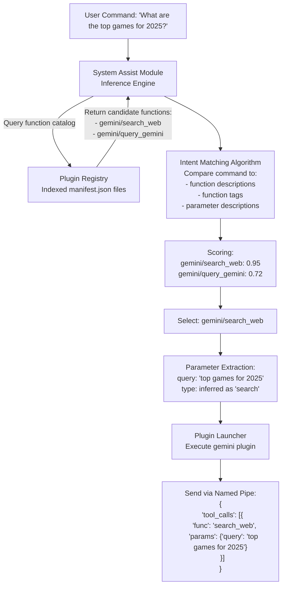
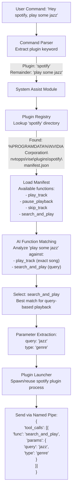
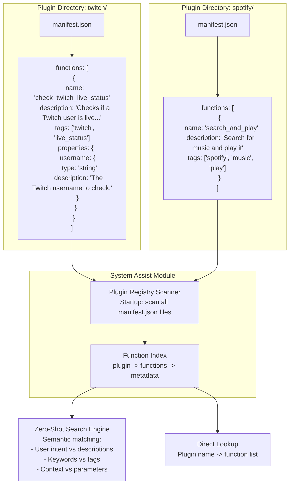
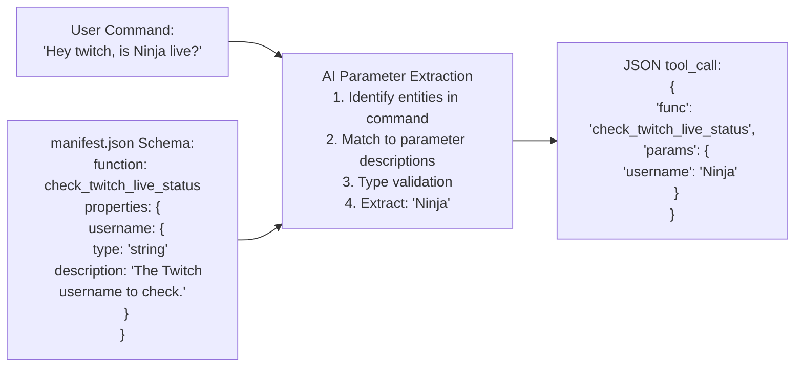
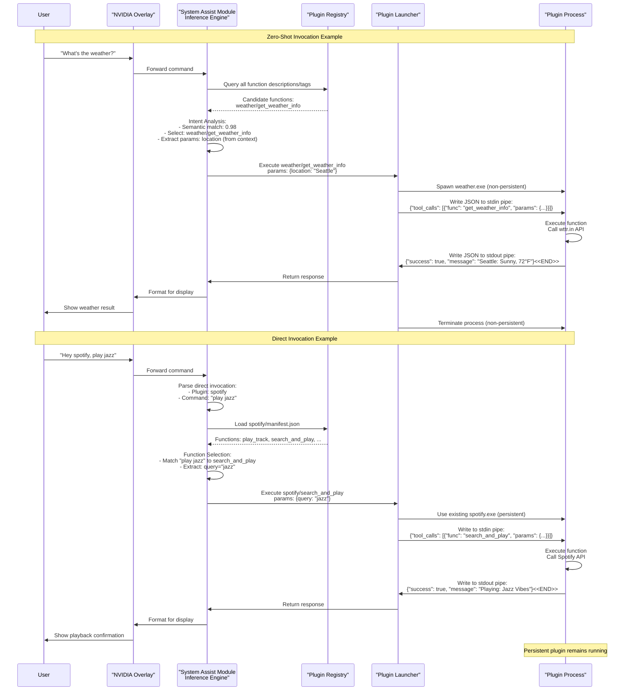

<!-- source: DeepWiki mcp.deepwiki.com · repo NVIDIA/G-Assist · page 3.4 Plugin Invocation Methods · fetched 2026-10-26 -->

# Plugin Invocation Methods

<details>
<summary>Relevant source files</summary>

The following files were used as context for generating this wiki page:

- [README.md](README.md)
- [api/bindings/python/README.md](api/bindings/python/README.md)
- [plugins/examples/twitch/README.md](plugins/examples/twitch/README.md)

</details>


## Purpose and Scope

This document explains how G-Assist determines which plugin and function to execute in response to user commands. It covers the two primary invocation methods—zero-shot function calling and direct plugin invocation—and describes how the System Assist Module's inference engine analyzes user intent to route commands appropriately.

For details on the System Assist Module's architecture, see [System Assist Module](#3.1). For information on the plugin manifest structure and function definitions, see [Plugin Architecture](#3.2). For the communication protocol used after invocation, see [Communication Protocol](#3.3).

## Invocation Methods Overview

G-Assist supports two distinct methods for invoking plugins, each optimized for different use cases:

| Method | Syntax Example | AI Role | Speed | Use Case |
|--------|---------------|---------|-------|----------|
| **Zero-Shot Function Calling** | `/fc What are the top upcoming games for 2025?` | Analyzes intent, selects plugin, chooses function, extracts parameters | Slower (full AI analysis) | When plugin is unknown or command is complex |
| **Direct Plugin Invocation** | `Hey spotify, play some jazz` or `/spotify play some jazz` | Determines function within specified plugin, extracts parameters | Faster (plugin pre-selected) | When user knows which plugin to use |

**Sources:** [README.md:163-191]()

## Zero-Shot Function Calling

### Mechanism

In zero-shot invocation, users issue natural language commands without specifying a plugin. The System Assist Module's inference engine analyzes the command and automatically determines:

1. Which plugin is most appropriate
2. Which function within that plugin to call
3. What parameter values to extract from the command

The matching process leverages the `description` and `tags` fields from each function definition in `manifest.json` files across all discovered plugins.

### Zero-Shot Invocation Flow



**Sources:** [README.md:169-177]()

### Example: Zero-Shot Weather Query

Consider the command: `"What's the weather like today?"`

1. **Intent Analysis**: The inference engine parses the command and identifies weather-related keywords
2. **Plugin Selection**: Scans all `manifest.json` files for functions with `tags` containing "weather" or descriptions mentioning weather information
3. **Function Matching**: Identifies `weather/get_weather_info` based on its description: "Retrieves current weather information"
4. **Parameter Extraction**: Extracts location from context (user's system location) or defaults to configured location
5. **Invocation**: Launches weather plugin with extracted parameters

### When to Use Zero-Shot

- User is unfamiliar with available plugins
- Command spans multiple possible plugins
- Natural language query is more intuitive than plugin names
- Exploratory interactions where optimal plugin is unclear

**Sources:** [README.md:169-177]()

## Direct Plugin Invocation

### Mechanism

Direct invocation allows users to explicitly specify which plugin to use by including the plugin's directory name in the command. The plugin name can be prefixed with "Hey" or "/":

- Natural: `Hey twitch, is Ninja live?`
- Command: `/twitch is Ninja live?`

The System Assist Module:
1. Extracts the plugin name from the command prefix
2. Loads only that plugin's `manifest.json`
3. Uses the inference engine to determine which function within the plugin to call
4. Extracts parameters from the remaining command text

### Direct Invocation Flow



**Sources:** [README.md:179-191]()

### Plugin Name Resolution

The plugin name in direct invocation maps directly to the plugin's directory name:

| User Command | Plugin Directory | Executable |
|-------------|-----------------|------------|
| `Hey twitch, ...` | `plugins/twitch/` | `g-assist-plugin-twitch.exe` |
| `/spotify ...` | `plugins/spotify/` | `g-assist-plugin-spotify.exe` |
| `Hey logiled, ...` | `plugins/logiled/` | `g-assist-plugin-logiled.exe` |

The directory name under `%PROGRAMDATA%\NVIDIA Corporation\nvtopps\rise\plugins\` serves as the invocation keyword.

**Sources:** [README.md:141-160]()

### When to Use Direct Invocation

- User knows the specific plugin needed
- Faster execution (skips multi-plugin search)
- Disambiguation when multiple plugins could match
- Scripting or automation scenarios
- Debugging specific plugin behavior

**Sources:** [README.md:179-191]()

## Intent Analysis and Plugin Selection

### Manifest-Driven Discovery

The inference engine's ability to match commands to plugins depends entirely on the metadata provided in each plugin's `manifest.json`:



**Sources:** [README.md:141-160](), [plugins/examples/twitch/README.md:104-122]()

### Matching Algorithm Components

While the exact inference engine implementation is proprietary, the matching process uses these manifest elements:

1. **Function Description**: Natural language explanation of what the function does
   - Example: `"Checks if a Twitch user is live and retrieves stream details"`
   - Used for semantic similarity matching

2. **Tags Array**: Keywords associated with the function
   - Example: `["twitch", "live_status"]`
   - Used for keyword-based matching and filtering

3. **Parameter Descriptions**: Explanation of each parameter
   - Example: `"The Twitch username to check"`
   - Used to guide parameter extraction

4. **Plugin Directory Name**: The invocation keyword
   - Example: `twitch` directory → "Hey twitch" commands
   - Used for direct plugin targeting

**Sources:** [plugins/examples/twitch/README.md:104-122]()

## Parameter Extraction

### Natural Language to Structured Data

After selecting a plugin and function, the inference engine extracts parameter values from the user's natural language command based on the parameter schema in `manifest.json`:



**Sources:** [plugins/examples/twitch/README.md:381-391]()

### Parameter Type Validation

Parameters in `manifest.json` include type information that guides extraction and validation:

| Type | Example Value | Extraction Strategy |
|------|--------------|---------------------|
| `string` | `"Ninja"` | Extract quoted text, proper nouns, or contextual phrases |
| `number` | `5` | Extract numeric literals from command |
| `boolean` | `true` | Infer from affirmative/negative language |
| `object` | `{...}` | Extract multiple related entities as nested structure |
| `array` | `["item1", "item2"]` | Extract lists from command |

### Multi-Parameter Extraction Example

For a function with multiple parameters:

```json
{
  "name": "set_lighting",
  "properties": {
    "device": {
      "type": "string",
      "description": "The device to control (keyboard, mouse, headset)"
    },
    "color": {
      "type": "string",
      "description": "The color to set (red, green, blue, etc)"
    },
    "brightness": {
      "type": "number",
      "description": "Brightness level from 0-100"
    }
  }
}
```

Command: `"Hey logiled, set my keyboard to bright green"`

Extraction:
- `device`: "keyboard" (matched "my keyboard")
- `color`: "green" (direct match)
- `brightness`: 100 (inferred from "bright" modifier)

**Sources:** [plugins/examples/twitch/README.md:104-122]()

## Complete Invocation Flow

### End-to-End Process



**Sources:** [README.md:163-191]()

## Invocation Performance Considerations

### Zero-Shot vs Direct Performance

| Aspect | Zero-Shot | Direct Invocation |
|--------|-----------|-------------------|
| Plugin Search | Scans all manifests | Single manifest lookup |
| AI Analysis Scope | All functions across plugins | Functions within one plugin |
| Parameter Extraction | Same complexity | Same complexity |
| Typical Latency | 200-500ms | 50-150ms |
| Cache Benefits | Full function index | Plugin-specific index |

### Optimization Strategies

1. **Plugin Registry Indexing**: G-Assist builds an index of all functions at startup by scanning `manifest.json` files, enabling fast zero-shot lookups

2. **Persistent Plugin Reuse**: Plugins with `"persistent": true` in their manifest remain running, eliminating spawn overhead for subsequent invocations

3. **Function Tag Quality**: Well-chosen `tags` improve zero-shot match accuracy and reduce ambiguity

4. **Description Clarity**: Clear, distinct function descriptions help the inference engine differentiate between similar plugins

**Sources:** [README.md:141-160]()

## Best Practices for Plugin Developers

### Enabling Effective Invocation

To maximize discoverability and correct invocation of your plugin:

1. **Choose Intuitive Directory Names**
   - Use lowercase, descriptive names: `spotify`, `twitch`, `weather`
   - Avoid abbreviations unless universally known
   - Match user expectations for direct invocation

2. **Write Descriptive Function Descriptions**
   ```json
   {
     "name": "search_and_play",
     "description": "Search for music by song name, artist, album, or genre and start playback immediately"
   }
   ```
   - Include what the function does and what types of inputs it accepts
   - Use natural language that matches user queries

3. **Select Relevant Tags**
   ```json
   {
     "tags": ["music", "play", "search", "spotify", "audio"]
   }
   ```
   - Include domain keywords, action verbs, and synonyms
   - Think about how users might phrase requests

4. **Provide Parameter Context**
   ```json
   {
     "query": {
       "type": "string",
       "description": "Song name, artist name, album title, or music genre to search for"
     }
   }
   ```
   - Explain what values are valid and their format
   - Include examples in the description when helpful

**Sources:** [README.md:141-160](), [plugins/examples/twitch/README.md:104-122]()

---

