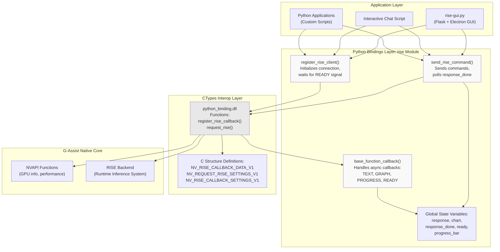
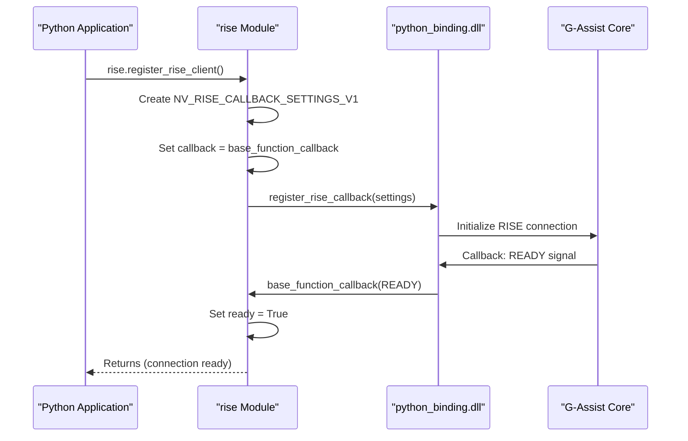
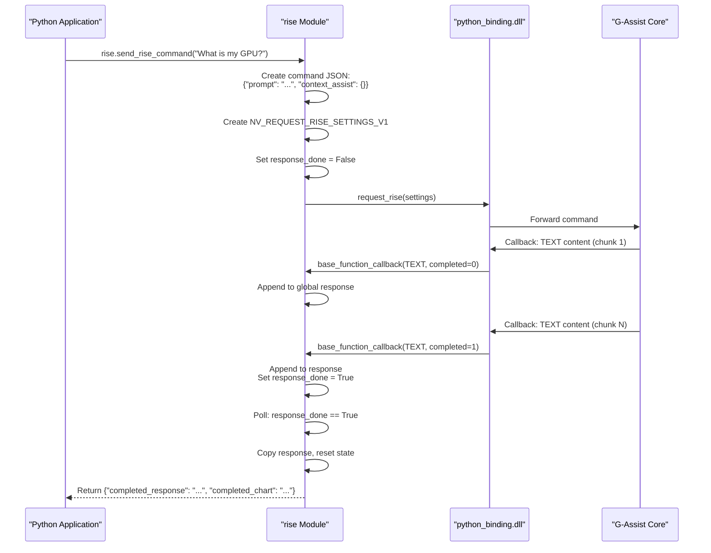
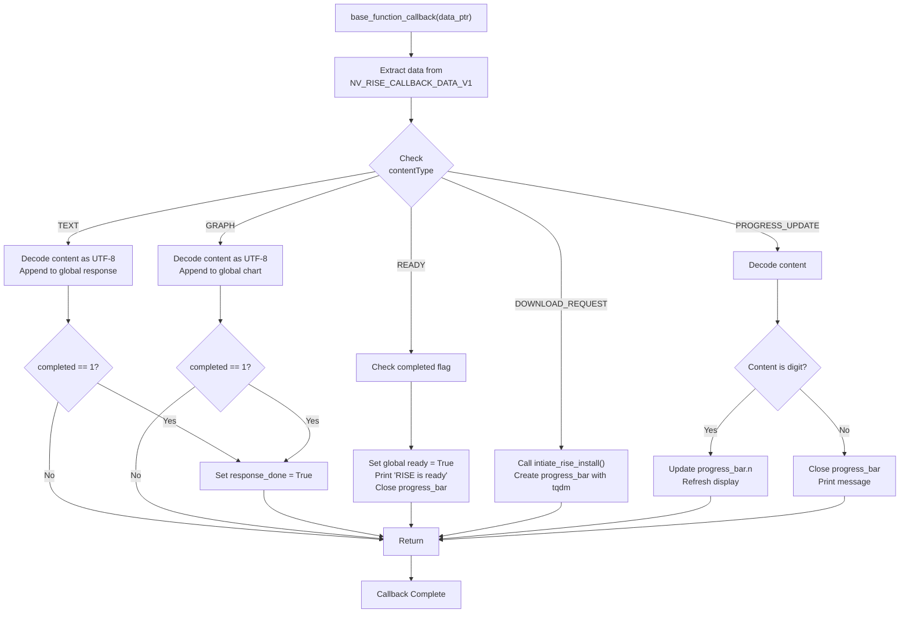
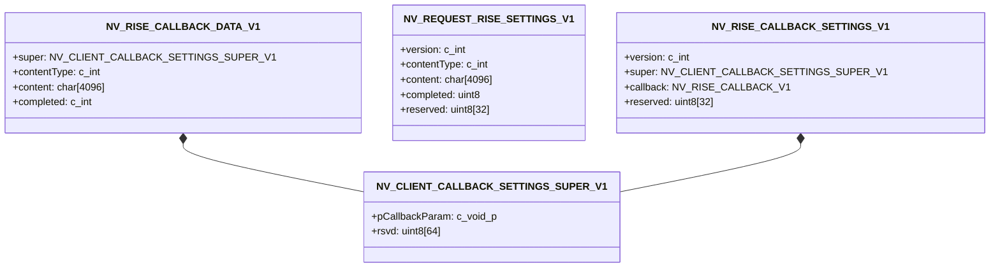
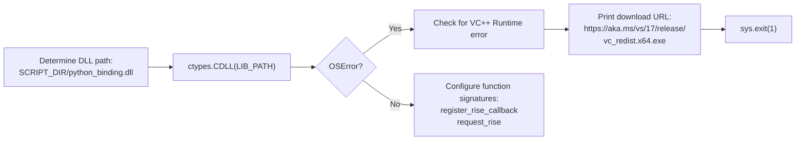
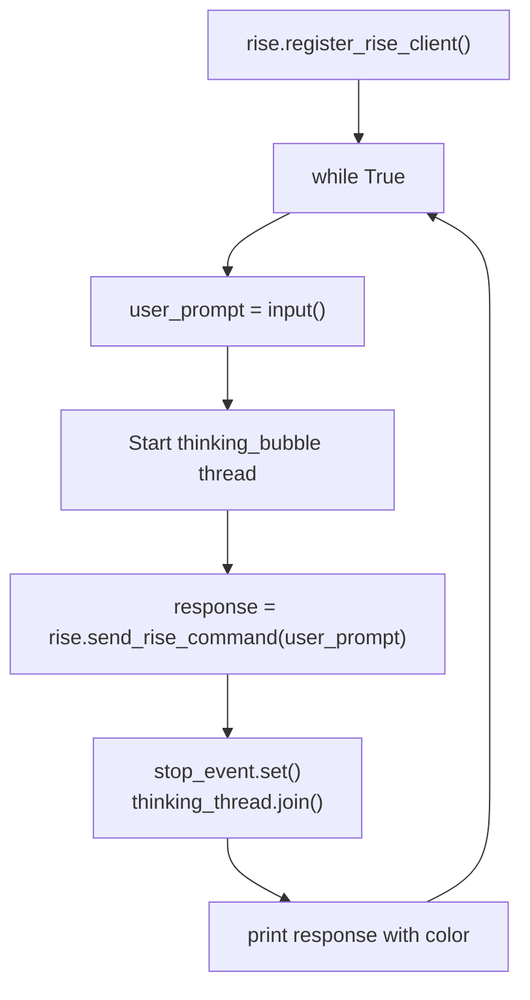
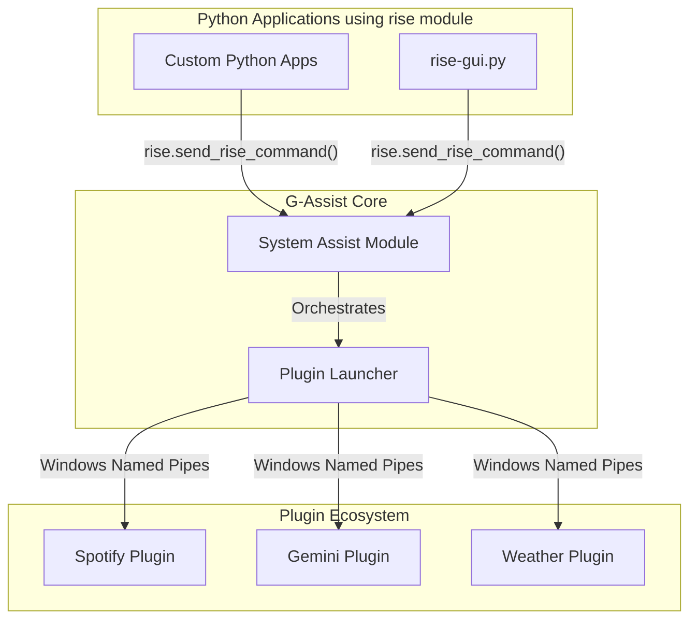

<!-- source: DeepWiki mcp.deepwiki.com · repo NVIDIA/G-Assist · page 4 Python Bindings (rise module) · fetched 2026-10-26 -->

# Python Bindings (rise module)

<details>
<summary>Relevant source files</summary>

The following files were used as context for generating this wiki page:

- [README.md](README.md)
- [api/bindings/python/README.md](api/bindings/python/README.md)
- [api/bindings/python/python_binding.vcxproj.user](api/bindings/python/python_binding.vcxproj.user)
- [api/bindings/python/rise-gui-example.png](api/bindings/python/rise-gui-example.png)
- [api/bindings/python/rise-gui.py](api/bindings/python/rise-gui.py)
- [api/bindings/python/rise/rise.py](api/bindings/python/rise/rise.py)
- [api/bindings/python/setup.py](api/bindings/python/setup.py)
- [plugins/examples/twitch/README.md](plugins/examples/twitch/README.md)

</details>


## Purpose and Scope

The `rise` Python module provides a high-level Python interface to G-Assist's RISE (Runtime Inference System Engine) backend. It abstracts the complexity of asynchronous C++ callbacks and native API calls into a simple, synchronous Python API that enables developers to integrate G-Assist capabilities into Python applications.

This page covers the `rise` module's architecture, core components, and usage patterns. For detailed API documentation of individual functions, see [API Reference](#4.1). For information on developing plugins that extend G-Assist functionality, see [Plugin Development Guide](#5).

**Sources**: [api/bindings/python/README.md:1-11](), [api/bindings/python/rise/rise.py:1-20]()

---

## Architecture Overview

The rise module implements a four-layer architecture that bridges Python applications to G-Assist's native C++ core:



**Synchronous API via Polling**: The module converts asynchronous C++ callbacks into synchronous Python calls by using global state variables that are updated by `base_function_callback()` and polled by `send_rise_command()`. This design simplifies Python application development by eliminating the need for async/await patterns or threading concerns.

**Sources**: [api/bindings/python/rise/rise.py:1-288](), [api/bindings/python/README.md:1-11]()

---

## Module Structure

### File Organization

The rise module is organized as a Python package:

```
api/bindings/python/
├── rise/
│   ├── __init__.py
│   ├── rise.py                    # Core module implementation
│   └── python_binding.dll         # Native DLL for C++ interop
├── rise-gui.py                    # GUI application example
├── setup.py                       # Package installation config
└── requirements.txt               # Python dependencies
```

**Sources**: [api/bindings/python/setup.py:1-21](), [api/bindings/python/README.md:44-49]()

---

## Core API Functions

### Registration and Initialization



The `register_rise_client()` function initializes the connection to G-Assist's RISE backend:

1. **Callback Setup**: Creates `NV_RISE_CALLBACK_SETTINGS_V1` structure and assigns `base_function_callback` as the callback handler
2. **DLL Registration**: Calls `nvapi.register_rise_callback()` with the callback settings
3. **Ready Wait**: Polls the global `ready` flag until RISE signals readiness via a `NV_RISE_CONTENT_TYPE_READY` callback
4. **Version Encoding**: Uses bitwise OR to encode version: `ctypes.sizeof(structure) | (1 << 16)`

**Implementation**: [api/bindings/python/rise/rise.py:179-205]()

**Sources**: [api/bindings/python/rise/rise.py:179-205](), [api/bindings/python/README.md:52-67]()

---

### Command Execution



The `send_rise_command()` function sends commands to RISE and returns responses synchronously:

1. **Command Formatting**: Wraps the prompt in a JSON object with optional `adapter` and `system_prompt` fields
2. **Request Creation**: Populates `NV_REQUEST_RISE_SETTINGS_V1` with UTF-8 encoded JSON and content type `NV_RISE_CONTENT_TYPE_TEXT`
3. **Async Execution**: Calls `nvapi.request_rise()` which returns immediately; actual processing is asynchronous
4. **Response Polling**: Blocks in a `while not response_done` loop, sleeping 1 second between checks
5. **State Reset**: Copies accumulated `response` and `chart` data, resets global state for next command

**Implementation**: [api/bindings/python/rise/rise.py:207-261]()

**Optional Parameters**:
- `adapter`: Specifies a custom adapter for the request [api/bindings/python/rise/rise.py:231-232]()
- `system_prompt`: Sets official adapter system prompt in `context_assist` [api/bindings/python/rise/rise.py:234-235]()

**Sources**: [api/bindings/python/rise/rise.py:207-261](), [README.md:36-49]()

---

## Callback System

### Content Type Enumeration

The `NV_RISE_CONTENT_TYPE` enum defines message types exchanged between RISE and the Python module:

| Content Type | Value | Purpose |
|-------------|-------|---------|
| `NV_RISE_CONTENT_TYPE_TEXT` | 1 | Standard text responses from RISE |
| `NV_RISE_CONTENT_TYPE_GRAPH` | 2 | Chart or graph data (JSON format) |
| `NV_RISE_CONTENT_TYPE_CUSTOM_BEHAVIOR` | 3 | Custom behavior triggers |
| `NV_RISE_CONTENT_TYPE_INSTALLING` | 5 | Installation status updates |
| `NV_RISE_CONTENT_TYPE_PROGRESS_UPDATE` | 6 | Progress percentage or messages |
| `NV_RISE_CONTENT_TYPE_READY` | 7 | RISE system ready signal |
| `NV_RISE_CONTENT_TYPE_DOWNLOAD_REQUEST` | 8 | Initiates download/installation |

**Implementation**: [api/bindings/python/rise/rise.py:42-63]()

**Sources**: [api/bindings/python/rise/rise.py:42-63]()

---

### Callback Handler Flow



**Callback Mechanism**: The `base_function_callback()` function is invoked asynchronously by the native DLL whenever RISE sends data. It updates global state variables that are polled by synchronous functions like `send_rise_command()`.

**Implementation**: [api/bindings/python/rise/rise.py:102-154]()

**Sources**: [api/bindings/python/rise/rise.py:102-154]()

---

### Global State Management

The module maintains several global variables for inter-function communication:

| Variable | Type | Purpose | Updated By | Read By |
|----------|------|---------|------------|---------|
| `nvapi` | `ctypes.CDLL` | Handle to python_binding.dll | Module load | All API calls |
| `callback_settings` | `NV_RISE_CALLBACK_SETTINGS_V1` | Callback configuration | `register_rise_client()` | DLL |
| `response` | `str` | Accumulated text response | `base_function_callback()` | `send_rise_command()` |
| `chart` | `str` | Accumulated graph data | `base_function_callback()` | `send_rise_command()` |
| `response_done` | `bool` | Response completion flag | `base_function_callback()` | `send_rise_command()` |
| `ready` | `bool` | RISE readiness flag | `base_function_callback()` | `register_rise_client()` |
| `progress_bar` | `tqdm` or `None` | Progress visualization | `base_function_callback()` | `base_function_callback()` |

**Declarations**: [api/bindings/python/rise/rise.py:32-39]()

**Thread Safety**: The module is **not thread-safe**. The global state design assumes single-threaded, sequential command execution. Concurrent calls to `send_rise_command()` will result in race conditions.

**Sources**: [api/bindings/python/rise/rise.py:32-39]()

---

## Native Interop Layer

### CTypes Structure Definitions

The module defines C-compatible structures for communication with `python_binding.dll`:



**Key Structures**:

1. **`NV_RISE_CALLBACK_DATA_V1`**: Carries callback data from DLL to Python
   - `contentType`: Message type from `NV_RISE_CONTENT_TYPE` enum
   - `content`: Up to 4096 bytes of UTF-8 encoded data
   - `completed`: Flag indicating final chunk of multi-part message
   - **Implementation**: [api/bindings/python/rise/rise.py:72-77]()

2. **`NV_REQUEST_RISE_SETTINGS_V1`**: Carries command data from Python to DLL
   - `version`: Encoded structure size and version number
   - `contentType`: Request type (typically `TEXT`)
   - `content`: JSON-encoded command
   - **Implementation**: [api/bindings/python/rise/rise.py:80-86]()

3. **`NV_RISE_CALLBACK_SETTINGS_V1`**: Callback registration configuration
   - `callback`: Function pointer to `base_function_callback`
   - **Implementation**: [api/bindings/python/rise/rise.py:94-99]()

**Callback Function Type**: Defined as `NV_RISE_CALLBACK_V1 = ctypes.CFUNCTYPE(None, ctypes.POINTER(NV_RISE_CALLBACK_DATA_V1))` [api/bindings/python/rise/rise.py:90-91]()

**Sources**: [api/bindings/python/rise/rise.py:66-99]()

---

### DLL Loading and Function Signatures



**DLL Loading**: The module locates `python_binding.dll` relative to the rise.py script location and loads it using `ctypes.CDLL` [api/bindings/python/rise/rise.py:157-169]()

**Function Signatures**:
```python
nvapi.register_rise_callback.argtypes = [ctypes.POINTER(NV_RISE_CALLBACK_SETTINGS_V1)]
nvapi.register_rise_callback.restype = ctypes.c_int

nvapi.request_rise.argtypes = [ctypes.POINTER(NV_REQUEST_RISE_SETTINGS_V1)]
nvapi.request_rise.restype = ctypes.c_int
```

Both functions return integer status codes; 0 indicates success [api/bindings/python/rise/rise.py:171-174]()

**Error Handling**: The module detects missing Visual C++ Runtime dependencies and provides user-friendly error messages with download links [api/bindings/python/rise/rise.py:161-168]()

**Sources**: [api/bindings/python/rise/rise.py:157-174](), [api/bindings/python/README.md:20-42]()

---

## Usage Patterns

### Basic Command Execution

**Minimal Example**:
```python
from rise import rise

# Initialize connection
rise.register_rise_client()

# Send command and get response
response = rise.send_rise_command("What is my GPU?")
print(response['completed_response'])
```

**Example Output**:
```
RISE is ready
Your GPU is an NVIDIA GeForce RTX 5090 with a Driver version of 572.83.
```

**Sources**: [README.md:36-49](), [api/bindings/python/README.md:52-67]()

---

### Interactive Chat Application

The repository includes an interactive chat example with visual feedback:



**Key Features**:
- **Threaded Animation**: Uses `threading.Thread` to display animated "thinking dots" while waiting for response
- **Colored Output**: Uses `colorama` library for color-coded user/assistant messages
- **Event Synchronization**: Employs `threading.Event` to cleanly stop animation thread

**Implementation**: [api/bindings/python/README.md:69-107]()

**Sources**: [api/bindings/python/README.md:69-107]()

---

### Advanced: Using Adapters and System Prompts

The `send_rise_command()` function supports optional parameters for customization:

```python
response = rise.send_rise_command(
    command="Analyze this data",
    adapter="custom_adapter_name",
    system_prompt="You are a data analysis assistant."
)
```

**Parameters**:
- `adapter`: Routes the command to a specific adapter/plugin [api/bindings/python/rise/rise.py:231-232]()
- `system_prompt`: Sets the system-level prompt for the official adapter [api/bindings/python/rise/rise.py:234-235]()

**JSON Command Structure**:
```json
{
    "prompt": "Analyze this data",
    "adapter": "custom_adapter_name",
    "context_assist": {
        "officialAdapterSystemPrompt": "You are a data analysis assistant."
    }
}
```

**Sources**: [api/bindings/python/rise/rise.py:207-241]()

---

## Installation and Dependencies

### Package Installation

The rise module is distributed as a Python package using setuptools:

**Installation Command**:
```bash
cd api/bindings/python
pip install .
```

**Package Configuration**: [api/bindings/python/setup.py:1-21]()

**Package Metadata**:
- **Name**: `gassist`
- **Version**: `0.0.1`
- **Binary Inclusion**: Includes `python_binding.dll` via `package_data`
- **Dependencies**: `tqdm`, `flask`, `flask-cors`, `colorama`

**Sources**: [api/bindings/python/setup.py:1-21](), [api/bindings/python/README.md:44-49]()

---

### System Requirements

**Prerequisites**:
1. **Python**: Version 3.x [api/bindings/python/README.md:12-15]()
2. **G-Assist Core Services**: Must be installed and running on the system
3. **Visual C++ Runtime**: Required for DLL loading
   - Option 1: Visual Studio Community with "Desktop development with C++" workload
   - Option 2: Standalone VC++ Redistributable (x64) from Microsoft

**Visual C++ Runtime Error Handling**:
The module automatically detects missing runtime components and provides installation guidance [api/bindings/python/rise/rise.py:161-168]()

**Sources**: [api/bindings/python/README.md:11-42]()

---

## Application Examples

### GUI Application (rise-gui.py)

A web-based chat interface built with Flask and Electron that demonstrates rise module integration. For detailed documentation, see [GUI Application (rise-gui.py)](#4.3).

**Architecture**:
- **Backend**: Flask server with `/api/send-message` endpoint
- **Frontend**: React UI with dark theme and NVIDIA branding
- **Desktop Integration**: Optional Electron wrapper for native desktop experience

**Key Implementation**: [api/bindings/python/rise-gui.py:1-50]()

**Sources**: [api/bindings/python/rise-gui.py:1-1456](), [api/bindings/python/README.md:109-138]()

---

## Relationship to Other Components

### Integration with Plugin System

The rise module operates at a different layer than the plugin system:



**Complementary Roles**:
- **Rise Module**: Enables Python applications to send commands to G-Assist and receive responses
- **Plugins**: Extend G-Assist functionality by implementing specific commands (e.g., Spotify control, weather queries)

**Communication Flow**: Python apps use rise module → G-Assist Core interprets command → Plugin Launcher invokes appropriate plugin → Response flows back through rise module

**Sources**: [README.md:108-134](), [api/bindings/python/README.md:1-11]()

---

## Error Handling and Troubleshooting

### Common Issues

**DLL Loading Failures**:
```
❌ Missing Visual C++ Redistributable (x64)
Download and install it from:
https://aka.ms/vs/17/release/vc_redist.x64.exe
```
**Solution**: Install Visual C++ Runtime or Visual Studio with C++ workload [api/bindings/python/rise/rise.py:161-168]()

**Registration Failures**:
```python
ret = nvapi.register_rise_callback(ctypes.byref(callback_settings))
if ret != 0:
    print('Registration Failed')
```
**Cause**: G-Assist core services not running or incompatible version [api/bindings/python/rise/rise.py:196-198]()

**Command Send Failures**:
```python
ret = nvapi.request_rise(content)
if ret != 0:
    print(f'Send RISE command failed with {ret}')
    return None
```
**Cause**: RISE backend not ready or malformed command JSON [api/bindings/python/rise/rise.py:243-246]()

**Sources**: [api/bindings/python/rise/rise.py:161-168](), [api/bindings/python/rise/rise.py:196-198](), [api/bindings/python/rise/rise.py:243-246]()

---

## Performance Considerations

### Polling Overhead

The synchronous API implementation uses polling with 1-second intervals:

```python
while not response_done:
    time.sleep(1)
```

**Implications**:
- **Minimum Latency**: Commands take at least 1 second to complete (even if RISE responds instantly)
- **CPU Usage**: Minimal due to sleep intervals
- **Responsiveness**: Suitable for interactive applications but not real-time systems

**Location**: [api/bindings/python/rise/rise.py:248-249]()

### State Reset Pattern

After each command, global state is copied and reset:

```python
response_done = False
completed_response = response
completed_chart = chart
response = ''
chart = ''
```

**Purpose**: Prevents data leakage between sequential commands [api/bindings/python/rise/rise.py:251-255]()

**Sources**: [api/bindings/python/rise/rise.py:248-256]()

---

## Related Documentation

- **[API Reference](#4.1)**: Detailed function signatures, parameters, and return values
- **[Content Types and Callbacks](#4.2)**: Deep dive into callback mechanism and content type handling
- **[GUI Application (rise-gui.py)](#4.3)**: Complete documentation of the sample GUI application
- **[Native Bindings (python_binding.dll)](#4.4)**: Technical details of the C++ DLL interface
- **[Plugin Development Guide](#5)**: Creating custom G-Assist plugins
- **[Communication Protocol](#3.3)**: Windows Named Pipes protocol used by plugins

**Sources**: Table of Contents structure

---

