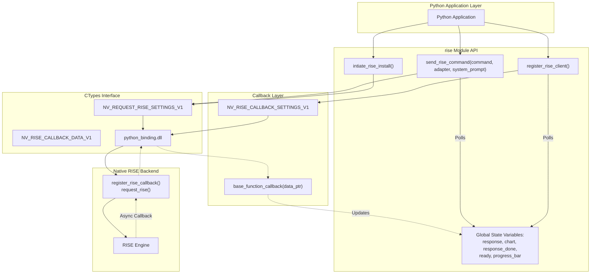
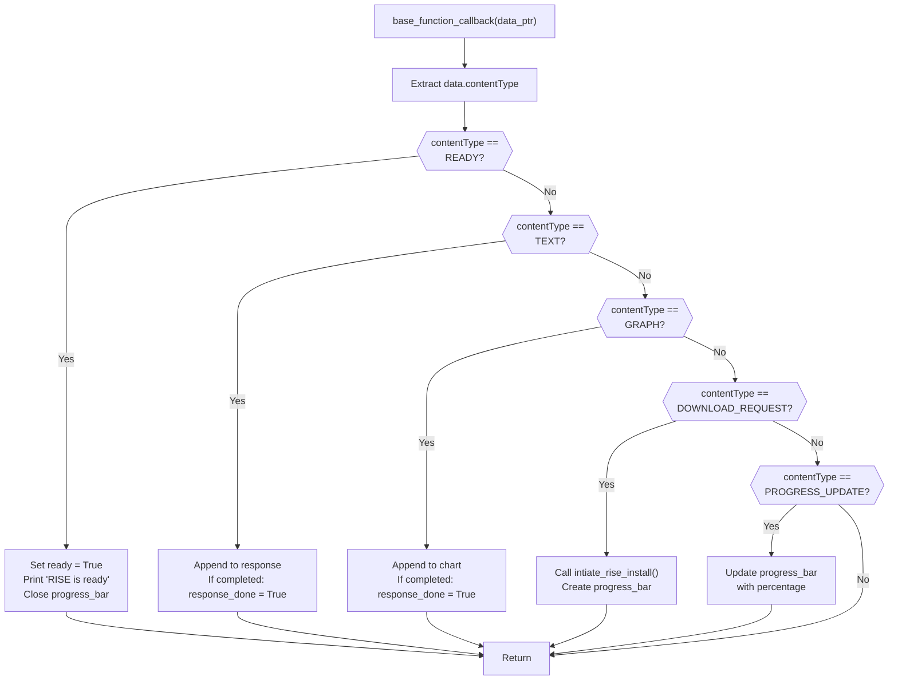
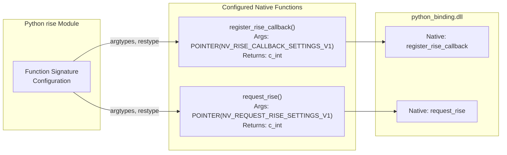
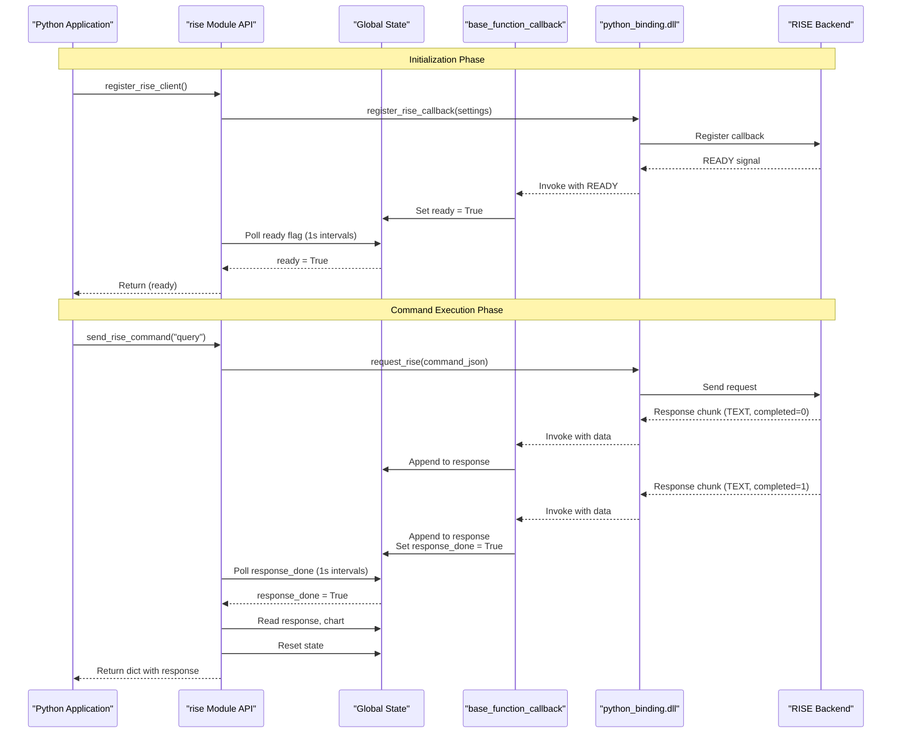

<!-- source: DeepWiki mcp.deepwiki.com · repo NVIDIA/G-Assist · page 4.1 API Reference · fetched 2026-10-26 -->

# API Reference

<details>
<summary>Relevant source files</summary>

The following files were used as context for generating this wiki page:

- [api/bindings/python/python_binding.vcxproj.user](api/bindings/python/python_binding.vcxproj.user)
- [api/bindings/python/rise-gui-example.png](api/bindings/python/rise-gui-example.png)
- [api/bindings/python/rise-gui.py](api/bindings/python/rise-gui.py)
- [api/bindings/python/rise/rise.py](api/bindings/python/rise/rise.py)
- [api/bindings/python/setup.py](api/bindings/python/setup.py)

</details>


This page provides complete API documentation for the `rise` Python module, which serves as the primary interface for Python applications to communicate with the G-Assist (RISE) backend. This page covers function signatures, parameters, return types, and data structures exposed by the module.

For implementation details of the callback mechanism and content type handling, see [Content Types and Callbacks](#4.2). For information on the native DLL interface, see [Native Bindings (python_binding.dll)](#4.4). For a complete GUI application example using this API, see [GUI Application (rise-gui.py)](#4.3).

## Module Overview

The `rise` module is located at [api/bindings/python/rise/rise.py:1-288]() and provides a Python wrapper around the native `python_binding.dll`. It manages asynchronous communication with the RISE backend using a callback-based architecture with synchronous polling for responses.

**Key Architecture Pattern**: The API uses **global state variables** updated by asynchronous C callbacks, with synchronous Python functions that poll these variables until completion.



**Sources**: [api/bindings/python/rise/rise.py:1-288]()

## Core API Functions

### register_rise_client()

Initializes the connection to the RISE service and blocks until the service signals readiness.

**Function Signature**:
```python
def register_rise_client() -> None
```

**Location**: [api/bindings/python/rise/rise.py:179-205]()

**Parameters**: None

**Returns**: None

**Raises**: 
- `AttributeError`: If there is an error accessing the RISE API functions

**Behavior**:
1. Creates a `NV_RISE_CALLBACK_SETTINGS_V1` structure and assigns `base_function_callback` as the callback handler [api/bindings/python/rise/rise.py:192]()
2. Sets the version field using `sizeof` and bit-shifting: `ctypes.sizeof(NV_RISE_CALLBACK_SETTINGS_V1) | (1 << 16)` [api/bindings/python/rise/rise.py:193]()
3. Calls native `nvapi.register_rise_callback()` [api/bindings/python/rise/rise.py:195]()
4. Polls the global `ready` variable in a loop with 1-second sleep intervals until RISE signals ready [api/bindings/python/rise/rise.py:200-201]()

**Global State Modified**:
- Sets `callback_settings` structure [api/bindings/python/rise/rise.py:176]()
- Polls `ready` flag (set by callback) [api/bindings/python/rise/rise.py:38]()

**Usage Pattern**:
```python
import rise

# Initialize connection - blocks until ready
rise.register_rise_client()
# RISE is now ready to accept commands
```

**Sources**: [api/bindings/python/rise/rise.py:179-205]()

---

### send_rise_command()

Sends a text command to RISE and blocks until a complete response is received.

**Function Signature**:
```python
def send_rise_command(command: str, adapter: str = '', system_prompt: str = '') -> Optional[dict]
```

**Location**: [api/bindings/python/rise/rise.py:207-261]()

**Parameters**:

| Parameter | Type | Default | Description |
|-----------|------|---------|-------------|
| `command` | `str` | Required | The text command/query to send to RISE |
| `adapter` | `str` | `''` | Optional adapter specification to route the command to a specific plugin |
| `system_prompt` | `str` | `''` | Optional system prompt override for context injection |

**Returns**: 
- `dict` with keys:
  - `'completed_response'`: Text response from RISE
  - `'completed_chart'`: Chart/graph data if applicable
- `None` if an error occurs

**Raises**: 
- `AttributeError`: If there is an error accessing the RISE API

**Behavior**:
1. Constructs a JSON command object with `prompt` and `context_assist` fields [api/bindings/python/rise/rise.py:226-229]()
2. Optionally adds `adapter` field if specified [api/bindings/python/rise/rise.py:231-232]()
3. Optionally adds `officialAdapterSystemPrompt` to context if `system_prompt` provided [api/bindings/python/rise/rise.py:234-235]()
4. Creates `NV_REQUEST_RISE_SETTINGS_V1` structure with encoded JSON [api/bindings/python/rise/rise.py:237-241]()
5. Calls native `nvapi.request_rise()` [api/bindings/python/rise/rise.py:243]()
6. Polls global `response_done` flag with 1-second sleep intervals [api/bindings/python/rise/rise.py:248-249]()
7. Captures accumulated `response` and `chart` values, resets global state, and returns [api/bindings/python/rise/rise.py:251-256]()

**Global State Modified**:
- Polls `response_done` flag [api/bindings/python/rise/rise.py:37]()
- Reads `response` and `chart` strings [api/bindings/python/rise/rise.py:35-36]()
- Resets state variables after reading [api/bindings/python/rise/rise.py:251-255]()

**Command Object Format**:
```json
{
  "prompt": "user command text",
  "context_assist": {
    "officialAdapterSystemPrompt": "optional system prompt"
  },
  "adapter": "optional adapter name"
}
```

**Usage Examples**:
```python
# Basic query
response = rise.send_rise_command("What's the weather in San Francisco?")
print(response['completed_response'])

# Query with adapter
response = rise.send_rise_command("play some jazz", adapter="spotify")

# Query with system prompt override
response = rise.send_rise_command(
    "analyze this data", 
    system_prompt="You are a data analyst expert"
)
```

**Sources**: [api/bindings/python/rise/rise.py:207-261]()

---

### intiate_rise_install()

Initiates the RISE installation/download process. This function triggers RISE to download and install itself if not already present.

**Function Signature**:
```python
def intiate_rise_install() -> None
```

**Location**: [api/bindings/python/rise/rise.py:263-288]()

**Parameters**: None

**Returns**: None

**Raises**: 
- `AttributeError`: If there is an error accessing the RISE API

**Behavior**:
1. Creates `NV_REQUEST_RISE_SETTINGS_V1` structure with `contentType` set to `NV_RISE_CONTENT_TYPE_DOWNLOAD_REQUEST` [api/bindings/python/rise/rise.py:276-279]()
2. Calls native `nvapi.request_rise()` [api/bindings/python/rise/rise.py:281]()
3. Progress is tracked asynchronously via callback updates to the global `progress_bar` [api/bindings/python/rise/rise.py:39]()

**Global State Modified**:
- `progress_bar` (updated by callback) [api/bindings/python/rise/rise.py:39]()

**Note**: This function is typically called automatically by the callback handler when RISE sends a `NV_RISE_CONTENT_TYPE_DOWNLOAD_REQUEST` signal [api/bindings/python/rise/rise.py:140-142]().

**Sources**: [api/bindings/python/rise/rise.py:263-288]()

---

## Data Structures

### CTypes Structures

The module defines several CTypes structures for C/C++ interoperability with the native DLL.

#### NV_CLIENT_CALLBACK_SETTINGS_SUPER_V1

Base structure for callback settings. Used as a parent structure for callback configuration.

**Location**: [api/bindings/python/rise/rise.py:66-69]()

**Fields**:

| Field | Type | Size | Description |
|-------|------|------|-------------|
| `pCallbackParam` | `ctypes.c_void_p` | Platform-dependent | Pointer to callback parameter |
| `rsvd` | `ctypes.c_uint8 * 64` | 64 bytes | Reserved space |

**Sources**: [api/bindings/python/rise/rise.py:66-69]()

---

#### NV_RISE_CALLBACK_DATA_V1

Structure containing callback data passed from RISE to Python via the callback function.

**Location**: [api/bindings/python/rise/rise.py:72-77]()

**Fields**:

| Field | Type | Size | Description |
|-------|------|------|-------------|
| `super` | `NV_CLIENT_CALLBACK_SETTINGS_SUPER_V1` | - | Base callback settings |
| `contentType` | `ctypes.c_int` | 4 bytes | Content type enum value (see `NV_RISE_CONTENT_TYPE`) |
| `content` | `ctypes.c_char * 4096` | 4096 bytes | Buffer containing response content |
| `completed` | `ctypes.c_int` | 4 bytes | Flag indicating if response is complete (1) or partial (0) |

**Usage**: This structure is passed as a pointer to `base_function_callback()` [api/bindings/python/rise/rise.py:102]()

**Sources**: [api/bindings/python/rise/rise.py:72-77]()

---

#### NV_REQUEST_RISE_SETTINGS_V1

Structure for RISE request settings sent from Python to the native backend.

**Location**: [api/bindings/python/rise/rise.py:80-86]()

**Fields**:

| Field | Type | Size | Description |
|-------|------|------|-------------|
| `version` | `ctypes.c_int` | 4 bytes | Version field (size-encoded) |
| `contentType` | `ctypes.c_int` | 4 bytes | Type of content being sent |
| `content` | `ctypes.c_char * 4096` | 4096 bytes | Buffer containing command/request content |
| `completed` | `ctypes.c_uint8` | 1 byte | Completion flag |
| `reserved` | `ctypes.c_uint8 * 32` | 32 bytes | Reserved space |

**Usage**: Created in `send_rise_command()` and `intiate_rise_install()` to package requests [api/bindings/python/rise/rise.py:237-241](), [api/bindings/python/rise/rise.py:276-279]()

**Sources**: [api/bindings/python/rise/rise.py:80-86]()

---

#### NV_RISE_CALLBACK_SETTINGS_V1

Structure for configuring the callback mechanism with RISE.

**Location**: [api/bindings/python/rise/rise.py:94-99]()

**Fields**:

| Field | Type | Description |
|-------|------|-------------|
| `version` | `ctypes.c_int` | Version field |
| `super` | `NV_CLIENT_CALLBACK_SETTINGS_SUPER_V1` | Base callback settings |
| `callback` | `NV_RISE_CALLBACK_V1` | Function pointer to callback handler |
| `reserved` | `ctypes.c_uint8 * 32` | Reserved space |

**Callback Type**: Defined as `NV_RISE_CALLBACK_V1 = ctypes.CFUNCTYPE(None, ctypes.POINTER(NV_RISE_CALLBACK_DATA_V1))` [api/bindings/python/rise/rise.py:90-91]()

**Usage**: Created in `register_rise_client()` to register the callback [api/bindings/python/rise/rise.py:192-193]()

**Sources**: [api/bindings/python/rise/rise.py:94-99](), [api/bindings/python/rise/rise.py:90-91]()

---

### Enumerations

#### NV_RISE_CONTENT_TYPE

IntEnum defining content types for RISE communication. Controls how content is interpreted and processed.

**Location**: [api/bindings/python/rise/rise.py:42-63]()

**Values**:

| Enum Value | Integer | Description |
|------------|---------|-------------|
| `NV_RISE_CONTENT_TYPE_INVALID` | 0 | Invalid/uninitialized type |
| `NV_RISE_CONTENT_TYPE_TEXT` | 1 | Standard text response |
| `NV_RISE_CONTENT_TYPE_GRAPH` | 2 | Graph/chart data |
| `NV_RISE_CONTENT_TYPE_CUSTOM_BEHAVIOR` | 3 | Custom behavior handler |
| `NV_RISE_CONTENT_TYPE_CUSTOM_BEHAVIOR_RESULT` | 4 | Custom behavior result |
| `NV_RISE_CONTENT_TYPE_INSTALLING` | 5 | Installation status |
| `NV_RISE_CONTENT_TYPE_PROGRESS_UPDATE` | 6 | Progress information (percentage) |
| `NV_RISE_CONTENT_TYPE_READY` | 7 | System ready signal |
| `NV_RISE_CONTENT_TYPE_DOWNLOAD_REQUEST` | 8 | Download initiation request |

**Usage in Callback**: The `base_function_callback()` function switches on `contentType` to determine response handling [api/bindings/python/rise/rise.py:122-153]()

For detailed information on how each content type is processed, see [Content Types and Callbacks](#4.2).

**Sources**: [api/bindings/python/rise/rise.py:42-63]()

---

## Global State Variables

The `rise` module maintains global state variables that are updated asynchronously by the callback function and polled synchronously by API functions.

**Location**: [api/bindings/python/rise/rise.py:32-39]()

| Variable | Type | Purpose | Updated By | Read By |
|----------|------|---------|------------|---------|
| `nvapi` | `ctypes.CDLL` | DLL handle | Module initialization | All API functions |
| `callback_settings` | `NV_RISE_CALLBACK_SETTINGS_V1` | Callback configuration | `register_rise_client()` | Callback system |
| `callback` | Function pointer | Unused legacy variable | - | - |
| `response` | `str` | Accumulated text response | `base_function_callback()` | `send_rise_command()` |
| `chart` | `str` | Accumulated chart data | `base_function_callback()` | `send_rise_command()` |
| `response_done` | `bool` | Response completion flag | `base_function_callback()` | `send_rise_command()` |
| `ready` | `bool` | RISE ready status | `base_function_callback()` | `register_rise_client()` |
| `progress_bar` | `tqdm.tqdm` or `None` | Progress visualization | `base_function_callback()` | Display only |

**Thread Safety**: These global variables are accessed from both the native callback thread and the main Python thread. The module relies on Python's GIL (Global Interpreter Lock) for thread safety during variable access.

**Sources**: [api/bindings/python/rise/rise.py:32-39]()

---

## Callback Function

### base_function_callback()

The primary asynchronous callback function invoked by the native DLL when RISE sends data back to Python.

**Function Signature**:
```python
def base_function_callback(data_ptr: ctypes.POINTER(NV_RISE_CALLBACK_DATA_V1)) -> None
```

**Location**: [api/bindings/python/rise/rise.py:102-154]()

**Parameters**:
- `data_ptr`: Pointer to `NV_RISE_CALLBACK_DATA_V1` structure containing callback data

**Returns**: None

**Processing Logic**:



**Content Type Handling**:

| Content Type | Action | Line Numbers |
|--------------|--------|--------------|
| `READY` | Sets `ready = True`, prints message, closes progress bar | [122-128]() |
| `TEXT` | Appends decoded content to `response`, sets `response_done` if completed | [130-133]() |
| `GRAPH` | Appends decoded content to `chart`, sets `response_done` if completed | [134-138]() |
| `DOWNLOAD_REQUEST` | Calls `intiate_rise_install()`, creates progress bar | [140-142]() |
| `PROGRESS_UPDATE` | Updates or creates progress bar with percentage | [144-153]() |

**Sources**: [api/bindings/python/rise/rise.py:102-154]()

---

## DLL Initialization and Configuration

The module loads the native DLL and configures function signatures at import time.

**DLL Loading**:
```python
SCRIPT_DIR = os.path.dirname(os.path.abspath(__file__))
LIB_PATH = os.path.join(SCRIPT_DIR, "python_binding.dll")
nvapi = ctypes.CDLL(LIB_PATH)
```
**Location**: [api/bindings/python/rise/rise.py:157-160]()

**Error Handling**: If DLL loading fails due to missing Visual C++ Redistributable, provides helpful error message [api/bindings/python/rise/rise.py:162-168]()

**Function Signature Configuration**:



**register_rise_callback Configuration**: [api/bindings/python/rise/rise.py:171-172]()
```python
nvapi.register_rise_callback.argtypes = [ctypes.POINTER(NV_RISE_CALLBACK_SETTINGS_V1)]
nvapi.register_rise_callback.restype = ctypes.c_int
```

**request_rise Configuration**: [api/bindings/python/rise/rise.py:173-174]()
```python
nvapi.request_rise.argtypes = [ctypes.POINTER(NV_REQUEST_RISE_SETTINGS_V1)]
nvapi.request_rise.restype = ctypes.c_int
```

**Return Value Convention**: Both functions return `0` on success, non-zero on failure [api/bindings/python/rise/rise.py:196-198](), [api/bindings/python/rise/rise.py:244-246]()

**Sources**: [api/bindings/python/rise/rise.py:157-174]()

---

## Error Handling

### Function Return Values

All API functions follow a consistent error handling pattern:

**register_rise_client()**:
- Prints `'Registration Failed'` if `nvapi.register_rise_callback()` returns non-zero [api/bindings/python/rise/rise.py:196-198]()
- Catches `AttributeError` and prints error message [api/bindings/python/rise/rise.py:203-204]()

**send_rise_command()**:
- Prints `'Send RISE command failed with {ret}'` and returns `None` if `nvapi.request_rise()` fails [api/bindings/python/rise/rise.py:244-246]()
- Catches `AttributeError`, prints error, and returns `None` [api/bindings/python/rise/rise.py:258-260]()

**intiate_rise_install()**:
- Prints `'Send RISE INSTALL failed with {ret}'` if `nvapi.request_rise()` fails [api/bindings/python/rise/rise.py:282-284]()
- Catches `AttributeError` and prints error message [api/bindings/python/rise/rise.py:286-287]()

### DLL Loading Errors

Special handling for missing Visual C++ Redistributable dependencies [api/bindings/python/rise/rise.py:162-168]():

```python
except OSError as e:
    if "vcruntime" in str(e).lower() or "msvcp" in str(e).lower() or "cannot load" in str(e).lower():
        print("\n❌ Missing Visual C++ Redistributable (x64)")
        print("Download and install it from:")
        print("https://aka.ms/vs/17/release/vc_redist.x64.exe\n")
        sys.exit(1)
    else:
        raise  # re-raise unexpected errors
```

**Sources**: [api/bindings/python/rise/rise.py:162-204](), [api/bindings/python/rise/rise.py:244-260](), [api/bindings/python/rise/rise.py:282-287]()

---

## Version Encoding

Both callback settings and request settings use a special version encoding scheme that combines structure size with version number:

**Encoding Formula**:
```python
version = ctypes.sizeof(Structure) | (1 << 16)
```

This encodes the structure size in the lower 16 bits and version `1` in bit 16.

**Used In**:
- `register_rise_client()`: [api/bindings/python/rise/rise.py:193]()
- `send_rise_command()`: [api/bindings/python/rise/rise.py:240]()
- `intiate_rise_install()`: [api/bindings/python/rise/rise.py:278]()

**Purpose**: Allows the native layer to validate structure sizes and detect version mismatches between Python bindings and DLL.

**Sources**: [api/bindings/python/rise/rise.py:193](), [api/bindings/python/rise/rise.py:240](), [api/bindings/python/rise/rise.py:278]()

---

## Typical API Usage Flow



**Sources**: [api/bindings/python/rise/rise.py:179-261]()

---

## Dependencies

The `rise` module requires the following dependencies:

| Package | Purpose | Import Location |
|---------|---------|-----------------|
| `ctypes` | C/C++ interoperability | [Line 22]() |
| `tqdm` | Progress bar visualization | [Line 28]() |
| `json` | Command serialization | [Line 27]() |
| `enum.IntEnum` | Content type enumeration | [Line 23]() |
| `os` | Path manipulation for DLL loading | [Line 24]() |
| `time` | Polling delays | [Line 25]() |
| `sys` | Error handling and exit | [Line 26]() |
| `typing` | Type hints | [Line 29]() |

**Package Installation**: Dependencies are specified in [api/bindings/python/setup.py:9-14]()

**Sources**: [api/bindings/python/rise/rise.py:22-29](), [api/bindings/python/setup.py:9-14]()

---

