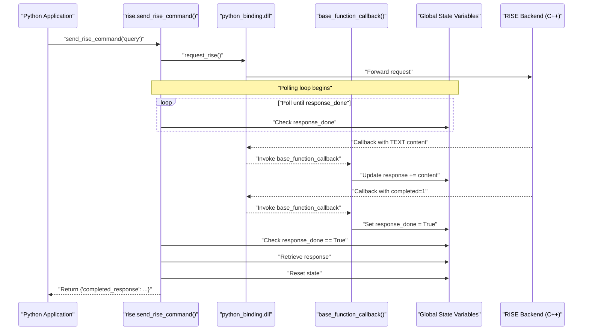
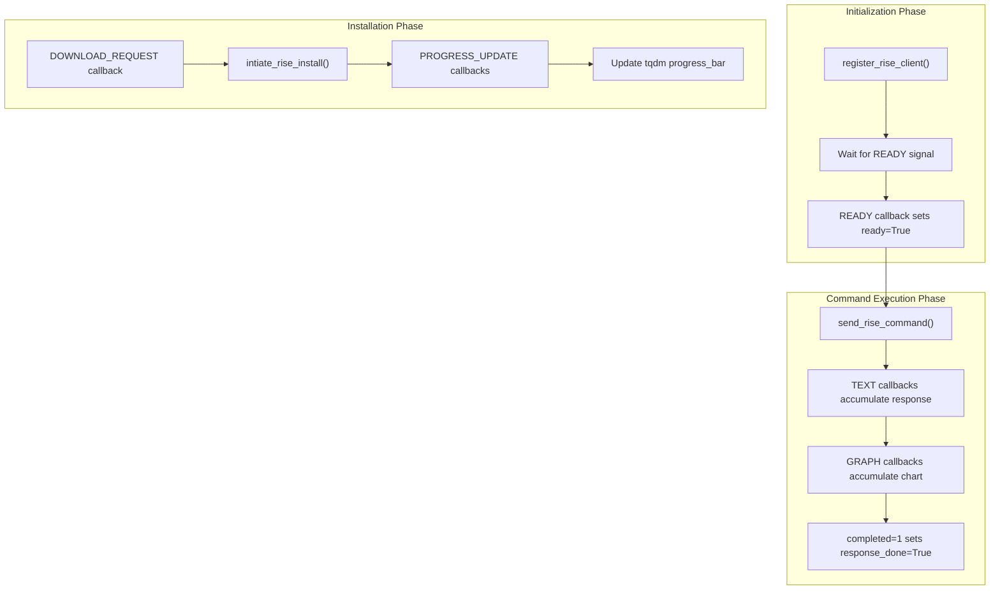
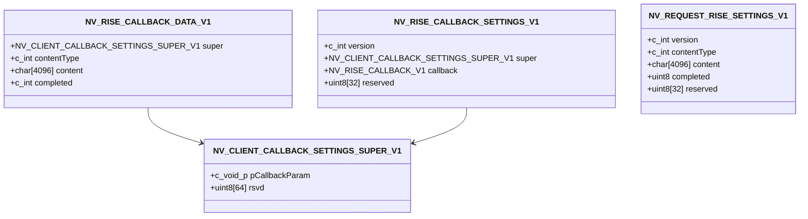
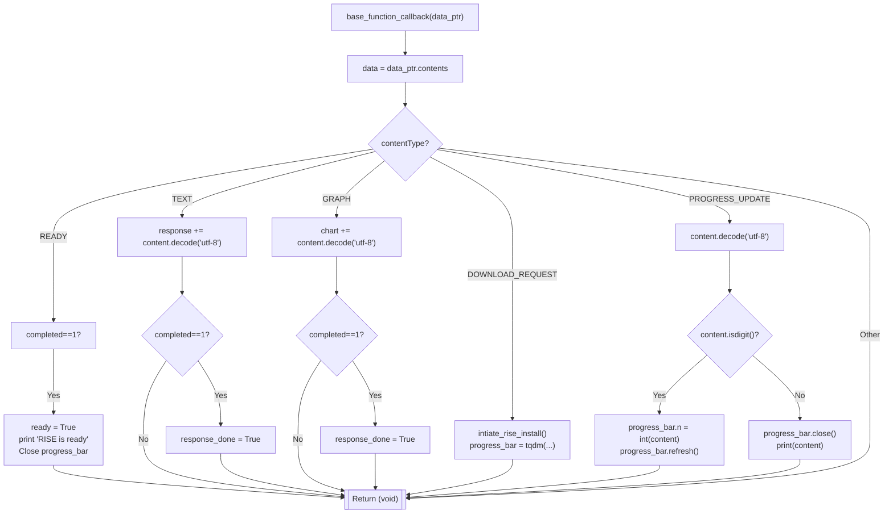
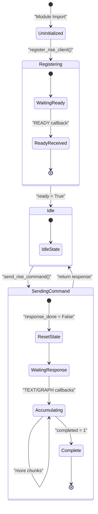
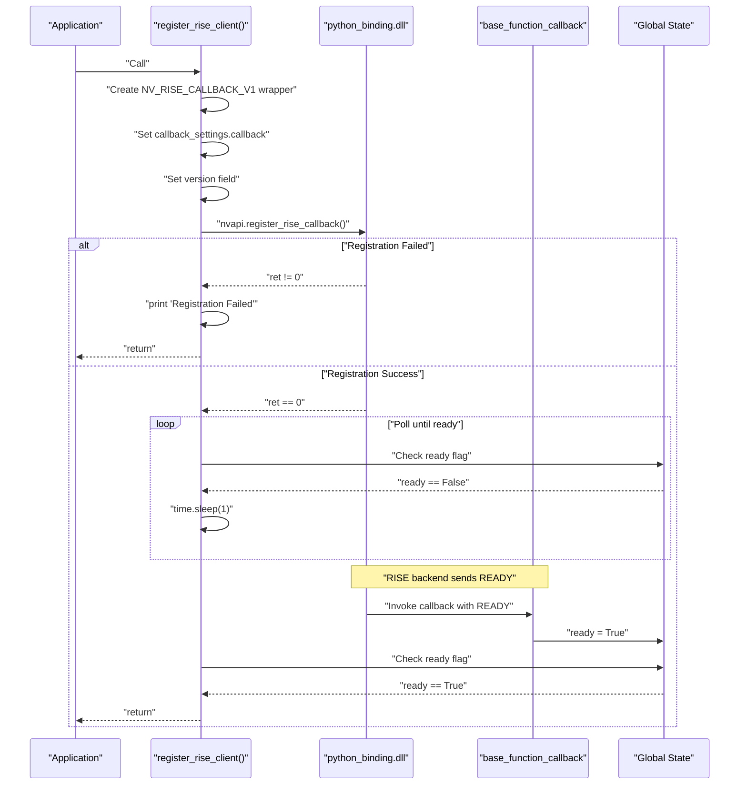
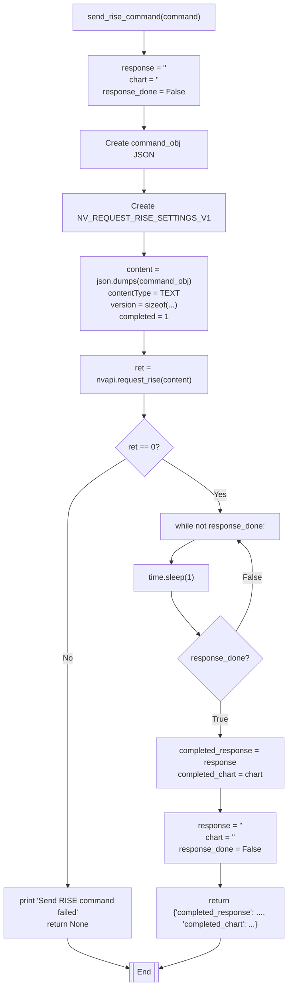
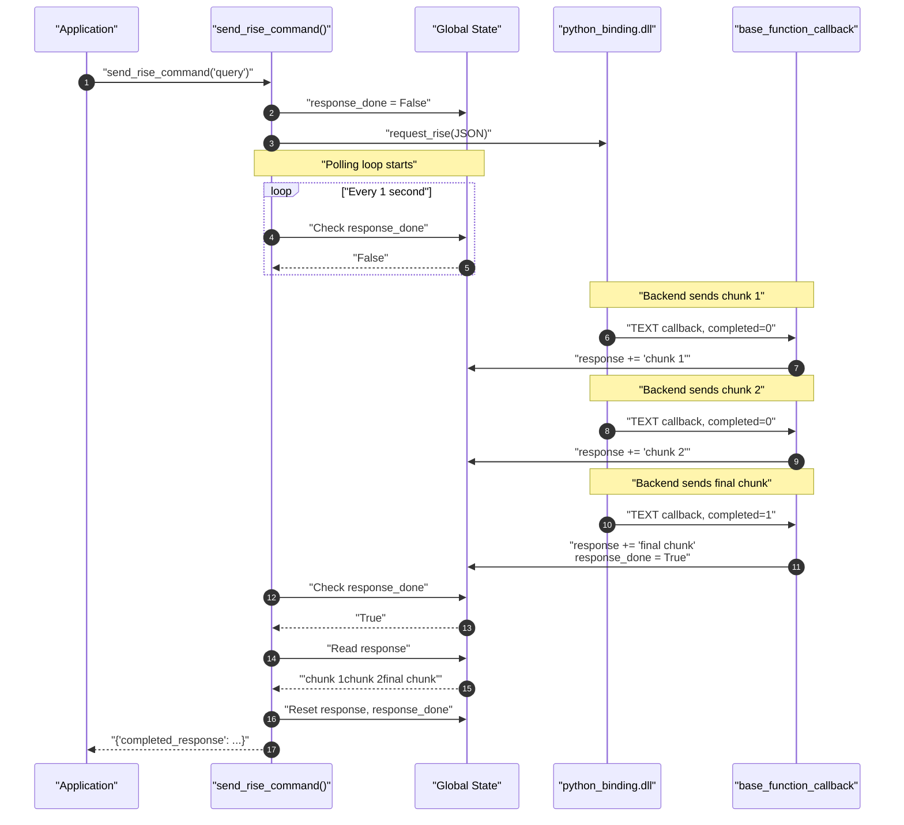

<!-- source: DeepWiki mcp.deepwiki.com · repo NVIDIA/G-Assist · page 4.2 Content Types and Callbacks · fetched 2026-10-26 -->

# Content Types and Callbacks

<details>
<summary>Relevant source files</summary>

The following files were used as context for generating this wiki page:

- [api/bindings/python/python_binding.vcxproj.user](api/bindings/python/python_binding.vcxproj.user)
- [api/bindings/python/rise-gui-example.png](api/bindings/python/rise-gui-example.png)
- [api/bindings/python/rise-gui.py](api/bindings/python/rise-gui.py)
- [api/bindings/python/rise/rise.py](api/bindings/python/rise/rise.py)
- [api/bindings/python/setup.py](api/bindings/python/setup.py)

</details>


This document explains the callback mechanism used in the `rise` Python module for receiving asynchronous responses from the G-Assist RISE backend. It covers the `NV_RISE_CONTENT_TYPE` enumeration, callback data structures, the `base_function_callback` implementation, and global state management patterns used to convert asynchronous C++ callbacks into synchronous Python APIs.

For API usage documentation including `register_rise_client()` and `send_rise_command()`, see [API Reference](#4.1). For details about the native C++ DLL interface, see [Native Bindings (python_binding.dll)](#4.4).

## Callback System Overview

The `rise` module uses a callback-based architecture to receive asynchronous notifications from the G-Assist RISE backend. The callback mechanism bridges the gap between the asynchronous C++ API (via `python_binding.dll`) and a synchronous Python interface through a global state polling pattern.

The callback flow operates as follows:



**Sources:** [api/bindings/python/rise/rise.py:102-154](), [api/bindings/python/rise/rise.py:207-261]()

## Content Types (NV_RISE_CONTENT_TYPE)

The `NV_RISE_CONTENT_TYPE` enumeration defines the types of messages that can be received from the RISE backend through callbacks. Each content type triggers different handling logic in `base_function_callback()`.

### Content Type Enumeration

[api/bindings/python/rise/rise.py:42-63]()

| Enum Value | Integer | Purpose | Handling Behavior |
|------------|---------|---------|-------------------|
| `NV_RISE_CONTENT_TYPE_INVALID` | 0 | Invalid/uninitialized content | Not handled |
| `NV_RISE_CONTENT_TYPE_TEXT` | 1 | Standard text responses from commands | Appends to global `response` string |
| `NV_RISE_CONTENT_TYPE_GRAPH` | 2 | Chart/graph data for visualization | Appends to global `chart` string |
| `NV_RISE_CONTENT_TYPE_CUSTOM_BEHAVIOR` | 3 | Special behavior triggers | Not currently handled |
| `NV_RISE_CONTENT_TYPE_CUSTOM_BEHAVIOR_RESULT` | 4 | Results from custom behaviors | Not currently handled |
| `NV_RISE_CONTENT_TYPE_INSTALLING` | 5 | Installation progress notification | Not currently handled |
| `NV_RISE_CONTENT_TYPE_PROGRESS_UPDATE` | 6 | Progress percentage or message | Updates `progress_bar` (tqdm) |
| `NV_RISE_CONTENT_TYPE_READY` | 7 | RISE system ready signal | Sets global `ready = True` |
| `NV_RISE_CONTENT_TYPE_DOWNLOAD_REQUEST` | 8 | Initiates RISE installation download | Calls `intiate_rise_install()` |

**Sources:** [api/bindings/python/rise/rise.py:42-63]()

### Content Type Usage Patterns



**Sources:** [api/bindings/python/rise/rise.py:102-154](), [api/bindings/python/rise/rise.py:179-205]()

## Callback Data Structures

The callback mechanism uses CTypes structures to marshal data between the native C++ layer and Python. These structures are defined using `ctypes.Structure` and match the layout of corresponding C/C++ structures in `python_binding.dll`.

### Structure Hierarchy



**Sources:** [api/bindings/python/rise/rise.py:66-100]()

### Key Structures

#### NV_RISE_CALLBACK_DATA_V1

[api/bindings/python/rise/rise.py:72-77]()

This structure is passed to `base_function_callback()` with response data:

- **`super`**: Base callback settings structure (not directly used in Python)
- **`contentType`**: Integer value from `NV_RISE_CONTENT_TYPE` enum
- **`content`**: Byte array (4096 bytes) containing the message content (UTF-8 encoded)
- **`completed`**: Integer flag (1 = final message in sequence, 0 = more messages coming)

#### NV_RISE_CALLBACK_SETTINGS_V1

[api/bindings/python/rise/rise.py:94-99]()

Used to register the callback function with the native layer:

- **`version`**: Structure version identifier (set to `ctypes.sizeof(structure) | (1 << 16)`)
- **`super`**: Base callback settings
- **`callback`**: Function pointer to `base_function_callback` (type `NV_RISE_CALLBACK_V1`)
- **`reserved`**: Reserved bytes for future use

#### NV_REQUEST_RISE_SETTINGS_V1

[api/bindings/python/rise/rise.py:80-86]()

Used to send commands to RISE:

- **`version`**: Structure version identifier
- **`contentType`**: Content type for the request (typically `NV_RISE_CONTENT_TYPE_TEXT`)
- **`content`**: JSON-encoded command object as byte array
- **`completed`**: Always 1 for complete requests
- **`reserved`**: Reserved bytes

**Sources:** [api/bindings/python/rise/rise.py:66-100]()

## Callback Function (base_function_callback)

The `base_function_callback()` function is the core handler invoked by `python_binding.dll` when RISE backend sends responses. It receives a pointer to `NV_RISE_CALLBACK_DATA_V1` and updates global state based on the content type.

### Implementation Overview

[api/bindings/python/rise/rise.py:102-154]()



**Sources:** [api/bindings/python/rise/rise.py:102-154]()

### Content Type Handlers

#### READY Handler

[api/bindings/python/rise/rise.py:122-128]()

Called when RISE initialization completes:
- Sets global `ready = True` to unblock `register_rise_client()`
- Prints "RISE is ready" to console
- Closes any existing progress bar

#### TEXT Handler

[api/bindings/python/rise/rise.py:130-133]()

Accumulates text response chunks:
- Decodes `content` from UTF-8 bytes
- Appends to global `response` string
- When `completed == 1`, sets `response_done = True` to unblock `send_rise_command()`

#### GRAPH Handler

[api/bindings/python/rise/rise.py:134-138]()

Accumulates chart/graph data:
- Decodes `content` from UTF-8 bytes
- Appends to global `chart` string
- When `completed == 1`, sets `response_done = True`

#### DOWNLOAD_REQUEST Handler

[api/bindings/python/rise/rise.py:140-142]()

Initiates RISE installation:
- Calls `intiate_rise_install()` to send download request
- Creates a `tqdm` progress bar with `total=100`

#### PROGRESS_UPDATE Handler

[api/bindings/python/rise/rise.py:144-153]()

Updates download/installation progress:
- If `content` is a digit string, updates `progress_bar.n` with the percentage
- If `content` is text, closes progress bar and prints the message
- Creates progress bar if one doesn't exist

**Sources:** [api/bindings/python/rise/rise.py:102-154]()

## Global State Management

The `rise` module uses global variables to maintain state across callback invocations and polling loops. This pattern converts asynchronous callbacks into a synchronous API.

### Global State Variables

[api/bindings/python/rise/rise.py:31-39]()

| Variable | Type | Purpose | Reset By |
|----------|------|---------|----------|
| `nvapi` | `ctypes.CDLL` | Reference to `python_binding.dll` | Never |
| `callback_settings` | `NV_RISE_CALLBACK_SETTINGS_V1` | Callback configuration | Never |
| `callback` | Function pointer | Reference to callback (prevents GC) | Never |
| `response` | `str` | Accumulated text response | `send_rise_command()` after return |
| `chart` | `str` | Accumulated graph data | `send_rise_command()` after return |
| `response_done` | `bool` | Flag indicating response complete | `send_rise_command()` before request |
| `ready` | `bool` | Flag indicating RISE ready | Never (set once) |
| `progress_bar` | `tqdm` or `None` | Progress bar for downloads | Closed when complete |

### State Lifecycle



**Sources:** [api/bindings/python/rise/rise.py:31-39](), [api/bindings/python/rise/rise.py:179-261]()

### Thread Safety Considerations

The global state variables are not protected by locks. The design assumes:
1. **Single-threaded access**: Only one thread calls `send_rise_command()` at a time
2. **Callback thread**: `base_function_callback()` is invoked from a separate thread by the DLL
3. **Polling pattern**: `send_rise_command()` polls `response_done` flag set by callback thread

This pattern works because:
- Boolean flag assignment (`response_done = True`) is atomic in CPython's GIL
- String concatenation (`response += content`) is protected by Python's GIL
- Only `send_rise_command()` reads the accumulated response

For multi-threaded applications, external synchronization is required.

**Sources:** [api/bindings/python/rise/rise.py:102-154](), [api/bindings/python/rise/rise.py:207-261]()

## Callback Registration

The `register_rise_client()` function initializes the callback mechanism and waits for the READY signal before returning.

### Registration Process

[api/bindings/python/rise/rise.py:179-205]()



**Sources:** [api/bindings/python/rise/rise.py:179-205]()

### Callback Wrapper Creation

The callback function pointer is created using `ctypes.CFUNCTYPE`:

[api/bindings/python/rise/rise.py:89-91]()

```python
NV_RISE_CALLBACK_V1 = ctypes.CFUNCTYPE(
    None, ctypes.POINTER(NV_RISE_CALLBACK_DATA_V1))
```

This defines a C function pointer type with:
- **Return type**: `None` (void in C)
- **Parameters**: Pointer to `NV_RISE_CALLBACK_DATA_V1`

The wrapper is created in `register_rise_client()`:

[api/bindings/python/rise/rise.py:192]()

```python
callback_settings.callback = NV_RISE_CALLBACK_V1(base_function_callback)
```

### Version Field Encoding

[api/bindings/python/rise/rise.py:193]()

The version field encodes both the structure size and version number:

```
version = ctypes.sizeof(NV_RISE_CALLBACK_SETTINGS_V1) | (1 << 16)
```

- Lower 16 bits: Structure size in bytes
- Upper 16 bits: Version number (1)

This allows the native layer to verify ABI compatibility.

**Sources:** [api/bindings/python/rise/rise.py:179-205]()

## Integration with Command Sending

The `send_rise_command()` function uses the callback mechanism to implement a synchronous API through polling.

### Polling Pattern

[api/bindings/python/rise/rise.py:207-261]()



**Sources:** [api/bindings/python/rise/rise.py:207-261]()

### Command Object Format

[api/bindings/python/rise/rise.py:226-236]()

The command is formatted as a JSON object:

```python
command_obj = {
    'prompt': command,
    'context_assist': {}
}
```

Optional fields can be added:
- **`adapter`**: Specific adapter name (if provided)
- **`context_assist.officialAdapterSystemPrompt`**: System prompt override (if provided)

### Response Format

The function returns a dictionary with two keys:

```python
{
    'completed_response': str,  # Accumulated TEXT content
    'completed_chart': str      # Accumulated GRAPH content
}
```

Both strings may be empty if the backend doesn't send those content types.

**Sources:** [api/bindings/python/rise/rise.py:207-261]()

## Usage Example

The following example demonstrates the complete callback lifecycle:

```python
from rise import rise

# Register client and wait for READY callback
rise.register_rise_client()  # Blocks until ready = True

# Send command - polls response_done flag set by TEXT callbacks
result = rise.send_rise_command("What's the weather?")

# Access accumulated response
print(result['completed_response'])  # TEXT content
print(result['completed_chart'])     # GRAPH content (if any)
```

### Callback Invocation Timeline



**Sources:** [api/bindings/python/rise/rise.py:207-261](), [api/bindings/python/rise/rise.py:102-154]()

---

