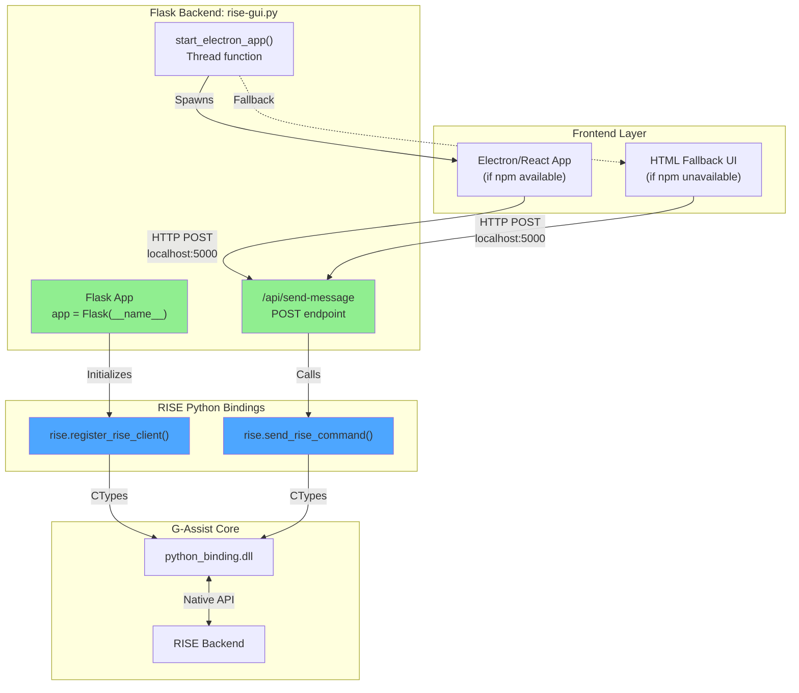
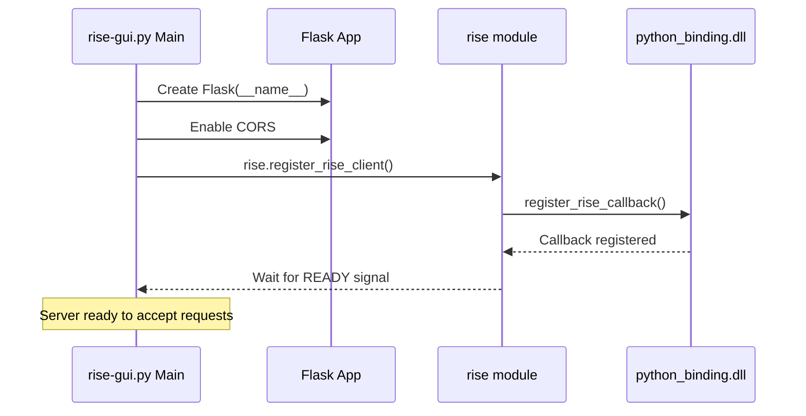
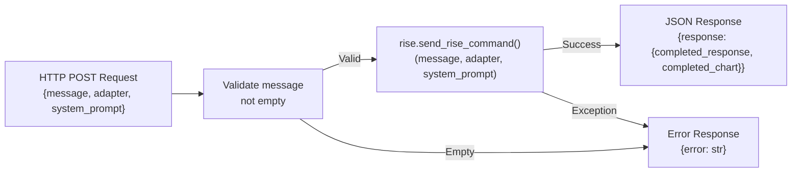
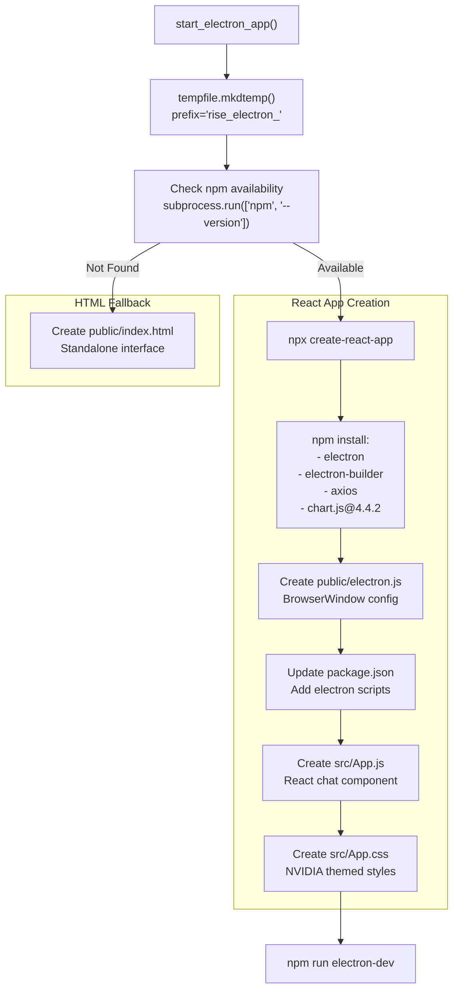
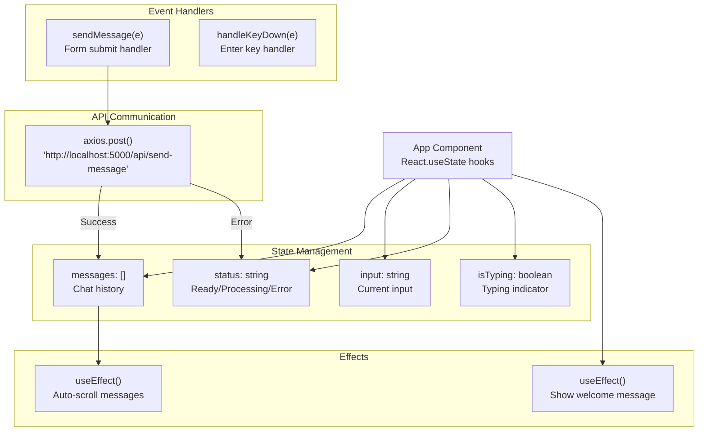
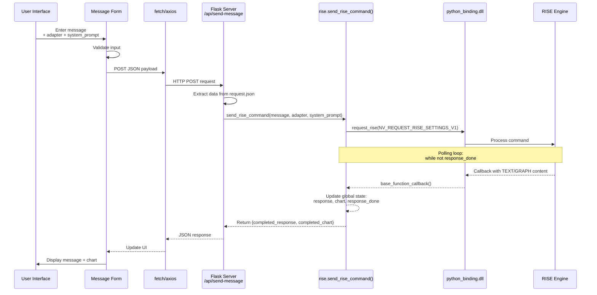
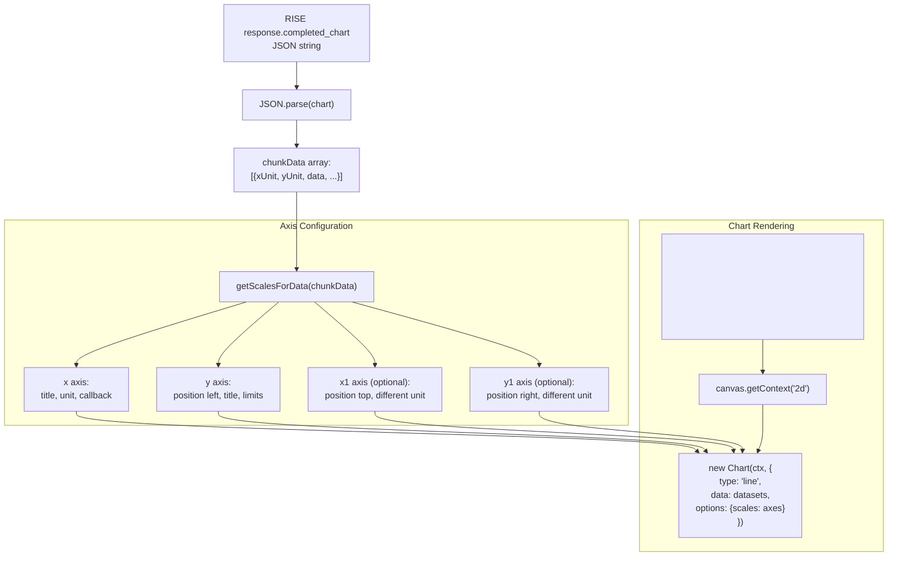
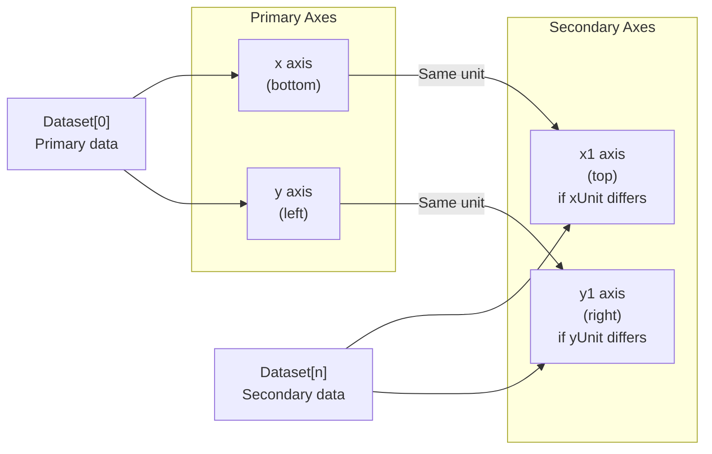
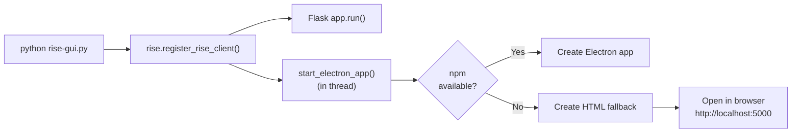

<!-- source: DeepWiki mcp.deepwiki.com · repo NVIDIA/G-Assist · page 4.3 GUI Application (rise-gui.py) · fetched 2026-10-26 -->

# GUI Application (rise-gui.py)

<details>
<summary>Relevant source files</summary>

The following files were used as context for generating this wiki page:

- [api/bindings/python/python_binding.vcxproj.user](api/bindings/python/python_binding.vcxproj.user)
- [api/bindings/python/rise-gui-example.png](api/bindings/python/rise-gui-example.png)
- [api/bindings/python/rise-gui.py](api/bindings/python/rise-gui.py)
- [api/bindings/python/rise/rise.py](api/bindings/python/rise/rise.py)
- [api/bindings/python/setup.py](api/bindings/python/setup.py)

</details>


## Purpose and Scope

This document describes the `rise-gui.py` graphical user interface application, which provides a web-based chat interface for interacting with the G-Assist RISE system. The application consists of a Flask backend server that communicates with the RISE engine and either an Electron/React or fallback HTML frontend for user interaction.

For information about the underlying `rise` module API that this GUI uses, see [API Reference](#4.1). For details on content types and callback mechanisms, see [Content Types and Callbacks](#4.2). For native binding implementation details, see [Native Bindings (python_binding.dll)](#4.4).

**Sources:** [api/bindings/python/rise-gui.py:1-1900]()

## Architecture Overview

The `rise-gui.py` application uses a client-server architecture with a Flask backend and a web-based frontend. The Flask server acts as a bridge between the user interface and the G-Assist RISE system.



**Sources:** [api/bindings/python/rise-gui.py:1-24](), [api/bindings/python/rise-gui.py:43-119]()

## Flask Backend Server

### Initialization

The Flask server initializes at module load time and immediately registers with the RISE service:



The initialization code registers the RISE client before starting the Flask server:

| Line Range | Function | Description |
|------------|----------|-------------|
| [13-15]() | Flask app creation | Creates Flask instance with CORS enabled |
| [18-23]() | RISE client registration | Calls `rise.register_rise_client()` and handles errors |

**Sources:** [api/bindings/python/rise-gui.py:13-24]()

### API Endpoints

#### POST /api/send-message

The primary endpoint for sending user messages to RISE:



**Request Schema:**
```json
{
  "message": "string (required)",
  "adapter": "string (optional)",
  "system_prompt": "string (optional)"
}
```

**Response Schema:**
```json
{
  "response": {
    "completed_response": "string",
    "completed_chart": "string (JSON)"
  }
}
```

**Error Response:**
```json
{
  "error": "string"
}
```

The endpoint implementation:

| Line Range | Logic | Description |
|------------|-------|-------------|
| [25-26]() | Route declaration | Defines POST endpoint at `/api/send-message` |
| [28-33]() | Request parsing | Extracts `message`, `adapter`, `system_prompt` from JSON body |
| [36-38]() | RISE command | Calls `rise.send_rise_command()` with parameters |
| [39]() | Success response | Returns response data as JSON |
| [40-41]() | Error handling | Returns 500 error with exception message |

**Sources:** [api/bindings/python/rise-gui.py:25-41]()

## Frontend Implementations

### Electron/React Application

The application attempts to create a full-featured Electron/React interface when npm is available:



**Key Components:**

| Component | File Path | Description |
|-----------|-----------|-------------|
| Main Process | `public/electron.js` | BrowserWindow configuration, window management |
| React Component | `src/App.js` | Chat interface with message handling |
| Styles | `src/App.css` | NVIDIA-themed CSS with green accent colors |
| Package Config | `package.json` | Electron scripts and dependencies |

**Sources:** [api/bindings/python/rise-gui.py:43-269]()

#### Electron Window Configuration

The Electron main process creates a frameless window with custom styling:

| Configuration | Value | Purpose |
|---------------|-------|---------|
| `width` | 1200 | Window width in pixels |
| `height` | 800 | Window height in pixels |
| `frame` | false | Removes native window frame |
| `transparent` | false | Opaque background |
| `titleBarStyle` | 'hidden' | Hides title bar |
| `backgroundColor` | '#0a0a0f' | Dark theme background |
| `nodeIntegration` | true | Enables Node.js APIs |
| `contextIsolation` | false | Allows direct Node.js access |

**Sources:** [api/bindings/python/rise-gui.py:70-90]()

#### React Chat Interface

The `App.js` component implements the chat interface:



**Sources:** [api/bindings/python/rise-gui.py:136-268]()

### HTML Fallback Interface

When npm is unavailable, a standalone HTML interface is created:

```mermaid
graph TB
    FallbackHTML["index.html<br/>Standalone interface"]
    
    subgraph "HTML Structure"
        Header["<header><br/>RISE title"]
        ChatPage["<div class='chat-page'>"]
        ChatContainer["<div class='chat-container'>"]
        MessagesDiv["<div class='messages'>"]
        InputForm["<form class='input-area'>"]
        SettingsPane["<div class='settings-pane'>"]
    end
    
    subgraph "JavaScript Functions"
        AddMessage["addMessage(type, text, chart)<br/>Appends message DOM"]
        GetScalesForData["getScalesForData(chunkData)<br/>Chart.js axis configuration"]
        EventListener["submit event listener<br/>fetch POST request"]
    end
    
    subgraph "Chart.js Integration"
        ChartCanvas["<canvas id='chart-{random}'>"]
        ChartScales["Chart scales:<br/>x, y, x1, y1 axes"]
        RenderChart["new Chart(ctx, config)"]
    end
    
    FallbackHTML --> Header
    FallbackHTML --> ChatPage
    ChatPage --> ChatContainer
    ChatPage --> SettingsPane
    
    ChatContainer --> MessagesDiv
    ChatContainer --> InputForm
    
    SettingsPane -->|"Adapter input"| EventListener
    SettingsPane -->|"System prompt"| EventListener
    
    EventListener --> AddMessage
    AddMessage --> ChartCanvas
    ChartCanvas --> GetScalesForData
    GetScalesForData --> RenderChart
```



**Key Features:**

| Feature | Implementation | Line Range |
|---------|----------------|------------|
| Message rendering | `addMessage(type, text, chart)` function | [1327-1378]() |
| Chart scales | `getScalesForData(chunkData)` function | [1221-1325]() |
| Fetch API | POST to `http://localhost:5000/api/send-message` | [1200-1219]() |
| Settings inputs | Adapter and system prompt text inputs | [1162-1172]() |

**Sources:** [api/bindings/python/rise-gui.py:759-1900]()

## Message Flow

### Request-Response Cycle



**Sources:** [api/bindings/python/rise-gui.py:25-41](), [api/bindings/python/rise/rise.py:207-260]()

### Message State Management

The frontend manages message state differently based on implementation:

**React Implementation:**
| State Variable | Type | Purpose |
|----------------|------|---------|
| `messages` | Array | Stores all chat messages with type and text |
| `input` | String | Current user input text |
| `status` | String | Display status: 'Ready', 'Processing', or error message |
| `isTyping` | Boolean | Shows typing indicator during API call |

**HTML Implementation:**
| DOM Element | ID | Purpose |
|-------------|-----|---------|
| Messages container | `messages` | Scrollable div containing message elements |
| Message input | `messageInput` | Text input for user messages |
| Adapter input | `adapterInput` | Optional adapter specification |
| System prompt | `systemPromptInput` | Optional system prompt override |
| Status bar | `status` | Status text display |

**Sources:** [api/bindings/python/rise-gui.py:143-197](), [api/bindings/python/rise-gui.py:1177-1220]()

## Chart Visualization

### Chart.js Integration

The application uses Chart.js 4.4.2 for rendering data visualizations returned by RISE:



**Chart Data Structure:**

Each chart dataset in the `chunkData` array contains:

| Property | Type | Description |
|----------|------|-------------|
| `xUnit` | String | X-axis unit (e.g., "Time", "%") |
| `yUnit` | String | Y-axis unit (e.g., "FPS", "%", "Temperature") |
| `yUpperLimit` | Number (optional) | Maximum Y value |
| `yLowerLimit` | Number (optional) | Minimum Y value |
| `data` | Array | Data points for the chart |

**Sources:** [api/bindings/python/rise-gui.py:1221-1325]()

### Multi-Axis Support

The `getScalesForData()` function supports multiple datasets with different units:



**Logic:**
- First dataset (`index === 0`) uses primary axes (`x`, `y`)
- Subsequent datasets check if units differ:
  - If `xUnit` differs: create `x1` axis at top position
  - If `yUnit` differs: create `y1` axis at right position
- Axes include title, unit formatting callback, and optional limits

**Sources:** [api/bindings/python/rise-gui.py:1221-1325]()

## UI Styling and Theming

### NVIDIA Theme

The application uses NVIDIA's brand colors throughout the interface:

**CSS Custom Properties:**

| Variable | Value | Usage |
|----------|-------|-------|
| `--accent-primary` | `#76b900` | Primary NVIDIA green |
| `--accent-secondary` | `#8fd619` | Lighter NVIDIA green |
| `--bg-primary` | `#0a0a0f` | Dark background |
| `--bg-secondary` | `#0d0d12` | Slightly lighter background |
| `--text-primary` | `#e8e8e8` | Primary text color |
| `--border-color` | `rgba(118, 185, 0, 0.2)` | NVIDIA green with opacity |
| `--glow` | `0 0 10px rgba(118, 185, 0, 0.4)` | Green glow effect |

**Sources:** [api/bindings/python/rise-gui.py:274-294](), [api/bindings/python/rise-gui.py:771-791]()

### Message Styling

All messages share consistent styling:

| Style Property | Value | Purpose |
|----------------|-------|---------|
| `background-color` | `var(--msg-bg)` | Same dark background for all message types |
| `border` | `1px dashed var(--border-color)` | Dashed green border |
| `border-radius` | `var(--border-radius)` | 16px rounded corners |
| `font-style` | `italic` | Italic text |
| `opacity` | `0.9` | Slight transparency |
| `max-width` | `100%` | Full width messages |

Text alignment varies by message type:
- User messages: right-aligned
- Assistant/System messages: left-aligned

**Sources:** [api/bindings/python/rise-gui.py:447-485](), [api/bindings/python/rise-gui.py:928-945]()

## Setup and Deployment

### Dependencies

The application requires the following Python packages (defined in `setup.py`):

| Package | Version | Purpose |
|---------|---------|---------|
| `flask` | Latest | Web server framework |
| `flask-cors` | Latest | Cross-Origin Resource Sharing support |
| `tqdm` | Latest | Progress bar display (used by rise module) |
| `colorama` | Latest | Colored terminal text |

**Sources:** [api/bindings/python/setup.py:9-14]()

### Node.js Dependencies (Optional)

For the Electron/React interface:

| Package | Version | Purpose |
|---------|---------|---------|
| `electron` | Latest | Desktop application framework |
| `electron-builder` | Latest | Electron build tool |
| `concurrently` | Latest | Run multiple npm scripts |
| `wait-on` | Latest | Wait for resources before proceeding |
| `axios` | Latest | HTTP client |
| `chart.js` | 4.4.2 | Chart rendering library |

**Sources:** [api/bindings/python/rise-gui.py:65-66]()

### Running the Application



**Execution Flow:**

1. **RISE Initialization:** [api/bindings/python/rise-gui.py:18-23]() - Registers client and waits for READY
2. **Flask Startup:** Server starts listening on `localhost:5000`
3. **Electron Thread:** [api/bindings/python/rise-gui.py:43-750]() - Attempts to create Electron app in separate thread
4. **Fallback:** [api/bindings/python/rise-gui.py:753-758]() - If npm unavailable, creates HTML interface

**Sources:** [api/bindings/python/rise-gui.py:1-1900]()

### Error Handling

The application includes error handling at multiple levels:

| Level | Error Type | Handler | Response |
|-------|------------|---------|----------|
| Initialization | RISE registration failure | Try-except block | Print error, `sys.exit(1)` |
| API endpoint | Empty message | Validation check | 400 error with message |
| API endpoint | RISE command exception | Try-except block | 500 error with exception details |
| Frontend | Fetch failure | Catch block | Display error in chat |

**Sources:** [api/bindings/python/rise-gui.py:20-23](), [api/bindings/python/rise-gui.py:32-41](), [api/bindings/python/rise-gui.py:179-196](), [api/bindings/python/rise-gui.py:1214-1218]()

---

