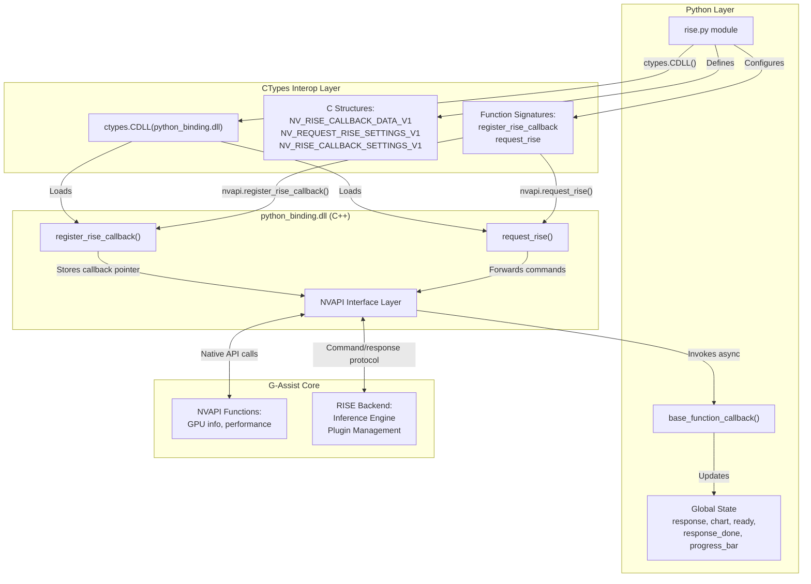
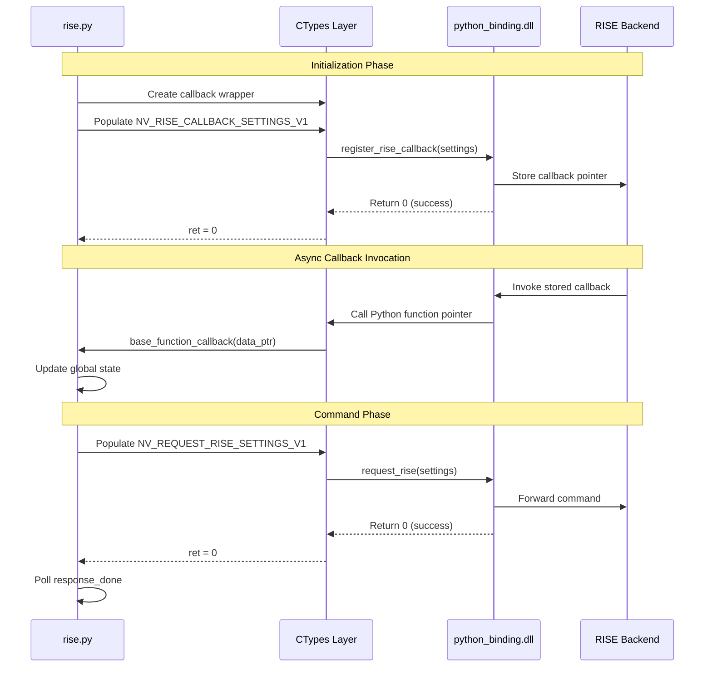
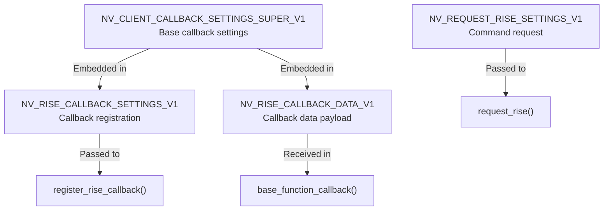
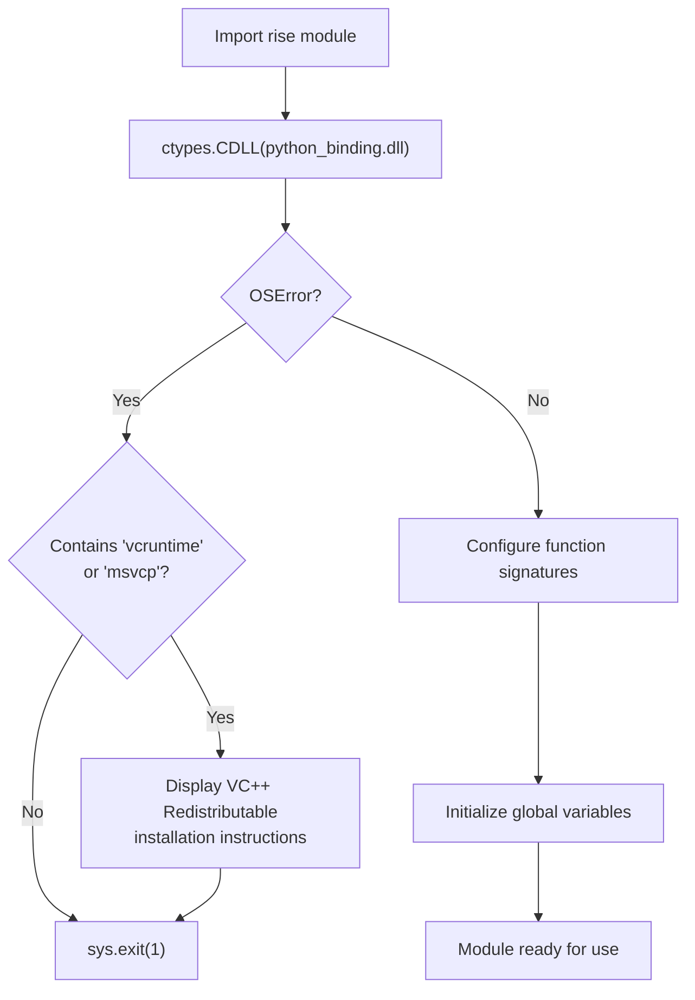
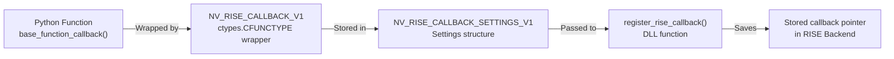
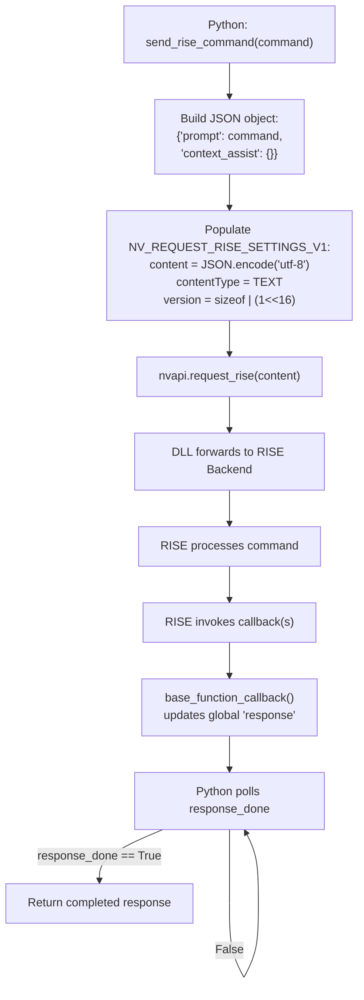
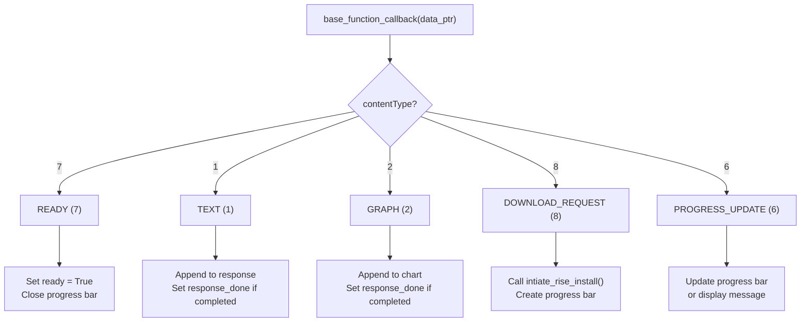
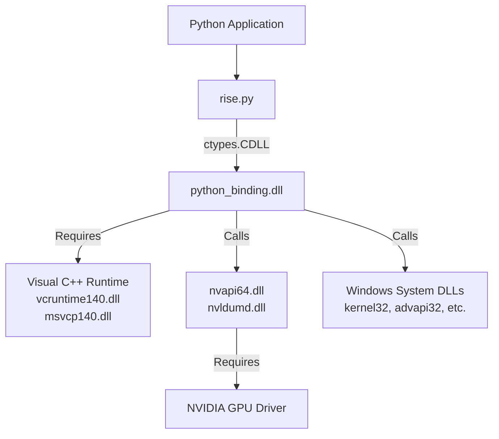
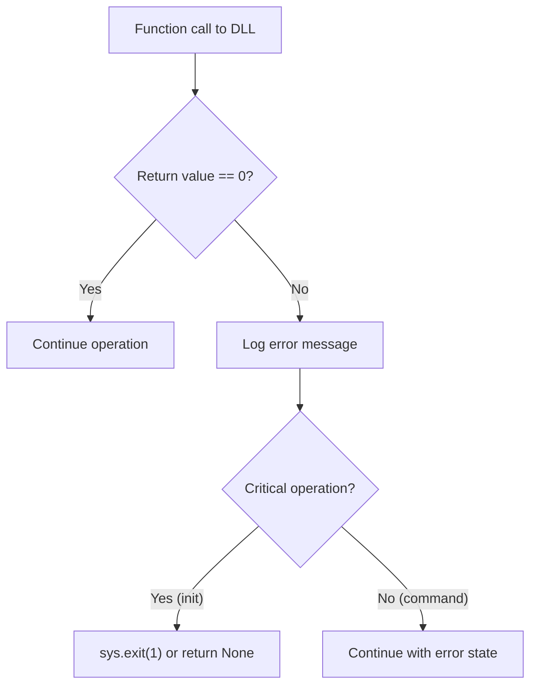

<!-- source: DeepWiki mcp.deepwiki.com · repo NVIDIA/G-Assist · page 4.4 Native Bindings (python_binding.dll) · fetched 2026-10-26 -->

# Native Bindings (python_binding.dll)

<details>
<summary>Relevant source files</summary>

The following files were used as context for generating this wiki page:

- [api/bindings/python/python_binding.vcxproj.user](api/bindings/python/python_binding.vcxproj.user)
- [api/bindings/python/rise-gui-example.png](api/bindings/python/rise-gui-example.png)
- [api/bindings/python/rise-gui.py](api/bindings/python/rise-gui.py)
- [api/bindings/python/rise/python_binding.dll](api/bindings/python/rise/python_binding.dll)
- [api/bindings/python/rise/rise.py](api/bindings/python/rise/rise.py)
- [api/bindings/python/setup.py](api/bindings/python/setup.py)

</details>


## Purpose and Scope

This page documents `python_binding.dll`, the native C++ dynamic link library that provides the bridge between Python applications and the G-Assist Core (RISE Backend). The DLL exposes a minimal C-compatible API that the Python `rise` module calls via CTypes, enabling Python scripts to register callbacks and send commands to the RISE inference engine running on RTX GPUs.

**Related Pages:**
- For the Python-side API (`rise.register_rise_client()`, `rise.send_rise_command()`), see [API Reference](#4.1)
- For callback handling and content types, see [Content Types and Callbacks](#4.2)
- For GUI applications using these bindings, see [GUI Application (rise-gui.py)](#4.3)

---

## Architecture Overview

The native bindings layer sits between the Python `rise` module and the G-Assist Core, handling all C/C++ interoperability through CTypes.

**Diagram: Native Bindings Architecture**



**Sources:** [api/bindings/python/rise/rise.py:1-288]()

---

## DLL Functions

The DLL exposes exactly two functions to Python through a C-compatible interface:

### Function Signatures

| Function Name | Purpose | Parameters | Return Value |
|--------------|---------|------------|--------------|
| `register_rise_callback` | Registers a callback function to receive async responses | `NV_RISE_CALLBACK_SETTINGS_V1*` | `int` (0=success) |
| `request_rise` | Sends a command to RISE | `NV_REQUEST_RISE_SETTINGS_V1*` | `int` (0=success) |

**Diagram: DLL Function Call Flow**



### Function Configuration in Python

The Python module configures function signatures at load time:

[api/bindings/python/rise/rise.py:171-174]()

```python
nvapi.register_rise_callback.argtypes = [ctypes.POINTER(NV_RISE_CALLBACK_SETTINGS_V1)]
nvapi.register_rise_callback.restype = ctypes.c_int
nvapi.request_rise.argtypes = [ctypes.POINTER(NV_REQUEST_RISE_SETTINGS_V1)]
nvapi.request_rise.restype = ctypes.c_int
```

**Sources:** [api/bindings/python/rise/rise.py:171-174]()

---

## CTypes Structures

The DLL interface uses versioned structures to maintain binary compatibility across updates. All structures include a `version` field that combines structure size and version number.

### Structure Hierarchy



### Structure Definitions

**NV_CLIENT_CALLBACK_SETTINGS_SUPER_V1**

[api/bindings/python/rise/rise.py:66-69]()

```python
class NV_CLIENT_CALLBACK_SETTINGS_SUPER_V1(ctypes.Structure):
    _fields_ = [("pCallbackParam", ctypes.c_void_p),
                ("rsvd", ctypes.c_uint8 * 64)]
```

| Field | Type | Purpose |
|-------|------|---------|
| `pCallbackParam` | `void*` | Optional user data pointer |
| `rsvd` | `uint8[64]` | Reserved space for future expansion |

**NV_RISE_CALLBACK_DATA_V1**

[api/bindings/python/rise/rise.py:72-77]()

```python
class NV_RISE_CALLBACK_DATA_V1(ctypes.Structure):
    _fields_ = [("super", NV_CLIENT_CALLBACK_SETTINGS_SUPER_V1),
                ("contentType", ctypes.c_int),
                ("content", ctypes.c_char * 4096),
                ("completed", ctypes.c_int)]
```

| Field | Type | Purpose |
|-------|------|---------|
| `super` | `NV_CLIENT_CALLBACK_SETTINGS_SUPER_V1` | Base structure |
| `contentType` | `int` | `NV_RISE_CONTENT_TYPE` enum value |
| `content` | `char[4096]` | Payload data (text, progress, etc.) |
| `completed` | `int` | 1 if this is the final chunk, 0 otherwise |

**NV_REQUEST_RISE_SETTINGS_V1**

[api/bindings/python/rise/rise.py:80-86]()

```python
class NV_REQUEST_RISE_SETTINGS_V1(ctypes.Structure):
    _fields_ = [("version", ctypes.c_int),
                ("contentType", ctypes.c_int),
                ("content", ctypes.c_char * 4096),
                ("completed", ctypes.c_uint8),
                ("reserved", ctypes.c_uint8 * 32)]
```

| Field | Type | Purpose |
|-------|------|---------|
| `version` | `int` | Structure size \| (1 << 16) |
| `contentType` | `int` | `NV_RISE_CONTENT_TYPE` enum value |
| `content` | `char[4096]` | JSON command payload |
| `completed` | `uint8` | Always 1 for single-chunk commands |
| `reserved` | `uint8[32]` | Reserved space |

**NV_RISE_CALLBACK_SETTINGS_V1**

[api/bindings/python/rise/rise.py:94-99]()

```python
class NV_RISE_CALLBACK_SETTINGS_V1(ctypes.Structure):
    _fields_ = [("version", ctypes.c_int),
                ("super", NV_CLIENT_CALLBACK_SETTINGS_SUPER_V1),
                ("callback", NV_RISE_CALLBACK_V1),
                ("reserved", ctypes.c_uint8 * 32)]
```

| Field | Type | Purpose |
|-------|------|---------|
| `version` | `int` | Structure size \| (1 << 16) |
| `super` | `NV_CLIENT_CALLBACK_SETTINGS_SUPER_V1` | Base structure |
| `callback` | Function pointer | Callback function to invoke |
| `reserved` | `uint8[32]` | Reserved space |

**Version Field Encoding**

All versioned structures use the formula: `version = sizeof(struct) | (1 << 16)`

[api/bindings/python/rise/rise.py:193]()
```python
callback_settings.version = ctypes.sizeof(NV_RISE_CALLBACK_SETTINGS_V1) | (1 << 16)
```

**Sources:** [api/bindings/python/rise/rise.py:66-99](), [api/bindings/python/rise/rise.py:193](), [api/bindings/python/rise/rise.py:240]()

---

## Loading and Initialization

### DLL Discovery

The DLL is located relative to the Python module's installation directory:

[api/bindings/python/rise/rise.py:156-158]()

```python
SCRIPT_DIR = os.path.dirname(os.path.abspath(__file__))
LIB_PATH = os.path.join(SCRIPT_DIR, "python_binding.dll")
```

**Directory Structure:**

```
api/bindings/python/rise/
├── rise.py                  # Python module
└── python_binding.dll       # Native DLL (same directory)
```

### Loading Process

**Diagram: DLL Loading and Error Handling**



[api/bindings/python/rise/rise.py:159-168]()

```python
try:
    nvapi = ctypes.CDLL(LIB_PATH)
except OSError as e:
    if "vcruntime" in str(e).lower() or "msvcp" in str(e).lower() or "cannot load" in str(e).lower():
        print("\n❌ Missing Visual C++ Redistributable (x64)")
        print("Download and install it from:")
        print("https://aka.ms/vs/17/release/vc_redist.x64.exe\n")
        sys.exit(1)
    else:
        raise  # re-raise unexpected errors
```

**Sources:** [api/bindings/python/rise/rise.py:156-168]()

---

## Communication Flow

### Callback Registration

The callback mechanism enables async communication from the native layer back to Python:

**Diagram: Callback Registration Details**



[api/bindings/python/rise/rise.py:189-198]()

```python
def register_rise_client() -> None:
    global nvapi, callback_settings, callback, ready
    
    try:
        callback_settings.callback = NV_RISE_CALLBACK_V1(base_function_callback)
        callback_settings.version = ctypes.sizeof(NV_RISE_CALLBACK_SETTINGS_V1) | (1 << 16)
        
        ret = nvapi.register_rise_callback(ctypes.byref(callback_settings))
        if ret != 0:
            print('Registration Failed')
            return
```

### Command Execution

Commands flow from Python through the DLL to RISE:

**Diagram: Command Execution Data Flow**



[api/bindings/python/rise/rise.py:226-243]()

```python
command_obj = {
    'prompt': command,
    'context_assist': {}
}

if (adapter != ''): 
    command_obj['adapter'] = adapter

if(system_prompt != ''):
    command_obj['context_assist']['officialAdapterSystemPrompt'] = system_prompt

content = NV_REQUEST_RISE_SETTINGS_V1()
content.content = json.dumps(command_obj).encode('utf-8')
content.contentType = NV_RISE_CONTENT_TYPE.NV_RISE_CONTENT_TYPE_TEXT
content.version = ctypes.sizeof(NV_REQUEST_RISE_SETTINGS_V1) | (1 << 16)
content.completed = 1

ret = nvapi.request_rise(content)
```

**Sources:** [api/bindings/python/rise/rise.py:189-260]()

---

## Content Type Handling

The DLL communicates different types of data through the `contentType` field:

| Content Type | Value | Purpose | Handled In |
|-------------|-------|---------|-----------|
| `NV_RISE_CONTENT_TYPE_INVALID` | 0 | Invalid/uninitialized | N/A |
| `NV_RISE_CONTENT_TYPE_TEXT` | 1 | Text responses | [rise.py:130-133]() |
| `NV_RISE_CONTENT_TYPE_GRAPH` | 2 | Chart/graph data | [rise.py:134-138]() |
| `NV_RISE_CONTENT_TYPE_CUSTOM_BEHAVIOR` | 3 | Custom behaviors | Not used |
| `NV_RISE_CONTENT_TYPE_CUSTOM_BEHAVIOR_RESULT` | 4 | Behavior results | Not used |
| `NV_RISE_CONTENT_TYPE_INSTALLING` | 5 | Installation status | Not used |
| `NV_RISE_CONTENT_TYPE_PROGRESS_UPDATE` | 6 | Progress percentage | [rise.py:144-153]() |
| `NV_RISE_CONTENT_TYPE_READY` | 7 | System ready signal | [rise.py:122-128]() |
| `NV_RISE_CONTENT_TYPE_DOWNLOAD_REQUEST` | 8 | Download initiation | [rise.py:140-142]() |

**Diagram: Content Type Processing**



**Sources:** [api/bindings/python/rise/rise.py:42-63](), [api/bindings/python/rise/rise.py:102-154]()

---

## Dependencies and Requirements

### Runtime Dependencies

**Required System Libraries:**

| Dependency | Purpose | Detection |
|-----------|---------|-----------|
| Visual C++ Redistributable (x64) | C++ runtime libraries (vcruntime140.dll, msvcp140.dll) | Error message on missing DLLs |
| Windows API | Native OS functions | Implicit dependency |
| NVAPI / NVIDIA drivers | GPU interface and RISE backend | Checked at runtime |

### DLL Export Table

The DLL includes these exported symbols (visible in binary):

[api/bindings/python/rise/python_binding.dll]() exports:
- `register_rise_callback`
- `request_rise`

Additional internal dependencies detected in binary:
- NVAPI functions: `nvapi_QueryInterface`, `nvapi_Direct_GetMethod`
- System DLLs: `kernel32.dll`, `advapi32.dll`, `setupapi.dll`, `gdi32.dll`

**Diagram: DLL Dependency Chain**



**Sources:** [api/bindings/python/rise/rise.py:159-168](), [api/bindings/python/rise/python_binding.dll]()

---

## Error Handling

### DLL Loading Errors

The module provides user-friendly error messages for common failure modes:

[api/bindings/python/rise/rise.py:159-168]()

```python
try:
    nvapi = ctypes.CDLL(LIB_PATH)
except OSError as e:
    if "vcruntime" in str(e).lower() or "msvcp" in str(e).lower() or "cannot load" in str(e).lower():
        print("\n❌ Missing Visual C++ Redistributable (x64)")
        print("Download and install it from:")
        print("https://aka.ms/vs/17/release/vc_redist.x64.exe\n")
        sys.exit(1)
    else:
        raise  # re-raise unexpected errors
```

### Function Call Return Codes

Both DLL functions return integer status codes:

| Return Value | Meaning | Handling |
|-------------|---------|----------|
| `0` | Success | Continue operation |
| Non-zero | Error | Print error message, abort |

[api/bindings/python/rise/rise.py:195-198]()
```python
ret = nvapi.register_rise_callback(ctypes.byref(callback_settings))
if ret != 0:
    print('Registration Failed')
    return
```

[api/bindings/python/rise/rise.py:243-246]()
```python
ret = nvapi.request_rise(content)
if ret != 0:
    print(f'Send RISE command failed with {ret}')
    return None
```

### Error Handling Best Practices

**Diagram: Error Handling Flow**



**Sources:** [api/bindings/python/rise/rise.py:159-168](), [api/bindings/python/rise/rise.py:195-198](), [api/bindings/python/rise/rise.py:243-246]()

---

## Package Distribution

### Setup Configuration

The DLL is packaged with the Python module for distribution:

[api/bindings/python/setup.py:16-19]()

```python
package_data={
    # Include the precompiled DLL file in the g-assist package.
    "gassist": ["python_binding.dll"]
},
```

### Installation

When installed via pip, the structure becomes:

```
site-packages/
└── gassist/
    ├── rise.py
    └── python_binding.dll
```

The DLL must remain in the same directory as `rise.py` for the relative path lookup to succeed.

**Sources:** [api/bindings/python/setup.py:1-21](), [api/bindings/python/rise/rise.py:156-158]()

---

## Binary Analysis

### DLL Characteristics

Based on the PE header in the binary:

| Property | Value |
|----------|-------|
| Architecture | x64 (64-bit) |
| Machine Type | AMD64 |
| Subsystem | Console |
| Compiler | MSVC (Visual Studio) |
| Build Path | `C:\Users\jamiek\source\g-assist-plugins-page\api\bindings\python\x64\Release\python_binding.pdb` |

### Embedded Resources

The DLL contains:
- Version information
- Manifest for execution level (asInvoker)
- Export table with 2 functions
- Debug PDB path reference

**Sources:** [api/bindings/python/rise/python_binding.dll]()

---

## Summary

`python_binding.dll` provides a minimal, stable ABI between Python and G-Assist Core:

1. **Two Functions**: `register_rise_callback` and `request_rise`
2. **Versioned Structures**: Binary-compatible interface with size encoding
3. **Async Callbacks**: Native layer invokes Python callbacks via function pointers
4. **Error Detection**: Automatic detection of missing Visual C++ Redistributable
5. **Package Integration**: Bundled with Python module for seamless deployment

This architecture enables Python developers to interact with RTX-accelerated AI features without managing C++ compilation or complex interop details.

---

