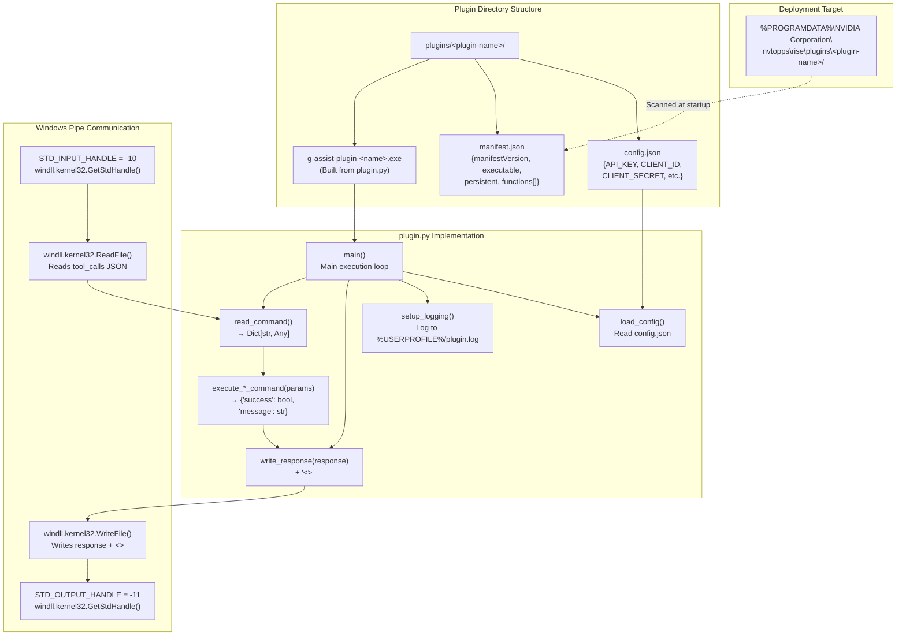
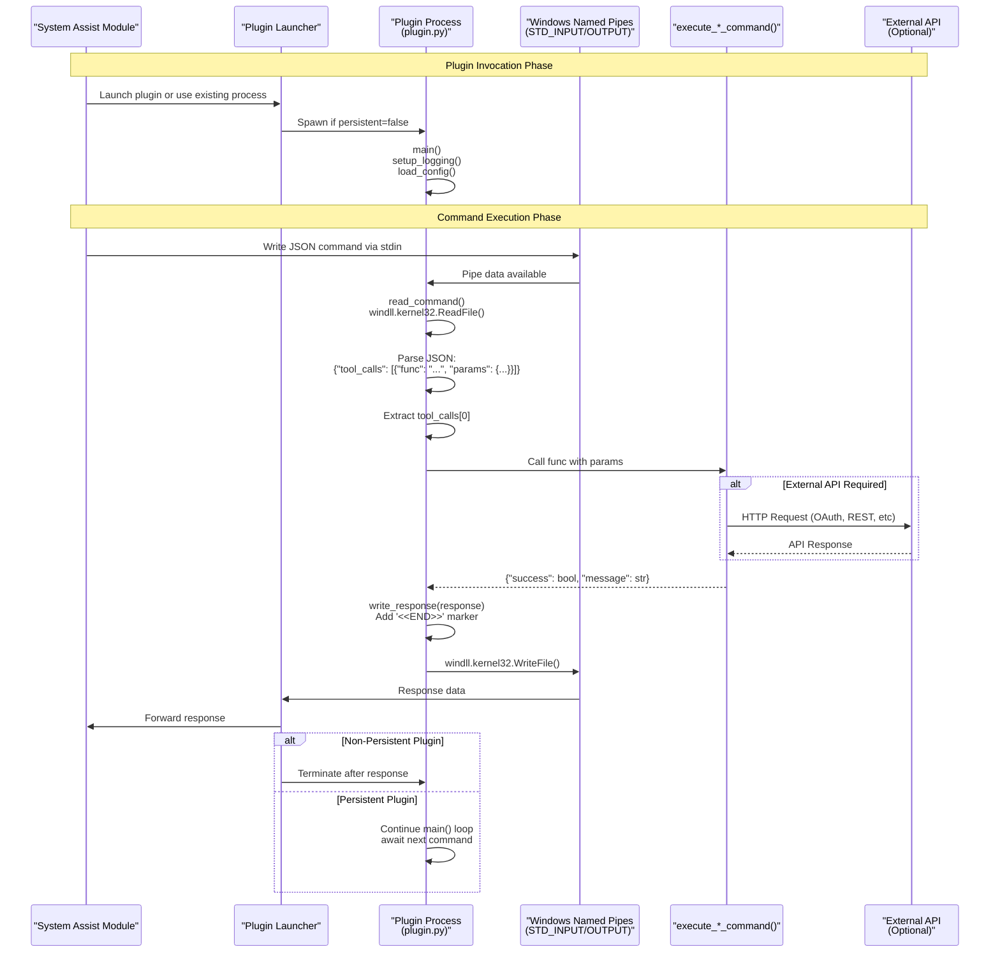
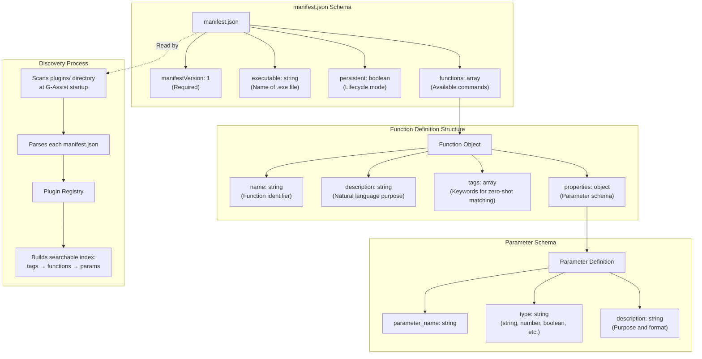
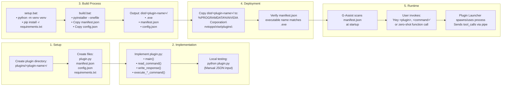

<!-- source: DeepWiki mcp.deepwiki.com · repo NVIDIA/G-Assist · page 5 Plugin Development Guide · fetched 2026-10-26 -->

# Plugin Development Guide

<details>
<summary>Relevant source files</summary>

The following files were used as context for generating this wiki page:

- [README.md](README.md)
- [api/bindings/python/README.md](api/bindings/python/README.md)
- [plugins/examples/twitch/README.md](plugins/examples/twitch/README.md)

</details>


This document provides a comprehensive technical guide for developing custom plugins for G-Assist. It covers the plugin architecture, communication protocols, file structures, and implementation patterns required to extend G-Assist's capabilities.

**Scope**: This guide focuses on the technical implementation details of plugin development. For rapid prototyping using the automated code generator, see [Quick Start with Plugin Builder](#5.1). For detailed examples of specific integration patterns, see [Plugin Examples](#6).

## Plugin Development Overview

G-Assist plugins are standalone executables that communicate with the System Assist Module via Windows Named Pipes using a JSON-based protocol. Each plugin is self-contained within its own directory and defines its capabilities through a declarative `manifest.json` file.

### Core Development Principles

1. **Process Isolation**: Each plugin runs as a separate process, ensuring security and stability
2. **Declarative Configuration**: Plugin capabilities are defined in `manifest.json`, enabling discovery without code execution
3. **Standardized Communication**: All plugins use the same pipe protocol for consistent error handling
4. **Flexible Lifecycle**: Plugins can be persistent (remain running) or non-persistent (spawned on-demand)

**Sources**: [README.md:1-23](), [README.md:135-161]()

## Plugin Architecture Components

The following diagram shows the core components of a plugin and their relationships using actual file and function names from the codebase:



**Sources**: [README.md:140-161](), [plugins/examples/twitch/README.md:90-97](), [plugins/examples/twitch/README.md:270-295](), [plugins/examples/twitch/README.md:297-380]()

## Communication Protocol

The plugin communication protocol uses Windows Named Pipes with a JSON message format. The following sequence diagram illustrates the complete request-response cycle using actual function names:



**Message Format Examples**:

**Command** (received via `read_command()`):
```json
{
  "tool_calls": [
    {
      "func": "check_twitch_live_status",
      "params": {
        "username": "nvidia"
      }
    }
  ]
}
```

**Response** (sent via `write_response()`):
```json
{
  "success": true,
  "message": "nvidia is LIVE!\nTitle: NVIDIA Gaming Stream"
}<<END>>
```

**Sources**: [plugins/examples/twitch/README.md:297-401](), [plugins/examples/twitch/README.md:381-399]()

## manifest.json Structure

The `manifest.json` file is the contract between your plugin and G-Assist. It defines plugin metadata, lifecycle behavior, and available functions with their parameters.



**Example manifest.json**:
```json
{
  "manifestVersion": 1,
  "executable": "g-assist-plugin-twitch.exe",
  "persistent": false,
  "functions": [
    {
      "name": "check_twitch_live_status",
      "description": "Checks if a Twitch user is live and retrieves stream details.",
      "tags": ["twitch", "live_status", "streaming"],
      "properties": {
        "username": {
          "type": "string",
          "description": "The Twitch username to check."
        }
      }
    }
  ]
}
```

**Key Fields**:

| Field | Type | Purpose | Example |
|-------|------|---------|---------|
| `manifestVersion` | number | Schema version for compatibility | `1` |
| `executable` | string | Name of plugin executable file | `"g-assist-plugin-twitch.exe"` |
| `persistent` | boolean | `true`: Stay running, `false`: Spawn on-demand | `false` |
| `functions[].name` | string | Function identifier (matches `tool_calls[].func`) | `"check_twitch_live_status"` |
| `functions[].description` | string | Natural language purpose for AI matching | `"Checks if a Twitch user is live..."` |
| `functions[].tags` | array | Keywords for zero-shot function discovery | `["twitch", "live_status"]` |
| `functions[].properties` | object | Parameter schema with types and descriptions | See example above |

**Sources**: [README.md:152-158](), [plugins/examples/twitch/README.md:103-122]()

## Development Workflow

The plugin development lifecycle consists of five main phases:



**Sources**: [README.md:140-161](), [plugins/examples/twitch/README.md:449-485]()

## Core Implementation Requirements

### Required Functions

Every plugin must implement these core functions in `plugin.py`:

| Function | Signature | Purpose |
|----------|-----------|---------|
| `main()` | `def main() -> None` | Main execution loop that continuously reads commands and writes responses |
| `read_command()` | `def read_command() -> Optional[Dict[str, Any]]` | Reads JSON command from stdin pipe, returns parsed dict or None on error |
| `write_response()` | `def write_response(response: Dict[str, Any]) -> None` | Writes JSON response to stdout pipe with `<<END>>` marker |
| `execute_*_command()` | `def execute_*_command(params: Dict[str, str]) -> Dict[str, Any]` | Business logic handler for each function defined in manifest.json |
| `setup_logging()` | `def setup_logging() -> None` | Configures logging to `%USERPROFILE%/<plugin>.log` |
| `load_config()` | `def load_config() -> Dict[str, Any]` | Loads API credentials and settings from `config.json` |

**Sources**: [plugins/examples/twitch/README.md:132-295]()

### Windows Pipe Communication

Plugins communicate via Windows Named Pipes using the `ctypes` library and Windows API calls:

**Constants** (required at module level):
```python
STD_INPUT_HANDLE = -10
STD_OUTPUT_HANDLE = -11
BUFFER_SIZE = 4096
```

**read_command() Implementation Pattern**:
- Use `windll.kernel32.GetStdHandle(STD_INPUT_HANDLE)` to get stdin pipe
- Call `windll.kernel32.ReadFile()` in a loop to read chunks
- Accumulate chunks until `bytes_read < BUFFER_SIZE` (end of message)
- Parse accumulated string as JSON
- Return parsed dict or None on error

**write_response() Implementation Pattern**:
- Use `windll.kernel32.GetStdHandle(STD_OUTPUT_HANDLE)` to get stdout pipe
- Create response dict: `{"success": bool, "message": str}`
- Append `<<END>>` marker to JSON string
- Call `windll.kernel32.WriteFile()` with encoded bytes
- Log errors to plugin log file

**Sources**: [plugins/examples/twitch/README.md:297-380]()

### Configuration Management

**config.json Structure**:
```json
{
  "API_KEY": "your_api_key_here",
  "CLIENT_ID": "your_client_id",
  "CLIENT_SECRET": "your_client_secret",
  "BASE_URL": "https://api.example.com",
  "OTHER_SETTINGS": "as needed"
}
```

**Security Requirements**:
- Store `config.json` in plugin directory alongside executable
- Add `config.json` to `.gitignore` to prevent credential exposure
- Load configuration at startup using `load_config()` function
- Path to config: `os.path.join(os.environ.get("PROGRAMDATA"), "NVIDIA Corporation", "nvtopps", "rise", "plugins", "<plugin-name>", "config.json")`

**Sources**: [plugins/examples/twitch/README.md:124-130](), [plugins/examples/twitch/README.md:154-178]()

### Logging and Error Handling

**Logging Configuration**:
- Log file location: `os.path.join(os.environ.get("USERPROFILE"), "<plugin>.log")`
- Use Python's `logging` module with INFO level
- Log format: `"%(asctime)s - %(levelname)s - %(message)s"`
- Log all command receipts, responses, and errors

**Error Response Format**:
```json
{
  "success": false,
  "message": "Error description for user"
}
```

**Error Handling Best Practices**:
- Wrap all API calls in try-except blocks
- Log detailed error information to log file
- Return user-friendly error messages in response
- Never crash - return error response and continue main loop
- Handle JSON parse errors gracefully in `read_command()`

**Sources**: [plugins/examples/twitch/README.md:162-169](), [plugins/examples/twitch/README.md:337-343]()

## Build System

### Directory Structure After Build

```
dist/
└── <plugin-name>/
    ├── g-assist-plugin-<name>.exe    (PyInstaller output)
    ├── manifest.json                  (Copied from source)
    └── config.json                    (Copied from source)
```

### setup.bat Purpose

The `setup.bat` script:
1. Creates Python virtual environment: `python -m venv venv`
2. Activates environment: `call venv\Scripts\activate.bat`
3. Installs dependencies: `pip install -r requirements.txt`

### build.bat Purpose

The `build.bat` script:
1. Activates virtual environment
2. Runs PyInstaller: `pyinstaller --onefile --name g-assist-plugin-<name> --distpath "%PLUGIN_DIR%" plugin.py`
3. Copies `manifest.json` to `dist/<plugin-name>/`
4. Copies `config.json` to `dist/<plugin-name>/`

**Critical**: The executable name in `build.bat` must match the `executable` field in `manifest.json`.

**Sources**: [plugins/examples/twitch/README.md:38-48](), [plugins/examples/twitch/README.md:455-481]()

## Plugin Invocation Methods

G-Assist supports two methods for invoking plugins:

### Zero-Shot Function Calling

User provides natural language without specifying plugin:
```
/fc What are the top upcoming games for 2025?
```

**Behavior**:
- System Assist Module analyzes intent using local SLM
- Searches function registry using `description` and `tags` fields
- Automatically selects best-matching plugin and function
- Extracts parameters from natural language
- Sends `tool_calls` command to plugin

### Direct Plugin Invocation

User explicitly names the plugin:
```
Hey twitch, is ninja live?
```
or
```
/twitch is ninja live?
```

**Behavior**:
- Plugin name (directory name) used to select plugin
- AI determines appropriate function from that plugin's manifest
- Extracts parameters from command text
- Sends `tool_calls` command to plugin

**Sources**: [README.md:163-192]()

## Next Steps

For specific implementation guidance:
- [Quick Start with Plugin Builder](#5.1) - Use AI to generate plugin scaffolding
- [Plugin Structure and Files](#5.2) - Detailed file format specifications
- [Implementing Command Handlers](#5.3) - Handler patterns and business logic
- [Building and Deployment](#5.4) - Build scripts and deployment procedures
- [Error Handling and Logging](#5.5) - Best practices for production plugins
- [External API Integration](#5.6) - OAuth, REST APIs, and credential management
- [Plugin Examples](#6) - Complete working examples for reference

---

