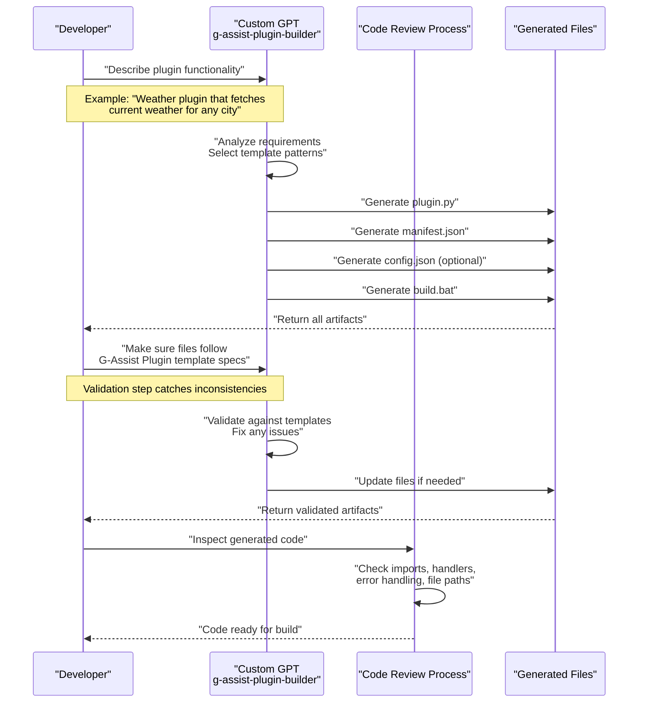
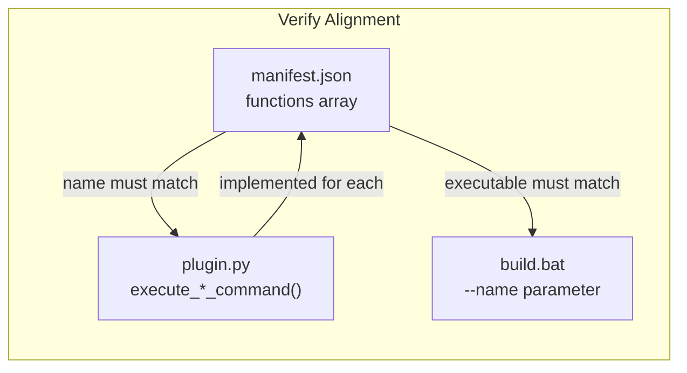

<!-- source: DeepWiki mcp.deepwiki.com · repo NVIDIA/G-Assist · page 5.1 Quick Start with Plugin Builder · fetched 2026-10-26 -->

# Quick Start with Plugin Builder

<details>
<summary>Relevant source files</summary>

The following files were used as context for generating this wiki page:

- [plugins/plugin-builder/README.md](plugins/plugin-builder/README.md)

</details>


## Purpose and Scope

This page covers the rapid plugin development workflow using the G-Assist Plugin Builder - an OpenAI GPT-based code generation tool that creates plugin scaffolding from natural language descriptions. This guide focuses specifically on the generation and initial review phases. For detailed information about plugin structure and files, see [Plugin Structure and Files](#5.2). For building and deploying generated plugins, see [Building and Deployment](#5.4).

---

## Overview

The Plugin Builder is a Custom GPT hosted on OpenAI's platform that generates complete G-Assist plugin code from natural language descriptions. The tool automates the creation of three core artifacts:

| Artifact | Purpose | Reference |
|----------|---------|-----------|
| `plugin.py` | Main plugin logic and command handlers | [5.3](#5.3) |
| `manifest.json` | Function definitions and G-Assist interface | [7.1](#7.1) |
| `config.json` | API keys and configuration parameters | [5.6](#5.6) |

The Plugin Builder reduces development time by generating template-compliant code that follows G-Assist's communication protocol and plugin architecture patterns.

**Sources:** [plugins/plugin-builder/README.md:1-9]()

---

## Prerequisites

Before using the Plugin Builder, verify the following requirements are met:

### Required Components

1. **G-Assist Installation**
   - G-Assist must be installed at `%PROGRAMDATA%\NVIDIA Corporation\nvtopps\rise\`
   - Plugin directory must exist at `%PROGRAMDATA%\NVIDIA Corporation\nvtopps\rise\plugins\`

2. **OpenAI Access**
   - Active OpenAI account with ChatGPT Plus subscription
   - Access to Custom GPT: https://chatgpt.com/g/g-67bcb083cc0c8191b7ca74993785baad-g-assist-plugin-builder

3. **Development Environment**
   - Python 3.8+ installed
   - PyInstaller for building executables (covered in [5.4](#5.4))
   - Text editor for reviewing generated code

### Recommended Knowledge

Understanding of the following G-Assist concepts improves generation quality:
- Plugin manifest structure ([3.2](#3.2))
- Named pipe communication protocol ([3.3](#3.3))
- Function invocation patterns ([3.4](#3.4))

**Sources:** [plugins/plugin-builder/README.md:11-18]()

---

## Plugin Generation Workflow

### Workflow Diagram



**Sources:** [plugins/plugin-builder/README.md:20-36]()

### Generation Process

#### Step 1: Describe Plugin Functionality

Interact with the Custom GPT at https://chatgpt.com/g/g-67bcb083cc0c8191b7ca74993785baad-g-assist-plugin-builder

Provide a clear, specific description of the plugin's purpose. Examples of effective prompts:

```
"I want to create a weather plugin that can fetch current weather for any city"
```

```
"I need a plugin that can manage a todo list with voice commands"
```

```
"Create a plugin to control Philips Hue smart lights via the Hue API"
```

The GPT will guide you through clarifying questions about:
- Required API integrations
- Expected command patterns
- Configuration parameters needed
- Response format preferences

**Sources:** [plugins/plugin-builder/README.md:25-34]()

#### Step 2: Validate Generated Files

After initial generation, execute the following validation step:

**Critical Validation Command:**
```
"Make sure the files follow the G-Assist Plugin template specifications"
```

This prompt triggers the GPT to:
- Verify `manifest.json` schema compliance ([7.1](#7.1))
- Check `plugin.py` implements required functions: `read_command()`, `write_response()`, command handlers
- Validate file path consistency between `manifest.json` (executable name) and `build.bat` (output name)
- Ensure `config.json` format matches expected structure

**Sources:** [plugins/plugin-builder/README.md:36-36]()

---

## Generated Artifacts

### File Generation Mapping

```mermaid
graph TB
    subgraph Input["Developer Input"]
        Desc["Natural Language Description"]
    end
    
    subgraph GPT["Custom GPT Processing"]
        Parse["Parse Requirements"]
        SelectTemplate["Select Code Patterns"]
        GenCode["Generate Code"]
    end
    
    subgraph Output["Generated Artifacts"]
        PluginPy["plugin.py<br/>Main logic + handlers"]
        ManifestJson["manifest.json<br/>Function definitions"]
        ConfigJson["config.json<br/>API keys/settings"]
        BuildBat["build.bat<br/>PyInstaller commands"]
        InstallMd["INSTALL.md<br/>Deployment instructions"]
    end
    
    Desc-->Parse
    Parse-->SelectTemplate
    SelectTemplate-->GenCode
    
    GenCode-->PluginPy
    GenCode-->ManifestJson
    GenCode-->ConfigJson
    GenCode-->BuildBat
    GenCode-->InstallMd
    
    PluginPy-.->"|imports|"Sys["sys.stdin/stdout"]
    PluginPy-.->"|uses|"Json["json module"]
    PluginPy-.->"|calls|"Requests["requests library"]
    
    ManifestJson-.->"|defines|"Functions["functions array"]
    ManifestJson-.->"|specifies|"Executable["executable name"]
    ManifestJson-.->"|sets|"Persistent["persistent flag"]
    
    ConfigJson-.->"|stores|"ApiKeys["api_key"]
    ConfigJson-.->"|stores|"Endpoints["api_endpoint"]
```

**Sources:** [plugins/plugin-builder/README.md:30-34]()

### Artifact Details

#### plugin.py

The main plugin file contains the following standard components:

| Component | Purpose | Location |
|-----------|---------|----------|
| `read_command()` | Reads JSON from stdin until `<<END>>` marker | See [5.3](#5.3) |
| `write_response()` | Writes JSON response with `<<END>>` marker to stdout | See [5.3](#5.3) |
| `execute_*_command()` | Handler functions for each manifest function | See [5.3](#5.3) |
| `main()` | Entry point that loops reading commands | See [5.3](#5.3) |
| Logging setup | Uses `logging` module to write to `%USERPROFILE%\plugin_name.log` | See [5.5](#5.5) |

**Sources:** [plugins/plugin-builder/README.md:39-55]()

#### manifest.json

Generated manifest follows this structure:

```json
{
  "manifestVersion": 1,
  "executable": "plugin-name.exe",
  "persistent": false,
  "functions": [
    {
      "name": "function_name",
      "description": "Detailed description for AI matching",
      "tags": ["keyword1", "keyword2"],
      "properties": {
        "param1": {
          "type": "string",
          "description": "Parameter description"
        }
      }
    }
  ]
}
```

For complete schema specification, see [7.1](#7.1).

**Sources:** [plugins/plugin-builder/README.md:30-34]()

#### config.json

Configuration file structure varies by plugin requirements. Common patterns:

```json
{
  "api_key": "",
  "api_endpoint": "https://api.example.com",
  "timeout": 30,
  "debug": false
}
```

For API integration patterns, see [5.6](#5.6).

**Sources:** [plugins/plugin-builder/README.md:30-34]()

---

## Review and Validation

### Code Review Checklist

After generation, systematically verify the following aspects:

#### Import Validation

Verify all required imports are present:

```python
import sys
import json
import logging
import os
# External libraries used by plugin logic
import requests  # for HTTP APIs
```

**Critical Check:** Ensure external dependencies are included in `requirements.txt` for build process ([5.4](#5.4)).

**Sources:** [plugins/plugin-builder/README.md:39-55]()

#### Handler Function Verification



**Verification Steps:**
1. For each function in `manifest.json` `functions` array, verify corresponding `execute_*_command()` exists in `plugin.py`
2. Check that all `execute_*_command()` functions are called in the command routing logic
3. Verify error handling is present in each handler (try/except blocks)

**Sources:** [plugins/plugin-builder/README.md:68-68]()

#### File Path Consistency

Common inconsistency issues:

| Issue | Location | Fix |
|-------|----------|-----|
| Executable name mismatch | `manifest.json` "executable" vs `build.bat` --name | Ensure both use same name |
| Log file path | `plugin.py` logging configuration | Verify uses `os.path.join(os.environ.get("USERPROFILE", "."), 'plugin.log')` |
| Config path | `plugin.py` config loading | Ensure uses `os.path.join(os.path.dirname(__file__), "config.json")` |

**Sources:** [plugins/plugin-builder/README.md:43-43]()

#### Response Format Validation

Ensure all response paths follow the required format:

```python
def write_response(success, message):
    response = {
        "success": success,
        "message": message
    }
    print(json.dumps(response) + "<<END>>", flush=True)
```

Verify:
- `success` field is boolean
- `message` field contains user-facing text
- Response ends with `<<END>>` marker
- `flush=True` is used to prevent buffering issues

For complete protocol specification, see [7.2](#7.2).

**Sources:** [plugins/plugin-builder/README.md:52-55]()

---

## Testing and Debugging

### Adding Logging Statements

The Plugin Builder can generate enhanced logging. Request this explicitly:

**Prompt:**
```
"Add logging statements to help with debugging"
```

**Generated Pattern:**

```python
import logging
import os

LOG_FILE = os.path.join(os.environ.get("USERPROFILE", "."), 'plugin_name.log')
logging.basicConfig(
    filename=LOG_FILE, 
    level=logging.INFO, 
    format="%(asctime)s - %(levelname)s - %(message)s"
)

logging.info('G-Assist plugin initialized.')
```

Logs are written to `%USERPROFILE%\plugin_name.log` for debugging purposes. For comprehensive logging patterns, see [5.5](#5.5).

**Sources:** [plugins/plugin-builder/README.md:57-66]()

### Local Testing

Before deploying, test the plugin's command/response cycle:

1. **Simulate stdin/stdout communication:**
   ```bash
   echo '{"tool_calls":[{"func":"function_name","params":{"param1":"value"}}]}<<END>>' | python plugin.py
   ```

2. **Verify response format:**
   - Check for valid JSON
   - Confirm `<<END>>` marker present
   - Validate `success` and `message` fields

3. **Test error cases:**
   - Missing parameters
   - Invalid parameter types
   - API failures (if external integration)

**Sources:** [plugins/plugin-builder/README.md:51-55]()

---

## Next Steps

After reviewing and validating the generated code:

1. **Build the Plugin**: Follow the build process in [Building and Deployment](#5.4) to:
   - Run `setup.bat` to create virtual environment
   - Run `build.bat` to package with PyInstaller
   - Verify `dist/` folder contains all required files

2. **Configure External Services**: If the plugin integrates with external APIs:
   - Obtain API keys
   - Update `config.json` with credentials
   - Review OAuth patterns in [External API Integration](#5.6)

3. **Deploy to G-Assist**: Copy built files to plugin directory:
   ```
   %PROGRAMDATA%\NVIDIA Corporation\nvtopps\rise\plugins\plugin-name\
   ```
   Deployment details in [5.4](#5.4).

4. **Implement Advanced Features**: Enhance generated code by reviewing:
   - Command handler patterns in [5.3](#5.3)
   - Error handling best practices in [5.5](#5.5)
   - Example implementations in [Plugin Examples](#6)

**Sources:** [plugins/plugin-builder/README.md:70-84]()

---

## Example Use Cases

The Plugin Builder supports generation for diverse plugin categories:

| Category | Example Plugins | Generated Components |
|----------|----------------|----------------------|
| Information Services | Weather, stock prices, news | API client, data formatters |
| Task Management | Todo lists, reminders, notes | Local storage, CRUD operations |
| Calendar Integration | Google Calendar, Outlook | OAuth flow, event management |
| Smart Home Control | Philips Hue, smart thermostats | Device discovery, control commands |
| Media Control | Spotify, YouTube | Playback control, playlist management |
| Custom Data Fetching | Database queries, web scraping | Connection management, parsers |

For detailed implementation examples, see [Plugin Examples](#6).

**Sources:** [plugins/plugin-builder/README.md:86-93]()

---

## Troubleshooting

### Common Generation Issues

| Issue | Cause | Solution |
|-------|-------|----------|
| Incomplete function definitions | Ambiguous requirements | Provide more specific description with example commands |
| Missing imports | GPT didn't recognize dependency | Explicitly mention required libraries in prompt |
| Inconsistent file names | Template deviation | Run validation prompt: "Make sure files follow G-Assist Plugin template specifications" |
| Missing error handling | Default template used | Request: "Add comprehensive error handling and logging" |

**Sources:** [plugins/plugin-builder/README.md:96-99]()

### Validation Failures

If the validation step reports issues:

1. **Manifest Schema Errors**: Compare generated `manifest.json` against specification in [7.1](#7.1)
2. **Missing Handler Functions**: Verify one `execute_*_command()` exists per manifest function
3. **Build Configuration Issues**: Check `build.bat` executable name matches `manifest.json` executable field
4. **Import Errors**: Ensure all imported modules are standard library or listed in `requirements.txt`

For build-specific issues, see [5.4](#5.4).

**Sources:** [plugins/plugin-builder/README.md:96-99]()

---

## Plugin Builder Limitations

The Plugin Builder automates scaffolding generation but has limitations:

| Limitation | Workaround |
|------------|-----------|
| Cannot generate custom C++ plugins | Use Python template, then manually port to C++ |
| Limited knowledge of proprietary APIs | Provide API documentation excerpts in prompt |
| May not implement complex OAuth flows | Review [5.6](#5.6) and enhance generated OAuth code |
| Cannot test external API credentials | Manual verification required during review phase |
| Generic error messages | Customize messages during review for better UX |

For complex plugins, use the Plugin Builder for initial scaffolding, then enhance with patterns from existing plugins in [6](#6).

**Sources:** [plugins/plugin-builder/README.md:1-121]()

---

