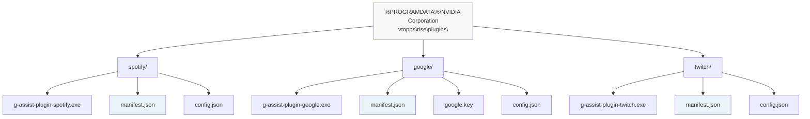
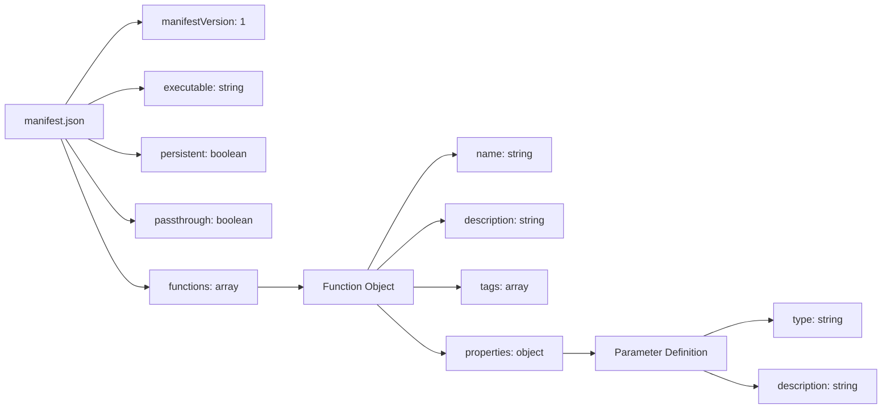
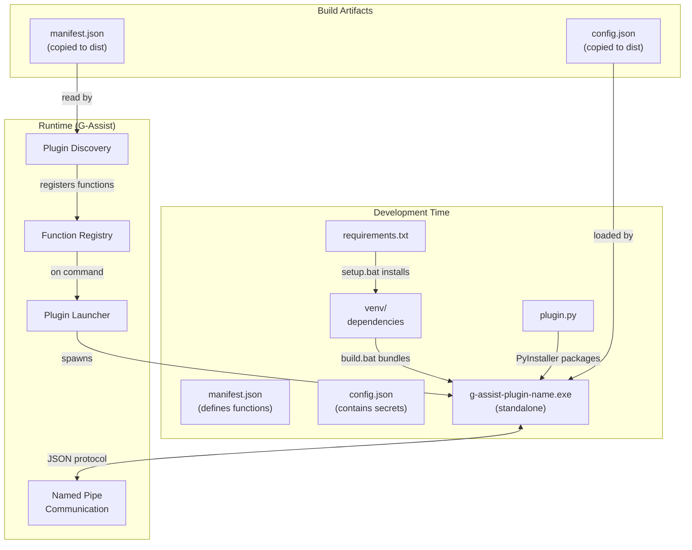
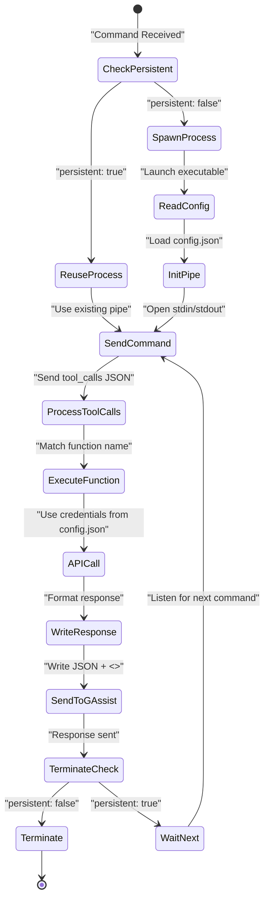

<!-- source: DeepWiki mcp.deepwiki.com · repo NVIDIA/G-Assist · page 5.2 Plugin Structure and Files · fetched 2026-10-26 -->

# Plugin Structure and Files

<details>
<summary>Relevant source files</summary>

The following files were used as context for generating this wiki page:

- [README.md](README.md)
- [api/bindings/python/README.md](api/bindings/python/README.md)
- [plugins/examples/gemini/.gitattributes](plugins/examples/gemini/.gitattributes)
- [plugins/examples/gemini/Release/g-assist-plugin-google.exe](plugins/examples/gemini/Release/g-assist-plugin-google.exe)
- [plugins/examples/gemini/Release/manifest.json](plugins/examples/gemini/Release/manifest.json)
- [plugins/examples/gemini/gemini.py](plugins/examples/gemini/gemini.py)
- [plugins/examples/gemini/manifest.json](plugins/examples/gemini/manifest.json)
- [plugins/examples/gemini/requirements.txt](plugins/examples/gemini/requirements.txt)
- [plugins/examples/twitch/README.md](plugins/examples/twitch/README.md)

</details>


This page provides a detailed breakdown of the directory structure and files that comprise a G-Assist plugin. Each plugin is a self-contained module with specific required files that enable G-Assist to discover, launch, and communicate with it.

**Purpose and Scope**: This document covers the physical file structure, the role of each file type, and how they relate to each other. For information on using the Plugin Builder to generate these files, see [Quick Start with Plugin Builder](#5.1). For implementing the actual command handling logic, see [Implementing Command Handlers](#5.3). For the build and deployment process, see [Building and Deployment](#5.4).

## Plugin Directory Structure

Each plugin resides in its own self-contained directory within the G-Assist plugins path. The directory name serves as the plugin identifier and is used for direct plugin invocation.

**Standard Directory Layout**:



**Sources**: [README.md:141-159](), [plugins/examples/twitch/README.md:90-97]()

| Directory Component | Purpose | Notes |
|---------------------|---------|-------|
| `%PROGRAMDATA%\NVIDIA Corporation\nvtopps\rise\plugins\` | Root plugins directory | G-Assist scans this location at startup |
| `<plugin-name>/` | Individual plugin directory | Name used for direct invocation (e.g., "Hey spotify") |
| Plugin subdirectories | Self-contained plugin files | Each plugin is isolated from others |

The plugin directory name is critical for user-facing invocation. When a user says "Hey twitch, is ninja live?", G-Assist looks for the `twitch/` directory and launches its executable.

**Sources**: [README.md:141-161]()

## Essential Plugin Files

### manifest.json - Plugin Interface Contract

The `manifest.json` file serves as the contract between G-Assist and the plugin. G-Assist reads this file during discovery to understand the plugin's capabilities without executing any code.

**File Location**: `<plugin-directory>/manifest.json`

**manifest.json Structure**:



**Sources**: [README.md:152-159](), [plugins/examples/gemini/manifest.json:1-23]()

**Manifest Schema Properties**:

| Property | Type | Required | Description |
|----------|------|----------|-------------|
| `manifestVersion` | integer | Yes | Schema version (currently 1) |
| `executable` | string | Yes | Name of the executable file (e.g., `"g-assist-plugin-twitch.exe"`) |
| `persistent` | boolean | Yes | If `true`, plugin remains running; if `false`, launched per-command |
| `passthrough` | boolean | No | If `true`, allows streaming responses back to G-Assist |
| `functions` | array | Yes | List of callable functions exposed by the plugin |

**Sources**: [plugins/examples/gemini/manifest.json:1-5](), [plugins/examples/twitch/README.md:103-122]()

**Function Definition Schema**:

Each object in the `functions` array defines a callable function:

| Property | Type | Required | Description |
|----------|------|----------|-------------|
| `name` | string | Yes | Function identifier (used in `tool_calls`) |
| `description` | string | Yes | Natural language description for AI function selection |
| `tags` | array<string> | Yes | Keywords for zero-shot function matching |
| `properties` | object | Yes | Parameter definitions (JSON Schema format) |

**Example manifest.json from Twitch Plugin**:

```json
{
  "manifestVersion": 1,
  "executable": "g-assist-plugin-twitch.exe",
  "persistent": false,
  "functions": [
    {
      "name": "check_twitch_live_status",
      "description": "Checks if a Twitch user is live and retrieves stream details.",
      "tags": ["twitch", "live_status"],
      "properties": {
        "username": {
          "type": "string",
          "description": "The Twitch username to check."
        }
      }
    }
  ]
}
```

**Sources**: [plugins/examples/twitch/README.md:103-122]()

**Example manifest.json from Gemini Plugin**:

[plugins/examples/gemini/manifest.json:1-23]() demonstrates a more complex function with multiple parameters:

```json
{
  "manifestVersion": 1,
  "executable": "g-assist-plugin-google.exe",
  "persistent": false,
  "passthrough": true,
  "functions": [
    {
      "name": "query_gemini",
      "description": "Google/Gemini tool search for real time access...",
      "tags": ["gemini", "google", "chat", "question", "answers", "query"],
      "properties": {
        "input": {
          "type": "string",
          "description": "the user's input"
        },
        "game": {
          "type": "string",
          "description": "an optional parameter that specifies which game is currently being played"
        }
      }
    }
  ]
}
```

**Sources**: [plugins/examples/gemini/manifest.json:1-23]()

### Plugin Executable

The plugin executable is the compiled or packaged application that G-Assist launches and communicates with via Windows Named Pipes.

**File Naming Convention**: `g-assist-plugin-<plugin-name>.exe`

**Key Requirements**:
- Name must match the `executable` field in `manifest.json`
- Must implement Windows Named Pipe communication protocol
- Must handle JSON `tool_calls` format
- Must respond with JSON including `<<END>>` termination marker

**Executable Types**:

| Type | Creation Method | Example |
|------|----------------|---------|
| Python (PyInstaller) | `pyinstaller --onefile --name g-assist-plugin-twitch plugin.py` | [plugins/examples/twitch/]() |
| C++ Native | Compiled binary | [plugins/examples/gemini/Release/g-assist-plugin-google.exe]() |

**Sources**: [plugins/examples/twitch/README.md:469-477](), [README.md:146-151]()

**Communication Protocol Implementation**:

The executable must implement:

1. **Read Command** from stdin pipe: [plugins/examples/twitch/README.md:302-343]()
2. **Write Response** to stdout pipe: [plugins/examples/twitch/README.md:345-367]()
3. **Tool Calls Handler**: Process `{"tool_calls": [...]}` format [plugins/examples/gemini/gemini.py:81-110]()

### config.json - Runtime Configuration

The `config.json` file contains runtime configuration including API credentials, settings, and other plugin-specific data.

**File Location**: `<plugin-directory>/config.json`

**Security Note**: This file should be added to `.gitignore` as it contains sensitive credentials.

**Example config.json Structure**:

```json
{
  "TWITCH_CLIENT_ID": "your_client_id_here",
  "TWITCH_CLIENT_SECRET": "your_client_secret_here"
}
```

**Sources**: [plugins/examples/twitch/README.md:124-130]()

**Access Pattern in Plugin Code**:

The plugin loads configuration at runtime using a consistent pattern:

```python
CONFIG_FILE = os.path.join(
    os.environ.get("PROGRAMDATA", "."),
    r'NVIDIA Corporation\nvtopps\rise\plugins\twitch',
    'config.json'
)

def load_config():
    try:
        if os.path.exists(CONFIG_FILE):
            with open(CONFIG_FILE, "r") as file:
                return json.load(file)
    except Exception as e:
        logging.error(f"Error loading config: {e}")
    return {}
```

**Sources**: [plugins/examples/twitch/README.md:154-179](), [plugins/examples/gemini/gemini.py:36]()

**Alternative: Separate Credential Files**:

Some plugins use dedicated credential files instead of `config.json`:

- `google.key` - Contains Google API key [plugins/examples/gemini/gemini.py:35]()

This pattern is useful for single-credential plugins or when following specific API provider conventions.

**Sources**: [plugins/examples/gemini/gemini.py:35-38]()

### requirements.txt - Python Dependencies

For Python-based plugins, `requirements.txt` specifies the dependencies needed during development and build.

**File Location**: `<plugin-directory>/requirements.txt`

**Purpose**:
- Used by `setup.bat` to install dependencies in virtual environment
- Used by PyInstaller to bundle dependencies into the executable
- Ensures reproducible builds

**Example requirements.txt**:

```txt
google-genai>=1.7.0
pyinstaller==6.11.0
```

**Sources**: [plugins/examples/gemini/requirements.txt:15-16]()

**Common Dependencies**:

| Package | Purpose | Example Usage |
|---------|---------|---------------|
| `requests` | HTTP API calls | Twitch, Spotify plugins |
| `google-genai` | Google AI integration | [plugins/examples/gemini/requirements.txt:15]() |
| `pyinstaller` | Build executable | [plugins/examples/gemini/requirements.txt:16]() |

**Build Process Integration**:

The `setup.bat` script uses this file:

```batch
python -m venv venv
call venv\Scripts\activate
pip install -r requirements.txt
```

**Sources**: [plugins/examples/twitch/README.md:39-42]()

## File Relationships and Plugin Lifecycle

The following diagram illustrates how the essential files relate to each other during the plugin lifecycle:

**Plugin File Dependencies and Usage**:



**Sources**: [README.md:141-191](), [plugins/examples/twitch/README.md:450-485]()

### Startup and Discovery Phase

When G-Assist starts, it scans the plugins directory:

1. **Directory Scan**: G-Assist enumerates `%PROGRAMDATA%\NVIDIA Corporation\nvtopps\rise\plugins\`
2. **Manifest Parsing**: Each subdirectory's `manifest.json` is read [README.md:165]()
3. **Function Registry**: G-Assist builds an index of available functions and their descriptions
4. **Tag Indexing**: The `tags` array enables zero-shot function matching [plugins/examples/gemini/manifest.json:10]()

**Sources**: [README.md:165-191]()

### Plugin Execution Lifecycle

**Persistent vs Non-Persistent Plugins**:



**Sources**: [README.md:152-159](), [plugins/examples/gemini/manifest.json:4]()

**File Usage During Execution**:

| Phase | Files Used | Purpose |
|-------|------------|---------|
| Discovery | `manifest.json` | G-Assist learns plugin capabilities |
| Launch | `manifest.json` | G-Assist reads `executable` field to spawn process |
| Initialization | `config.json`, `*.key` | Plugin loads credentials [plugins/examples/gemini/gemini.py:267-269]() |
| Communication | stdin/stdout pipes | JSON `tool_calls` and responses exchanged |
| Logging | `%USERPROFILE%\<plugin>.log` | Plugin writes debug/error logs [plugins/examples/gemini/gemini.py:38-39]() |

**Sources**: [plugins/examples/gemini/gemini.py:35-39](), [plugins/examples/gemini/gemini.py:267-283]()

## Complete Plugin File Example

**Twitch Plugin Directory Contents**:

```
plugins/twitch/
├── g-assist-plugin-twitch.exe    # Compiled executable (references config.json)
├── manifest.json                  # Defines check_twitch_live_status function
└── config.json                    # Contains TWITCH_CLIENT_ID, TWITCH_CLIENT_SECRET
```

**File Interdependencies**:

1. `manifest.json` declares `"executable": "g-assist-plugin-twitch.exe"` [plugins/examples/twitch/README.md:106]()
2. `manifest.json` defines `check_twitch_live_status` with `username` parameter [plugins/examples/twitch/README.md:110-118]()
3. `g-assist-plugin-twitch.exe` reads credentials from `config.json` at runtime [plugins/examples/twitch/README.md:171-177]()
4. When G-Assist calls `check_twitch_live_status`, the executable:
   - Receives `{"tool_calls": [{"func": "check_twitch_live_status", "params": {"username": "ninja"}}]}`
   - Loads credentials from `config.json`
   - Makes Twitch API call
   - Responds with `{"success": true, "message": "..."}<<END>>`

**Sources**: [plugins/examples/twitch/README.md:90-97](), [plugins/examples/twitch/README.md:103-122](), [plugins/examples/twitch/README.md:381-399]()

## Optional Files and Build Artifacts

### .gitattributes - Git LFS Configuration

For plugins with large executables tracked in Git LFS:

```
Release/g-assist-plugin-google.exe filter=lfs diff=lfs merge=lfs -text
Release/* filter=lfs diff=lfs merge=lfs -text
```

**Sources**: [plugins/examples/gemini/.gitattributes:1-2]()

### Build Scripts

- `setup.bat` - Creates virtual environment, installs `requirements.txt`
- `build.bat` - Runs PyInstaller, creates `dist/` directory with plugin files

These scripts are part of the development workflow but not deployed with the plugin.

**Sources**: [plugins/examples/twitch/README.md:39-48](), [plugins/examples/twitch/README.md:455-481]()

### Development Files Not Deployed

| File | Purpose | Deployment |
|------|---------|------------|
| `plugin.py` | Source code | Not deployed (bundled into .exe) |
| `requirements.txt` | Dependency list | Not deployed (dependencies bundled) |
| `setup.bat`, `build.bat` | Build automation | Not deployed |
| `venv/` | Virtual environment | Not deployed |

Only the `dist/` folder contents are deployed to G-Assist's plugins directory.

**Sources**: [plugins/examples/twitch/README.md:51-60]()

## File Path Resolution Patterns

Plugins use consistent path resolution to locate configuration files:

**Configuration Path Pattern**:

```python
CONFIG_FILE = os.path.join(
    os.environ.get("PROGRAMDATA", "."),
    r'NVIDIA Corporation\nvtopps\rise\plugins\<plugin-name>',
    'config.json'
)
```

**Log File Path Pattern**:

```python
LOG_FILE = os.path.join(
    os.environ.get("USERPROFILE", "."), 
    '<plugin-name>.log'
)
```

**Sources**: [plugins/examples/twitch/README.md:154-160](), [plugins/examples/gemini/gemini.py:35-39]()

These patterns ensure plugins can locate their configuration regardless of the current working directory when launched by G-Assist.

---

