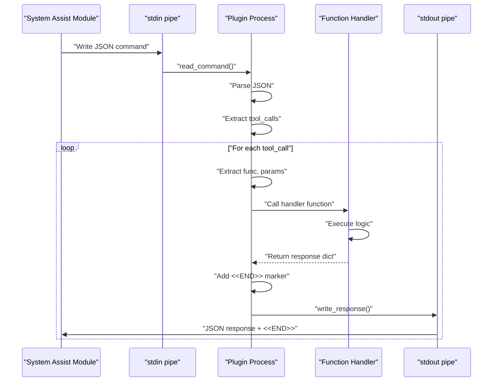
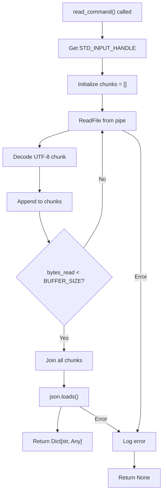
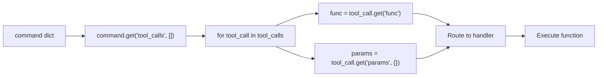
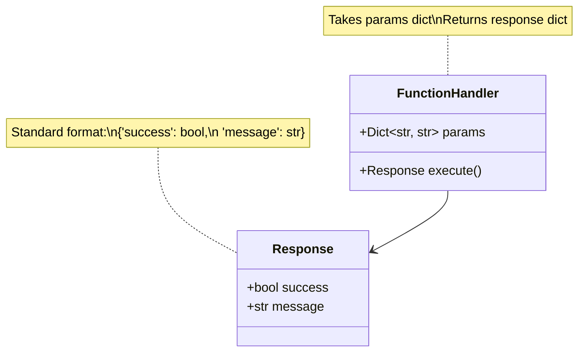
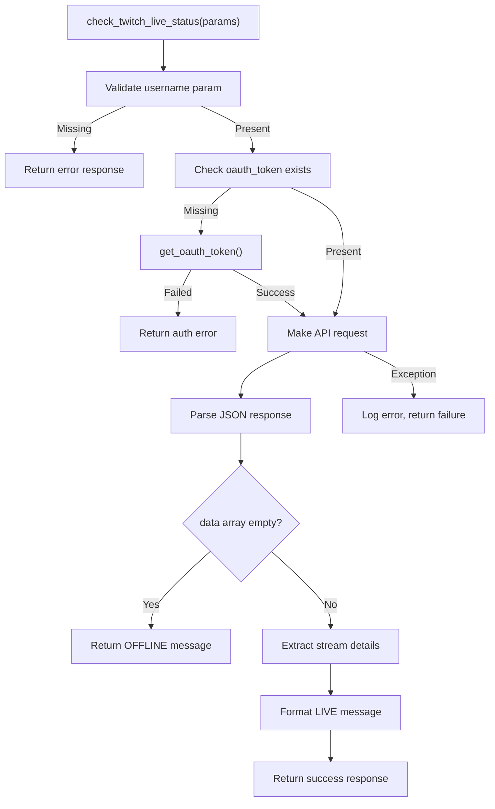
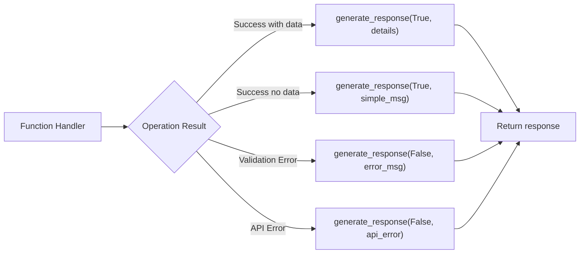
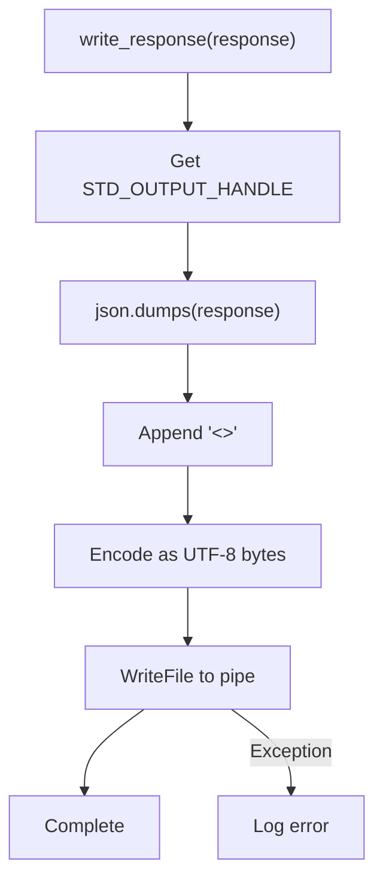
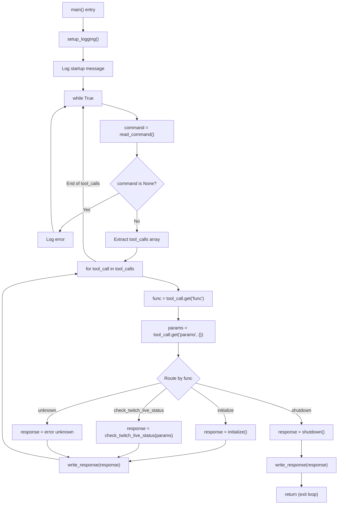
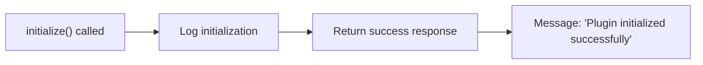
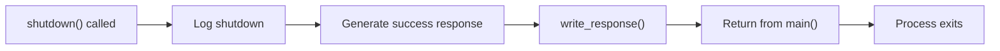

<!-- source: DeepWiki mcp.deepwiki.com · repo NVIDIA/G-Assist · page 5.3 Implementing Command Handlers · fetched 2026-10-26 -->

# Implementing Command Handlers

<details>
<summary>Relevant source files</summary>

The following files were used as context for generating this wiki page:

- [README.md](README.md)
- [api/bindings/python/README.md](api/bindings/python/README.md)
- [plugins/examples/twitch/README.md](plugins/examples/twitch/README.md)
- [plugins/examples/twitch/plugin.py](plugins/examples/twitch/plugin.py)

</details>


This document covers the implementation of command handlers in G-Assist plugins. It explains how to implement the core functions that enable your plugin to communicate with the G-Assist platform: reading commands from Windows pipes, parsing the `tool_calls` structure, executing your plugin's logic, and writing properly formatted responses.

For information about the overall plugin structure and manifest configuration, see [Plugin Structure and Files](#5.2). For details on error handling patterns and logging, see [Error Handling and Logging](#5.5). For integration with external APIs, see [External API Integration](#5.6).

## Command Handler Architecture

A G-Assist plugin operates as a standalone process that communicates with the System Assist Module via Windows Named Pipes using a JSON-based protocol. The plugin implements a request-response pattern where it continuously reads commands from stdin, executes the appropriate function, and writes responses to stdout.

### Command Processing Flow



**Sources:** [plugins/examples/twitch/plugin.py:237-396](), [plugins/examples/twitch/README.md:299-401]()

## Reading Commands from the Pipe

The `read_command()` function reads JSON-formatted commands from stdin using Windows pipe handles. Commands may exceed the buffer size, requiring chunked reading until the complete message is received.

### Implementation Pattern



**Sources:** [plugins/examples/twitch/plugin.py:237-295](), [plugins/examples/twitch/README.md:302-343]()

### Key Implementation Details

The implementation uses Windows kernel32 API functions via ctypes:

| Constant | Value | Purpose |
|----------|-------|---------|
| `STD_INPUT_HANDLE` | -10 | Windows handle for stdin |
| `BUFFER_SIZE` | 4096 | Size of read buffer in bytes |

[plugins/examples/twitch/plugin.py:41-48]()

**Reading Process:**
1. Obtain stdin handle using `windll.kernel32.GetStdHandle(STD_INPUT_HANDLE)`
2. Allocate a buffer of `BUFFER_SIZE` bytes
3. Call `windll.kernel32.ReadFile()` to read data into buffer
4. Decode the buffer slice containing actual data using UTF-8
5. Append to chunks list
6. Continue reading until `message_bytes.value < BUFFER_SIZE`
7. Join all chunks and parse as JSON

[plugins/examples/twitch/plugin.py:260-287]()

### Expected Command Format

Commands received from G-Assist follow this structure:

```json
{
    "tool_calls": [
        {
            "func": "function_name",
            "params": {
                "param1": "value1",
                "param2": "value2"
            }
        }
    ]
}
```

**Sources:** [plugins/examples/twitch/plugin.py:247-258](), [plugins/examples/twitch/README.md:381-391]()

## Parsing Tool Calls Structure

After reading the command, the plugin must extract the `tool_calls` array and iterate through each tool call to determine which function to execute.

### Tool Call Extraction Pattern



**Sources:** [plugins/examples/twitch/plugin.py:376-392]()

### Main Loop Implementation

The main processing loop continuously reads commands and dispatches them to appropriate handlers:

[plugins/examples/twitch/plugin.py:370-392]()

The loop structure:
1. Call `read_command()` to get command dictionary
2. Handle `None` return (read failure) by continuing to next iteration
3. Extract `tool_calls` array using `command.get("tool_calls", [])`
4. Iterate through each tool call in the array
5. Extract `func` string and `params` dictionary
6. Use conditional logic to route to appropriate handler function
7. Call handler with `params` dictionary
8. Write response using `write_response()`
9. Check for shutdown command to exit loop

**Sources:** [plugins/examples/twitch/plugin.py:348-393](), [README.md:162-191]()

## Implementing Function Handlers

Function handlers are the core logic of your plugin. Each handler corresponds to a function defined in `manifest.json` and implements the actual plugin functionality.

### Function Handler Signature



**Sources:** [plugins/examples/twitch/plugin.py:171-235]()

### Handler Implementation Pattern

Each function handler follows this pattern:

1. **Extract and Validate Parameters**
   - Use `params.get("param_name")` to extract parameters
   - Validate required parameters are present
   - Return error response if validation fails

[plugins/examples/twitch/plugin.py:197-200]()

2. **Execute Plugin Logic**
   - Perform the actual work (API calls, calculations, etc.)
   - Handle exceptions from external dependencies
   - Log significant operations

[plugins/examples/twitch/plugin.py:207-230]()

3. **Generate Response**
   - Use `generate_response(success, message)` helper function
   - Format message string for user display
   - Include relevant details in the response

[plugins/examples/twitch/plugin.py:156-169](), [plugins/examples/twitch/plugin.py:224-230]()

### Example: Twitch Stream Status Handler

The `check_twitch_live_status` function demonstrates the complete handler pattern:



**Sources:** [plugins/examples/twitch/plugin.py:171-235](), [plugins/examples/twitch/README.md:230-259]()

The handler implementation at [plugins/examples/twitch/plugin.py:171-235]():
- Extracts `username` from params dictionary
- Validates required parameters and returns early if missing
- Obtains OAuth token if not cached
- Makes HTTP request to Twitch API with proper headers
- Parses response and extracts stream information
- Formats detailed message for live streams or simple offline status
- Handles exceptions and returns appropriate error responses

## Generating Responses

All plugin responses must follow a standardized format to be properly displayed by G-Assist. The response structure consists of a `success` boolean flag and an optional `message` string.

### Response Format Specification

| Field | Type | Required | Purpose |
|-------|------|----------|---------|
| `success` | boolean | Yes | Indicates if operation completed successfully |
| `message` | string | No | User-facing message to display in G-Assist |

**Sources:** [plugins/examples/twitch/README.md:261-268]()

### Response Helper Function

The `generate_response()` helper function creates standardized response dictionaries:

[plugins/examples/twitch/plugin.py:156-169]()

This function:
- Takes `success` boolean as required parameter
- Optionally includes `message` string
- Returns properly formatted response dictionary
- Ensures consistent response structure across all handlers

### Response Scenarios



**Sources:** [plugins/examples/twitch/plugin.py:156-169](), [plugins/examples/twitch/plugin.py:171-235]()

### Example Response Messages

**Live Stream Response:**
```json
{
    "success": true,
    "message": "ninja is LIVE!\nTitle: Friday Fortnite!\nGame: Fortnite\nViewers: 45,231\nStarted At: 2024-03-14T12:34:56Z"
}
```

**Offline Response:**
```json
{
    "success": true,
    "message": "shroud is OFFLINE"
}
```

**Error Response:**
```json
{
    "success": false,
    "message": "Failed to authenticate with Twitch"
}
```

**Sources:** [plugins/examples/twitch/README.md:70-83](), [plugins/examples/twitch/README.md:393-399]()

## Writing Responses to the Pipe

The `write_response()` function sends JSON-formatted responses back to G-Assist via stdout. Responses must include the `<<END>>` termination marker to signal message completion.

### Response Writing Process



**Sources:** [plugins/examples/twitch/plugin.py:297-324](), [plugins/examples/twitch/README.md:345-367]()

### Implementation Details

The implementation uses Windows kernel32 API functions:

| Constant | Value | Purpose |
|----------|-------|---------|
| `STD_OUTPUT_HANDLE` | -11 | Windows handle for stdout |

[plugins/examples/twitch/plugin.py:44-45]()

**Writing Process:**
1. Obtain stdout handle using `windll.kernel32.GetStdHandle(STD_OUTPUT_HANDLE)`
2. Serialize response dictionary to JSON string
3. Append `<<END>>` marker to signal message termination
4. Encode combined string as UTF-8 bytes
5. Call `windll.kernel32.WriteFile()` to write bytes to pipe
6. Log any errors that occur during writing

[plugins/examples/twitch/plugin.py:310-323]()

### Termination Marker Requirement

The `<<END>>` marker is **required** for proper message parsing by G-Assist:

```
{"success": true, "message": "Plugin initialized"}<<END>>
```

Without this marker, G-Assist cannot determine where the response ends, especially when responses contain newlines or special characters.

**Sources:** [plugins/examples/twitch/README.md:369-379](), [plugins/examples/twitch/plugin.py:312]()

## Main Plugin Loop

The main plugin loop ties together all command handling components into a continuous execution pattern that processes commands until the plugin receives a shutdown signal.

### Complete Plugin Execution Flow



**Sources:** [plugins/examples/twitch/plugin.py:348-393]()

### Main Function Implementation

The main function at [plugins/examples/twitch/plugin.py:348-393]() implements:

1. **Initialization Phase**
   - Calls `setup_logging()` to configure log file
   - Logs startup message
   - Enters infinite loop

2. **Command Reading Phase**
   - Calls `read_command()` to receive next command
   - Handles `None` return by logging error and continuing
   - Extracts `tool_calls` array from command dictionary

3. **Command Routing Phase**
   - Iterates through each tool_call in the array
   - Extracts `func` name and `params` dictionary
   - Uses conditional statements to route to appropriate handler
   - Calls handler function with params

4. **Response Phase**
   - Handler returns response dictionary
   - Calls `write_response()` to send response back
   - Special handling for shutdown command (exits after response)

5. **Error Handling**
   - Unknown function names receive error response
   - Read failures are logged but loop continues
   - Exceptions in handlers should be caught and converted to error responses

### Entry Point

The plugin entry point loads configuration and starts the main loop:

[plugins/examples/twitch/plugin.py:394-396]()

This pattern:
- Loads configuration from `config.json` into global `config` variable
- Calls `main()` to start command processing loop
- Only executes when script is run directly (not imported)

**Sources:** [plugins/examples/twitch/plugin.py:348-396]()

## Special Commands

G-Assist plugins must handle two special built-in commands: `initialize` and `shutdown`. These commands manage plugin lifecycle and are not defined in `manifest.json`.

### Initialize Command

The `initialize` function is called when the plugin first starts or when G-Assist needs to verify plugin availability.



**Sources:** [plugins/examples/twitch/plugin.py:326-335]()

Implementation at [plugins/examples/twitch/plugin.py:326-335]():
- Logs initialization event
- Performs any necessary setup (if needed)
- Returns success response with initialization message
- Does not exit the main loop

### Shutdown Command

The `shutdown` function signals the plugin to perform cleanup and exit gracefully.



**Sources:** [plugins/examples/twitch/plugin.py:337-346](), [plugins/examples/twitch/plugin.py:385-388]()

Implementation pattern:
1. Log shutdown event at [plugins/examples/twitch/plugin.py:345]()
2. Generate success response with shutdown message
3. Return response to caller
4. Main loop handles shutdown specially by calling `write_response()` then returning at [plugins/examples/twitch/plugin.py:386-388]()
5. Returning from `main()` causes script to exit and process to terminate

### Command Routing for Special Commands

In the main loop, special commands are handled alongside regular function calls:

[plugins/examples/twitch/plugin.py:381-392]()

The routing pattern:
- `initialize` → Call `initialize()`, write response, continue loop
- `shutdown` → Call `shutdown()`, write response, **return from main()**
- Regular functions → Call handler, write response, continue loop
- Unknown function → Generate error response, continue loop

**Sources:** [plugins/examples/twitch/plugin.py:348-393]()

---

