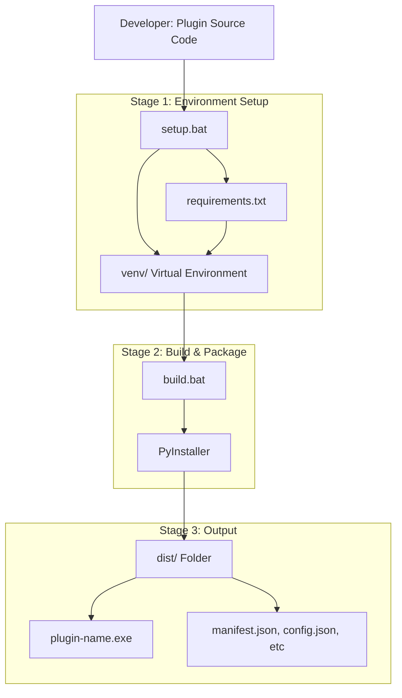
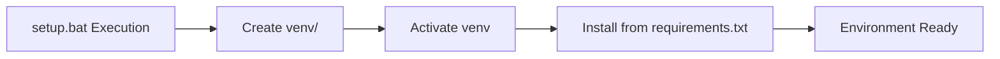
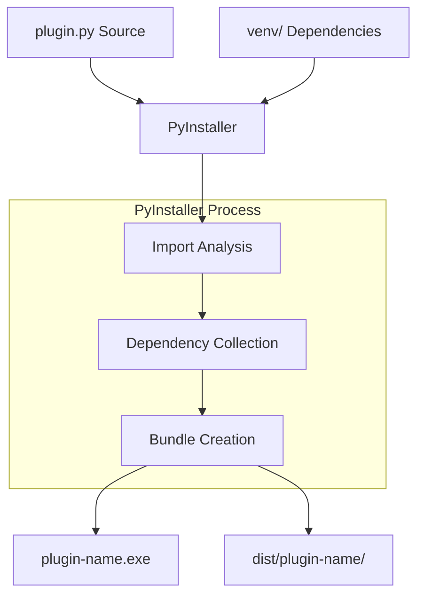
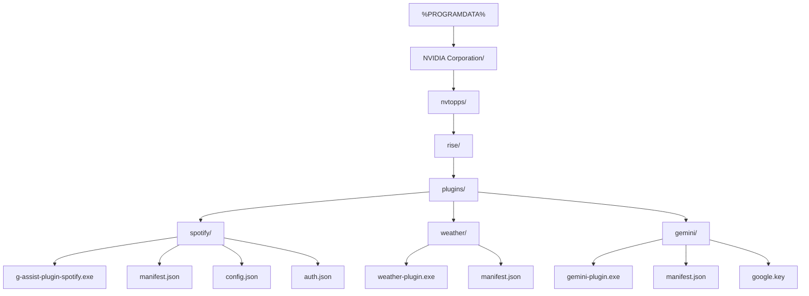
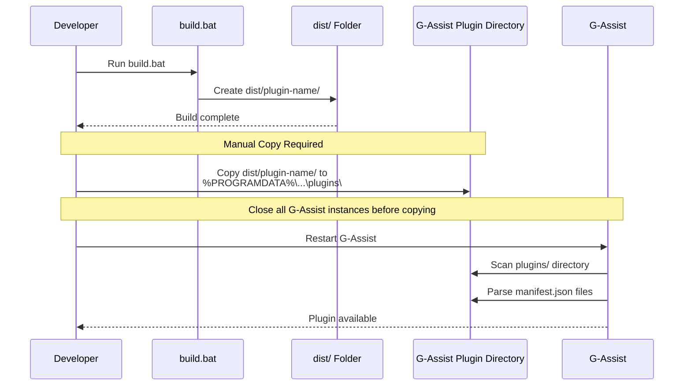
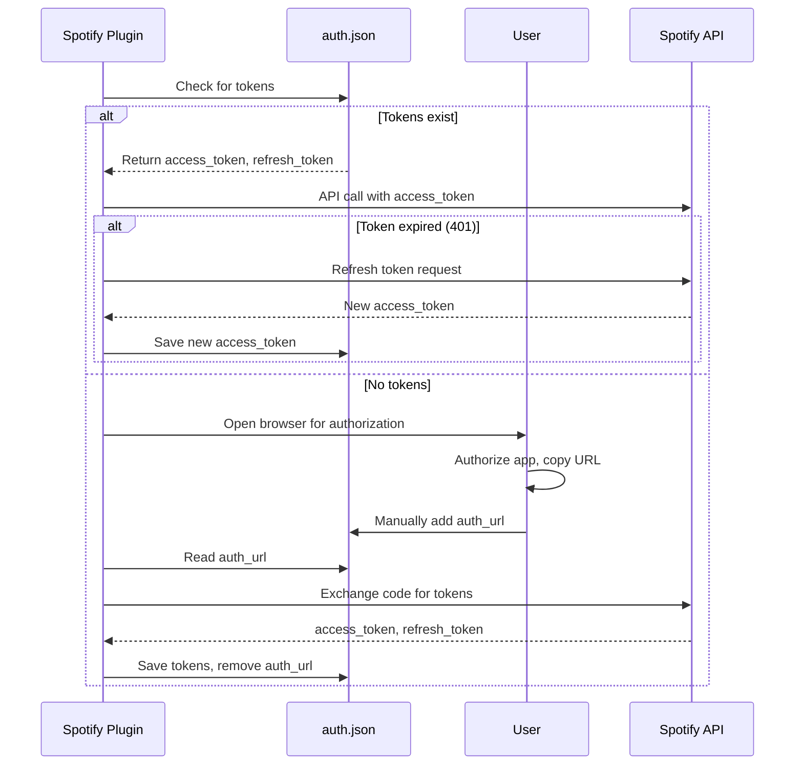
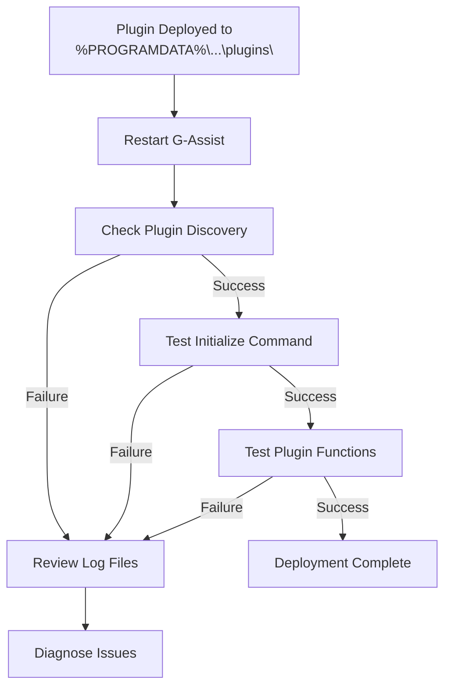
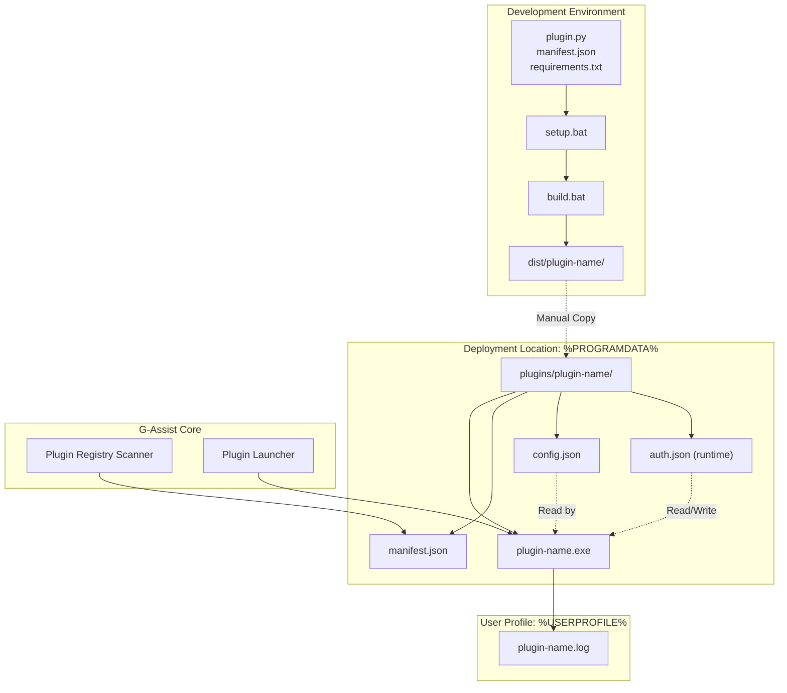

<!-- source: DeepWiki mcp.deepwiki.com · repo NVIDIA/G-Assist · page 5.4 Building and Deployment · fetched 2026-10-26 -->

# Building and Deployment

<details>
<summary>Relevant source files</summary>

The following files were used as context for generating this wiki page:

- [plugins/examples/spotify/README.md](plugins/examples/spotify/README.md)
- [plugins/examples/spotify/plugin.py](plugins/examples/spotify/plugin.py)
- [plugins/examples/weather/README.md](plugins/examples/weather/README.md)

</details>


This page covers the build and deployment process for G-Assist plugins, including environment setup, PyInstaller packaging, and installation to the G-Assist plugin directory. For information about implementing plugin logic and command handlers, see [Implementing Command Handlers](#5.3). For details on plugin file structure and manifest configuration, see [Plugin Structure and Files](#5.2).

## Overview

The plugin build and deployment process consists of three main stages:

1. **Environment Setup**: Creating a Python virtual environment and installing dependencies via `setup.bat`
2. **Build/Package**: Using PyInstaller to create a standalone executable via `build.bat`
3. **Deployment**: Copying the built plugin to the G-Assist plugin directory

All plugins follow this standardized workflow, ensuring consistent deployment across different plugin types.

**Sources:** [plugins/examples/spotify/README.md:49-68](), [plugins/examples/weather/README.md:28-46]()

## Build Process Workflow



**Sources:** [plugins/examples/spotify/README.md:49-59](), [plugins/examples/weather/README.md:28-39]()

## Stage 1: Environment Setup (setup.bat)

The `setup.bat` script creates an isolated Python virtual environment and installs all plugin dependencies. This ensures that plugin dependencies do not conflict with system Python packages.

### Setup Process



### Typical setup.bat Implementation

The setup script performs the following operations:

1. Creates a new virtual environment in the `venv/` directory
2. Activates the virtual environment
3. Upgrades pip to the latest version
4. Installs all packages listed in `requirements.txt`

**Sources:** [plugins/examples/spotify/README.md:50-53](), [plugins/examples/weather/README.md:29-33]()

### requirements.txt Dependencies

Common dependencies for G-Assist plugins include:

| Package | Purpose | Example Plugin |
|---------|---------|----------------|
| `requests` | HTTP API calls to external services | Spotify, Weather, Stock, Twitch |
| `spotipy` | Spotify Web API client | Spotify |
| `google-generativeai` | Google Gemini AI integration | Gemini |
| Standard library | `json`, `logging`, `os`, `ctypes` | All plugins |

**Sources:** [plugins/examples/weather/README.md:183-189]()

## Stage 2: Build and Package (build.bat)

The `build.bat` script uses PyInstaller to create a standalone executable containing the plugin code and all dependencies. This produces a single `.exe` file that can run without requiring a Python installation.

### PyInstaller Packaging Process



### Build Output Structure

After running `build.bat`, the `dist/` directory contains the packaged plugin:

```
dist/
└── plugin-name/
    ├── plugin-name.exe          # Standalone executable
    ├── manifest.json            # Plugin capabilities definition
    ├── config.json              # Configuration (API keys, settings)
    └── [additional files]       # Plugin-specific resources
```

**Sources:** [plugins/examples/spotify/README.md:56-59](), [plugins/examples/weather/README.md:35-39]()

## Stage 3: Deployment to G-Assist

### Deployment Directory Structure

G-Assist discovers plugins by scanning the following directory structure:



**Sources:** [plugins/examples/spotify/README.md:62-65](), [plugins/examples/spotify/plugin.py:142-143](), [plugins/examples/weather/README.md:42-46]()

### Standard Deployment Path

The canonical plugin installation path is:

```
%PROGRAMDATA%\NVIDIA Corporation\nvtopps\rise\plugins\<plugin-name>\
```

This path expands to:
- Windows: `C:\ProgramData\NVIDIA Corporation\nvtopps\rise\plugins\<plugin-name>\`

### Required Files per Plugin

Each plugin directory must contain:

| File | Required | Purpose |
|------|----------|---------|
| `plugin-name.exe` | Yes | Standalone executable |
| `manifest.json` | Yes | Function definitions for G-Assist discovery |
| `config.json` | Optional | API keys, settings, configuration |
| `*.key` files | Optional | API keys for external services |
| `auth.json` | Runtime | OAuth tokens (created during auth flow) |

**Sources:** [plugins/examples/spotify/README.md:42-47](), [plugins/examples/spotify/plugin.py:142-143](), [plugins/examples/weather/README.md:48-51]()

## Deployment Installation Steps

### Manual Installation Process



### Installation Commands

1. **Build the plugin:**
   ```bash
   cd plugins/examples/your-plugin
   setup.bat
   build.bat
   ```

2. **Close G-Assist instances:**
   - Close all G-Assist overlay windows
   - Ensure no `rise` processes are running

3. **Copy to plugin directory:**
   ```bash
   xcopy /E /I dist\your-plugin "%PROGRAMDATA%\NVIDIA Corporation\nvtopps\rise\plugins\your-plugin"
   ```

4. **Restart G-Assist** to load the new plugin

**Sources:** [plugins/examples/spotify/README.md:62-67](), [plugins/examples/weather/README.md:42-46]()

## Configuration File Deployment

### config.json Location

The `config.json` file must be placed in the plugin directory and contains sensitive configuration:

```
%PROGRAMDATA%\NVIDIA Corporation\nvtopps\rise\plugins\<plugin-name>\config.json
```

This file is read by the plugin at runtime via [plugins/examples/spotify/plugin.py:142]().

### config.json Structure Examples

**Spotify Plugin:**
```json
{
    "client_id": "<Your Client ID>",
    "client_secret": "<Your Client Secret>",
    "username": "<Your Spotify Username>"
}
```

The Spotify plugin reads this configuration using:
- `get_client_id()` - [plugins/examples/spotify/plugin.py:328-343]()
- `get_client_secret()` - [plugins/examples/spotify/plugin.py:345-360]()
- `get_username()` - [plugins/examples/spotify/plugin.py:362-377]()

**Sources:** [plugins/examples/spotify/README.md:40-47](), [plugins/examples/spotify/plugin.py:142-153]()

## Runtime File Generation

### auth.json (OAuth Tokens)

Some plugins generate runtime state files during operation:

```
%PROGRAMDATA%\NVIDIA Corporation\nvtopps\rise\plugins\<plugin-name>\auth.json
```

The Spotify plugin creates this file to store OAuth tokens:
- `access_token` - Short-lived API access token
- `refresh_token` - Long-lived token for refreshing access
- `auth_url` - Temporary field for completing OAuth flow

**Token Management Flow:**



**Token Functions:**
- `get_auth_state()` - [plugins/examples/spotify/plugin.py:266-325]()
- `save_auth_state()` - [plugins/examples/spotify/plugin.py:1121-1143]()
- `refresh_access_token()` - [plugins/examples/spotify/plugin.py:1078-1119]()

**Sources:** [plugins/examples/spotify/README.md:90-120](), [plugins/examples/spotify/plugin.py:143](), [plugins/examples/spotify/plugin.py:266-325]()

## Log File Deployment

### Log File Locations

Plugins write log files to the user profile directory (not the plugin directory):

```
%USERPROFILE%\<plugin-name>-plugin.log
```

**Plugin-Specific Log Paths:**

| Plugin | Log File Location |
|--------|-------------------|
| Spotify | `%USERPROFILE%\spotify-plugin.log` |
| Weather | `%USERPROFILE%\weather_plugin.log` |

### Log Configuration

Plugins configure logging at startup:

**Spotify Plugin:** [plugins/examples/spotify/plugin.py:14-15]()
```python
LOG_FILE = os.path.join(os.environ.get("USERPROFILE", "."), 'spotify-plugin.log')
logging.basicConfig(filename=LOG_FILE, level=logging.INFO, format="%(asctime)s - %(levelname)s - %(message)s")
```

The log file location is chosen to be user-writable without requiring elevated permissions, unlike the `%PROGRAMDATA%` plugin directory which may be read-only for standard users.

**Sources:** [plugins/examples/spotify/README.md:134-139](), [plugins/examples/spotify/plugin.py:14-15](), [plugins/examples/weather/README.md:69-74]()

## Verification and Testing

### Post-Deployment Verification Steps



### Verification Checklist

1. **File Deployment**
   - ✓ Executable exists at `%PROGRAMDATA%\NVIDIA Corporation\nvtopps\rise\plugins\<plugin-name>\<plugin-name>.exe`
   - ✓ `manifest.json` exists in plugin directory
   - ✓ `config.json` exists (if required)
   - ✓ All file permissions are correct

2. **Plugin Discovery**
   - ✓ G-Assist has been restarted
   - ✓ Plugin appears in available functions
   - ✓ Check G-Assist logs for manifest parsing errors

3. **Functional Testing**
   - ✓ Test initialize command
   - ✓ Test each plugin function with valid parameters
   - ✓ Test error handling with invalid parameters
   - ✓ Review plugin log file at `%USERPROFILE%\<plugin-name>-plugin.log`

4. **Integration Testing**
   - ✓ Test zero-shot invocation (natural language without plugin name)
   - ✓ Test direct invocation (`Hey <plugin-name>, ...`)
   - ✓ Verify responses display correctly in G-Assist overlay

**Sources:** [plugins/examples/spotify/README.md:134-139](), [plugins/examples/spotify/README.md:141-143](), [plugins/examples/weather/README.md:69-74]()

## Common Deployment Issues

### Troubleshooting Guide

| Issue | Symptom | Solution |
|-------|---------|----------|
| **Plugin Not Discovered** | Plugin doesn't appear in G-Assist | - Verify manifest.json syntax<br/>- Check file location<br/>- Restart G-Assist |
| **Configuration Not Found** | Plugin errors on initialization | - Verify config.json exists<br/>- Check JSON syntax<br/>- Verify file path |
| **Permission Errors** | Plugin fails to write logs | - Check %USERPROFILE% is writable<br/>- Verify log path configuration |
| **Missing Dependencies** | Plugin crashes on startup | - Rebuild with build.bat<br/>- Verify PyInstaller bundled all modules |
| **Authentication Failures** | OAuth or API key errors | - Verify API keys in config.json<br/>- Check auth.json generation<br/>- Review authentication flow in logs |

### Log Analysis

Check plugin logs for common error patterns:

```bash
# View recent log entries
type %USERPROFILE%\plugin-name.log | more

# Search for errors
findstr /I "error" %USERPROFILE%\plugin-name.log

# Search for exceptions
findstr /I "exception" %USERPROFILE%\plugin-name.log
```

Key log entries to review:
- Plugin startup confirmation
- Configuration file loading
- Command reception and parsing
- API request/response cycles
- Error stack traces

**Sources:** [plugins/examples/spotify/README.md:141-143](), [plugins/examples/weather/README.md:69-74]()

## Deployment Architecture Summary



**Sources:** [plugins/examples/spotify/README.md:49-68](), [plugins/examples/spotify/plugin.py:14-15](), [plugins/examples/spotify/plugin.py:142-143]()

---

