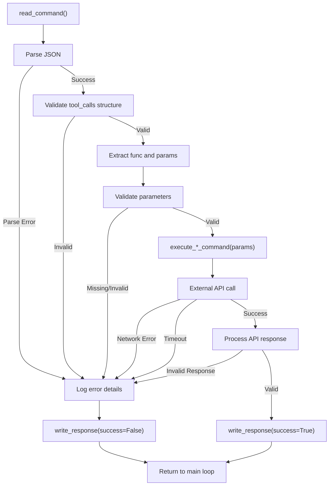
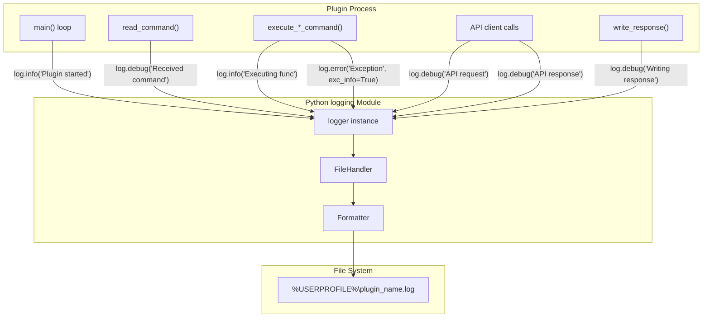
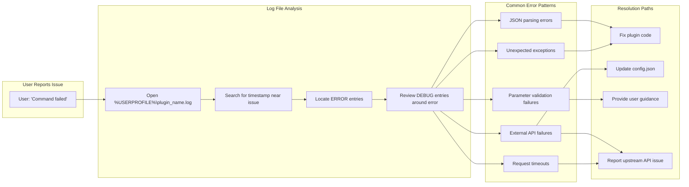

<!-- source: DeepWiki mcp.deepwiki.com · repo NVIDIA/G-Assist · page 5.5 Error Handling and Logging · fetched 2026-10-26 -->

# Error Handling and Logging

<details>
<summary>Relevant source files</summary>

The following files were used as context for generating this wiki page:

- [plugins/examples/stock/README.md](plugins/examples/stock/README.md)
- [plugins/examples/weather/README.md](plugins/examples/weather/README.md)

</details>


## Purpose and Scope

This document covers best practices for error handling and logging in G-Assist plugins. It details standard response formats, logging configuration, error handling patterns, and debugging strategies to ensure robust plugin behavior and maintainability. For information about implementing the core command handlers that use these patterns, see [Implementing Command Handlers](#5.3). For deployment considerations, see [Building and Deployment](#5.4).

## Standard Response Format

All plugin commands must return responses conforming to a standard JSON structure, regardless of success or failure. This ensures consistent handling by the G-Assist core system.

### Success Response Structure

```json
{
    "success": true,
    "message": "Human-readable result description"
}
```

### Failure Response Structure

```json
{
    "success": false,
    "message": "Descriptive error message for the user"
}
```

The response must be written to STDOUT followed by the `<<END>>` termination marker, as implemented in the `write_response()` function.

**Sources:** [plugins/examples/stock/README.md:110-113](), [plugins/examples/weather/README.md:90-93]()

## Error Handling Architecture

### Command Processing Error Flow



This diagram illustrates the complete error handling flow from command reception through response generation, showing all potential failure points and their handling paths.

**Sources:** [plugins/examples/weather/README.md:158-168](), [plugins/examples/stock/README.md:164-169]()

### Error Handling Patterns by Layer

| Layer | Error Type | Handling Strategy | Example |
|-------|-----------|-------------------|---------|
| **Command Parsing** | JSON decode errors | Log and return failure response | Invalid JSON structure from G-Assist |
| **Structure Validation** | Missing `tool_calls` | Log and return failure response | Malformed command object |
| **Parameter Validation** | Missing required params | Log and return user-friendly message | Missing `city` parameter in weather query |
| **Parameter Validation** | Type mismatch | Log and return type error message | String provided where integer expected |
| **External API** | Network timeout | Log full error, return timeout message | API takes >10 seconds to respond |
| **External API** | HTTP errors (4xx/5xx) | Log status code, return API error message | 404 Not Found, 500 Server Error |
| **External API** | Invalid response format | Log raw response, return parsing error | Unexpected JSON structure |
| **Unexpected Exceptions** | Any unhandled exception | Log full traceback, return generic error | Runtime exceptions |

**Sources:** [plugins/examples/weather/README.md:158-168](), [plugins/examples/stock/README.md:164-169]()

## Logging Configuration

### Log File Location Standards

Plugins must write log files to the user profile directory using the `%USERPROFILE%` environment variable:

```
%USERPROFILE%\<plugin_name>_plugin.log
```

**Examples:**
- Stock plugin: `%USERPROFILE%\stock_plugin.log`
- Weather plugin: `%USERPROFILE%\weather_plugin.log`

This location ensures:
- User-specific logs (multi-user systems)
- Write permissions without elevation
- Easy access for troubleshooting

**Sources:** [plugins/examples/stock/README.md:172](), [plugins/examples/weather/README.md:170]()

### Logging Setup Example

Plugins typically configure logging in the main initialization section:

```python
import logging
import os

log_file = os.path.join(os.environ.get('USERPROFILE', ''), 'plugin_name.log')
logging.basicConfig(
    filename=log_file,
    level=logging.DEBUG,  # or logging.INFO
    format='%(asctime)s - %(levelname)s - %(message)s'
)
```

For more detailed context, include file and line information:

```python
format='%(asctime)s - %(levelname)s - [%(filename)s:%(lineno)d] - %(message)s'
```

**Sources:** [plugins/examples/stock/README.md:172-174](), [plugins/examples/weather/README.md:170-172]()

### Logging Architecture



**Sources:** [plugins/examples/stock/README.md:172-179](), [plugins/examples/weather/README.md:170-179]()

## Comprehensive Error Handling Implementation

### Try-Except Block Structure

All command execution functions should wrap operations in try-except blocks with specific exception handlers:

```python
def execute_command(params):
    try:
        # Validate parameters
        if not params or 'required_param' not in params:
            logging.error("Missing required parameter: required_param")
            return {"success": False, "message": "Missing required parameter"}
        
        # Type validation
        param_value = params['required_param']
        if not isinstance(param_value, str):
            logging.error(f"Invalid type for parameter: {type(param_value)}")
            return {"success": False, "message": "Invalid parameter type"}
        
        # External API call
        response = api_client.call(param_value)
        
        # Response validation
        if not response or 'expected_field' not in response:
            logging.error(f"Invalid API response: {response}")
            return {"success": False, "message": "Failed to fetch data"}
        
        # Success path
        logging.info(f"Command executed successfully")
        return {"success": True, "message": format_result(response)}
        
    except requests.Timeout:
        logging.error("Request timed out", exc_info=True)
        return {"success": False, "message": "Request timed out, please try again"}
    
    except requests.RequestException as e:
        logging.error(f"API request failed: {e}", exc_info=True)
        return {"success": False, "message": "Failed to fetch data"}
    
    except Exception as e:
        logging.error(f"Unexpected error: {e}", exc_info=True)
        return {"success": False, "message": "An unexpected error occurred"}
```

**Sources:** [plugins/examples/weather/README.md:158-168](), [plugins/examples/stock/README.md:164-169]()

## Logging Event Categories

### Essential Events to Log

| Event Category | Log Level | Information to Include | Example |
|----------------|-----------|------------------------|---------|
| **Plugin Lifecycle** | INFO | Startup, shutdown, initialization | `"Plugin initialized successfully"` |
| **Command Reception** | DEBUG | Raw command JSON, timestamp | `"Received command: {json_str}"` |
| **Function Invocation** | INFO | Function name, parameters (sanitized) | `"Executing get_stock_price with ticker=NVDA"` |
| **Parameter Validation** | ERROR | Missing/invalid parameters, expected types | `"Missing required parameter: city"` |
| **API Requests** | DEBUG | Endpoint, method, parameters | `"GET https://api.example.com/data?param=value"` |
| **API Responses** | DEBUG | Status code, response size, latency | `"API response: 200 OK, 1.2s"` |
| **Error Conditions** | ERROR | Exception type, message, full traceback | `"RequestException: Connection timeout"` |
| **Response Generation** | DEBUG | Success status, message content | `"Sending response: success=True"` |

**Sources:** [plugins/examples/stock/README.md:175-179](), [plugins/examples/weather/README.md:173-179]()

### Sensitive Data Handling

Never log sensitive information:
- API keys or authentication tokens
- User credentials
- Personal identifiable information (PII)

Use sanitization when logging parameters:

```python
def sanitize_params(params):
    """Remove sensitive data before logging"""
    safe_params = params.copy()
    if 'api_key' in safe_params:
        safe_params['api_key'] = '***REDACTED***'
    if 'password' in safe_params:
        safe_params['password'] = '***REDACTED***'
    return safe_params

logging.debug(f"Parameters: {sanitize_params(params)}")
```

**Sources:** General security best practices inferred from plugin examples

## Error Message Best Practices

### User-Facing Error Messages

Error messages returned to users should be:

1. **Clear and Non-Technical**: Avoid stack traces or internal error codes
2. **Actionable**: Suggest what the user can do to resolve the issue
3. **Consistent**: Use similar phrasing across error types

#### Good Examples

| Situation | Good Message | Poor Message |
|-----------|-------------|--------------|
| Missing parameter | `"City name is required"` | `"KeyError: 'city' not found in params dict"` |
| API timeout | `"Request timed out, please try again"` | `"requests.exceptions.Timeout at line 45"` |
| Invalid API key | `"API key is invalid. Please check your configuration"` | `"401 Unauthorized"` |
| Rate limit exceeded | `"API limit reached. Please try again later"` | `"HTTP 429 Too Many Requests"` |
| Invalid ticker symbol | `"Could not find stock symbol for that company"` | `"Symbol lookup failed: None returned"` |

**Sources:** [plugins/examples/stock/README.md:164-169](), [plugins/examples/weather/README.md:158-168]()

### Internal Log Messages

Log messages for debugging should be:

1. **Detailed**: Include full context and data (sanitized)
2. **Searchable**: Use consistent prefixes and keywords
3. **Complete**: Include stack traces for exceptions using `exc_info=True`

```python
# Good logging examples
logging.info(f"Executing get_weather_info for city: {city}")
logging.debug(f"API request to {url} with params: {sanitize_params(params)}")
logging.error(f"Failed to parse API response: {response_text}", exc_info=True)
```

**Sources:** [plugins/examples/stock/README.md:175-179](), [plugins/examples/weather/README.md:173-179]()

## Debugging Strategies

### Error Flow Debugging Map



**Sources:** [plugins/examples/stock/README.md:83-95](), [plugins/examples/weather/README.md:67-74]()

### Log Analysis Checklist

When troubleshooting plugin issues:

1. **Locate the log file**: `%USERPROFILE%\<plugin_name>.log`
2. **Find the relevant time window**: Search for timestamps matching when the error occurred
3. **Identify the command**: Look for the command reception log entry
4. **Trace execution flow**: Follow DEBUG/INFO entries showing function calls
5. **Find the failure point**: Locate ERROR entries with exception details
6. **Check API interactions**: Review API request/response logs if applicable
7. **Examine parameter values**: Verify parameters were extracted correctly
8. **Review response sent**: Confirm what error message was returned to user

**Sources:** [plugins/examples/stock/README.md:83-95](), [plugins/examples/weather/README.md:67-74]()

## Implementation Checklist

### Error Handling Requirements

- [ ] All command execution functions wrapped in try-except blocks
- [ ] Specific exception handlers for expected error types
- [ ] Generic exception handler as final catch-all
- [ ] Parameter validation before processing
- [ ] Type checking for all parameters
- [ ] API response validation
- [ ] User-friendly error messages for all failure cases
- [ ] Detailed error logging with `exc_info=True`

### Logging Requirements

- [ ] Log file configured in `%USERPROFILE%` directory
- [ ] Log level set appropriately (DEBUG for development, INFO for production)
- [ ] Log format includes timestamp and level
- [ ] Plugin lifecycle events logged (startup, shutdown)
- [ ] All command invocations logged
- [ ] All API interactions logged
- [ ] All error conditions logged with full context
- [ ] Sensitive data sanitized before logging
- [ ] Log file location documented in README

**Sources:** [plugins/examples/stock/README.md:164-179](), [plugins/examples/weather/README.md:158-179]()

## Testing Error Handling

### Manual Error Testing

When developing or testing plugins, verify error handling by intentionally triggering error conditions:

1. **Missing parameters**: Omit required parameters from test commands
2. **Invalid types**: Send wrong parameter types (string instead of integer)
3. **Invalid values**: Use values that should trigger validation errors
4. **API failures**: Test with invalid API keys or unreachable endpoints
5. **Network issues**: Test behavior when network is unavailable
6. **Malformed responses**: Mock API responses with unexpected structures

Example test command for missing parameter:

```json
{
    "tool_calls": [{
        "func": "get_weather_info",
        "params": {}
    }]
}
```

Expected: Error logged and failure response returned with clear message about missing parameter.

**Sources:** [plugins/examples/stock/README.md:200-222](), [plugins/examples/weather/README.md:210-232]()

### Log Verification

After each test, verify:
1. Error was logged with appropriate level (ERROR)
2. Log message contains sufficient context to diagnose issue
3. User-facing error message is clear and actionable
4. Response format is valid JSON with `success: false`
5. Plugin continues to handle subsequent commands correctly

**Sources:** [plugins/examples/stock/README.md:172-179](), [plugins/examples/weather/README.md:170-179]()

---

