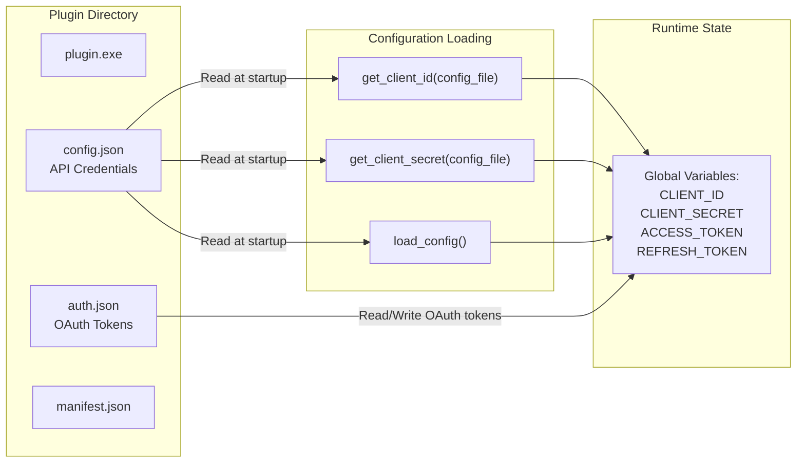
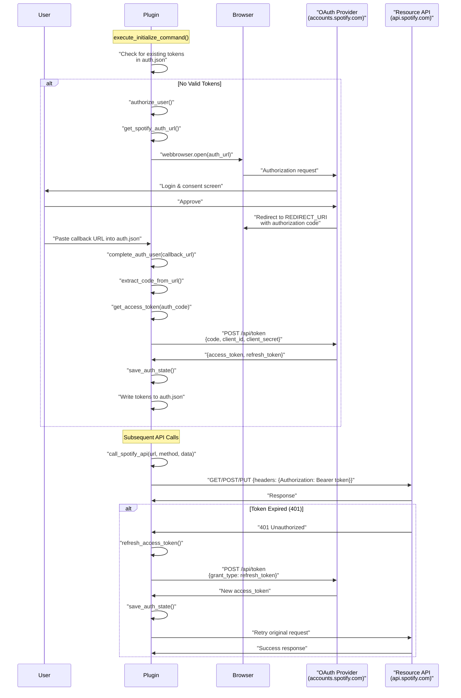
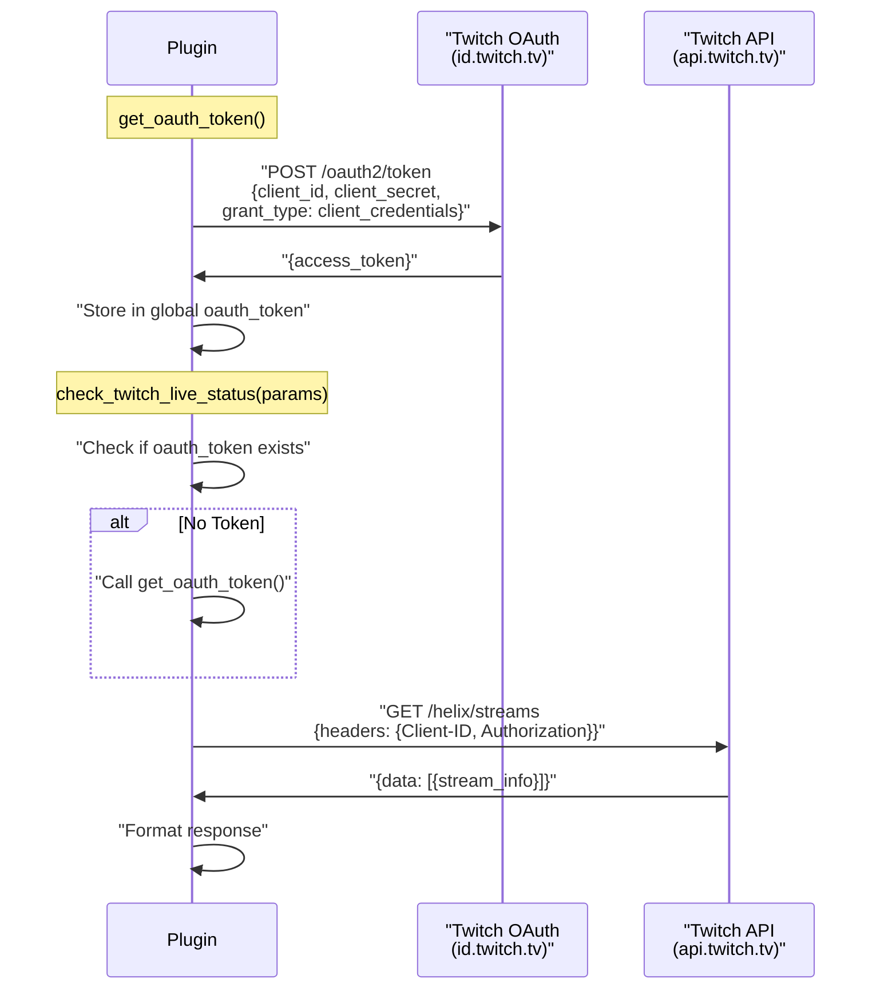
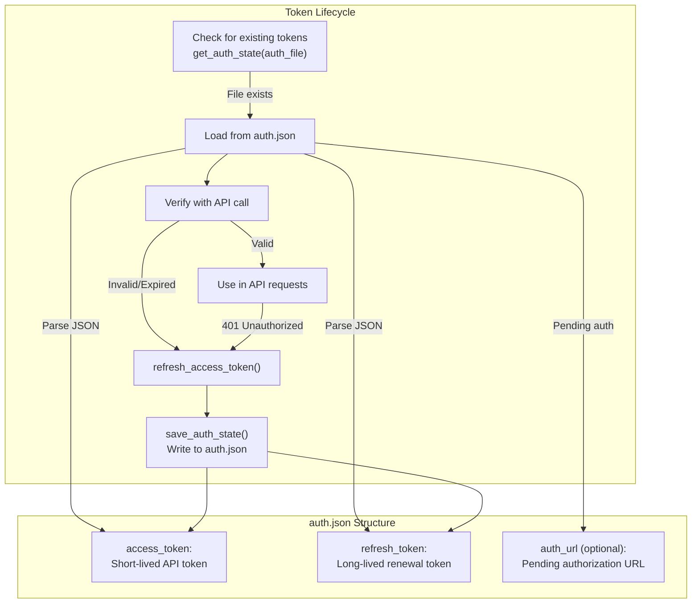
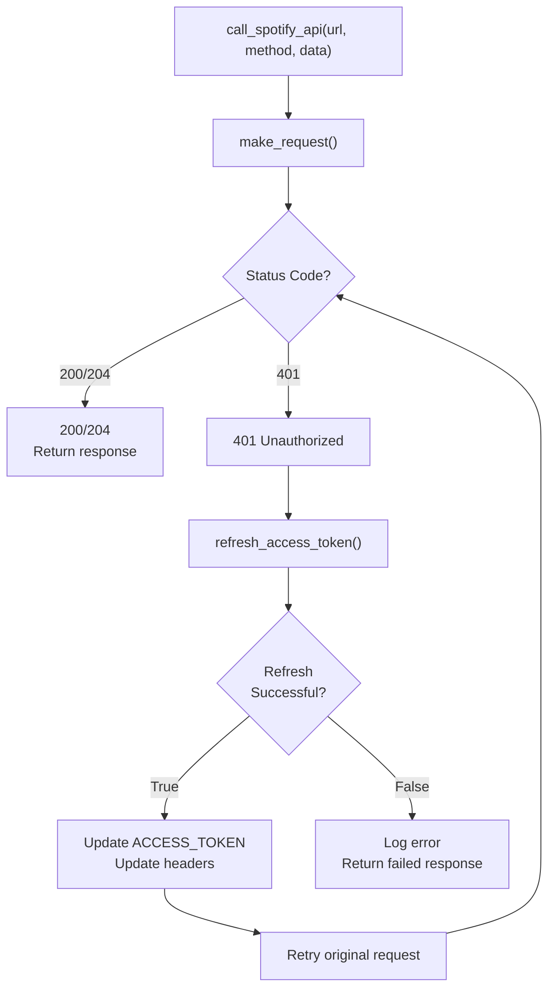
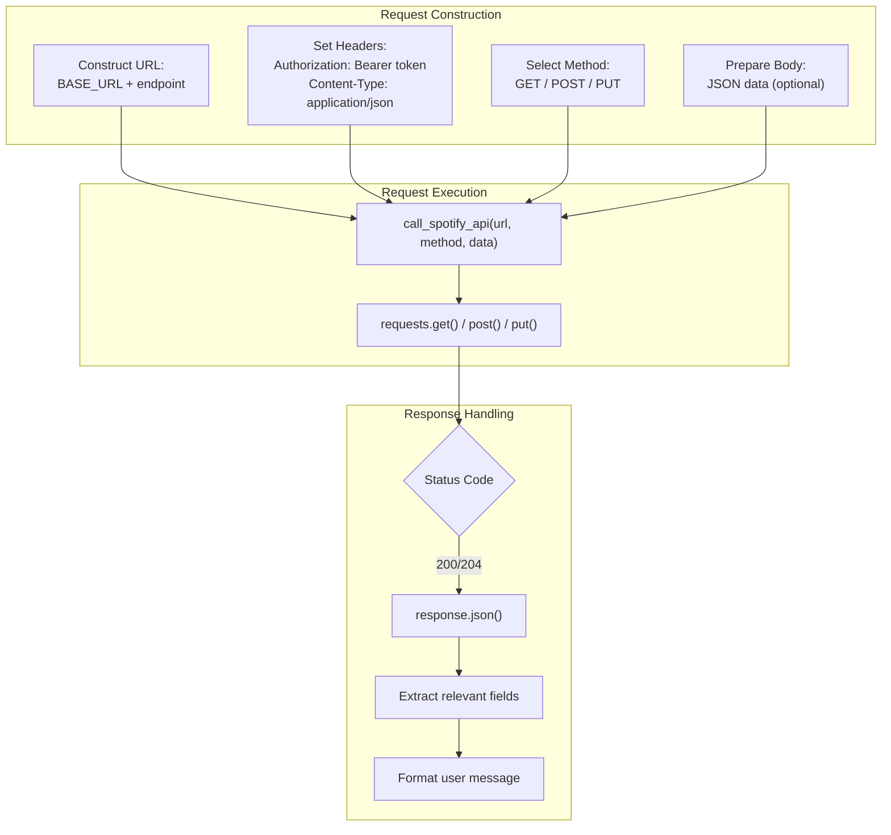
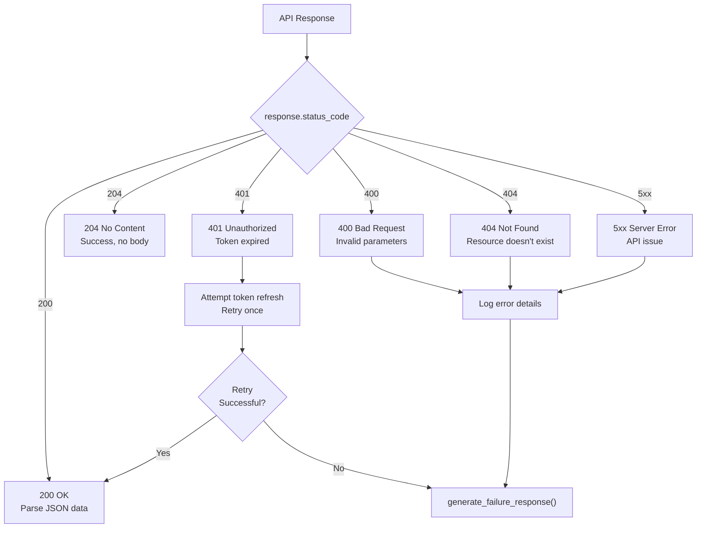

<!-- source: DeepWiki mcp.deepwiki.com · repo NVIDIA/G-Assist · page 5.6 External API Integration · fetched 2026-10-26 -->

# External API Integration

<details>
<summary>Relevant source files</summary>

The following files were used as context for generating this wiki page:

- [plugins/examples/spotify/README.md](plugins/examples/spotify/README.md)
- [plugins/examples/spotify/plugin.py](plugins/examples/spotify/plugin.py)
- [plugins/examples/twitch/plugin.py](plugins/examples/twitch/plugin.py)

</details>


## Purpose and Scope

This page documents patterns and best practices for integrating G-Assist plugins with external APIs. It covers authentication mechanisms (OAuth 2.0, API keys), credential storage, token management, request handling, and error recovery strategies.

For information about the overall plugin architecture and manifest structure, see [Plugin Architecture](#3.2). For details on implementing command handlers that use these APIs, see [Implementing Command Handlers](#5.3).

---

## Configuration Management

External API credentials are stored in `config.json` files within each plugin's directory at `%PROGRAMDATA%\NVIDIA Corporation\nvtopps\rise\plugins\<plugin-name>\config.json`.

### Configuration File Structure



**Spotify Configuration Example**

[plugins/examples/spotify/plugin.py:142-143]() defines the configuration file path:

```python
CONFIG_FILE = os.path.join(os.environ.get("PROGRAMDATA", "."), 
    "NVIDIA Corporation", "nvtopps", "rise", "plugins", "spotify", "config.json")
```

The configuration contains API credentials:

```json
{
    "client_id": "your_spotify_client_id",
    "client_secret": "your_spotify_client_secret",
    "username": "your_spotify_username"
}
```

Configuration is loaded via helper functions [plugins/examples/spotify/plugin.py:328-377]():
- `get_client_id(config_file)` - Extracts `client_id` from configuration
- `get_client_secret(config_file)` - Extracts `client_secret` from configuration  
- `get_username(config_file)` - Extracts `username` from configuration

**Twitch Configuration Example**

[plugins/examples/twitch/plugin.py:50-54]() defines the configuration path and [plugins/examples/twitch/plugin.py:90-112]() implements `load_config()`:

```json
{
    "TWITCH_CLIENT_ID": "your_twitch_client_id",
    "TWITCH_CLIENT_SECRET": "your_twitch_client_secret"
}
```

**Sources:** [plugins/examples/spotify/plugin.py:142-143](), [plugins/examples/spotify/plugin.py:328-377](), [plugins/examples/twitch/plugin.py:50-54](), [plugins/examples/twitch/plugin.py:90-112]()

---

## Authentication Patterns

### OAuth 2.0 Authorization Code Flow

Used when plugins need to act on behalf of users and access their private data. The Spotify plugin demonstrates this pattern.



**Key Functions**

| Function | Location | Purpose |
|----------|----------|---------|
| `get_spotify_auth_url()` | [plugins/examples/spotify/plugin.py:30-40]() | Generates OAuth authorization URL with client_id, redirect_uri, and scopes |
| `authorize_user()` | [plugins/examples/spotify/plugin.py:72-79]() | Opens browser to authorization URL |
| `extract_code_from_url()` | [plugins/examples/spotify/plugin.py:42-48]() | Parses authorization code from callback URL |
| `get_access_token()` | [plugins/examples/spotify/plugin.py:50-70]() | Exchanges authorization code for access/refresh tokens |
| `complete_auth_user()` | [plugins/examples/spotify/plugin.py:82-119]() | Orchestrates token exchange and storage |
| `save_auth_state()` | [plugins/examples/spotify/plugin.py:1121-1143]() | Persists tokens to `auth.json` |

**Authorization Constants** [plugins/examples/spotify/plugin.py:17-23]():
- `REDIRECT_URI` - OAuth redirect endpoint (e.g., "https://open.spotify.com")
- `SCOPE` - Requested permissions (e.g., "user-library-read user-modify-playback-state")
- `AUTHORIZATION_URL` - "https://accounts.spotify.com/authorize"
- `AUTH_URL` - "https://accounts.spotify.com/api/token"

**Sources:** [plugins/examples/spotify/plugin.py:30-70](), [plugins/examples/spotify/plugin.py:72-119](), [plugins/examples/spotify/plugin.py:1121-1143](), [plugins/examples/spotify/README.md:90-120]()

---

### OAuth 2.0 Client Credentials Flow

Used when plugins need application-level access without user-specific data. The Twitch plugin demonstrates this pattern.



**Key Functions**

| Function | Location | Purpose |
|----------|----------|---------|
| `get_oauth_token()` | [plugins/examples/twitch/plugin.py:126-154]() | Obtains OAuth token using client credentials |
| `check_twitch_live_status()` | [plugins/examples/twitch/plugin.py:171-235]() | Uses token to query Twitch API |

**Authentication Flow** [plugins/examples/twitch/plugin.py:126-154]():

1. **Request Token**: POST to `TWITCH_OAUTH_URL` with client credentials
2. **Cache Token**: Store in global `oauth_token` variable
3. **Use Token**: Include in `Authorization: Bearer {token}` header
4. **Refresh**: Client credentials tokens don't expire frequently; re-request if needed

**Global State** [plugins/examples/twitch/plugin.py:68-69]():
```python
oauth_token: Optional[str] = None  # Cached OAuth token
```

**Sources:** [plugins/examples/twitch/plugin.py:126-154](), [plugins/examples/twitch/plugin.py:171-235](), [plugins/examples/twitch/plugin.py:60-64]()

---

## Token Management and Storage

### Token Storage Pattern



**Token File Location**

Both Spotify and Twitch plugins use `auth.json` in the plugin directory:
- Spotify: `%PROGRAMDATA%\NVIDIA Corporation\nvtopps\rise\plugins\spotify\auth.json`
- Twitch: Tokens stored in memory (client credentials pattern)

**Spotify Token Storage** [plugins/examples/spotify/plugin.py:1121-1143]():

```python
def save_auth_state(access_token: str, refresh_token: str) -> None:
    auth_file = os.path.join(os.environ.get("PROGRAMDATA", "."), 
        "NVIDIA Corporation", "nvtopps", "rise", "plugins", "spotify", "auth.json")
    os.makedirs(os.path.dirname(auth_file), exist_ok=True)
    data = {
        'access_token': access_token,
        'refresh_token': refresh_token
    }
    with open(auth_file, 'w') as file:
        json.dump(data, file, indent=2)
```

**Token Loading** [plugins/examples/spotify/plugin.py:266-325]():

The `get_auth_state()` function:
1. Checks if `auth.json` exists
2. Parses JSON content
3. Handles pending `auth_url` if present (processes OAuth callback)
4. Returns tuple of `(access_token, refresh_token)`

**Sources:** [plugins/examples/spotify/plugin.py:266-325](), [plugins/examples/spotify/plugin.py:1121-1143]()

---

### Token Refresh Logic



**Automatic Token Refresh** [plugins/examples/spotify/plugin.py:499-554]():

The `call_spotify_api()` function implements automatic retry:

```python
def call_spotify_api(url: str, request_method: str, data) -> Response:
    headers = {"Authorization": f"Bearer {ACCESS_TOKEN}"}
    
    # Make initial request
    response = make_request()
    
    # If we get a 401, try refreshing the token and retry once
    if response.status_code == 401:
        if refresh_access_token():
            headers["Authorization"] = f"Bearer {ACCESS_TOKEN}"
            response = make_request()  # Retry with new token
    
    return response
```

**Refresh Token Implementation** [plugins/examples/spotify/plugin.py:1078-1119]():

```python
def refresh_access_token() -> bool:
    global ACCESS_TOKEN
    global REFRESH_TOKEN
    
    token_response = requests.post(
        AUTH_URL,
        data={
            "grant_type": "refresh_token",
            "refresh_token": REFRESH_TOKEN,
            "client_id": CLIENT_ID,
            "client_secret": CLIENT_SECRET,
        },
        headers={"Content-Type": "application/x-www-form-urlencoded"}
    )
    
    if token_response.status_code != 200:
        return False
    
    token_data = token_response.json()
    ACCESS_TOKEN = token_data['access_token']
    save_auth_state(ACCESS_TOKEN, REFRESH_TOKEN)
    return True
```

**Sources:** [plugins/examples/spotify/plugin.py:499-554](), [plugins/examples/spotify/plugin.py:1078-1119]()

---

## Making API Requests

### HTTP Request Patterns



**Spotify API Request Pattern** [plugins/examples/spotify/plugin.py:499-554]():

```python
def call_spotify_api(url: str, request_method: str, data) -> Response:
    headers = {"Authorization": f"Bearer {ACCESS_TOKEN}"}
    full_url = f"{BASE_URL}{url}"
    
    if request_method == 'GET':
        return requests.get(full_url, headers=headers)
    elif request_method == 'POST':
        return requests.post(full_url, headers=headers)
    elif request_method == 'PUT':
        headers["Content-Type"] = "application/json"
        if data != None:
            return requests.put(full_url, headers=headers, json=data)
        else: 
            return requests.put(full_url, headers=headers)
```

**Constants** [plugins/examples/spotify/plugin.py:23]():
```python
BASE_URL = "https://api.spotify.com/v1"
```

### Common API Operations

| Operation | Method | Example Function | Location |
|-----------|--------|------------------|----------|
| Get User Data | GET | `get_user_id()` | [plugins/examples/spotify/plugin.py:556-568]() |
| Get Device List | GET | `get_device()` | [plugins/examples/spotify/plugin.py:579-604]() |
| Search Content | GET | `get_track_uri()`, `get_album_uri()` | [plugins/examples/spotify/plugin.py:614-688]() |
| Control Playback | PUT | `execute_play_command()` | [plugins/examples/spotify/plugin.py:828-877]() |
| Modify State | PUT | `execute_pause_command()` | [plugins/examples/spotify/plugin.py:879-896]() |
| Skip Track | POST | `execute_next_track_command()` | [plugins/examples/spotify/plugin.py:898-915]() |

**Twitch API Request Pattern** [plugins/examples/twitch/plugin.py:171-235]():

```python
def check_twitch_live_status(params: Dict[str, str]) -> Response:
    headers = {
        "Client-ID": config.get("TWITCH_CLIENT_ID", ""),
        "Authorization": f"Bearer {oauth_token}"
    }
    response = requests.get(
        TWITCH_STREAM_URL,
        headers=headers,
        params={"user_login": username}
    )
    response_data = response.json()
    
    if "data" in response_data and response_data["data"]:
        stream_info = response_data["data"][0]
        # Process stream info
```

**Sources:** [plugins/examples/spotify/plugin.py:499-554](), [plugins/examples/spotify/plugin.py:556-688](), [plugins/examples/twitch/plugin.py:171-235]()

---

## Error Handling and Retry Logic

### Response Status Code Handling



**Status Code Handling Examples**

**Spotify Playback Commands** [plugins/examples/spotify/plugin.py:872-877]():
```python
if response is not None and (response.status_code == 204 or response.status_code == 200): 
    return generate_success_response({ 'message': 'Playback successfully started.' })
else: 
    return generate_failure_response({ 'message': f'Playback Error: {response}' })
```

**Twitch Stream Check** [plugins/examples/twitch/plugin.py:219-231]():
```python
if "data" in response_data and response_data["data"]:
    stream_info = response_data["data"][0]
    return generate_response(True, f"{username} is LIVE!\n...")
return generate_response(True, f"{username} is OFFLINE")
```

### Exception Handling Pattern

All API operation functions follow a try-except pattern:

**Spotify Command Handler** [plugins/examples/spotify/plugin.py:847-877]():
```python
def execute_play_command(params: dict) -> dict:
    try:
        device = get_device_id()
        uri = get_track_uri(params)
        response = call_spotify_api(url, request_method='PUT', data=body)
        
        if response.status_code == 204 or response.status_code == 200: 
            return generate_success_response({ 'message': 'Playback successfully started.' })
        else: 
            return generate_failure_response({ 'message': f'Playback Error: {response}' })
    except Exception as e:
        return generate_failure_response({ 'message': f'Playback Error: {e}' })
```

**Logging Errors** [plugins/examples/spotify/plugin.py:14-15]():
```python
LOG_FILE = os.path.join(os.environ.get("USERPROFILE", "."), 'spotify-plugin.log')
logging.basicConfig(filename=LOG_FILE, level=logging.INFO, format="%(asctime)s - %(levelname)s - %(message)s")
```

All errors are logged with context:
- [plugins/examples/spotify/plugin.py:633-635]() - Search errors
- [plugins/examples/spotify/plugin.py:551-552]() - API request failures
- [plugins/examples/twitch/plugin.py:234]() - API request exceptions

**Sources:** [plugins/examples/spotify/plugin.py:847-877](), [plugins/examples/spotify/plugin.py:872-877](), [plugins/examples/twitch/plugin.py:219-235](), [plugins/examples/spotify/plugin.py:14-15]()

---

## Best Practices

### Security Considerations

| Practice | Implementation | Example |
|----------|----------------|---------|
| **Never Hardcode Credentials** | Store in `config.json` | [plugins/examples/spotify/plugin.py:142]() |
| **Use Environment-Specific Paths** | Use `os.environ.get("PROGRAMDATA")` | [plugins/examples/spotify/plugin.py:142-143]() |
| **Secure Token Storage** | File permissions on `auth.json` | [plugins/examples/spotify/plugin.py:1121-1143]() |
| **Log Security Events** | Log authentication attempts | [plugins/examples/spotify/plugin.py:94]() |
| **Handle Token Expiry** | Automatic refresh on 401 | [plugins/examples/spotify/plugin.py:538-546]() |

### API Request Best Practices

1. **Use Global Constants for URLs** [plugins/examples/spotify/plugin.py:21-23]():
   ```python
   AUTHORIZATION_URL = "https://accounts.spotify.com/authorize"
   AUTH_URL = "https://accounts.spotify.com/api/token"
   BASE_URL = "https://api.spotify.com/v1"
   ```

2. **Centralize API Calls** [plugins/examples/spotify/plugin.py:499]():
   - Single function handles all HTTP methods
   - Consistent error handling
   - Automatic token refresh

3. **Parse and Validate Parameters** [plugins/examples/twitch/plugin.py:199-205]():
   ```python
   username = params.get("username")
   if not username:
       return generate_response(False, "Missing required parameter: username")
   ```

4. **Strip Non-ASCII Characters** [plugins/examples/spotify/plugin.py:1066]():
   ```python
   playlists = list(map(lambda s: ''.join(char for char in s['name'] if ord(char) < 128), items))
   ```

5. **Provide User-Friendly Messages** [plugins/examples/twitch/plugin.py:224-230]():
   ```python
   return generate_response(True, 
       f"{username} is LIVE!\n"
       f"Title: {title}\n"
       f"Game: {game_name}\n"
       f"Viewers: {stream_info['viewer_count']}"
   )
   ```

### Testing API Integration

**Manual Testing Flow** [plugins/examples/spotify/README.md:259-277]():

1. Run plugin directly: `python plugin.py`
2. Send test commands via stdin as JSON
3. Verify responses via stdout
4. Check log file for detailed traces

**Example Test Command**:
```json
{
    "tool_calls": [{
        "func": "spotify_start_playback",
        "params": {
            "type": "track",
            "name": "Yesterday",
            "artist": "The Beatles"
        }
    }]
}
```

### Common Integration Patterns

| Pattern | Use Case | Example Plugin |
|---------|----------|----------------|
| **OAuth Authorization Code** | User-specific data access | Spotify [plugins/examples/spotify/plugin.py:30-119]() |
| **OAuth Client Credentials** | Application-level access | Twitch [plugins/examples/twitch/plugin.py:126-154]() |
| **API Key Authentication** | Simple service APIs | Weather (not shown in provided files) |
| **Search and URI Resolution** | Content lookup before action | Spotify search functions [plugins/examples/spotify/plugin.py:614-711]() |
| **Device Management** | Multi-device control | Spotify device functions [plugins/examples/spotify/plugin.py:579-612]() |
| **Cached Tokens** | Minimize auth requests | Global token variables [plugins/examples/spotify/plugin.py:25-27]() |

**Sources:** [plugins/examples/spotify/plugin.py:499-554](), [plugins/examples/spotify/plugin.py:21-23](), [plugins/examples/spotify/plugin.py:1066](), [plugins/examples/twitch/plugin.py:199-205](), [plugins/examples/spotify/README.md:259-277]()

---

## Related Topics

- For overall plugin structure and files, see [Plugin Structure and Files](#5.2)
- For command handler implementation, see [Implementing Command Handlers](#5.3)
- For error handling and logging, see [Error Handling and Logging](#5.5)
- For complete examples, see [Spotify Plugin](#6.1) and [Twitch Plugin](#6.3)

---

