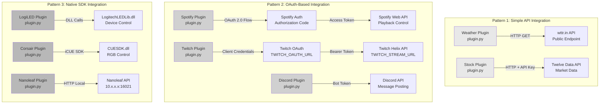
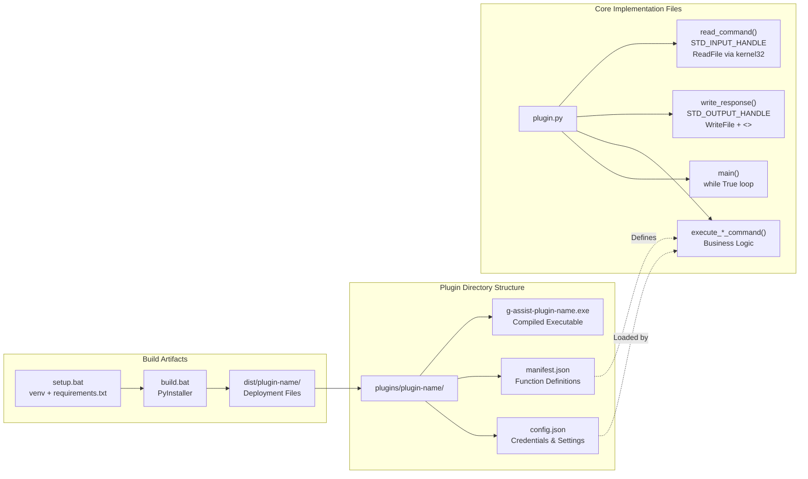
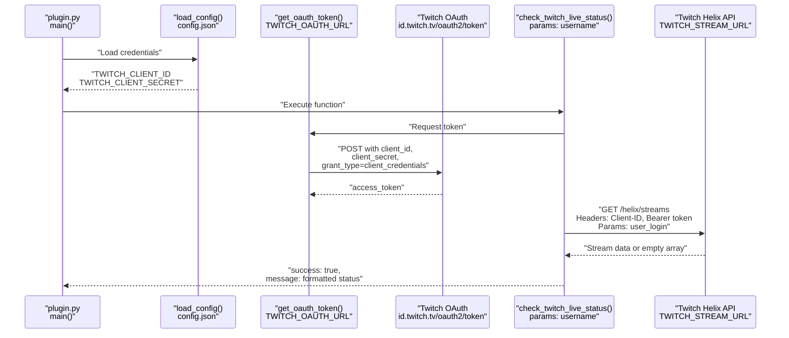
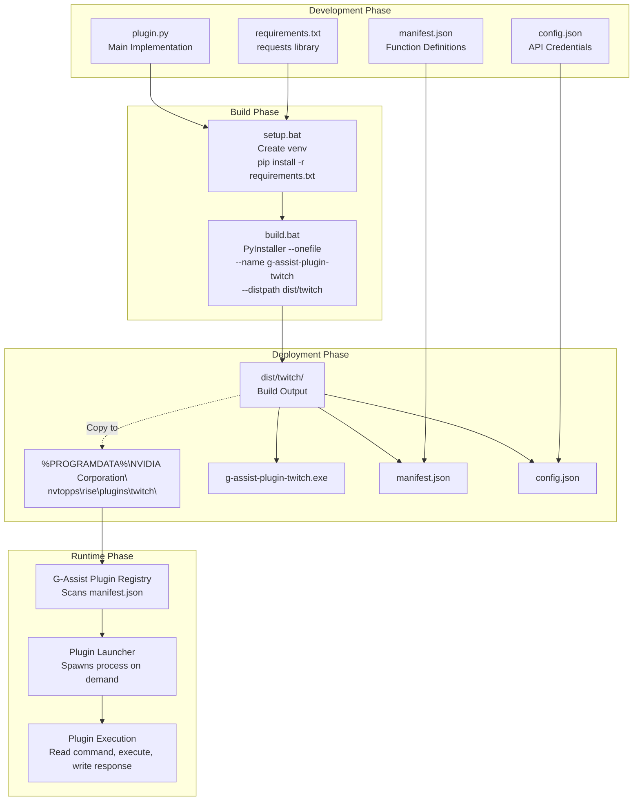

<!-- source: DeepWiki mcp.deepwiki.com · repo NVIDIA/G-Assist · page 6 Plugin Examples · fetched 2026-10-26 -->

# Plugin Examples

<details>
<summary>Relevant source files</summary>

The following files were used as context for generating this wiki page:

- [README.md](README.md)
- [api/bindings/python/README.md](api/bindings/python/README.md)
- [plugins/examples/twitch/README.md](plugins/examples/twitch/README.md)

</details>


This document provides detailed walkthroughs of the example plugins included with G-Assist, demonstrating different integration patterns and implementation approaches. These examples serve as reference implementations for common plugin development scenarios.

For general plugin development concepts and architecture, see [Plugin Architecture](#3.2). For step-by-step development instructions, see [Plugin Development Guide](#5). For building new plugins from scratch, see [Quick Start with Plugin Builder](#5.1).

## Overview of Example Plugins

The G-Assist repository includes several example plugins demonstrating different integration patterns:

| Plugin | Type | Persistent | Integration Pattern | Primary Use Case |
|--------|------|------------|-------------------|------------------|
| Spotify | Media Control | No | OAuth 2.0 + REST API | Music playback control |
| Gemini | AI/Search | No | API Key + LLM Integration | Web search and AI queries |
| Twitch | Information Service | No | OAuth Client Credentials | Stream status checking |
| Weather | Information Service | No | Public HTTP API | Weather information retrieval |
| Stock | Financial Data | No | API Key + REST API | Stock market data |
| Discord | Communication | No | Bot Token + Webhook | Message and media sharing |
| LogiLED | Hardware Control | Yes | Native SDK | Logitech device lighting |
| Corsair iCUE | Hardware Control | Yes | Native SDK | Corsair peripheral lighting |
| Nanoleaf | Smart Home | Yes | Local API + Token | Smart lighting control |

**Sources:** [README.md:193-201]()

## Plugin Architecture Patterns

The example plugins demonstrate three primary architectural patterns:



**Pattern Characteristics:**

- **Simple API Integration**: No authentication or API key only, single HTTP request pattern
- **OAuth-Based Integration**: Multi-step authentication flow, token management required
- **Native SDK Integration**: Direct hardware control via manufacturer SDKs, typically persistent processes

**Sources:** [README.md:193-201](), [plugins/examples/twitch/README.md:1-500]()

## Common Plugin Structure

All plugins follow a consistent file structure and communication pattern:



**Core Functions Present in All Plugins:**

- `read_command()`: Reads JSON from stdin pipe using Windows API [plugins/examples/twitch/README.md:302-343]()
- `write_response()`: Writes JSON response with `<<END>>` marker [plugins/examples/twitch/README.md:345-367]()
- `execute_*_command()`: Plugin-specific business logic
- `main()`: Main execution loop handling tool_calls [plugins/examples/twitch/README.md:272-295]()

**Sources:** [README.md:141-161](), [plugins/examples/twitch/README.md:90-97]()

## Twitch Plugin

The Twitch plugin demonstrates OAuth client credentials flow and REST API integration for checking streamer status.

### Implementation Overview

**Invocation Examples:**
```
"Hey Twitch, is Ninja live?"
"Check if shroud is streaming"
"Is pokimane online right now?"
```

### Manifest Configuration

The Twitch plugin defines a single function in its manifest:

**Function Definition:** [plugins/examples/twitch/README.md:103-122]()

```json
{
  "manifestVersion": 1,
  "executable": "g-assist-plugin-twitch.exe",
  "persistent": false,
  "functions": [{
    "name": "check_twitch_live_status",
    "description": "Checks if a Twitch user is live and retrieves stream details.",
    "tags": ["twitch", "live_status"],
    "properties": {
      "username": {
        "type": "string",
        "description": "The Twitch username to check."
      }
    }
  }]
}
```

**Key Configuration:**
- `persistent: false` - Plugin spawns per-request
- Single function with string parameter
- Tags enable zero-shot function calling

**Sources:** [plugins/examples/twitch/README.md:102-122]()

### Authentication Flow



**Authentication Implementation:**

The `get_oauth_token()` function implements OAuth client credentials flow [plugins/examples/twitch/README.md:195-210]():

```python
def get_oauth_token():
    response = requests.post(
        TWITCH_OAUTH_URL,
        params={
            "client_id": config.get("TWITCH_CLIENT_ID"),
            "client_secret": config.get("TWITCH_CLIENT_SECRET"),
            "grant_type": "client_credentials"
        }
    )
    return response.json().get("access_token")
```

**Sources:** [plugins/examples/twitch/README.md:182-210](), [plugins/examples/twitch/README.md:124-130]()

### Stream Status Checking

The `check_twitch_live_status()` function queries the Twitch Helix API [plugins/examples/twitch/README.md:230-259]():

**Request Format:**
- Headers: `Client-ID` and `Authorization: Bearer <token>`
- Endpoint: `https://api.twitch.tv/helix/streams`
- Query Parameter: `user_login=<username>`

**Response Handling:**
- Live stream: Returns stream details (title, game, viewer count, start time)
- Offline: Returns empty `data` array

**Response Format:** [plugins/examples/twitch/README.md:262-268]()
```json
{
  "success": true,
  "message": "ninja is LIVE!\nTitle: Friday Fortnite!\nGame: Fortnite\nViewers: 45,231"
}
```

**Sources:** [plugins/examples/twitch/README.md:213-259]()

### Windows Pipe Communication

The Twitch plugin demonstrates the standard pipe communication pattern used by all plugins:

**Constants:** [plugins/examples/twitch/README.md:374-379]()
```python
STD_INPUT_HANDLE = -10
STD_OUTPUT_HANDLE = -11
BUFFER_SIZE = 4096
```

**Reading Commands:** [plugins/examples/twitch/README.md:302-343]()

The `read_command()` function:
1. Gets stdin handle via `GetStdHandle(STD_INPUT_HANDLE)`
2. Reads data in chunks using `ReadFile`
3. Accumulates chunks until `message_bytes.value < BUFFER_SIZE`
4. Parses accumulated data as JSON

**Writing Responses:** [plugins/examples/twitch/README.md:345-367]()

The `write_response()` function:
1. Serializes response dictionary to JSON
2. Appends `<<END>>` termination marker
3. Writes to stdout using `WriteFile` via `GetStdHandle(STD_OUTPUT_HANDLE)`

**Command Format Expected:** [plugins/examples/twitch/README.md:381-391]()
```json
{
  "tool_calls": [{
    "func": "check_twitch_live_status",
    "params": {
      "username": "nvidia"
    }
  }]
}
```

**Sources:** [plugins/examples/twitch/README.md:297-402]()

### Main Execution Loop

The main loop handles continuous command processing [plugins/examples/twitch/README.md:272-295]():

```python
def main():
    setup_logging()
    logging.info("Twitch Plugin Started")
    
    while True:
        command = read_command()
        if command is None:
            continue
        
        for tool_call in command.get("tool_calls", []):
            func = tool_call.get("func")
            params = tool_call.get("params", {})
            
            if func == "check_twitch_live_status":
                response = check_twitch_live_status(params)
                write_response(response)
            elif func == "shutdown":
                return
```

**Key Behaviors:**
- Infinite loop for non-persistent plugins (handles single request then exits)
- Iterates over `tool_calls` array to support batch operations
- Special `shutdown` function for graceful termination
- Error handling via None checks

**Sources:** [plugins/examples/twitch/README.md:270-295]()

### Logging Configuration

The plugin logs to user-specific location [plugins/examples/twitch/README.md:152-169]():

**Log File Location:**
```python
LOG_FILE = os.path.join(os.environ.get("USERPROFILE", "."), 'twitch.log')
```

**Logging Setup:**
```python
def setup_logging():
    logging.basicConfig(
        filename=LOG_FILE,
        level=logging.INFO,
        format="%(asctime)s - %(levelname)s - %(message)s"
    )
```

**Log File Path:** `%USERPROFILE%\twitch.log` [plugins/examples/twitch/README.md:92-96]()

**Sources:** [plugins/examples/twitch/README.md:152-178](), [README.md:86-87]()

### Build and Deployment Process



**Build Script Modifications Required:** [plugins/examples/twitch/README.md:454-477]()

1. Set plugin directory name:
```batch
set PLUGIN_DIR=%DIST_DIR%\twitch
```

2. Set executable name to match manifest:
```batch
pyinstaller --onefile --name g-assist-plugin-twitch --distpath "%PLUGIN_DIR%" plugin.py
```

**Deployment Location:**
```
%PROGRAMDATA%\NVIDIA Corporation\nvtopps\rise\plugins\twitch\
```

**Sources:** [plugins/examples/twitch/README.md:38-59](), [plugins/examples/twitch/README.md:449-485]()

## Other Example Plugins

### Spotify Plugin

The Spotify plugin demonstrates full OAuth 2.0 authorization code flow with PKCE for music playback control.

**Key Features:**
- OAuth 2.0 Authorization Code flow with PKCE
- Playback control (play, pause, skip, volume)
- Playlist management
- Search functionality

**Integration Pattern:** OAuth-based with user authorization requiring browser-based consent flow.

For detailed implementation, see [Spotify Plugin](#6.1).

**Sources:** [README.md:200]()

### Gemini AI Plugin

The Gemini plugin integrates Google's Gemini AI for web search and LLM queries.

**Key Features:**
- Web search classification
- LLM query routing
- Google AI API integration
- Search result processing

**Integration Pattern:** API key-based authentication with LLM endpoint integration.

For detailed implementation, see [Gemini AI Plugin](#6.2).

**Sources:** [README.md:195]()

### Weather Plugin

The Weather plugin demonstrates simple HTTP API integration using the wttr.in service.

**Key Features:**
- Location-based weather queries
- Public API (no authentication required)
- Simple request-response pattern

**Integration Pattern:** Public HTTP API with no authentication.

For detailed implementation, see [Weather Plugin](#6.4).

**Sources:** [README.md:23]()

### Stock Market Plugin

The Stock plugin provides financial market data via the Twelve Data API.

**Key Features:**
- Real-time stock quotes
- Market data retrieval
- API key authentication

**Integration Pattern:** REST API with API key authentication.

For detailed implementation, see [Stock Market Plugin](#6.5).

**Sources:** [README.md:23]()

### Discord Plugin

The Discord plugin enables sending messages, charts, and media to Discord channels.

**Key Features:**
- Message posting
- Chart/graph sharing
- Media file uploads
- Webhook and bot token support

**Integration Pattern:** Bot token authentication with Discord API.

For detailed implementation, see [Discord Plugin](#6.6).

**Sources:** [README.md:23]()

### Hardware Control Plugins

#### LogiLED Plugin

Controls Logitech peripheral lighting via the Logitech LED SDK.

**Key Features:**
- Keyboard lighting control
- Color setting and effects
- Native DLL integration

**Characteristics:**
- `persistent: true` - Remains running for responsive control
- Direct hardware access via LogitechLEDLib.dll
- RGB color parameter handling

For detailed implementation, see [Hardware Control Plugins](#6.7).

**Sources:** [README.md:196]()

#### Corsair iCUE Plugin

Controls Corsair peripheral RGB lighting through the iCUE SDK.

**Key Features:**
- Multi-device RGB control
- iCUE SDK integration
- Lighting effect management

**Characteristics:**
- `persistent: true` - Background process for immediate response
- Native SDK calls via CUESDK.dll

For detailed implementation, see [Hardware Control Plugins](#6.7).

**Sources:** [README.md:197]()

#### Nanoleaf Plugin

Controls Nanoleaf smart lighting panels via local network API.

**Key Features:**
- Smart lighting control
- Local network communication
- Scene and brightness management

**Characteristics:**
- `persistent: true` - Maintains connection to devices
- Local HTTP API (10.x.x.x:16021)
- Token-based authentication

For detailed implementation, see [Hardware Control Plugins](#6.7).

**Sources:** [README.md:198]()

## Plugin Development Patterns Summary

| Pattern | Authentication | Persistence | Example Use Case |
|---------|---------------|-------------|------------------|
| Simple HTTP | None or API Key | Non-persistent | Weather data retrieval |
| OAuth Client Credentials | Client ID/Secret | Non-persistent | Twitch status checking |
| OAuth Authorization Code | User consent flow | Non-persistent | Spotify playback control |
| Bot Token | Static token | Non-persistent | Discord messaging |
| Native SDK | SDK initialization | Persistent | Hardware RGB control |
| Local Network | Token/Key | Persistent | Smart home device control |

**Choosing a Pattern:**
- **Simple HTTP**: Public APIs or simple API key authentication
- **OAuth Client Credentials**: App-level access without user interaction
- **OAuth Authorization Code**: User-specific data access requiring consent
- **Bot Token**: Service integration with static credentials
- **Native SDK**: Direct hardware/software control requiring low latency
- **Local Network**: Local device control over LAN

**Sources:** [plugins/examples/twitch/README.md:1-500](), [README.md:193-201]()

---

