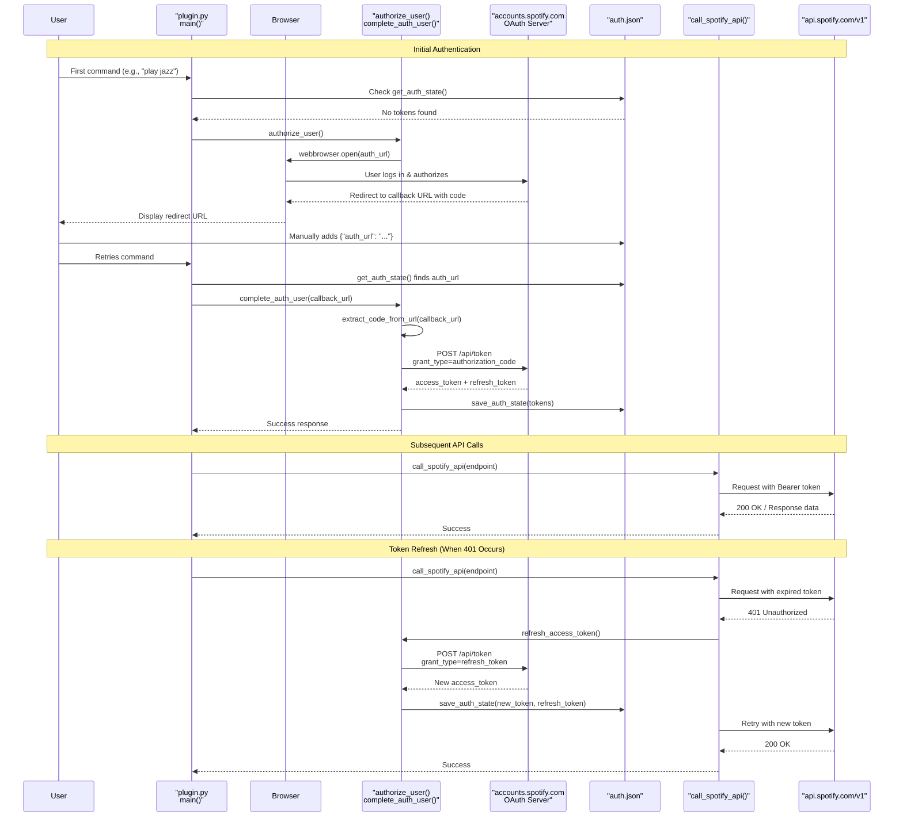
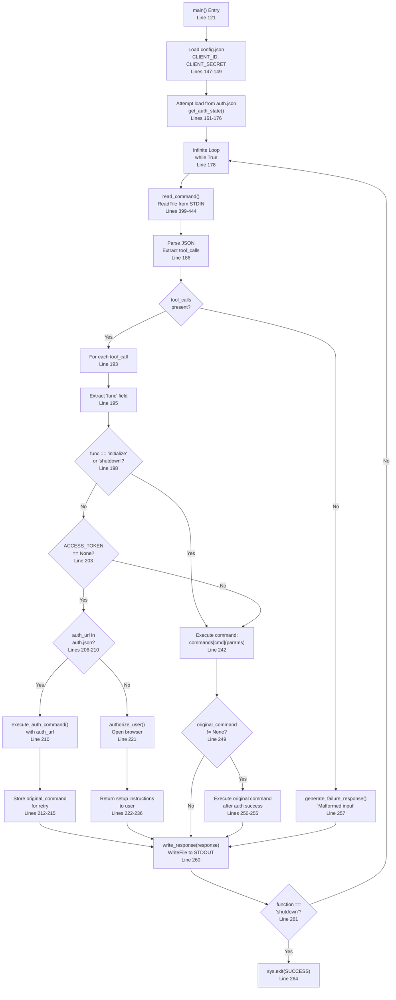
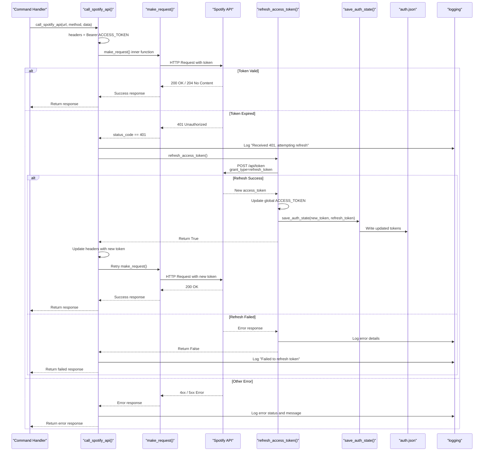

<!-- source: DeepWiki mcp.deepwiki.com · repo NVIDIA/G-Assist · page 6.1 Spotify Plugin · fetched 2026-10-26 -->

# Spotify Plugin

<details>
<summary>Relevant source files</summary>

The following files were used as context for generating this wiki page:

- [plugins/examples/spotify/README.md](plugins/examples/spotify/README.md)
- [plugins/examples/spotify/plugin.py](plugins/examples/spotify/plugin.py)
- [plugins/examples/spotify/requirements.txt](plugins/examples/spotify/requirements.txt)

</details>


## Purpose and Scope

The Spotify Plugin enables voice and text-based control of Spotify playback through G-Assist. This plugin implements OAuth 2.0 authentication with the Spotify Web API to provide music control, playlist management, and playback information retrieval. This page covers the plugin's architecture, authentication flow, command handlers, and API integration patterns.

For general plugin development concepts, see [Plugin Development Guide](#5). For the manifest structure used by this plugin, see [Manifest Schema](#7.1). For information about the communication protocol between G-Assist and plugins, see [Communication Protocol](#3.3).

---

## Plugin Architecture Overview

The Spotify plugin follows the standard G-Assist plugin architecture with specialized handling for OAuth authentication and Spotify API integration.

```mermaid
graph TB
    subgraph "G-Assist Core"
        SAM["System Assist Module"]
        Launcher["Plugin Launcher"]
    end
    
    subgraph "Named Pipe Communication"
        STDIN["STDIN Pipe<br/>Commands from G-Assist"]
        STDOUT["STDOUT Pipe<br/>Responses to G-Assist"]
    end
    
    subgraph "Spotify Plugin Process"
        Main["main()<br/>Entry Point"]
        ReadCmd["read_command()<br/>ReadFile via kernel32"]
        WriteResp["write_response()<br/>WriteFile via kernel32"]
        
        CmdRouter["generate_command_handlers()<br/>Command Mapping"]
        
        subgraph "Authentication Layer"
            AuthUser["authorize_user()<br/>Opens browser"]
            CompleteAuth["complete_auth_user()<br/>Processes callback"]
            RefreshToken["refresh_access_token()<br/>Token refresh"]
            SaveAuth["save_auth_state()<br/>Persists tokens"]
            GetAuth["get_auth_state()<br/>Loads tokens"]
        end
        
        subgraph "Command Handlers"
            ExecInit["execute_initialize_command()"]
            ExecPlay["execute_play_command()"]
            ExecPause["execute_pause_command()"]
            ExecNext["execute_next_track_command()"]
            ExecPrev["execute_previous_track_command()"]
            ExecShuffle["execute_shuffle_command()"]
            ExecVol["execute_volume_command()"]
            ExecCurrent["execute_currently_playing_command()"]
            ExecQueue["execute_queue_track_command()"]
            ExecPlaylists["execute_get_user_playlists_command()"]
        end
        
        APIWrapper["call_spotify_api()<br/>Handles GET/POST/PUT"]
        
        subgraph "Search Helpers"
            GetTrackURI["get_track_uri()"]
            GetAlbumURI["get_album_uri()"]
            GetPlaylistURI["get_playlist_uri()"]
            GetGenericURI["get_generic_uri()"]
        end
        
        subgraph "Device Management"
            GetDevice["get_device()<br/>Active device lookup"]
            GetDeviceID["get_device_id()"]
        end
    end
    
    subgraph "External Services"
        SpotifyAuth["Spotify OAuth<br/>accounts.spotify.com"]
        SpotifyAPI["Spotify Web API<br/>api.spotify.com/v1"]
    end
    
    subgraph "File System"
        ConfigJSON["config.json<br/>Client ID/Secret"]
        AuthJSON["auth.json<br/>Access/Refresh Tokens"]
        LogFile["spotify-plugin.log<br/>%USERPROFILE%"]
    end
    
    Launcher -->|Spawns| Main
    SAM --> Launcher
    
    Main --> ReadCmd
    Main --> WriteResp
    Main --> CmdRouter
    
    STDIN --> ReadCmd
    WriteResp --> STDOUT
    
    ReadCmd -->|JSON tool_calls| CmdRouter
    
    CmdRouter --> ExecInit & ExecPlay & ExecPause & ExecNext & ExecPrev & ExecShuffle & ExecVol & ExecCurrent & ExecQueue & ExecPlaylists
    
    ExecInit --> AuthUser & GetAuth
    CompleteAuth --> SaveAuth
    GetAuth --> CompleteAuth
    
    ExecPlay & ExecPause & ExecNext & ExecPrev & ExecShuffle & ExecVol & ExecCurrent & ExecQueue & ExecPlaylists --> APIWrapper
    
    ExecPlay --> GetTrackURI & GetAlbumURI & GetPlaylistURI & GetGenericURI
    ExecQueue --> GetTrackURI
    
    APIWrapper --> GetDevice
    GetDevice --> GetDeviceID
    
    APIWrapper -->|401 Unauthorized| RefreshToken
    RefreshToken --> SaveAuth
    
    APIWrapper -->|HTTP Requests| SpotifyAPI
    AuthUser -->|Opens browser| SpotifyAuth
    CompleteAuth & RefreshToken -->|Token exchange| SpotifyAuth
    
    Main --> ConfigJSON
    GetAuth & SaveAuth --> AuthJSON
    Main --> LogFile
```



**Sources:** [plugins/examples/spotify/plugin.py:1-1147]()

---

## Configuration Files

The Spotify plugin requires two JSON configuration files stored in the plugin directory at `%PROGRAMDATA%\NVIDIA Corporation\nvtopps\rise\plugins\spotify\`.

### config.json Structure

Contains Spotify application credentials obtained from the Spotify Developer Dashboard.

| Field | Type | Description | Source |
|-------|------|-------------|--------|
| `client_id` | string | Spotify application client ID | Developer Dashboard |
| `client_secret` | string | Spotify application client secret | Developer Dashboard |
| `username` | string | Spotify username | User's Spotify account |

The configuration is loaded at startup by `get_client_id()`, `get_client_secret()`, and `get_username()` functions.

```json
{
    "client_id": "<Your Client ID>",
    "client_secret": "<Your Client Secret>",
    "username": "<Your Spotify Username>"
}
```

**Sources:** [plugins/examples/spotify/plugin.py:142-149](), [plugins/examples/spotify/plugin.py:328-377]()

### auth.json Structure

Stores OAuth tokens and authorization state. This file is created and managed automatically by the plugin.

| Field | Type | Description | Lifecycle |
|-------|------|-------------|-----------|
| `auth_url` | string (optional) | Callback URL from OAuth flow | Temporary - deleted after processing |
| `access_token` | string | Active access token | Refreshed automatically |
| `refresh_token` | string | Token for obtaining new access tokens | Persisted long-term |

The auth state is managed by `get_auth_state()`, `save_auth_state()`, and `complete_auth_user()`.

**Sources:** [plugins/examples/spotify/plugin.py:143](), [plugins/examples/spotify/plugin.py:266-325](), [plugins/examples/spotify/plugin.py:1121-1143]()

---

## OAuth 2.0 Authentication Flow

The Spotify plugin implements the Authorization Code Flow with token refresh capability.



### Key Authentication Functions

| Function | Location | Purpose |
|----------|----------|---------|
| `get_spotify_auth_url()` | [plugin.py:30-40]() | Generates OAuth URL with client_id and scopes |
| `authorize_user()` | [plugin.py:72-79]() | Opens browser to authorization URL |
| `extract_code_from_url()` | [plugin.py:42-48]() | Parses authorization code from callback |
| `get_access_token()` | [plugin.py:50-70]() | Exchanges code for tokens |
| `complete_auth_user()` | [plugin.py:82-119]() | Orchestrates token exchange and storage |
| `refresh_access_token()` | [plugin.py:1078-1119]() | Refreshes expired access token |
| `save_auth_state()` | [plugin.py:1121-1143]() | Persists tokens to auth.json |
| `get_auth_state()` | [plugin.py:266-325]() | Loads tokens from auth.json |

### OAuth Scopes

The plugin requests the following Spotify scopes defined at [plugin.py:18]():

```
user-library-read user-read-currently-playing user-read-playback-state 
user-modify-playback-state playlist-read-private playlist-read-collaborative
```

**Sources:** [plugins/examples/spotify/plugin.py:17-28](), [plugins/examples/spotify/plugin.py:30-119](), [plugins/examples/spotify/plugin.py:1078-1143]()

---

## Command Processing Pipeline

The plugin implements a command loop that processes JSON-formatted tool calls from G-Assist.



### Command Handler Mapping

The `generate_command_handlers()` function at [plugin.py:379-397]() creates the command routing dictionary:

| Command String | Handler Function | Purpose |
|----------------|------------------|---------|
| `initialize` | `execute_initialize_command()` | Plugin startup and auth |
| `shutdown` | `execute_shutdown_command()` | Plugin cleanup |
| `authorize` | `execute_auth_command()` | Manual authorization |
| `spotify_start_playback` | `execute_play_command()` | Play/resume music |
| `spotify_pause_playback` | `execute_pause_command()` | Pause playback |
| `spotify_next_track` | `execute_next_track_command()` | Skip to next track |
| `spotify_previous_track` | `execute_previous_track_command()` | Go to previous track |
| `spotify_shuffle_playback` | `execute_shuffle_command()` | Toggle shuffle mode |
| `spotify_set_volume` | `execute_volume_command()` | Adjust volume (0-100) |
| `spotify_get_currently_playing` | `execute_currently_playing_command()` | Get current track info |
| `spotify_queue_track` | `execute_queue_track_command()` | Add track to queue |
| `spotify_get_user_playlists` | `execute_get_user_playlists_command()` | List user playlists |

### Pipe Communication Functions

**read_command()** [plugin.py:399-444]()
- Uses Windows API via `ctypes`: `windll.kernel32.ReadFile()`
- Reads from `STD_INPUT_HANDLE` (-10)
- Reads in 4096-byte chunks until complete message received
- Parses JSON and returns dictionary or None

**write_response()** [plugin.py:446-473]()
- Uses Windows API via `ctypes`: `windll.kernel32.WriteFile()`
- Writes to `STD_OUTPUT_HANDLE` (-11)
- Appends `<<END>>` marker to JSON response
- Response format: `{"success": bool, "message": str}<<END>>`

**Sources:** [plugins/examples/spotify/plugin.py:121-264](), [plugins/examples/spotify/plugin.py:379-397](), [plugins/examples/spotify/plugin.py:399-473]()

---

## Spotify API Integration

The plugin abstracts Spotify Web API calls through a unified wrapper function with automatic token refresh.

```mermaid
graph TB
    subgraph "Command Layer"
        ExecPlay["execute_play_command()<br/>Lines 828-877"]
        ExecPause["execute_pause_command()<br/>Lines 879-896"]
        ExecNext["execute_next_track_command()<br/>Lines 898-915"]
        ExecVol["execute_volume_command()<br/>Lines 958-991"]
        ExecCurrent["execute_currently_playing_command()<br/>Lines 993-1020"]
        ExecQueue["execute_queue_track_command()<br/>Lines 1022-1043"]
        ExecPlaylists["execute_get_user_playlists_command()<br/>Lines 1045-1076"]
    end
    
    subgraph "API Wrapper"
        CallAPI["call_spotify_api(url, method, data)<br/>Lines 499-554"]
        
        MakeRequest["make_request()<br/>Inner function<br/>Lines 521-531"]
        
        CheckStatus{"status_code<br/>== 401?<br/>Line 538"}
        
        RefreshToken["refresh_access_token()<br/>Lines 1078-1119"]
        
        RetryRequest["Retry with new token<br/>Lines 544-546"]
    end
    
    subgraph "Search Helpers"
        GetTrackURI["get_track_uri(params)<br/>Searches tracks<br/>Lines 658-688"]
        GetAlbumURI["get_album_uri(params)<br/>Searches albums<br/>Lines 614-635"]
        GetPlaylistURI["get_playlist_uri(params)<br/>Searches playlists<br/>Lines 637-656"]
        GetGenericURI["get_generic_uri(params)<br/>Generic search<br/>Lines 690-711"]
    end
    
    subgraph "Device Management"
        GetDevice["get_device()<br/>Returns active device<br/>Lines 579-604"]
        GetDeviceID["get_device_id()<br/>Extracts device ID<br/>Lines 606-612"]
    end
    
    subgraph "Spotify Web API Endpoints"
        AuthEndpoint["/api/token<br/>Token management"]
        DevicesEndpoint["/me/player/devices<br/>Device list"]
        PlaybackEndpoint["/me/player/play<br/>Start/resume playback"]
        PauseEndpoint["/me/player/pause<br/>Pause playback"]
        NextEndpoint["/me/player/next<br/>Skip track"]
        SearchEndpoint["/search?q=...&type=...<br/>Search content"]
        CurrentEndpoint["/me/player/currently-playing<br/>Current track info"]
        QueueEndpoint["/me/player/queue<br/>Add to queue"]
        PlaylistsEndpoint["/me/playlists<br/>User playlists"]
    end
    
    ExecPlay --> GetTrackURI & GetAlbumURI & GetPlaylistURI & GetGenericURI
    ExecPlay --> GetDeviceID
    ExecPlay --> CallAPI
    
    ExecPause & ExecNext & ExecVol & ExecCurrent & ExecQueue & ExecPlaylists --> GetDeviceID
    ExecPause & ExecNext & ExecVol & ExecCurrent & ExecQueue & ExecPlaylists --> CallAPI
    
    GetTrackURI & GetAlbumURI & GetPlaylistURI & GetGenericURI --> CallAPI
    GetDevice --> CallAPI
    
    CallAPI --> MakeRequest
    MakeRequest --> CheckStatus
    
    CheckStatus -->|Yes| RefreshToken
    RefreshToken -->|Success| RetryRequest
    RetryRequest --> MakeRequest
    
    CheckStatus -->|No| ExecPlay & ExecPause & ExecNext
    
    RefreshToken --> AuthEndpoint
    GetDevice --> DevicesEndpoint
    
    CallAPI --> PlaybackEndpoint & PauseEndpoint & NextEndpoint & SearchEndpoint & CurrentEndpoint & QueueEndpoint & PlaylistsEndpoint
```



### call_spotify_api() Function

Located at [plugin.py:499-554](), this function provides:

1. **Automatic header construction** with Bearer token
2. **HTTP method abstraction** (GET, POST, PUT)
3. **Automatic token refresh** on 401 responses
4. **Retry logic** after successful refresh
5. **Error logging** for failed requests

Request flow:
```python
# Line 517-518
headers = {"Authorization": f"Bearer {ACCESS_TOKEN}"}
full_url = f"{BASE_URL}{url}"  # BASE_URL = "https://api.spotify.com/v1"

# Lines 521-531: Inner make_request() handles method routing
# Lines 534-546: Initial request, then retry with refresh if 401
```

### Search Helper Functions

All search functions use URL-encoded query parameters and return Spotify URIs:

**get_track_uri()** [plugin.py:658-688]()
- Constructs query: `track:"name" artist:"artist"`
- Returns `spotify:track:...` URI

**get_album_uri()** [plugin.py:614-635]()
- Constructs query: `album:"name" artist:"artist"`
- Returns `spotify:album:...` URI

**get_playlist_uri()** [plugin.py:637-656]()
- Searches user playlists by name
- Returns `spotify:playlist:...` URI

**get_generic_uri()** [plugin.py:690-711]()
- Fallback search without type prefix
- Used when type is ambiguous

### Device Management

**get_device()** [plugin.py:579-604]()
- Calls `/me/player/devices` endpoint
- Filters for active devices using `is_device_active()` helper [plugin.py:570-577]()
- Returns first unrestricted device

**Sources:** [plugins/examples/spotify/plugin.py:499-711](), [plugins/examples/spotify/plugin.py:828-1076]()

---

## Available Command Implementations

### Playback Control Commands

**execute_play_command()** [plugin.py:828-877]()

Handles three playback modes:

| Mode | Parameter `type` | API Endpoint | Body Format |
|------|------------------|--------------|-------------|
| Track | `track` | `/me/player/play` | `{"uris": ["spotify:track:..."]}` |
| Album | `album` | `/me/player/play` | `{"context_uri": "spotify:album:..."}` |
| Playlist | `playlist` | `/me/player/play` | `{"context_uri": "spotify:playlist:..."}` |
| Resume | None/Empty | `/me/player/play` | `null` body |

**execute_pause_command()** [plugin.py:879-896]()
- PUT request to `/me/player/pause?device_id={device}`
- Returns success if status is 204 or 200

**execute_next_track_command()** [plugin.py:898-915]()
- POST request to `/me/player/next?device_id={device}`

**execute_previous_track_command()** [plugin.py:917-934]()
- POST request to `/me/player/previous?device_id={device}`

**execute_shuffle_command()** [plugin.py:936-956]()
- PUT request to `/me/player/shuffle?device_id={device}&state={true|false}`
- Parameter: `state` (boolean)

**execute_volume_command()** [plugin.py:958-991]()
- Checks device supports volume control: `device['supports_volume']`
- PUT request to `/me/player/volume?volume_percent={0-100}&device_id={device}`
- Parameter: `volume_level` (0-100)

### Information Retrieval Commands

**execute_currently_playing_command()** [plugin.py:993-1020]()
- GET request to `/me/player/currently-playing`
- Extracts: `track_name`, `artist_name`, `is_playing` status
- Returns formatted message with track and artist

**execute_get_user_playlists_command()** [plugin.py:1045-1076]()
- GET request to `/me/playlists?limit={limit}` (default 10)
- Strips emoji/special characters: `ord(char) < 128`
- Returns newline-separated playlist names

**execute_queue_track_command()** [plugin.py:1022-1043]()
- Searches for track using `get_track_uri()`
- POST request to `/me/player/queue?uri={uri}&device_id={device}`

### Initialization Commands

**execute_initialize_command()** [plugin.py:715-784]()
1. Checks for existing tokens in `auth.json`
2. If found and valid, returns success
3. If not found or invalid, calls `authorize_user()` and returns setup instructions
4. Verifies tokens by calling `get_device_id()`

**execute_shutdown_command()** [plugin.py:787-792]()
- Returns success response immediately
- Causes main loop to exit at [plugin.py:261-262]()

**Sources:** [plugins/examples/spotify/plugin.py:715-1076]()

---

## Error Handling and Token Refresh

The plugin implements automatic recovery from authentication failures.



### Error Response Generation

**generate_failure_response()** [plugin.py:475-485]()
```python
def generate_failure_response(body:dict=None) -> dict:
    response = body.copy() if body is not None else dict()
    response['success'] = False
    return response
```

**generate_success_response()** [plugin.py:487-497]()
```python
def generate_success_response(body:dict=None) -> dict:
    response = body.copy() if body is not None else dict()
    response['success'] = True
    return response
```

### Token Refresh Implementation

Located at [plugin.py:1078-1119](), the refresh process:

1. Checks if `REFRESH_TOKEN` exists
2. POSTs to `https://accounts.spotify.com/api/token` with:
   - `grant_type: "refresh_token"`
   - `refresh_token: REFRESH_TOKEN`
   - `client_id` and `client_secret`
3. Updates global `ACCESS_TOKEN`
4. Saves new token via `save_auth_state()`
5. Returns `True` on success, `False` on failure

### Logging Configuration

Configured at [plugin.py:14-15]():
```python
LOG_FILE = os.path.join(os.environ.get("USERPROFILE", "."), 'spotify-plugin.log')
logging.basicConfig(filename=LOG_FILE, level=logging.INFO, 
                   format="%(asctime)s - %(levelname)s - %(message)s")
```

Log entries include:
- Command receipt and parsing
- Authentication state changes
- API request/response status codes
- Error stack traces
- Token refresh attempts

**Sources:** [plugins/examples/spotify/plugin.py:14-15](), [plugins/examples/spotify/plugin.py:475-497](), [plugins/examples/spotify/plugin.py:499-554](), [plugins/examples/spotify/plugin.py:1078-1143]()

---

## Deployment and Build Process

### Directory Structure

```
plugins/examples/spotify/
├── plugin.py                 # Main implementation
├── requirements.txt          # Python dependencies
├── setup.bat                 # Virtual environment setup
├── build.bat                 # PyInstaller packaging
├── manifest.json             # G-Assist plugin manifest
├── config.json               # User credentials (manual creation)
└── dist/                     # Build output directory
    └── spotify/
        ├── g-assist-plugin-spotify.exe
        ├── manifest.json
        ├── config.json       # Copied from parent
        └── [dependencies]
```

### Dependencies

From [plugins/examples/spotify/requirements.txt:1-3]():
- `spotipy==2.25.1` - Spotify Web API Python library (not directly used, may be legacy)
- `pyinstaller==6.11.0` - Packages Python to executable

### Installation Location

The built plugin is deployed to:
```
%PROGRAMDATA%\NVIDIA Corporation\nvtopps\rise\plugins\spotify\
```

This directory contains:
- `g-assist-plugin-spotify.exe` - Compiled plugin
- `manifest.json` - Function definitions for G-Assist
- `config.json` - User-provided credentials
- `auth.json` - Runtime-generated token storage

### Manifest Example

The manifest.json defines available functions for G-Assist discovery:

```json
{
  "manifestVersion": 1,
  "executable": "g-assist-plugin-spotify.exe",
  "persistent": false,
  "functions": [
    {
      "name": "spotify_start_playback",
      "description": "Start or resume Spotify playback",
      "tags": ["music", "play", "spotify"],
      "properties": {
        "type": {
          "type": "string",
          "description": "Type of content: track, album, or playlist"
        },
        "name": {
          "type": "string",
          "description": "Name of the track, album, or playlist"
        },
        "artist": {
          "type": "string",
          "description": "Artist name (optional, for better search)"
        }
      }
    }
  ]
}
```

Each function defined in the manifest corresponds to a command handler in `generate_command_handlers()`.

**Sources:** [plugins/examples/spotify/README.md:49-66](), [plugins/examples/spotify/requirements.txt:1-3]()

---

## Usage Examples

### Natural Language to Command Translation

G-Assist's inference engine maps natural language to the appropriate command handler:

| User Input | Resolved Command | Parameters |
|------------|------------------|------------|
| "Hey Spotify, play Life Itself by Glass Animals" | `spotify_start_playback` | `{type: "track", name: "Life Itself", artist: "Glass Animals"}` |
| "Hey Spotify, play reputation by Taylor Swift" | `spotify_start_playback` | `{type: "album", name: "reputation", artist: "Taylor Swift"}` |
| "Hey Spotify, pause it" | `spotify_pause_playback` | `{}` |
| "Hey Spotify, turn shuffle on" | `spotify_shuffle_playback` | `{state: true}` |
| "Hey Spotify, set volume to 30" | `spotify_set_volume` | `{volume_level: 30}` |
| "Hey Spotify, what song is playing?" | `spotify_get_currently_playing` | `{}` |
| "Hey Spotify, what are my top 5 playlists" | `spotify_get_user_playlists` | `{limit: 5}` |

### JSON Command Format

Commands sent via named pipe follow the tool_calls structure:

```json
{
  "tool_calls": [
    {
      "func": "spotify_start_playback",
      "params": {
        "type": "track",
        "name": "Yesterday",
        "artist": "The Beatles"
      }
    }
  ]
}
```

Response format:
```json
{
  "success": true,
  "message": "Playback successfully started."
}<<END>>
```

**Sources:** [plugins/examples/spotify/README.md:70-89](), [plugins/examples/spotify/plugin.py:186-259]()

---

