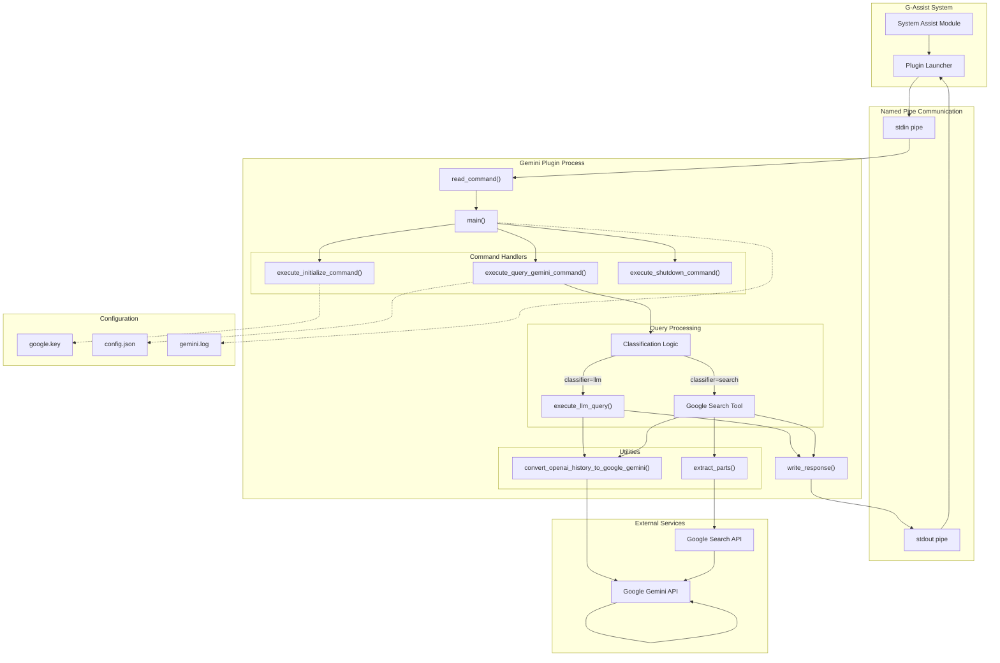
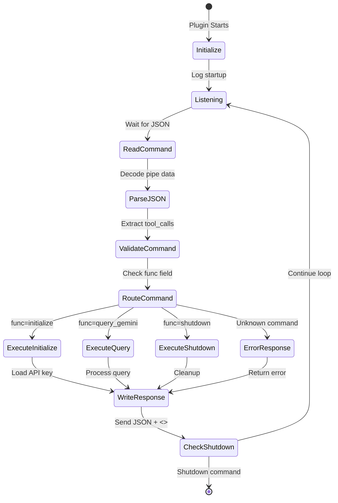
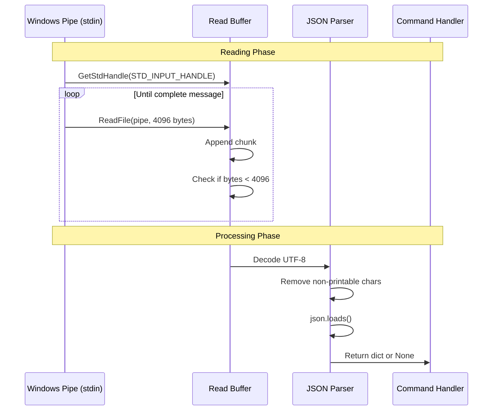
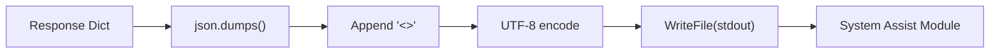
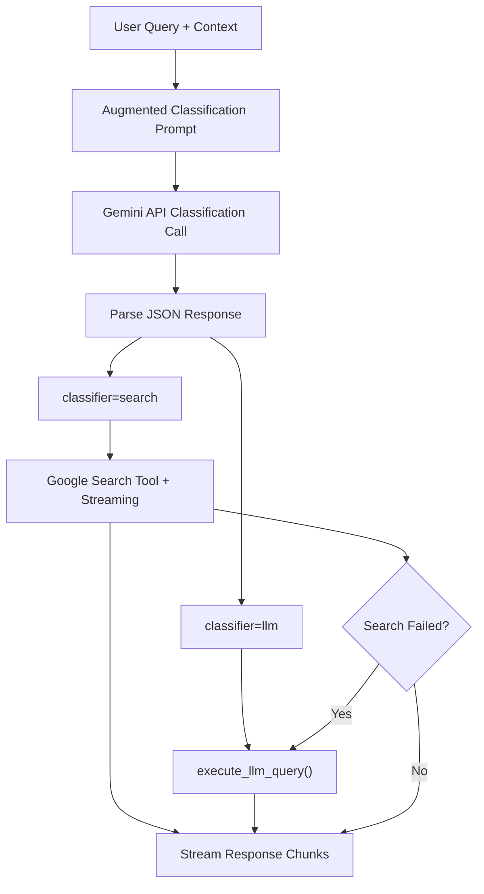
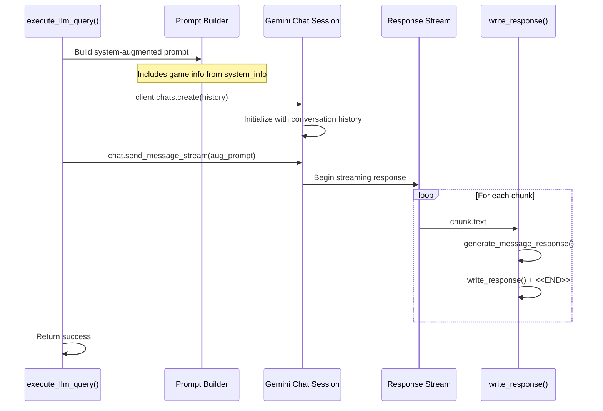
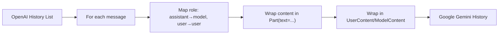
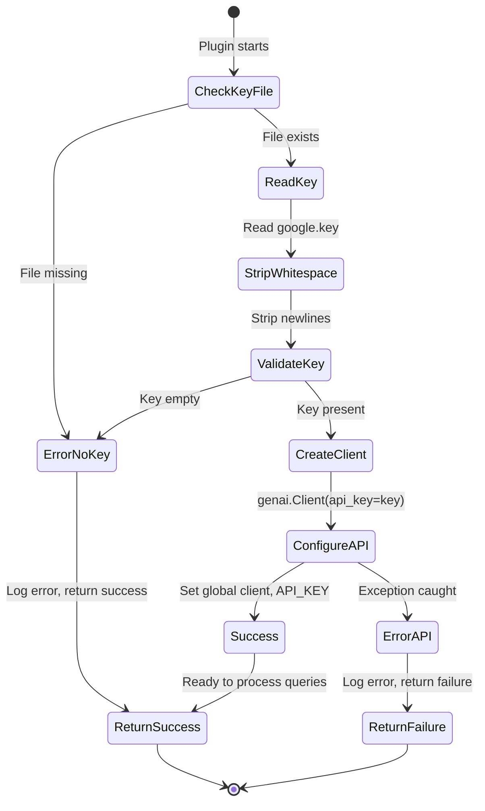
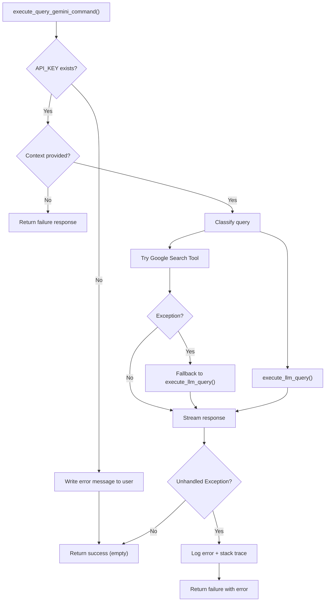

<!-- source: DeepWiki mcp.deepwiki.com · repo NVIDIA/G-Assist · page 6.2 Gemini AI Plugin · fetched 2026-10-26 -->

# Gemini AI Plugin

<details>
<summary>Relevant source files</summary>

The following files were used as context for generating this wiki page:

- [plugins/examples/corsair/README.md](plugins/examples/corsair/README.md)
- [plugins/examples/gemini/.gitattributes](plugins/examples/gemini/.gitattributes)
- [plugins/examples/gemini/README.md](plugins/examples/gemini/README.md)
- [plugins/examples/gemini/Release/g-assist-plugin-google.exe](plugins/examples/gemini/Release/g-assist-plugin-google.exe)
- [plugins/examples/gemini/Release/manifest.json](plugins/examples/gemini/Release/manifest.json)
- [plugins/examples/gemini/gemini.py](plugins/examples/gemini/gemini.py)
- [plugins/examples/gemini/manifest.json](plugins/examples/gemini/manifest.json)
- [plugins/examples/gemini/requirements.txt](plugins/examples/gemini/requirements.txt)

</details>


This document describes the implementation of the Gemini AI plugin, which integrates Google's Gemini language model and search capabilities into G-Assist. The plugin demonstrates intelligent query routing, streaming responses, and conversation history management.

For general plugin development concepts, see [Plugin Development Guide](#5). For information about the communication protocol used by all plugins, see [Communication Protocol](#3.3). For other plugin examples, see [Plugin Examples](#6).

## Overview

The Gemini plugin is a Python-based, non-persistent plugin that provides two primary capabilities:

1. **Search-grounded responses**: Routes queries requiring current information through Google Search
2. **Knowledge-based responses**: Handles queries using Gemini's language model without search

The plugin classifies incoming queries to determine the appropriate response path and streams results back to G-Assist in real-time.

**Sources:** [plugins/examples/gemini/README.md:1-28](), [plugins/examples/gemini/gemini.py:1-16]()

## Plugin Manifest

The plugin registers a single function `query_gemini` with G-Assist:

```json
{
  "manifestVersion": 1,
  "executable": "g-assist-plugin-google.exe",
  "persistent": false,
  "passthrough": true,
  "functions": [
    {
      "name": "query_gemini",
      "description": "Google/Gemini tool search for real time access...",
      "tags": ["gemini", "google", "chat", "question", "answers", "query"],
      "properties": {
        "input": {
          "type": "string",
          "description": "the user's input"
        },
        "game": {
          "type": "string",
          "description": "optional parameter specifying current game"
        }
      }
    }
  ]
}
```

| Manifest Field | Value | Purpose |
|---------------|-------|---------|
| `persistent` | `false` | Plugin spawns on-demand and terminates after response |
| `passthrough` | `true` | Enables context passing from G-Assist |
| `executable` | `g-assist-plugin-google.exe` | PyInstaller-packaged Python script |

**Sources:** [plugins/examples/gemini/manifest.json:1-24]()

## Architecture and Core Components



**Sources:** [plugins/examples/gemini/gemini.py:45-112](), [plugins/examples/gemini/README.md:99-146]()

## Command Processing Loop

The `main()` function implements the plugin's command processing lifecycle:

### Main Loop Structure



### Command Handler Mapping

The plugin maps commands to handler functions using a dictionary:

| Command | Handler Function | Parameters |
|---------|-----------------|------------|
| `initialize` | `execute_initialize_command()` | None |
| `shutdown` | `execute_shutdown_command()` | None |
| `query_gemini` | `execute_query_gemini_command()` | `params`, `context`, `system_info` |

**Sources:** [plugins/examples/gemini/gemini.py:45-112](), [plugins/examples/gemini/gemini.py:66-70]()

## Pipe Communication Implementation

### Reading Commands

The `read_command()` function reads JSON messages from stdin using Windows API:



Key aspects of the read implementation:
- Uses `windll.kernel32.ReadFile()` for Windows pipe reading
- Reads in 4096-byte chunks until message complete
- Handles Unicode escape sequences via `raw_unicode_escape` codec
- Filters non-printable characters except newlines/tabs
- Returns `None` on JSON decode errors

**Sources:** [plugins/examples/gemini/gemini.py:133-182]()

### Writing Responses

The `write_response()` function sends JSON responses to stdout:



The `<<END>>` marker signals message completion to the Plugin Launcher.

**Sources:** [plugins/examples/gemini/gemini.py:184-212]()

## Query Classification and Routing

The `execute_query_gemini_command()` function implements a two-stage processing pipeline:

### Stage 1: Query Classification



The classification prompt template:

```
Respond with "{"classifier": "search"}" if the following prompt is better 
served with a google search query of current and news events or respond 
with "{"classifier": "llm"}" if it is better served with LLM knowledge 
base where time and recent events do not have an impact.
```

**Sources:** [plugins/examples/gemini/gemini.py:348-460](), [plugins/examples/gemini/gemini.py:396-397]()

### Stage 2: Response Generation

#### Search Path Processing

For queries classified as `search`, the plugin uses Gemini's Google Search integration:

| Step | Function/API | Purpose |
|------|-------------|---------|
| 1 | `convert_openai_history_to_google_gemini(context)` | Convert OpenAI format to Gemini format |
| 2 | `extract_parts(gemini_history)` | Extract text parts from history |
| 3 | `client.models.generate_content_stream()` | Generate with Search tool enabled |
| 4 | `write_response(generate_message_response(chunk.text))` | Stream each chunk |

The search configuration uses:
```python
config=GenerateContentConfig(
    tools=[Tool(google_search=GoogleSearch())],
)
```

**Sources:** [plugins/examples/gemini/gemini.py:425-444]()

#### LLM Path Processing

For queries classified as `llm`, the `execute_llm_query()` function handles responses:



The system prompt template injects context about installed games:

```python
aug_prompt = f"""You are a helpful AI assistant that can help with a wide 
range of topics. You are a plugin within the Nvidia G-Assist ecosystem of 
plugins. Keep your responses concise and within 100 words if possible. 
If a user is inquiring about games and Nvidia GPUs, keep in mind the list 
of games installed on the user PC including the current playing game as: 
{system_info}. {incoming_context[-1]['content']}"""
```

**Sources:** [plugins/examples/gemini/gemini.py:461-489](), [plugins/examples/gemini/gemini.py:476-477]()

## Conversation History Management

### Format Conversion

The plugin converts between OpenAI-style and Gemini-style message formats:

**OpenAI Format (G-Assist Context)**
```json
[
  {"role": "user", "content": "What is ray tracing?"},
  {"role": "assistant", "content": "Ray tracing is..."},
  {"role": "user", "content": "How does it work?"}
]
```

**Gemini Format (API Requirements)**
```json
[
  {"role": "user", "parts": [{"text": "What is ray tracing?"}]},
  {"role": "model", "parts": [{"text": "Ray tracing is..."}]},
  {"role": "user", "parts": [{"text": "How does it work?"}]}
]
```

The `convert_openai_history_to_google_gemini()` function performs this conversion:



**Sources:** [plugins/examples/gemini/gemini.py:312-330](), [plugins/examples/gemini/gemini.py:294-310]()

## Configuration and Initialization

### File Locations

| File | Path | Purpose |
|------|------|---------|
| `google.key` | `%PROGRAMDATA%\NVIDIA Corporation\nvtopps\rise\plugins\google\google.key` | API key storage |
| `config.json` | `%PROGRAMDATA%\NVIDIA Corporation\nvtopps\rise\plugins\google\config.json` | Model configuration |
| `gemini.log` | `%USERPROFILE%\gemini.log` | Runtime logging |

**Sources:** [plugins/examples/gemini/gemini.py:35-38]()

### Initialization Sequence

The `execute_initialize_command()` function loads configuration on plugin startup:



Note: The function returns success even when no API key is found. This allows the plugin to start and display error messages to users on first query attempt.

**Sources:** [plugins/examples/gemini/gemini.py:256-284](), [plugins/examples/gemini/gemini.py:272-273]()

### Model Configuration

The `config.json` file allows model selection:

```json
{
  "model": "gemini-2.0-flash"
}
```

Default model is `gemini-pro` if no configuration file exists. The model setting is loaded on each query in `execute_query_gemini_command()` at [plugins/examples/gemini/gemini.py:374-378]().

**Sources:** [plugins/examples/gemini/README.md:40-46](), [plugins/examples/gemini/gemini.py:43]()

## Error Handling and Logging

### Response Generation Functions

| Function | Return Format | Use Case |
|----------|--------------|----------|
| `generate_success_response(message)` | `{"success": True, "message": "..."}` | Successful command completion |
| `generate_failure_response(message)` | `{"success": False, "message": "..."}` | Command processing errors |
| `generate_message_response(message)` | `{"message": "..."}` | Streaming response chunks |

**Sources:** [plugins/examples/gemini/gemini.py:214-254]()

### Error Recovery Strategies



The search-to-LLM fallback mechanism ensures queries receive responses even when search fails:

```python
try:
    # Search path
    response = client.models.generate_content_stream(...)
    for chunk in response:
        write_response(generate_message_response(chunk.text))
    return generate_success_response()
except Exception as search_error:
    logging.error(f'Search failed, falling back to LLM: {str(search_error)}')
    write_response(generate_message_response("Unable to ground search the query, falling back to LLM.\n"))
    return execute_llm_query(gemini_history, incoming_context, system_info)
```

**Sources:** [plugins/examples/gemini/gemini.py:445-449](), [plugins/examples/gemini/gemini.py:455-459]()

### Logging Configuration

Logging is configured at module level:

```python
LOG_FILE = os.path.join(os.environ.get("USERPROFILE", "."), 'gemini.log')
logging.basicConfig(filename=LOG_FILE, level=logging.INFO, 
                   format="%(asctime)s - %(levelname)s - %(message)s")
```

Key logged events:
- Plugin startup/shutdown
- Raw command input
- Response generation
- Classification decisions
- API errors with stack traces
- Search fallback triggers

**Sources:** [plugins/examples/gemini/gemini.py:38-39](), [plugins/examples/gemini/README.md:85-90]()

## Dependencies

The plugin requires the following Python packages:

```
google-genai>=1.7.0
pyinstaller==6.11.0
```

The `google-genai` package provides:
- `genai.Client`: Main API client
- `ModelContent`, `UserContent`, `Part`: Message format classes
- `GoogleSearch`, `Tool`, `GenerateContentConfig`: Search integration
- Streaming response capabilities

**Sources:** [plugins/examples/gemini/requirements.txt:15-16]()

## Build and Deployment

### Build Process

The plugin uses PyInstaller to create a standalone executable:

```bash
# Install dependencies
python -m pip install -r requirements.txt

# Build executable
pyinstaller --onefile --name gemini-plugin gemini.py
```

The build output is placed in `dist/google/` directory.

**Sources:** [plugins/examples/gemini/README.md:49-52]()

### Deployment Structure

After building, deploy these files to the plugin directory:

```
%PROGRAMDATA%\NVIDIA Corporation\nvtopps\rise\plugins\gemini\
├── gemini-plugin.exe          # Built executable
├── manifest.json              # Function definitions
├── config.json                # Model configuration
└── google.key                 # API key (user-provided)
```

**Sources:** [plugins/examples/gemini/README.md:55-66]()

## Usage Examples

The plugin responds to both direct invocation and zero-shot routing:

### Direct Invocation
```
User: Hey Google, tell me about artificial intelligence.
→ Triggers: query_gemini function
→ Path: LLM (knowledge-based)
```

```
User: /google What are the top five features in the latest major patch of RUST?
→ Triggers: query_gemini function  
→ Path: Search (current information)
```

### Zero-Shot Routing
```
User: What's the weather in Santa Clara, CA?
→ G-Assist routes to: query_gemini
→ Path: Search (real-time data)
```

**Sources:** [plugins/examples/gemini/README.md:69-78]()

## Limitations and Constraints

| Limitation | Impact |
|-----------|--------|
| Requires internet connection | Offline queries not supported |
| Google API rate limits | May throttle high-volume usage |
| No image generation | Text-only responses |
| Search API availability | Fallback to LLM if search fails |
| Context window limits | Very long conversations may be truncated |

**Sources:** [plugins/examples/gemini/README.md:79-84]()

---

