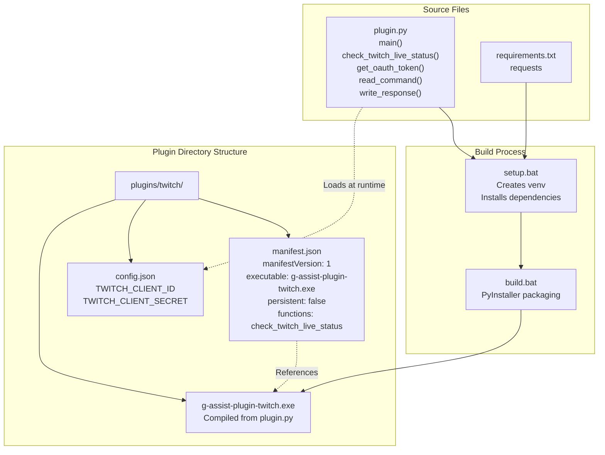
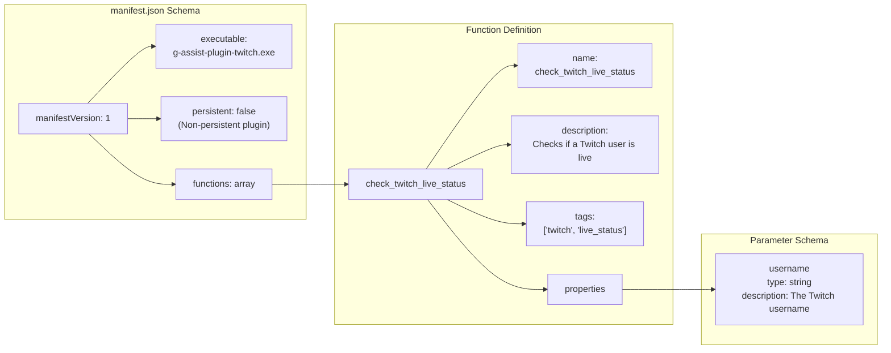
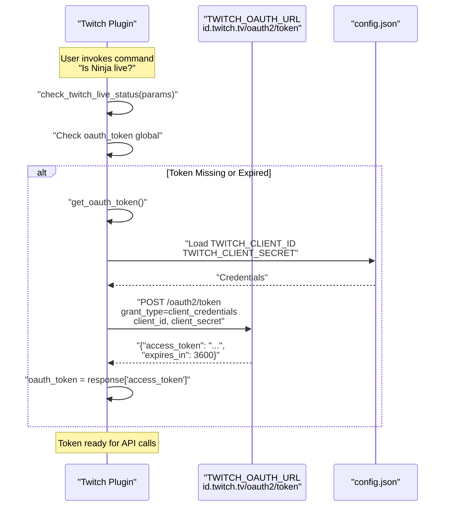
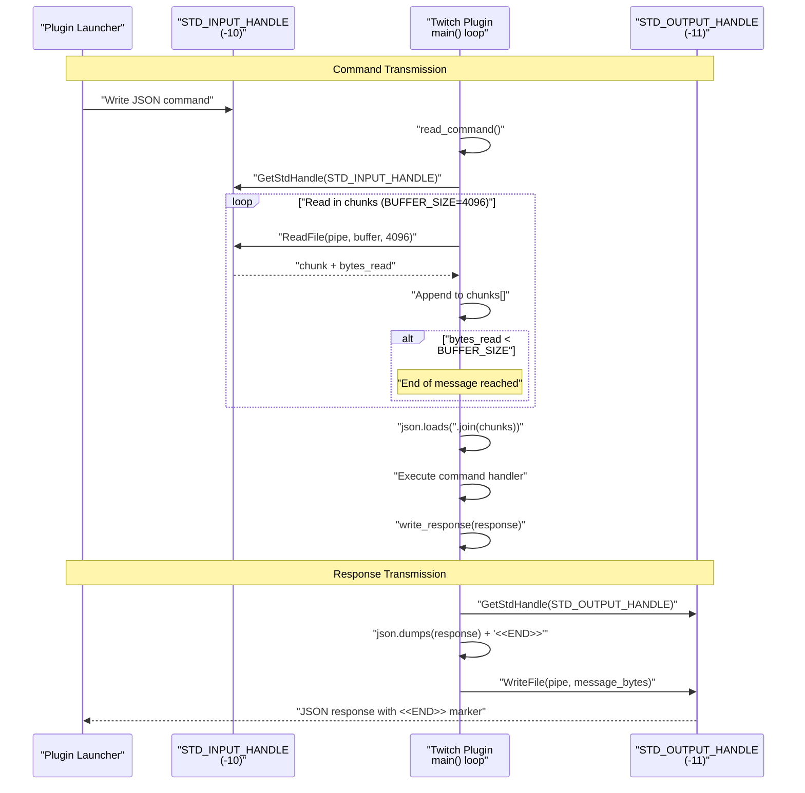
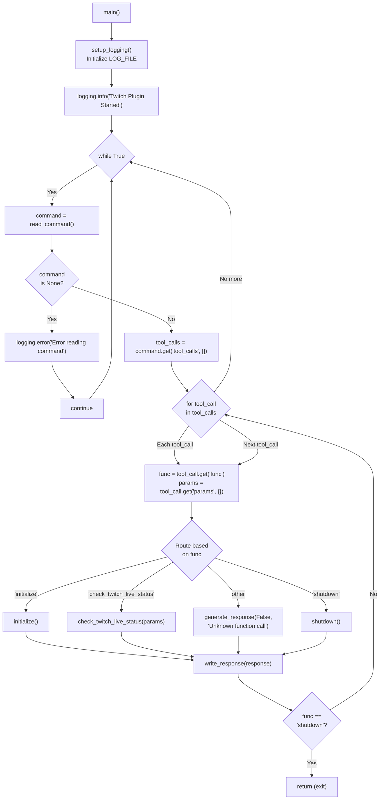
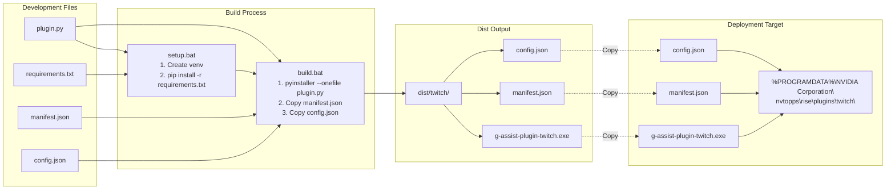

<!-- source: DeepWiki mcp.deepwiki.com · repo NVIDIA/G-Assist · page 6.3 Twitch Plugin · fetched 2026-10-26 -->

# Twitch Plugin

<details>
<summary>Relevant source files</summary>

The following files were used as context for generating this wiki page:

- [README.md](README.md)
- [api/bindings/python/README.md](api/bindings/python/README.md)
- [plugins/examples/twitch/README.md](plugins/examples/twitch/README.md)
- [plugins/examples/twitch/plugin.py](plugins/examples/twitch/plugin.py)

</details>


This page documents the Twitch stream status plugin, which integrates with the Twitch API to check whether streamers are currently live and retrieve stream information. This plugin demonstrates external API integration, OAuth token management, and Windows pipe-based IPC communication.

For general plugin development guidance, see [Plugin Development Guide](#5). For API integration patterns applicable to other services, see [External API Integration](#5.6).

## Overview

The Twitch plugin enables G-Assist to check whether a Twitch user is currently streaming and retrieve stream details including title, game, viewer count, and start time. Users can invoke the plugin using natural language commands like "Is Ninja live?" or "Check if shroud is streaming."

**Key Features:**
- Real-time stream status checking via Twitch Helix API
- OAuth 2.0 client credentials flow for authentication
- Secure credential storage in `config.json`
- Windows Named Pipes communication
- Non-persistent execution model (spawned on-demand)
- Comprehensive logging to `%USERPROFILE%\twitch.log`

**Sources:** [README.md:60-98](), [plugins/examples/twitch/README.md:1-13]()

## Plugin Structure

The plugin consists of three core files within the `plugins/twitch/` directory:

| File | Purpose | Location |
|------|---------|----------|
| `manifest.json` | Declares plugin capabilities and function schemas | `%PROGRAMDATA%\NVIDIA Corporation\nvtopps\rise\plugins\twitch\` |
| `config.json` | Stores Twitch API credentials (Client ID and Secret) | `%PROGRAMDATA%\NVIDIA Corporation\nvtopps\rise\plugins\twitch\` |
| `g-assist-plugin-twitch.exe` | Compiled plugin executable | `%PROGRAMDATA%\NVIDIA Corporation\nvtopps\rise\plugins\twitch\` |
| `twitch.log` | Runtime logging output | `%USERPROFILE%\` |



**Sources:** [README.md:90-98](), [plugins/examples/twitch/README.md:102-131]()

## Manifest Configuration

The `manifest.json` file defines the plugin's interface contract with G-Assist. It specifies the executable name, persistence model, and available functions with their parameter schemas.



The manifest declares `persistent: false`, indicating the plugin is spawned on-demand when a command is received and terminates after responding. This differs from persistent plugins like Spotify that maintain state across multiple commands.

**Key Elements:**
- **manifestVersion:** Schema version identifier (currently `1`)
- **executable:** Must match the compiled `.exe` filename exactly
- **functions:** Array of function definitions that G-Assist uses for zero-shot function calling
- **tags:** Keywords used by G-Assist's AI model to match user intent to plugin capabilities

**Sources:** [plugins/examples/twitch/README.md:102-122]()

## Configuration Management

The plugin uses `config.json` to securely store Twitch API credentials outside the codebase. This file must be manually created and populated before deployment.

**Required Configuration Structure:**
```json
{
    "TWITCH_CLIENT_ID": "your_client_id_here",
    "TWITCH_CLIENT_SECRET": "your_client_secret_here"
}
```

**Configuration Loading Implementation:**

The `load_config()` function at [plugins/examples/twitch/plugin.py:90-112]() reads credentials from the standard plugin configuration path:

```python
CONFIG_FILE = os.path.join(
    os.environ.get("PROGRAMDATA", "."),
    r'NVIDIA Corporation\nvtopps\rise\plugins\twitch',
    'config.json'
)
```

The configuration is loaded into a global `config` dictionary at module initialization [plugins/examples/twitch/plugin.py:395]() and accessed by API functions throughout the plugin lifecycle.

**Obtaining Credentials:**
1. Register an application at the [Twitch Developer Console](https://dev.twitch.tv/console)
2. Set OAuth Redirect URLs to `http://localhost:3000`
3. Set Category to "Application Integration"
4. Copy Client ID and Client Secret from the "Manage" page

**Sources:** [plugins/examples/twitch/README.md:30-36, 124-130](), [plugins/examples/twitch/plugin.py:50-54, 90-112]()

## OAuth Authentication Flow

The plugin implements OAuth 2.0 client credentials flow to authenticate with the Twitch API. This flow obtains an access token that is used for all subsequent API requests.



**Implementation Details:**

The `get_oauth_token()` function at [plugins/examples/twitch/plugin.py:126-154]() implements the authentication flow:

1. **Request Construction:** Uses `requests.post()` to send credentials to `TWITCH_OAUTH_URL` (`https://id.twitch.tv/oauth2/token`)
2. **Grant Type:** Specifies `client_credentials` for app-only authentication (no user login required)
3. **Token Storage:** Stores the `access_token` in the global `oauth_token` variable [plugins/examples/twitch/plugin.py:68-69]()
4. **Error Handling:** Logs failures and returns `None` if authentication fails

**Token Lifecycle:**
- Tokens are obtained on-demand when needed for API calls
- The global `oauth_token` variable caches the token across function calls within a single plugin execution
- Since the plugin is non-persistent, tokens are not persisted between invocations
- Token expiration is not explicitly handled; a new token is requested for each plugin spawn

**Sources:** [plugins/examples/twitch/plugin.py:126-154](), [plugins/examples/twitch/README.md:185-210]()

## Stream Status Checking

The core functionality is implemented in the `check_twitch_live_status()` function, which queries the Twitch Helix API to determine if a user is streaming.

```mermaid
graph TB
    subgraph "check_twitch_live_status Function Flow"
        Entry["check_twitch_live_status(params)"]
        ExtractUser["Extract username from params"]
        ValidateUser{"username<br/>present?"}
        CheckToken{"oauth_token<br/>exists?"}
        GetToken["get_oauth_token()"]
        ValidateToken{"Token<br/>obtained?"}
        
        BuildHeaders["Build headers:<br/>Client-ID: config['TWITCH_CLIENT_ID']<br/>Authorization: Bearer oauth_token"]
        APICall["requests.get(TWITCH_STREAM_URL,<br/>headers, params={'user_login': username})"]
        ParseResponse["Parse response.json()"]
        CheckData{"'data' array<br/>not empty?"}
        
        FormatLive["Format LIVE response:<br/>Title, Game, Viewers, Start Time"]
        FormatOffline["Format OFFLINE response"]
        ReturnError["Return error response"]
        
        Entry --> ExtractUser
        ExtractUser --> ValidateUser
        ValidateUser -->|No| ReturnError
        ValidateUser -->|Yes| CheckToken
        CheckToken -->|No| GetToken
        CheckToken -->|Yes| BuildHeaders
        GetToken --> ValidateToken
        ValidateToken -->|No| ReturnError
        ValidateToken -->|Yes| BuildHeaders
        
        BuildHeaders --> APICall
        APICall --> ParseResponse
        ParseResponse --> CheckData
        CheckData -->|Yes| FormatLive
        CheckData -->|No| FormatOffline
    end
```



**API Endpoint:** `https://api.twitch.tv/helix/streams` (defined as `TWITCH_STREAM_URL` at [plugins/examples/twitch/plugin.py:64-65]())

**Request Parameters:**
- **user_login:** The Twitch username to query (lowercased automatically by Twitch)

**Required Headers:**
- **Client-ID:** The application's Client ID from `config.json`
- **Authorization:** Bearer token format with OAuth access token

**Response Processing:**

The function at [plugins/examples/twitch/plugin.py:171-235]() handles three scenarios:

1. **User is Live:** API returns non-empty `data` array with stream information
   - Extracts: `title`, `game_name`, `viewer_count`, `started_at`
   - Strips non-ASCII characters from title and game name to prevent encoding issues [plugins/examples/twitch/plugin.py:222-223]()
   - Returns formatted multi-line response

2. **User is Offline:** API returns empty `data` array
   - Returns simple "username is OFFLINE" message

3. **API Error:** Request fails or authentication invalid
   - Logs error via `logging.error()` [plugins/examples/twitch/plugin.py:234]()
   - Returns error response with `success: False`

**Example API Response (User Live):**
```json
{
  "data": [{
    "title": "Friday Fortnite!",
    "game_name": "Fortnite",
    "viewer_count": 45231,
    "started_at": "2024-03-14T12:34:56Z"
  }]
}
```

**Sources:** [plugins/examples/twitch/plugin.py:171-235](), [plugins/examples/twitch/README.md:228-259](), [README.md:68-81]()

## Windows Pipe Communication

The plugin uses Windows Named Pipes for IPC with the G-Assist Plugin Launcher. Commands are read from stdin and responses written to stdout using the Windows API via `ctypes`.



**Read Implementation (`read_command()`):**

The function at [plugins/examples/twitch/plugin.py:237-295]() implements chunked reading:

1. **Handle Acquisition:** `windll.kernel32.GetStdHandle(STD_INPUT_HANDLE)` where `STD_INPUT_HANDLE = -10` [plugins/examples/twitch/plugin.py:41-42]()
2. **Chunked Reading:** Loop calls `ReadFile()` with `BUFFER_SIZE = 4096` bytes [plugins/examples/twitch/plugin.py:47-48]()
3. **Termination:** Exits loop when `message_bytes.value < BUFFER_SIZE` [plugins/examples/twitch/plugin.py:282]()
4. **Parsing:** Joins chunks and parses with `json.loads()` [plugins/examples/twitch/plugin.py:287]()
5. **Logging:** Records raw input to `twitch.log` for debugging [plugins/examples/twitch/plugin.py:286]()

**Write Implementation (`write_response()`):**

The function at [plugins/examples/twitch/plugin.py:297-324]() writes responses:

1. **Serialization:** `json.dumps(response)` converts response dictionary to JSON string [plugins/examples/twitch/plugin.py:312]()
2. **Marker Appending:** Adds `<<END>>` marker for message termination [plugins/examples/twitch/plugin.py:312]()
3. **Handle Acquisition:** `windll.kernel32.GetStdHandle(STD_OUTPUT_HANDLE)` where `STD_OUTPUT_HANDLE = -11` [plugins/examples/twitch/plugin.py:44-45]()
4. **Writing:** `WriteFile()` transmits encoded bytes [plugins/examples/twitch/plugin.py:316-321]()

**Message Format:**

**Incoming Command:**
```json
{
  "tool_calls": [{
    "func": "check_twitch_live_status",
    "params": {
      "username": "nvidia"
    }
  }]
}
```

**Outgoing Response:**
```json
{"success": true, "message": "nvidia is LIVE!\nTitle: NVIDIA Gaming Stream\nGame: Cyberpunk 2077\nViewers: 1234"}<<END>>
```

**Sources:** [plugins/examples/twitch/plugin.py:237-324](), [plugins/examples/twitch/README.md:298-401]()

## Command Processing Loop

The `main()` function at [plugins/examples/twitch/plugin.py:348-393]() implements the command processing loop that runs for the plugin's lifetime.



**Command Routing:**

The plugin supports three command functions:

1. **initialize:** Performs setup operations (currently minimal) [plugins/examples/twitch/plugin.py:326-335]()
2. **check_twitch_live_status:** Executes stream status check [plugins/examples/twitch/plugin.py:171-235]()
3. **shutdown:** Performs cleanup and exits the main loop [plugins/examples/twitch/plugin.py:337-346]()

**Execution Flow:**

1. **Initialization:** `setup_logging()` configures logging to `%USERPROFILE%\twitch.log` [plugins/examples/twitch/plugin.py:74-88]()
2. **Loop Entry:** Enters infinite `while True` loop [plugins/examples/twitch/plugin.py:370]()
3. **Command Reading:** Calls `read_command()` to receive JSON from pipe [plugins/examples/twitch/plugin.py:371]()
4. **Error Handling:** Continues loop if command reading fails [plugins/examples/twitch/plugin.py:372-374]()
5. **Tool Call Extraction:** Iterates over `tool_calls` array [plugins/examples/twitch/plugin.py:376-377]()
6. **Function Dispatch:** Routes to handler based on `func` field [plugins/examples/twitch/plugin.py:378-391]()
7. **Response Writing:** Calls `write_response()` for each tool call [plugins/examples/twitch/plugin.py:392]()
8. **Shutdown Handling:** Returns from `main()` on shutdown command, terminating the process [plugins/examples/twitch/plugin.py:387-388]()

**Module Initialization:**

The plugin loads configuration at module level before entering `main()` [plugins/examples/twitch/plugin.py:394-396]():
```python
if __name__ == "__main__":
    config = load_config()
    main()
```

**Sources:** [plugins/examples/twitch/plugin.py:348-396](), [plugins/examples/twitch/README.md:270-295]()

## Response Format

The plugin uses a standardized response format enforced by the `generate_response()` helper function at [plugins/examples/twitch/plugin.py:156-169]().

**Response Schema:**

| Field | Type | Required | Description |
|-------|------|----------|-------------|
| `success` | boolean | Yes | Indicates whether the operation completed successfully |
| `message` | string | No | Human-readable message describing the result or error |

**Response Generation:**

All command handlers return responses via `generate_response(success, message)`:

```python
def generate_response(success: bool, message: Optional[str] = None) -> Response:
    response = {'success': success}
    if message:
        response['message'] = message
    return response
```

**Example Responses:**

**Successful Stream Check (User Live):**
```json
{
  "success": true,
  "message": "ninja is LIVE!\nTitle: Friday Fortnite!\nGame: Fortnite\nViewers: 45231\nStarted At: 2024-03-14T12:34:56Z"
}
```

**Successful Stream Check (User Offline):**
```json
{
  "success": true,
  "message": "ninja is OFFLINE"
}
```

**Error Response (Missing Parameter):**
```json
{
  "success": false,
  "message": "Missing required parameter: username"
}
```

**Error Response (Authentication Failure):**
```json
{
  "success": false,
  "message": "Failed to authenticate with Twitch"
}
```

**Display Requirement:**

G-Assist requires responses to follow this format with `success` and `message` fields. The `message` field contents are displayed directly in the G-Assist UI, supporting multi-line strings with `\n` characters for formatting.

**Sources:** [plugins/examples/twitch/plugin.py:156-169, 171-235](), [plugins/examples/twitch/README.md:261-268]()

## Logging System

The plugin implements comprehensive logging to `%USERPROFILE%\twitch.log` for debugging and monitoring.

**Log Configuration:**

Setup performed by `setup_logging()` at [plugins/examples/twitch/plugin.py:74-88]():

```python
logging.basicConfig(
    filename=LOG_FILE,
    level=logging.INFO,
    format="%(asctime)s - %(levelname)s - %(message)s"
)
```

**Log File Location:**
- **Path:** `%USERPROFILE%\twitch.log` (defined at [plugins/examples/twitch/plugin.py:57-58]())
- **Format:** `2024-03-14 12:34:56,789 - INFO - Plugin initialized`

**Logged Events:**

| Event | Log Level | Location |
|-------|-----------|----------|
| Plugin startup | INFO | [plugins/examples/twitch/plugin.py:368]() |
| Configuration load errors | ERROR | [plugins/examples/twitch/plugin.py:111]() |
| OAuth token obtained | INFO | [plugins/examples/twitch/plugin.py:148]() |
| OAuth token failure | ERROR | [plugins/examples/twitch/plugin.py:150]() |
| Raw command input | INFO | [plugins/examples/twitch/plugin.py:286]() |
| Command read errors | ERROR | [plugins/examples/twitch/plugin.py:276, 290, 294]() |
| Stream status check errors | ERROR | [plugins/examples/twitch/plugin.py:234]() |
| Response write errors | ERROR | [plugins/examples/twitch/plugin.py:324]() |
| Initialize command | INFO | [plugins/examples/twitch/plugin.py:334]() |
| Shutdown command | INFO | [plugins/examples/twitch/plugin.py:345]() |

**Debugging Tips:**

1. **Command Issues:** Check `Raw Input:` log entries to verify JSON format [plugins/examples/twitch/plugin.py:286]()
2. **Authentication Problems:** Look for OAuth token errors and verify credentials in `config.json`
3. **API Failures:** Check for request exception logs from `check_twitch_live_status()`
4. **Pipe Communication:** Monitor read/write error messages for IPC issues

**Sources:** [plugins/examples/twitch/plugin.py:57-58, 74-88, 111, 148, 150, 234, 276, 286, 290, 294, 324, 334, 345, 368](), [plugins/examples/twitch/README.md:92-96]()

## Build and Deployment

The plugin build process uses two batch scripts to create a standalone executable suitable for deployment to G-Assist.



**Step 1: Setup (`setup.bat`):**

Creates a Python virtual environment and installs dependencies:
```batch
python -m venv venv
venv\Scripts\pip install -r requirements.txt
```

Dependencies in `requirements.txt`:
- `requests` - HTTP library for Twitch API calls

**Step 2: Build (`build.bat`):**

Uses PyInstaller to create a standalone executable:
```batch
set PLUGIN_DIR=%DIST_DIR%\twitch
pyinstaller --onefile --name g-assist-plugin-twitch --distpath "%PLUGIN_DIR%" plugin.py
copy manifest.json "%PLUGIN_DIR%"
copy config.json "%PLUGIN_DIR%"
```

**Key Build Parameters:**
- `--onefile`: Bundles all dependencies into single `.exe`
- `--name g-assist-plugin-twitch`: Sets executable name to match `manifest.json`
- `--distpath`: Outputs to `dist/twitch/` subdirectory

**Step 3: Deployment:**

Copy the entire `dist/twitch/` folder to:
```
%PROGRAMDATA%\NVIDIA Corporation\nvtopps\rise\plugins\twitch\
```

**Verification Checklist:**

1. ✓ Executable name matches `manifest.json` `executable` field exactly
2. ✓ `config.json` contains valid Twitch Client ID and Secret
3. ✓ All three files are present in the target directory
4. ✓ G-Assist is restarted to discover the new plugin

**Post-Deployment:**

G-Assist automatically scans the plugins directory at startup and loads `manifest.json` to register the plugin's capabilities. The plugin will be invoked when users issue commands matching the function tags or explicit plugin name.

**Sources:** [plugins/examples/twitch/README.md:38-60, 449-485](), [README.md:90-98]()

## Usage Examples

**Direct Plugin Invocation:**
```
Hey Twitch, is Ninja live?
/twitch check if shroud is streaming
Is pokimane online right now?
```

**Zero-Shot Function Calling:**
```
/fc Check if DrLupo is streaming on Twitch
```

The AI model analyzes the intent, identifies the `check_twitch_live_status` function from the manifest's tags (`["twitch", "live_status"]`), and extracts the username parameter.

**Example User Flow:**

1. User says: "Is Ninja live?"
2. G-Assist AI routes to Twitch plugin
3. Plugin spawns, reads command:
   ```json
   {"tool_calls": [{"func": "check_twitch_live_status", "params": {"username": "ninja"}}]}
   ```
4. Plugin authenticates via `get_oauth_token()` [plugins/examples/twitch/plugin.py:126-154]()
5. Plugin calls `check_twitch_live_status({"username": "ninja"})` [plugins/examples/twitch/plugin.py:171-235]()
6. Plugin queries Twitch API at `TWITCH_STREAM_URL` [plugins/examples/twitch/plugin.py:212-216]()
7. Plugin formats response and writes to pipe [plugins/examples/twitch/plugin.py:224-230]()
8. G-Assist displays result in UI
9. Plugin process terminates (non-persistent)

**Sources:** [README.md:62-81](), [plugins/examples/twitch/README.md:64-83]()

## Extension Opportunities

The plugin provides a foundation for additional Twitch integration features:

**Potential Enhancements:**

| Feature | Implementation Approach | API Endpoint |
|---------|------------------------|--------------|
| Channel information | Query user profile data | `/helix/users` |
| Top games listing | Retrieve popular games | `/helix/games/top` |
| Clip retrieval | Fetch recent clips | `/helix/clips` |
| Stream analytics | Historical stream data | `/helix/analytics` |
| Follow notifications | User follows channel | `/helix/users/follows` |
| VOD information | Past broadcast details | `/helix/videos` |

**Development Pattern:**

1. Add new function to `manifest.json` with appropriate `name`, `description`, `tags`, and `properties`
2. Implement handler function in `plugin.py` following the pattern of `check_twitch_live_status()`
3. Add routing case in `main()` loop [plugins/examples/twitch/plugin.py:376-391]()
4. Use existing `get_oauth_token()` for authentication [plugins/examples/twitch/plugin.py:126-154]()
5. Utilize `generate_response()` for standardized responses [plugins/examples/twitch/plugin.py:156-169]()
6. Log operations for debugging [plugins/examples/twitch/plugin.py:74-88]()

**Architecture Benefits:**

The plugin's modular design with separate authentication, API calling, and response handling makes it straightforward to add new Twitch API integrations without modifying the core communication infrastructure.

**Sources:** [plugins/examples/twitch/README.md:488-493]()

---

