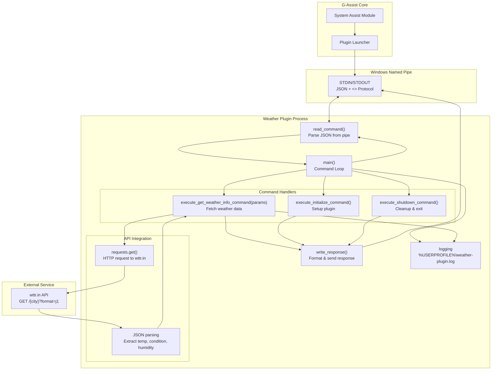
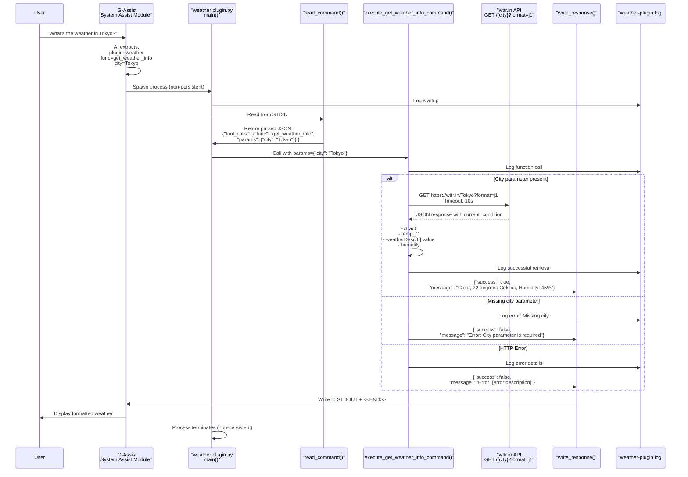
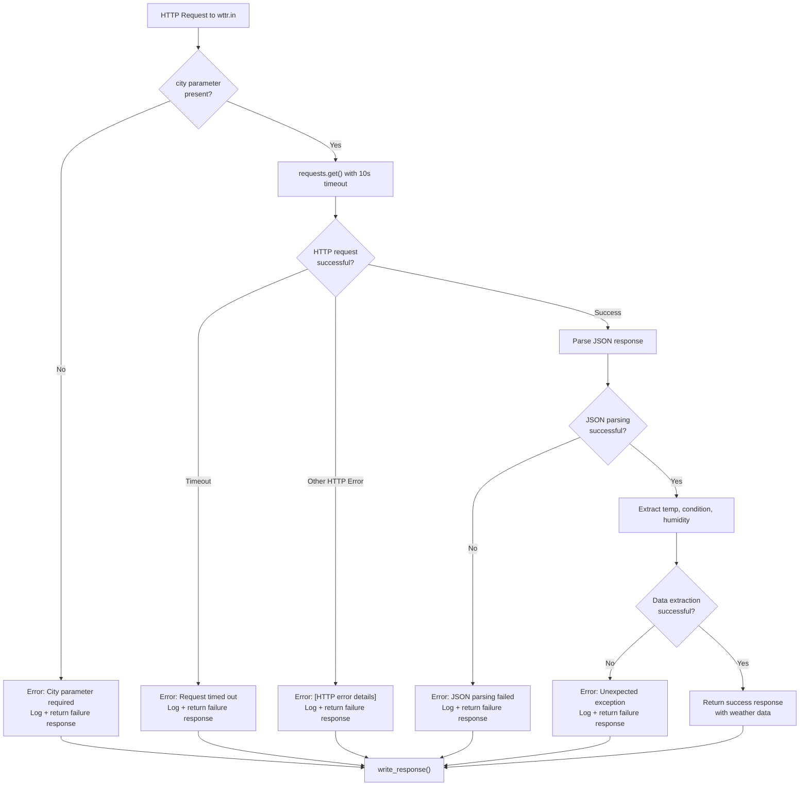

<!-- source: DeepWiki mcp.deepwiki.com · repo NVIDIA/G-Assist · page 6.4 Weather Plugin · fetched 2026-10-26 -->

# Weather Plugin

<details>
<summary>Relevant source files</summary>

The following files were used as context for generating this wiki page:

- [plugins/examples/weather/README.md](plugins/examples/weather/README.md)
- [plugins/examples/weather/requirements.txt](plugins/examples/weather/requirements.txt)

</details>


## Purpose and Scope

This document provides a detailed technical walkthrough of the Weather Plugin, a simple G-Assist plugin that demonstrates HTTP API integration patterns. The Weather Plugin retrieves real-time weather information from the wttr.in service and exposes it through G-Assist's natural language interface.

This plugin serves as an example of:
- Simple external API integration without authentication
- Basic JSON-based command handling
- Standard error handling and logging patterns
- PyInstaller packaging for Python plugins

For general plugin development concepts, see [Plugin Development Guide](#5). For the plugin architecture overview, see [Plugin Architecture](#3.2). For other plugin examples demonstrating different patterns (OAuth, persistent connections, hardware control), see sections [6.1](#6.1) through [6.7](#6.7).

**Sources:** [plugins/examples/weather/README.md:1-5]()

## Plugin Overview

The Weather Plugin is a non-persistent Python plugin that communicates with G-Assist via Windows Named Pipes using the standard JSON protocol. It queries the wttr.in weather service API to provide current weather conditions for any city worldwide.

**Key Characteristics:**
- **Persistence:** Non-persistent (spawned on-demand, terminates after response)
- **Language:** Python 3.6+
- **External API:** wttr.in (https://wttr.in/{city}?format=j1)
- **Authentication:** None required
- **Response Time:** Typically < 1 second per query

**Sources:** [plugins/examples/weather/README.md:79-104]()

## Architecture and Components

### Directory Structure

```
weather/
├── plugin.py                    # Main plugin logic
├── manifest.json               # G-Assist function definitions
├── requirements.txt            # Python dependencies
├── setup.bat                   # Virtual environment setup script
├── build.bat                   # PyInstaller build script
└── dist/                       # Generated after build
    └── weather/
        ├── g-assist-plugin-weather.exe
        └── manifest.json
```

**Installation Path:** `%PROGRAMDATA%\NVIDIA Corporation\nvtopps\rise\plugins\weather\`

**Sources:** [plugins/examples/weather/README.md:42-50]()

### Component Architecture



**Sources:** [plugins/examples/weather/README.md:78-104]()

## Command Protocol

### Input Message Format

The plugin receives commands via STDIN in the following JSON format:

```json
{
    "tool_calls": [
        {
            "func": "get_weather_info",
            "params": {
                "city": "London"
            }
        }
    ]
}
```

**Reading Logic:** The `read_command()` function uses Windows API (`ctypes`) to read from STDIN with a 4096-byte buffer, handling chunked input for large messages.

**Sources:** [plugins/examples/weather/README.md:84-89](), [plugins/examples/weather/README.md:136-148]()

### Output Message Format

The plugin sends responses via STDOUT with the `<<END>>` termination marker:

```json
{
    "success": true,
    "message": "Partly cloudy, 15 degrees Celsius, Humidity: 65%"
}<<END>>
```

**Writing Logic:** The `write_response()` function uses Windows API to write to STDOUT and automatically appends the `<<END>>` marker.

**Sources:** [plugins/examples/weather/README.md:90-93](), [plugins/examples/weather/README.md:150-156]()

## Available Commands

### Command: `initialize`

**Purpose:** Sets up the plugin environment at startup.

**Parameters:** None

**Response:**
```json
{
    "success": true,
    "message": "Plugin initialized"
}
```

**Implementation:** [plugins/examples/weather/README.md:107-110]()

### Command: `shutdown`

**Purpose:** Gracefully terminates the plugin process.

**Parameters:** None

**Response:**
```json
{
    "success": true,
    "message": "Plugin shutdown"
}
```

**Implementation:** [plugins/examples/weather/README.md:112-115]()

### Command: `get_weather_info`

**Purpose:** Retrieves current weather conditions for a specified city.

**Parameters:**

| Parameter | Type | Required | Description |
|-----------|------|----------|-------------|
| `city` | string | Yes | Name of the city to query |

**Response:**
```json
{
    "success": true,
    "message": "Partly cloudy, 15 degrees Celsius, Humidity: 65%"
}
```

**Error Response:**
```json
{
    "success": false,
    "message": "Error: City parameter is required"
}
```

**Implementation:** [plugins/examples/weather/README.md:117-131]()

**Sources:** [plugins/examples/weather/README.md:105-132]()

## Weather Data Retrieval Flow



**Sources:** [plugins/examples/weather/README.md:78-104](), [plugins/examples/weather/README.md:133-156]()

## External API Integration

### wttr.in Service

The plugin integrates with the wttr.in weather service, a console-oriented weather forecast service that provides free, unauthenticated API access.

**API Endpoint:** `https://wttr.in/{city}?format=j1`

**Request Method:** GET

**Request Headers:** None (default)

**Timeout:** 10 seconds

**Response Format:** JSON

### Example API Response

```json
{
    "current_condition": [
        {
            "temp_C": "15",
            "weatherDesc": [
                {
                    "value": "Partly cloudy"
                }
            ],
            "humidity": "65",
            "windspeedKmph": "13",
            "cloudcover": "50"
        }
    ]
}
```

### Data Extraction

The plugin extracts three key fields from the API response:

| Field | JSON Path | Description |
|-------|-----------|-------------|
| Temperature | `current_condition[0].temp_C` | Temperature in Celsius |
| Condition | `current_condition[0].weatherDesc[0].value` | Weather description |
| Humidity | `current_condition[0].humidity` | Humidity percentage |

**Implementation:** The `execute_get_weather_info_command()` function parses the JSON response and formats it into a human-readable message.

**Sources:** [plugins/examples/weather/README.md:95-103]()

## Error Handling

The Weather Plugin implements comprehensive error handling for all potential failure scenarios:

### Error Categories



### Error Handling Implementation

All command execution is wrapped in try-except blocks with specific handlers for:

- **Missing Parameters:** Validates required `city` parameter before API call
- **Request Timeouts:** 10-second timeout on HTTP requests prevents hanging
- **HTTP Errors:** Catches `requests.RequestException` for network issues
- **JSON Parsing Errors:** Handles malformed API responses
- **Unexpected Exceptions:** Catch-all handler logs and returns generic error

All errors are:
1. Logged to `%USERPROFILE%\weather-plugin.log` with detailed information
2. Returned to G-Assist with `{"success": false, "message": "Error: [description]"}` format

**Sources:** [plugins/examples/weather/README.md:158-167]()

## Logging

### Log Configuration

**Log File Location:** `%USERPROFILE%\weather-plugin.log`

**Logging Level:** INFO

**Log Format:**
```
%(asctime)s - %(levelname)s - [%(filename)s:%(lineno)d] - %(message)s
```

**Example Log Entry:**
```
2024-01-15 14:32:18,543 - INFO - [plugin.py:127] - Executing get_weather_info for city: London
```

### Logged Events

The plugin logs the following events:

| Event Type | Description |
|------------|-------------|
| Command reception | Incoming JSON command from G-Assist |
| Function calls | Execution of each command handler |
| Parameter validation | Presence/absence of required parameters |
| API requests | HTTP requests to wttr.in with city name |
| Error conditions | All exceptions with stack traces |
| Response generation | Success/failure responses before sending |

**Sources:** [plugins/examples/weather/README.md:169-179]()

## Dependencies

### Python Requirements

The plugin requires Python 3.6 or higher and the following packages:

| Package | Version | Purpose |
|---------|---------|---------|
| `requests` | 2.32.2 | HTTP requests to wttr.in API |
| `pyinstaller` | 6.11.0 | Build standalone executable |

**Requirements File:** [plugins/examples/weather/requirements.txt:1-2]()

### Standard Library Modules

The plugin also uses these built-in Python modules:

- `json` - Message serialization/deserialization
- `logging` - Operation logging
- `os` - File path operations
- `ctypes` - Windows API interaction for pipe communication

**Sources:** [plugins/examples/weather/README.md:181-189]()

## Build and Deployment

### Build Process

1. **Setup Environment:**
   ```bash
   setup.bat
   ```
   - Creates Python virtual environment
   - Installs dependencies from requirements.txt

2. **Build Executable:**
   ```bash
   build.bat
   ```
   - Uses PyInstaller to create standalone executable
   - Generates `dist/weather/` folder with:
     - `g-assist-plugin-weather.exe`
     - `manifest.json`

3. **Deploy Plugin:**
   - Copy entire `dist/weather/` folder to:
     ```
     %PROGRAMDATA%\NVIDIA Corporation\nvtopps\rise\plugins\
     ```

**Sources:** [plugins/examples/weather/README.md:28-50]()

### Manifest Configuration

The `manifest.json` file defines the plugin's capabilities for G-Assist discovery:

```json
{
    "manifestVersion": 1,
    "executable": "g-assist-plugin-weather.exe",
    "persistent": false,
    "functions": [
        {
            "name": "get_weather_info",
            "description": "Get current weather conditions for any city",
            "tags": ["weather", "temperature", "forecast", "climate"],
            "properties": {
                "city": {
                    "type": "string",
                    "description": "Name of the city to check weather for"
                }
            }
        }
    ]
}
```

**Key Fields:**
- `persistent: false` - Plugin terminates after each command
- `functions` array - Defines available commands for AI matching
- `tags` - Keywords to improve zero-shot function discovery

For complete manifest schema, see [Manifest Schema](#7.1).

**Sources:** [plugins/examples/weather/README.md:197-209]()

## Usage Examples

### Natural Language Invocation

Users can query weather through natural language commands:

```
"What's the weather like in London?"
"Check the temperature in New York"
"How's the weather in Tokyo?"
```

G-Assist's AI automatically:
1. Recognizes weather-related intent
2. Matches to `weather` plugin
3. Selects `get_weather_info` function
4. Extracts city parameter
5. Executes command

### Direct Plugin Invocation

Users can explicitly target the weather plugin:

```
"Hey weather, what's the temperature in Paris?"
"/weather Check conditions in Berlin"
```

**Sources:** [plugins/examples/weather/README.md:52-65]()

## Extension Points

The Weather Plugin serves as a template for adding new functionality:

### Adding New Commands

To extend the plugin with additional commands:

1. Implement function with signature: `def new_command(params: dict = None) -> dict`
2. Add to `commands` dictionary in `main()`
3. Add error handling and logging
4. Update `manifest.json` with function definition
5. Test manually before building
6. Rebuild with `build.bat` and redeploy

**Testing Procedure:**
```bash
python plugin.py
```

Input test command:
```json
{
    "tool_calls": [{
        "func": "new_command",
        "params": {"parameter_name": "parameter_value"}
    }]
}
```

**Sources:** [plugins/examples/weather/README.md:191-232]()

### Potential Enhancements

The README suggests several enhancement opportunities:

- **Weather Forecasts:** Multi-day predictions
- **Weather Alerts:** Severe weather warnings
- **Historical Data:** Past weather conditions

These would require additional API integration or alternative weather services.

**Sources:** [plugins/examples/weather/README.md:235-239]()

## Key Takeaways

The Weather Plugin demonstrates several important patterns for G-Assist plugin development:

1. **Simple API Integration:** Shows how to integrate unauthenticated HTTP APIs
2. **Non-Persistent Pattern:** Efficient for stateless, on-demand operations
3. **Standard Error Handling:** Comprehensive error catching and logging
4. **Clean Command Structure:** Modular command handlers with clear separation
5. **Windows Pipe Communication:** Correct usage of ctypes for STDIN/STDOUT
6. **PyInstaller Packaging:** Standard Python-to-executable workflow

This plugin is ideal as a starting point for developers building similar information retrieval plugins that query external APIs without complex authentication flows.

**Sources:** [plugins/examples/weather/README.md:1-250]()

---

