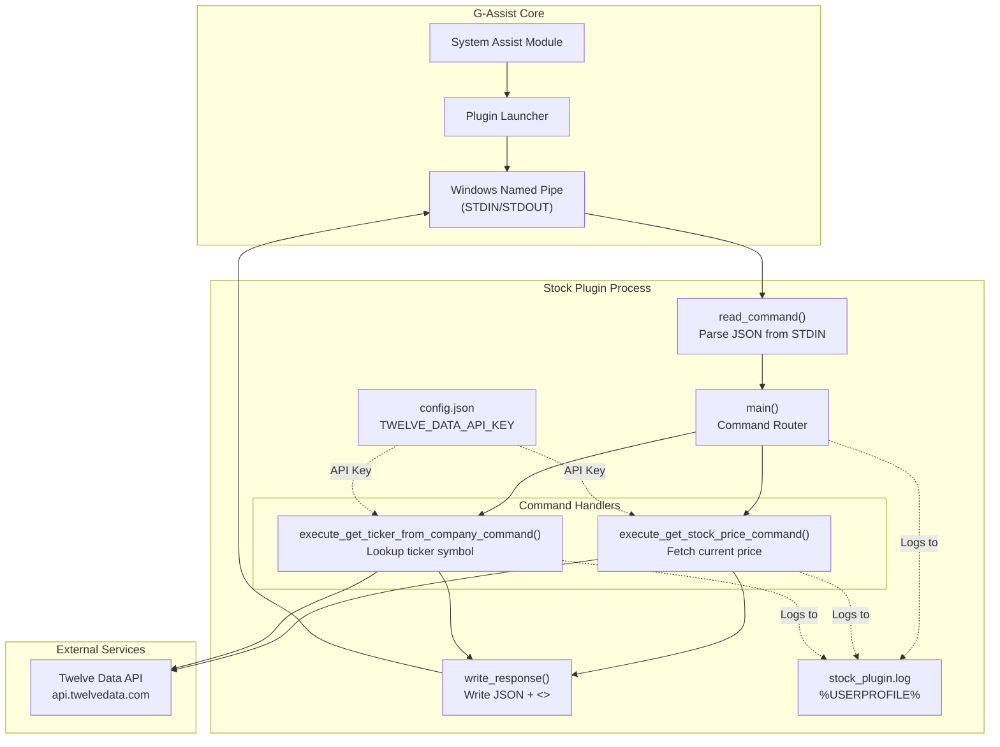
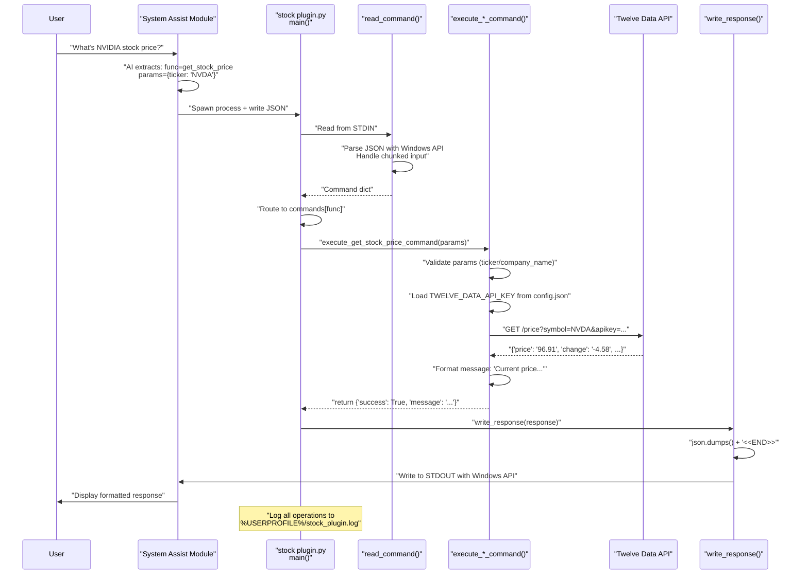

<!-- source: DeepWiki mcp.deepwiki.com · repo NVIDIA/G-Assist · page 6.5 Stock Market Plugin · fetched 2026-10-26 -->

# Stock Market Plugin

<details>
<summary>Relevant source files</summary>

The following files were used as context for generating this wiki page:

- [plugins/examples/stock/README.md](plugins/examples/stock/README.md)

</details>


## Purpose and Scope

The Stock Market Plugin provides real-time stock market data integration for G-Assist, enabling users to query stock prices and company information through natural language commands. This plugin demonstrates financial API integration patterns using the Twelve Data API service.

This document covers the technical implementation of the stock plugin, including command handlers, API integration, and data flow. For general plugin development concepts, see [Plugin Development Guide](#5). For information about the plugin communication protocol, see [Communication Protocol](#3.3). For plugin structure and manifest details, see [Plugin Structure and Files](#5.2).

**Sources:** [plugins/examples/stock/README.md:1-3]()

## Architecture Overview

The stock plugin follows the standard G-Assist plugin architecture: a standalone Python process that communicates with the System Assist Module via Windows Named Pipes using a JSON-based protocol. The plugin acts as a bridge between G-Assist and the Twelve Data API, translating user queries into API requests and formatting responses for display.

### Component Architecture



The plugin operates as a non-persistent process (spawned on-demand) that:
1. Reads JSON commands from STDIN via `read_command()` [plugins/examples/stock/README.md:105-108]()
2. Routes commands to appropriate handlers in `main()` [plugins/examples/stock/README.md:183]()
3. Executes API calls to Twelve Data [plugins/examples/stock/README.md:155-162]()
4. Returns formatted JSON responses via `write_response()` [plugins/examples/stock/README.md:110-113]()

**Sources:** [plugins/examples/stock/README.md:99-113]()

## Command Protocol and Data Flow

### Command Structure

The stock plugin receives commands following the standard tool_calls protocol:

```json
{
  "tool_calls": [{
    "func": "command_name",
    "params": {
      "ticker": "NVDA",
      "company_name": "NVIDIA"
    },
    "messages": [],
    "system_info": ""
  }]
}
```

**Sources:** [plugins/examples/stock/README.md:116-128]()

### Command Execution Flow



**Sources:** [plugins/examples/stock/README.md:105-113, 130-150]()

## Available Commands

### Stock Price Lookup

The `execute_get_stock_price_command()` handler retrieves current stock price information.

| Parameter | Type | Description |
|-----------|------|-------------|
| `ticker` | string | Stock symbol (e.g., "NVDA") |
| `company_name` | string | Company name (e.g., "NVIDIA") |

**Response Data:**
- Current/closing price
- Price change (absolute and percentage)
- Market status (open/closed)
- Timestamp of data

**Example User Query:**
- "What's the stock price for NVIDIA?"
- "/stock Check the price of AMC"

**Example Response:**
```
The current stock price for NVDA is $96.91 USD (as of 2024-03-14). Change: $-4.58 (-4.51%)
```

**Sources:** [plugins/examples/stock/README.md:133-141, 66-76]()

### Ticker Symbol Lookup

The `execute_get_ticker_from_company_command()` handler translates company names to stock ticker symbols.

| Parameter | Type | Description |
|-----------|------|-------------|
| `company_name` | string | Name of the company to lookup |

**Response Data:**
- Ticker symbol
- Exchange (NASDAQ, NYSE, etc.)
- Official company name

**Example User Query:**
- "What's the ticker symbol for GameStop?"

**Example Response:**
```
Found ticker for 'NVIDIA Corporation' on NASDAQ: NVDA
```

**Sources:** [plugins/examples/stock/README.md:144-150, 69, 79-81]()

## API Integration: Twelve Data

The plugin integrates with the Twelve Data API for market data retrieval.

### Configuration

API credentials are stored in `config.json` in the plugin directory:

```json
{
  "TWELVE_DATA_API_KEY": "your_api_key_here"
}
```

The API key is loaded by command handlers during execution. Users must obtain a free API key from [Twelve Data](https://twelvedata.com/pricing).

**Sources:** [plugins/examples/stock/README.md:54-61, 155-162]()

### API Endpoints

| Command Handler | Endpoint | Method | Purpose |
|----------------|----------|--------|---------|
| `execute_get_stock_price_command()` | `/price` | GET | Retrieve current stock price |
| `execute_get_ticker_from_company_command()` | `/symbol_search` | GET | Search for ticker by company name |

**Base URL:** `https://api.twelvedata.com`

**Sources:** [plugins/examples/stock/README.md:155-162]()

## Error Handling and Logging

### Error Handling Strategy

The plugin implements comprehensive error handling:

1. **Parameter Validation**: Type checking for all command parameters [plugins/examples/stock/README.md:168]()
2. **API Response Validation**: Verification of API response structure [plugins/examples/stock/README.md:169]()
3. **User-Friendly Messages**: Errors translated to readable messages [plugins/examples/stock/README.md:166]()
4. **Detailed Logging**: All errors logged with full context [plugins/examples/stock/README.md:167]()

**Common Error Scenarios:**
- Invalid API key: "Failed to fetch stock price" with logging of API error
- API rate limit exceeded: Logged with HTTP status code
- Invalid ticker symbol: User-friendly message about symbol not found

**Sources:** [plugins/examples/stock/README.md:164-169, 85-89]()

### Logging Configuration

**Log File Location:** `%USERPROFILE%\stock_plugin.log`

**Log Format:** `%(asctime)s - %(levelname)s - %(message)s`

**Log Level:** DEBUG

**Logged Events:**
- Command receipt and parsing [plugins/examples/stock/README.md:176]()
- API requests and responses [plugins/examples/stock/README.md:177]()
- Error details and stack traces [plugins/examples/stock/README.md:178]()
- Plugin lifecycle events (start/stop) [plugins/examples/stock/README.md:179]()

**Sources:** [plugins/examples/stock/README.md:91-95, 171-179]()

## Build and Deployment

### Build Process

The plugin uses a standard two-step build process:

**Step 1: Setup Dependencies**
```bash
setup.bat
```
- Creates Python virtual environment
- Installs packages from `requirements.txt`

**Step 2: Package Executable**
```bash
build.bat
```
- Uses PyInstaller to create standalone executable
- Outputs to `dist/stock/` directory
- Bundles all dependencies

**Sources:** [plugins/examples/stock/README.md:29-40]()

### Deployment Structure

The built plugin must be copied to:
```
%PROGRAMDATA%\NVIDIA Corporation\nvtopps\rise\plugins\stock\
```

**Required Files:**
- `stock.exe` (or configured executable name)
- `manifest.json` - Function definitions for G-Assist discovery
- `config.json` - API key configuration

**Sources:** [plugins/examples/stock/README.md:42-53]()

### Manifest Configuration

The `manifest.json` defines the plugin's capabilities for G-Assist discovery:

```json
{
  "manifestVersion": 1,
  "executable": "stock.exe",
  "persistent": false,
  "functions": [
    {
      "name": "get_stock_price",
      "description": "Get current stock price for a company",
      "tags": ["stock", "price", "market"],
      "properties": {
        "ticker": {
          "type": "string",
          "description": "Stock ticker symbol"
        },
        "company_name": {
          "type": "string",
          "description": "Company name"
        }
      }
    }
  ]
}
```

The `persistent: false` setting indicates this plugin is spawned on-demand rather than kept running continuously.

**Sources:** [plugins/examples/stock/README.md:186-199]()

## Adding New Commands

To extend the plugin with additional stock market features:

1. **Define Command Handler**: Create `execute_*_command()` function with type hints [plugins/examples/stock/README.md:183-184]()
2. **Register in Router**: Add to `commands` dictionary in `main()` [plugins/examples/stock/README.md:183]()
3. **Add Error Handling**: Implement try-except with logging [plugins/examples/stock/README.md:185]()
4. **Update Manifest**: Add function definition to `manifest.json` with name, description, tags, and properties [plugins/examples/stock/README.md:186-199]()
5. **Manual Testing**: Test via direct JSON input to `plugin.py` [plugins/examples/stock/README.md:200-222]()

**Testing Example:**
```bash
python plugin.py
```

Input initialize command:
```json
{"tool_calls": "initialize"}
```

Input test command:
```json
{
  "tool_calls": "new_command",
  "params": {
    "parameter_name": "parameter_value"
  }
}
```

**Sources:** [plugins/examples/stock/README.md:181-223]()

## Usage Examples

### Natural Language Queries

Users can invoke stock commands through various natural language patterns:

| User Input | Matched Command | Extracted Parameters |
|------------|----------------|---------------------|
| "What's the stock price for NVIDIA?" | `get_stock_price` | `company_name: "NVIDIA"` |
| "Hey stock, check the price of AMC" | `get_stock_price` | `ticker: "AMC"` |
| "/stock What's the ticker symbol for GameStop?" | `get_ticker_from_company` | `company_name: "GameStop"` |

The System Assist Module's AI engine analyzes user intent to determine the appropriate command and extract parameters, enabling flexible query patterns without hardcoded phrase matching.

**Sources:** [plugins/examples/stock/README.md:66-69]()

---

