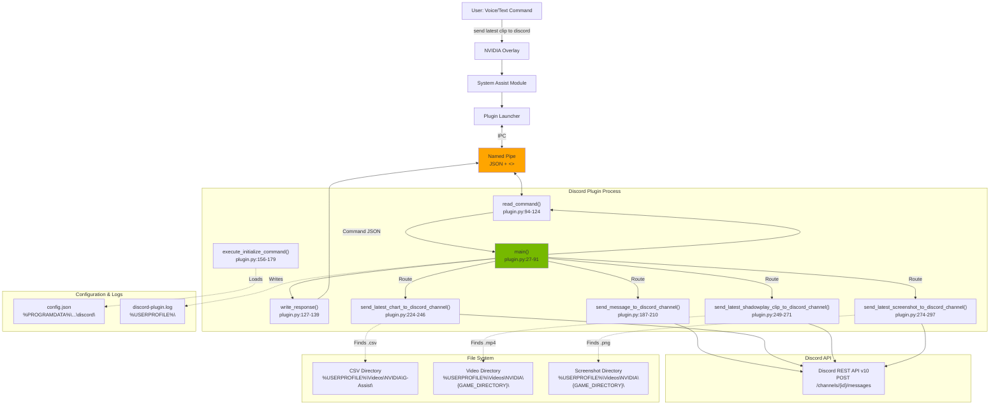
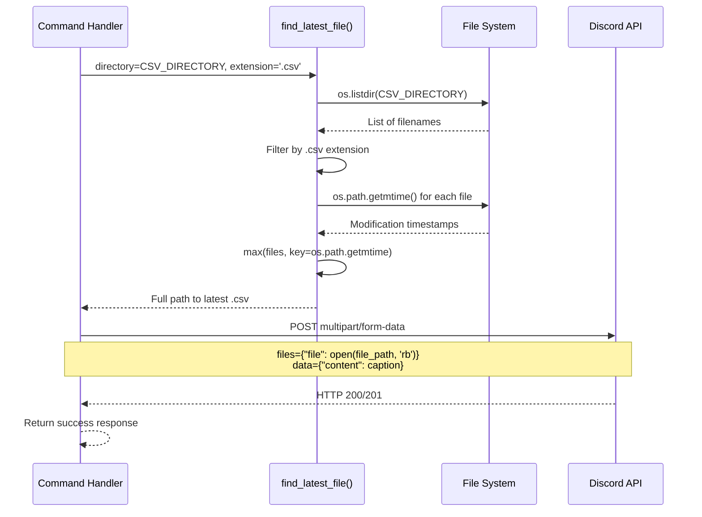
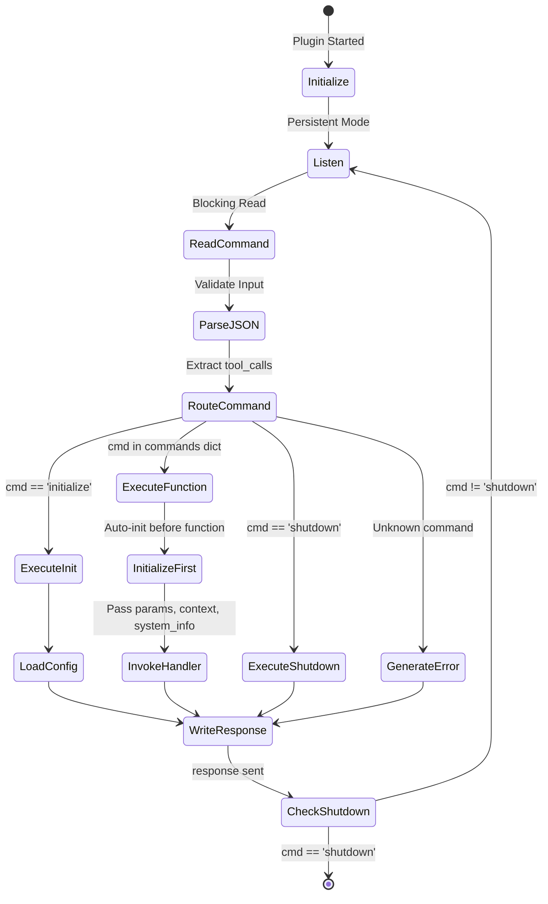

<!-- source: DeepWiki mcp.deepwiki.com · repo NVIDIA/G-Assist · page 6.6 Discord Plugin · fetched 2026-10-26 -->

# Discord Plugin

<details>
<summary>Relevant source files</summary>

The following files were used as context for generating this wiki page:

- [plugins/examples/discord/.gitignore](plugins/examples/discord/.gitignore)
- [plugins/examples/discord/ATTRIBUTIONS.md](plugins/examples/discord/ATTRIBUTIONS.md)
- [plugins/examples/discord/CONTRIBUTING.md](plugins/examples/discord/CONTRIBUTING.md)
- [plugins/examples/discord/README.md](plugins/examples/discord/README.md)
- [plugins/examples/discord/build.bat](plugins/examples/discord/build.bat)
- [plugins/examples/discord/manifest.json](plugins/examples/discord/manifest.json)
- [plugins/examples/discord/plugin.py](plugins/examples/discord/plugin.py)
- [plugins/examples/discord/requirements.txt](plugins/examples/discord/requirements.txt)
- [plugins/examples/discord/setup.bat](plugins/examples/discord/setup.bat)

</details>


## Purpose and Scope

This document describes the Discord Plugin for G-Assist, which enables users to send messages, performance charts, Shadowplay clips, and screenshots to Discord channels through voice or text commands. The plugin operates as a persistent process, communicating with Discord's REST API to deliver content from the user's local system to configured Discord channels.

For general information about plugin architecture and manifest structure, see [Plugin Architecture](#3.2). For details on the communication protocol used by all plugins, see [Communication Protocol](#3.3). For implementation guidance on building custom plugins, see [Plugin Development Guide](#5).

## Overview

The Discord plugin is a Python-based persistent plugin that bridges G-Assist with Discord's messaging platform. It authenticates using a Discord Bot Token, monitors G-Assist command pipe for invocations, and executes Discord API operations to send text messages and upload files (CSV charts, MP4 video clips, PNG screenshots) to a specified Discord channel.

**Key Characteristics:**
- **Persistent Process**: Runs continuously, listening for commands rather than spawning per-request
- **File Discovery**: Automatically finds latest files in NVIDIA App capture directories
- **Token Authentication**: Uses Discord Bot Token stored in `config.json`
- **Windows API Integration**: Uses `kernel32.dll` for Named Pipe I/O

**Sources:** [plugins/examples/discord/README.md:1-11](), [plugins/examples/discord/manifest.json:1-51]()

## System Architecture

### Plugin in G-Assist Ecosystem



**Sources:** [plugins/examples/discord/plugin.py:27-91](), [plugins/examples/discord/manifest.json:1-51]()

## Configuration

### config.json Structure

The plugin requires a configuration file located at `%PROGRAMDATA%\NVIDIA Corporation\nvtopps\rise\plugins\discord\config.json`:

```json
{
    "BOT_TOKEN": "YOUR_BOT_TOKEN_HERE",
    "CHANNEL_ID": "YOUR_CHANNEL_ID_HERE",
    "GAME_DIRECTORY": "GAME_DIRECTORY_HERE"
}
```

**Configuration Parameters:**

| Parameter | Type | Description | Example |
|-----------|------|-------------|---------|
| `BOT_TOKEN` | string | Discord Bot Token from Developer Portal | `"MTIzNDU2Nzg5MDEyMzQ1Njc4.GhIjKl.MnOpQr..."` |
| `CHANNEL_ID` | string | Numeric Discord channel ID (enable Developer Mode) | `"1234567890123456789"` |
| `GAME_DIRECTORY` | string | Subdirectory name under `%USERPROFILE%\Videos\NVIDIA\` for game-specific captures | `"RUST"`, `"Desktop"` |

### Configuration Loading

The `execute_initialize_command()` function loads configuration from disk:

[plugins/examples/discord/plugin.py:156-179]()

```python
def execute_initialize_command() -> dict:
    global BOT_TOKEN
    global CHANNEL_ID
    global GAME_DIRECTORY
    try:
        with open(CONFIG_FILE, 'r') as f:
            config = json.load(f)
            BOT_TOKEN = config['BOT_TOKEN']
            CHANNEL_ID = config['CHANNEL_ID']
            GAME_DIRECTORY = config['GAME_DIRECTORY']
        logging.info('Config loaded successfully.')
        return generate_success_response('Initialize success.')
    except FileNotFoundError:
        logging.error('Config file not found, creating sample config.')
        # Creates template config.json
        return generate_failure_response('Config file not found. Sample config created.')
```

The plugin stores configuration in global variables (`BOT_TOKEN`, `CHANNEL_ID`, `GAME_DIRECTORY`) declared at module level [plugins/examples/discord/plugin.py:23-25](). The initialization is invoked before every command execution [plugins/examples/discord/plugin.py:67]().

**Sources:** [plugins/examples/discord/plugin.py:156-179](), [plugins/examples/discord/README.md:44-58]()

## Plugin Functions

### Manifest Definition

The plugin declares its capabilities in `manifest.json`:

[plugins/examples/discord/manifest.json:1-51]()

**Manifest Properties:**

| Property | Value | Description |
|----------|-------|-------------|
| `manifestVersion` | `1` | Manifest schema version |
| `executable` | `"./g-assist-plugin-discord.exe"` | Relative path to plugin executable |
| `persistent` | `true` | Plugin runs continuously, not spawned per-command |
| `functions` | Array of 4 function definitions | Command handlers exposed to G-Assist |

### Function: send_message_to_discord_channel

Sends a text message to the configured Discord channel.

**Manifest Entry:**
```json
{
  "name": "send_message_to_discord_channel",
  "description": "Send a text message to a Discord channel",
  "tags": ["discord", "message"],
  "properties": {
    "message": {
      "type": "string",
      "description": "The text content of the message"
    }
  }
}
```

**Implementation:**

[plugins/examples/discord/plugin.py:187-210]()

The function:
1. Extracts `message` parameter from `params` dict
2. Constructs Discord API v10 endpoint: `https://discord.com/api/v10/channels/{CHANNEL_ID}/messages`
3. Includes Bot Token in Authorization header: `"Bot {BOT_TOKEN}"`
4. POSTs JSON payload: `{"content": text}`
5. Returns success if HTTP 200/201, failure otherwise

**Sources:** [plugins/examples/discord/manifest.json:7-16](), [plugins/examples/discord/plugin.py:187-210]()

### Function: send_latest_chart_to_discord_channel

Uploads the most recent CSV file from G-Assist charts directory.

**Manifest Entry:**
```json
{
  "name": "send_latest_chart_to_discord_channel",
  "description": "Send the latest .csv file from the G-Assist directory to a Discord channel",
  "tags": ["discord", "file", "csv", "chart", "metrics", "performance data", "perf", "data"],
  "properties": {
    "caption": {
      "type": "string",
      "description": "[optional] An optional caption for the file attachment"
    }
  }
}
```

**Implementation:**

[plugins/examples/discord/plugin.py:224-246]()

**File Discovery Process:**



The function uses `find_latest_file()` utility [plugins/examples/discord/plugin.py:213-221]() to locate the most recently modified CSV in `%USERPROFILE%\Videos\NVIDIA\G-Assist\` [plugins/examples/discord/plugin.py:17]().

**Sources:** [plugins/examples/discord/manifest.json:18-27](), [plugins/examples/discord/plugin.py:224-246](), [plugins/examples/discord/plugin.py:213-221]()

### Function: send_latest_shadowplay_clip_to_discord_channel

Uploads the most recent MP4 video clip from game-specific directory.

**Manifest Entry:**
```json
{
  "name": "send_latest_shadowplay_clip_to_discord_channel",
  "description": "Send the latest .mp4 Shadowplay clip from the specified directory to a Discord channel",
  "tags": ["discord", "file", "video", "shadowplay", "clip", "replay"],
  "properties": {
    "caption": {
      "type": "string",
      "description": "[optional] An option caption for the video attachment"
    }
  }
}
```

**Implementation:**

[plugins/examples/discord/plugin.py:249-271]()

**Directory Construction:**
```python
mp4_directory = os.path.join(BASE_MP4_DIRECTORY, GAME_DIRECTORY)
# Resolves to: %USERPROFILE%\Videos\NVIDIA\{GAME_DIRECTORY}
```

Where `BASE_MP4_DIRECTORY` is defined at [plugins/examples/discord/plugin.py:18]() and `GAME_DIRECTORY` is loaded from `config.json`.

**Example Paths:**
- For RUST: `C:\Users\Username\Videos\NVIDIA\RUST\`
- For Desktop: `C:\Users\Username\Videos\NVIDIA\Desktop\`

**Sources:** [plugins/examples/discord/manifest.json:29-38](), [plugins/examples/discord/plugin.py:249-271]()

### Function: send_latest_screenshot_to_discord_channel

Uploads the most recent PNG screenshot from game-specific directory.

**Manifest Entry:**
```json
{
  "name": "send_latest_screenshot_to_discord_channel",
  "description": "Send the latest .png screenshot from the specified directory to a Discord channel",
  "tags": ["discord", "file", "screenshot", "pic"],
  "properties": {
    "caption": {
      "type": "string",
      "description": "[optional] An optional caption for the screenshot attachment"
    }
  }
}
```

**Implementation:**

[plugins/examples/discord/plugin.py:274-297]()

Identical logic to `send_latest_shadowplay_clip_to_discord_channel` but searches for `.png` files instead of `.mp4` files. Uses `BASE_SCREENSHOT_DIRECTORY` [plugins/examples/discord/plugin.py:19]() which resolves to the same base path as video clips.

**Sources:** [plugins/examples/discord/manifest.json:40-49](), [plugins/examples/discord/plugin.py:274-297]()

## Command Processing Flow

### Main Loop

The plugin's main execution loop:



**Sources:** [plugins/examples/discord/plugin.py:27-91]()

### Command Dispatch Table

The `commands` dictionary maps command names to handler functions:

[plugins/examples/discord/plugin.py:36-43]()

```python
commands = {
    'initialize': execute_initialize_command,
    'shutdown': execute_shutdown_command,
    'send_message_to_discord_channel': send_message_to_discord_channel,
    'send_latest_chart_to_discord_channel': send_latest_chart_to_discord_channel,
    'send_latest_shadowplay_clip_to_discord_channel': send_latest_shadowplay_clip_to_discord_channel,
    'send_latest_screenshot_to_discord_channel': send_latest_screenshot_to_discord_channel,
}
```

### Tool Calls Structure

Commands from G-Assist arrive as JSON with the following structure:

```json
{
  "tool_calls": [
    {
      "func": "send_message_to_discord_channel",
      "params": {
        "message": "I'll be there in five minutes"
      },
      "messages": { /* optional context */ },
      "system_info": { /* optional system state */ }
    }
  ]
}
```

The main loop iterates over `tool_calls` array [plugins/examples/discord/plugin.py:57-72](), extracting:
- `func`: Command name [plugins/examples/discord/plugin.py:61]()
- `params`: Function parameters [plugins/examples/discord/plugin.py:68]()
- `messages`: Conversation context (optional) [plugins/examples/discord/plugin.py:69]()
- `system_info`: System state (optional) [plugins/examples/discord/plugin.py:70]()

**Sources:** [plugins/examples/discord/plugin.py:57-72]()

## Communication Protocol Implementation

### Windows Named Pipe I/O

The plugin uses Windows kernel32 API for pipe communication via `ctypes`:

#### Reading Commands

[plugins/examples/discord/plugin.py:94-124]()

**Read Algorithm:**
1. Get STDIN handle: `windll.kernel32.GetStdHandle(-10)` [plugins/examples/discord/plugin.py:96-97]()
2. Read in chunks of 4096 bytes [plugins/examples/discord/plugin.py:101]()
3. Call `ReadFile()` with buffer [plugins/examples/discord/plugin.py:104]()
4. Decode UTF-8 bytes [plugins/examples/discord/plugin.py:110]()
5. Accumulate chunks until `message_bytes.value < BUFFER_SIZE` [plugins/examples/discord/plugin.py:113-114]()
6. Parse accumulated JSON [plugins/examples/discord/plugin.py:117]()

**Error Handling:**
- Returns `None` on `ReadFile()` failure [plugins/examples/discord/plugin.py:106-108]()
- Returns `None` on JSON decode error [plugins/examples/discord/plugin.py:119-121]()
- Catches all exceptions [plugins/examples/discord/plugin.py:122-124]()

#### Writing Responses

[plugins/examples/discord/plugin.py:127-139]()

**Write Algorithm:**
1. Get STDOUT handle: `windll.kernel32.GetStdHandle(-11)` [plugins/examples/discord/plugin.py:129-130]()
2. Serialize response to JSON [plugins/examples/discord/plugin.py:131]()
3. Append termination marker: `'<<END>>'` [plugins/examples/discord/plugin.py:131]()
4. Encode to UTF-8 bytes [plugins/examples/discord/plugin.py:132]()
5. Call `WriteFile()` [plugins/examples/discord/plugin.py:136]()

**Response Format:**

```json
{"success": true, "message": "Message sent successfully."}<<END>>
```

or

```json
{"success": false, "message": "Error sending message."}<<END>>
```

**Sources:** [plugins/examples/discord/plugin.py:94-139]()

### Response Generation

Two utility functions standardize response creation:

[plugins/examples/discord/plugin.py:142-153]()

```python
def generate_failure_response(message: str = None) -> Response:
    response = { 'success': False }
    if message:
        response['message'] = message
    return response

def generate_success_response(message: str = None) -> Response:
    response = { 'success': True }
    if message:
        response['message'] = message
    return response
```

The `Response` type is defined as: `Response = dict[bool, Optional[str]]` [plugins/examples/discord/plugin.py:8]()

**Sources:** [plugins/examples/discord/plugin.py:8](), [plugins/examples/discord/plugin.py:142-153]()

## Discord API Integration

### REST API v10

The plugin uses Discord REST API version 10 with the following endpoint:

```
POST https://discord.com/api/v10/channels/{CHANNEL_ID}/messages
```

### Authentication

All requests include the Bot Token in the Authorization header:

```python
headers = {"Authorization": f"Bot {BOT_TOKEN}"}
```

[plugins/examples/discord/plugin.py:196](), [plugins/examples/discord/plugin.py:233](), [plugins/examples/discord/plugin.py:259](), [plugins/examples/discord/plugin.py:284]()

### Request Types

#### Text Messages

```python
headers = {"Authorization": f"Bot {BOT_TOKEN}", "Content-Type": "application/json"}
payload = {"content": text}
r = requests.post(url, headers=headers, json=payload)
```

[plugins/examples/discord/plugin.py:196-199]()

#### File Uploads

```python
headers = {"Authorization": f"Bot {BOT_TOKEN}"}
files = {"file": open(file_path, 'rb')}
payload = {"content": caption}
r = requests.post(url, headers=headers, data=payload, files=files)
```

[plugins/examples/discord/plugin.py:233-237]() (CSV), [plugins/examples/discord/plugin.py:259-262]() (MP4), [plugins/examples/discord/plugin.py:284-287]() (PNG)

### Response Handling

All Discord API calls check for HTTP 200 or 201 status codes:

```python
if r.status_code == 200 or r.status_code == 201:
    return generate_success_response('Message sent successfully.')
else:
    return generate_failure_response(f'Failed to send message: {r.text}')
```

The pattern appears in all Discord functions [plugins/examples/discord/plugin.py:201-206](), [plugins/examples/discord/plugin.py:239-242](), [plugins/examples/discord/plugin.py:264-267](), [plugins/examples/discord/plugin.py:289-293]().

**Sources:** [plugins/examples/discord/plugin.py:187-297]()

## File Discovery and Handling

### File Search Utility

The `find_latest_file()` function locates the most recently modified file with a given extension:

[plugins/examples/discord/plugin.py:213-221]()

```python
def find_latest_file(directory: str, extension: str) -> Optional[str]:
    try:
        files = [os.path.join(directory, f) for f in os.listdir(directory) if f.endswith(extension)]
        if not files:
            return None
        return max(files, key=os.path.getmtime)
    except Exception as e:
        logging.error(f'Error finding latest file: {str(e)}')
        return None
```

**Algorithm:**
1. List all files in directory
2. Filter by extension (`.csv`, `.mp4`, or `.png`)
3. Get modification time for each file using `os.path.getmtime()`
4. Return file with maximum modification time
5. Return `None` if directory is empty or error occurs

### Directory Constants

File paths are constructed from environment variables:

[plugins/examples/discord/plugin.py:11-19]()

| Constant | Value | Purpose |
|----------|-------|---------|
| `CSV_DIRECTORY` | `%USERPROFILE%\Videos\NVIDIA\G-Assist` | G-Assist performance charts |
| `BASE_MP4_DIRECTORY` | `%USERPROFILE%\Videos\NVIDIA` | Base directory for video clips |
| `BASE_SCREENSHOT_DIRECTORY` | `%USERPROFILE%\Videos\NVIDIA` | Base directory for screenshots |

**Game-Specific Paths:**

```python
mp4_directory = os.path.join(BASE_MP4_DIRECTORY, GAME_DIRECTORY)
screenshot_directory = os.path.join(BASE_SCREENSHOT_DIRECTORY, GAME_DIRECTORY)
```

The `GAME_DIRECTORY` variable comes from `config.json` and specifies the subdirectory name (e.g., `"RUST"`, `"Desktop"`).

**Sources:** [plugins/examples/discord/plugin.py:11-19](), [plugins/examples/discord/plugin.py:213-221](), [plugins/examples/discord/plugin.py:252](), [plugins/examples/discord/plugin.py:277]()

## Error Handling and Logging

### Logging Configuration

Logging is configured at module level:

[plugins/examples/discord/plugin.py:21]()

```python
logging.basicConfig(filename=LOG_FILE, level=logging.INFO, format="%(asctime)s - %(levelname)s - %(message)s")
```

Where `LOG_FILE` resolves to `%USERPROFILE%\discord-plugin.log` [plugins/examples/discord/plugin.py:11]().

### Log Events

The plugin logs the following events:

| Event | Log Level | Example |
|-------|-----------|---------|
| Plugin startup | INFO | `"Plugin started"` [plugins/examples/discord/plugin.py:46]() |
| Command received | INFO | `"Received input: {input}"` [plugins/examples/discord/plugin.py:55]() |
| Command processing | INFO | `"Processing command: {cmd}"` [plugins/examples/discord/plugin.py:62]() |
| Command execution | INFO | `"Executing command: {cmd} with params: {params}..."` [plugins/examples/discord/plugin.py:71]() |
| Response sent | INFO | `"Sending response: {response}"` [plugins/examples/discord/plugin.py:83]() |
| Config loaded | INFO | `"Config loaded successfully."` [plugins/examples/discord/plugin.py:166]() |
| Discord message sent | INFO | `"Sending message to Discord channel: {CHANNEL_ID}"` [plugins/examples/discord/plugin.py:192]() |
| Unknown command | WARNING | `"Unknown command: {cmd}"` [plugins/examples/discord/plugin.py:74]() |
| Malformed input | WARNING | `"Malformed input: missing function property"` [plugins/examples/discord/plugin.py:77]() |
| Read error | ERROR | `"Error reading command pipe"` [plugins/examples/discord/plugin.py:107]() |
| JSON decode error | ERROR | `"Failed to decode JSON input"` [plugins/examples/discord/plugin.py:120]() |
| Config file missing | ERROR | `"Config file not found, creating sample config."` [plugins/examples/discord/plugin.py:169]() |
| Discord API error | ERROR | `"Failed to send message: {r.text}"` [plugins/examples/discord/plugin.py:205]() |

### Exception Handling Patterns

All command handlers wrap logic in try-except blocks:

```python
def send_message_to_discord_channel(params: dict = None, context: dict = None, system_info: dict = None) -> dict:
    try:
        # Command logic
        return generate_success_response('Message sent successfully.')
    except Exception as e:
        logging.error(f'Error in send_message_to_discord_channel: {str(e)}')
        return generate_failure_response('Error sending message.')
```

This pattern appears in:
- [plugins/examples/discord/plugin.py:187-210]() (send message)
- [plugins/examples/discord/plugin.py:224-246]() (send chart)
- [plugins/examples/discord/plugin.py:249-271]() (send clip)
- [plugins/examples/discord/plugin.py:274-297]() (send screenshot)

**Sources:** [plugins/examples/discord/plugin.py:21](), [plugins/examples/discord/plugin.py:46-90](), [plugins/examples/discord/plugin.py:187-297]()

## Build and Deployment

### Build Process

The plugin uses a two-stage build process:

#### 1. Environment Setup

[plugins/examples/discord/setup.bat:1-37]()

**Actions:**
1. Detect Python executable (`python` or `python3`)
2. Create virtual environment: `python -m venv .venv`
3. Activate virtual environment
4. Install dependencies: `pip install -r requirements.txt`

**Dependencies** [plugins/examples/discord/requirements.txt:1-3]():
- `requests>=2.31.0` - Discord REST API calls
- `pywin32>=223` - Windows API bindings for Named Pipes
- `pyinstaller==6.11.0` - Executable packaging

#### 2. Executable Build

[plugins/examples/discord/build.bat:1-53]()

**Actions:**
1. Activate virtual environment
2. Create distribution directory: `dist\discord\`
3. Run PyInstaller: `pyinstaller --onefile --name g-assist-plugin-discord --distpath "dist\discord" plugin.py`
4. Copy `manifest.json` to `dist\discord\`
5. Copy `config.json` to `dist\discord\` (if exists)

**PyInstaller Options:**
- `--onefile`: Bundle into single executable
- `--name g-assist-plugin-discord`: Output filename
- `--distpath "dist\discord"`: Output directory

### Deployment Structure

After building, the `dist\discord\` directory contains:

```
dist/
└── discord/
    ├── g-assist-plugin-discord.exe
    ├── manifest.json
    └── config.json
```

This directory is copied to:
```
%PROGRAMDATA%\NVIDIA Corporation\nvtopps\rise\plugins\discord\
```

**Sources:** [plugins/examples/discord/setup.bat:1-37](), [plugins/examples/discord/build.bat:1-53](), [plugins/examples/discord/requirements.txt:1-3]()

## Usage Examples

### User Commands

The plugin responds to natural language commands that G-Assist routes based on manifest tags:

| User Input | Matched Function | Parameters Extracted |
|------------|------------------|---------------------|
| "Hey Discord, send a message saying I'll be there soon" | `send_message_to_discord_channel` | `{"message": "I'll be there soon"}` |
| "Send the latest perf chart to Discord" | `send_latest_chart_to_discord_channel` | `{"caption": ""}` |
| "Upload my latest Shadowplay clip to Discord with caption 'epic moment'" | `send_latest_shadowplay_clip_to_discord_channel` | `{"caption": "epic moment"}` |
| "Share my latest screenshot on Discord" | `send_latest_screenshot_to_discord_channel` | `{"caption": ""}` |

### Direct Testing

For development and testing, commands can be sent directly to the plugin process:

**1. Initialize:**
```json
{
  "tool_calls": [{
    "func": "initialize"
  }]
}
```

**2. Send Message:**
```json
{
  "tool_calls": [{
    "func": "send_message_to_discord_channel",
    "params": {
      "message": "Test message from G-Assist"
    }
  }]
}
```

**3. Send Chart:**
```json
{
  "tool_calls": [{
    "func": "send_latest_chart_to_discord_channel",
    "params": {
      "caption": "Performance metrics"
    }
  }]
}
```

The plugin responds with:
```json
{"success": true, "message": "Message sent successfully."}<<END>>
```

**Sources:** [plugins/examples/discord/README.md:82-88](), [plugins/examples/discord/README.md:196-218]()

## Extension Points

### Adding New Commands

To extend the plugin with additional Discord operations:

**1. Implement handler function:**
```python
def new_command(params: dict = None, context: dict = None, system_info: dict = None) -> dict:
    try:
        # Command logic
        return generate_success_response('Operation completed.')
    except Exception as e:
        logging.error(f'Error in new_command: {str(e)}')
        return generate_failure_response('Operation failed.')
```

**2. Register in command dictionary** [plugins/examples/discord/plugin.py:36-43]():
```python
commands = {
    # ... existing commands ...
    'new_command': new_command,
}
```

**3. Define in manifest.json** [plugins/examples/discord/manifest.json:5-50]():
```json
{
  "name": "new_command",
  "description": "Description of what the command does",
  "tags": ["discord", "relevant", "tags"],
  "properties": {
    "param_name": {
      "type": "string",
      "description": "Parameter description"
    }
  }
}
```

**4. Rebuild and deploy:**
```bash
build.bat
```

Copy `dist\discord\` to G-Assist plugins directory.

**Sources:** [plugins/examples/discord/README.md:176-219]()

## Security Considerations

### Token Management

The Discord Bot Token is a sensitive credential that grants full bot permissions:

- **Storage**: Stored in `config.json` at `%PROGRAMDATA%\NVIDIA Corporation\nvtopps\rise\plugins\discord\` [plugins/examples/discord/plugin.py:12-16]()
- **Access**: Readable by any user with access to `%PROGRAMDATA%` directory
- **Logging**: Token is never logged; only loaded into memory [plugins/examples/discord/plugin.py:156-179]()
- **Transmission**: Sent only to Discord API over HTTPS

### Bot Permissions

The plugin requires minimal Discord Bot permissions:
- **Send Messages** (`2048`): Required for text message posting
- **Attach Files**: Required for CSV, MP4, and PNG uploads

Configure in Discord Developer Portal under OAuth2 URL Generator [plugins/examples/discord/README.md:29-32]().

### File Access

The plugin accesses files in NVIDIA App directories:
- **Read-only**: Only reads files, never modifies or deletes
- **Latest file**: Automatically selects most recent, no directory traversal
- **User scope**: Only accesses current user's `%USERPROFILE%` directories

**Sources:** [plugins/examples/discord/plugin.py:12-16](), [plugins/examples/discord/README.md:18-41]()

---

