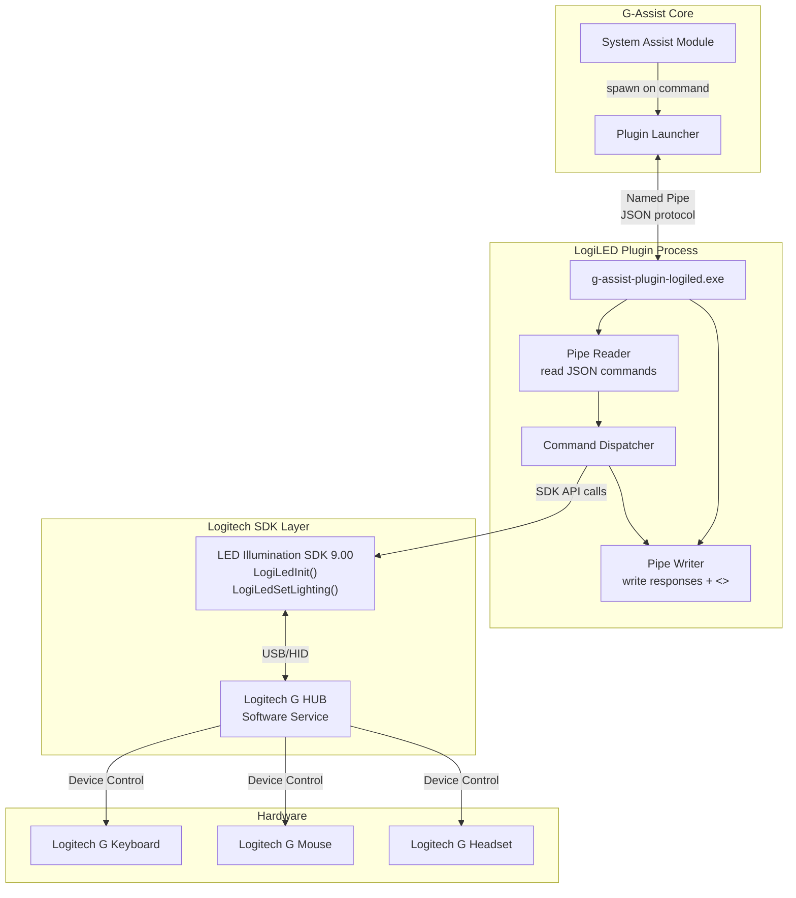
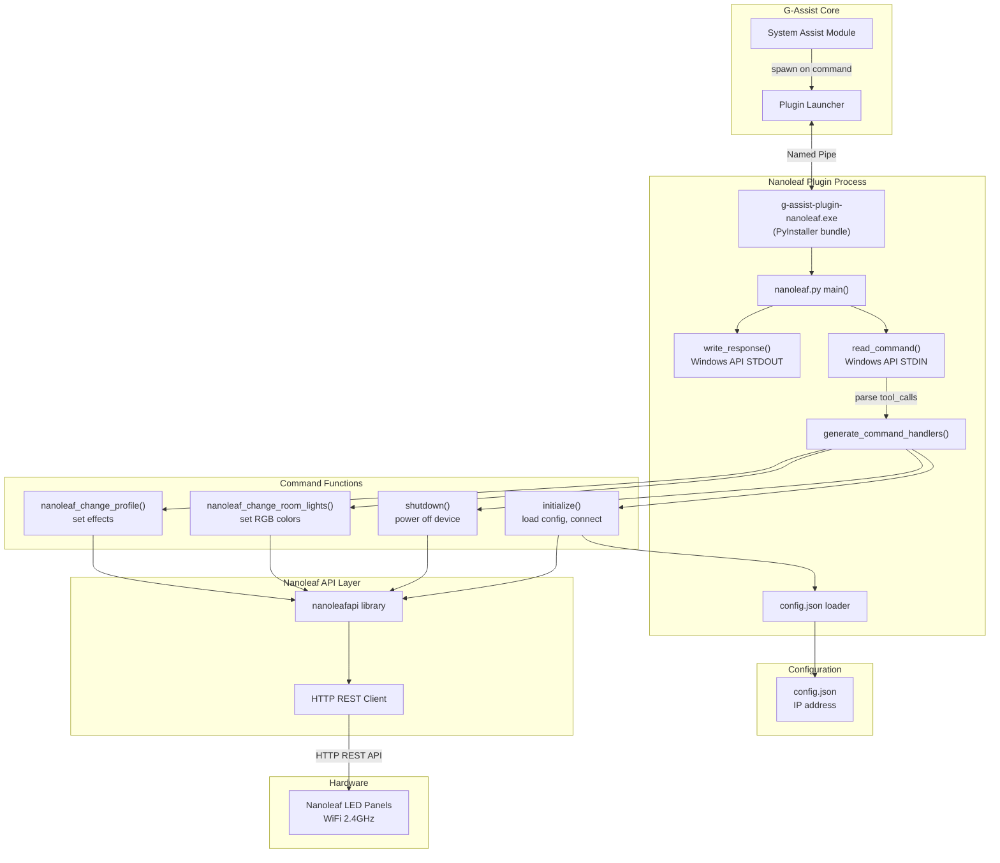
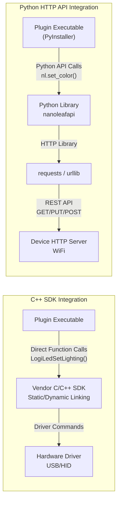

<!-- source: DeepWiki mcp.deepwiki.com · repo NVIDIA/G-Assist · page 6.7 Hardware Control Plugins · fetched 2026-10-26 -->

# Hardware Control Plugins

<details>
<summary>Relevant source files</summary>

The following files were used as context for generating this wiki page:

- [plugins/examples/logiled/README.md](plugins/examples/logiled/README.md)
- [plugins/examples/nanoleaf/README.md](plugins/examples/nanoleaf/README.md)

</details>


## Purpose and Scope

This page documents the hardware control plugins in the G-Assist ecosystem, which enable voice and text-based control of RGB lighting and other hardware peripherals. These plugins demonstrate integration with vendor-specific SDKs and APIs to provide unified natural language control over physical devices.

The three primary hardware control plugins covered are:
- **LogiLED Plugin**: Controls Logitech G devices via the LED Illumination SDK
- **Corsair Plugin**: Manages Corsair iCUE-compatible devices
- **Nanoleaf Plugin**: Controls Nanoleaf smart lighting panels via REST API

For general plugin development patterns, see [Plugin Development Guide](#5). For other plugin examples like Spotify or Discord, see [Plugin Examples](#6).

---

## Hardware Control Plugin Architecture

Hardware control plugins follow the standard G-Assist plugin architecture but with additional considerations for hardware SDK integration and device state management. Unlike information retrieval plugins (Weather, Stock), hardware plugins must maintain connections to physical devices and handle device-specific error conditions.

### Plugin Comparison Matrix

| Plugin | Language | SDK/API | Persistent | Device Connection | Config Required |
|--------|----------|---------|------------|-------------------|-----------------|
| LogiLED | C++ | Logitech LED Illumination SDK 9.00 | No | USB/G HUB | No |
| Corsair | C++ | Corsair iCUE SDK | No | USB/iCUE Software | No |
| Nanoleaf | Python | Nanoleaf HTTP REST API | No | WiFi (2.4GHz) | Yes (IP address) |

**Sources**: [plugins/examples/logiled/README.md:1-85](), [plugins/examples/nanoleaf/README.md:1-230]()

---

## LogiLED Plugin (Logitech G Devices)

### Overview

The LogiLED plugin provides voice and text control for Logitech G devices that support the LED Illumination SDK, including gaming keyboards, mice, and headsets. It is implemented as a C++ plugin that communicates with Logitech G HUB software.

### Architecture Diagram



**Sources**: [plugins/examples/logiled/README.md:1-85]()

### Installation and Build Process

The LogiLED plugin requires Visual Studio 2022 and several external dependencies:

1. **Logitech G HUB** - Device driver and communication layer
2. **LED Illumination SDK 9.00** - C++ SDK for LED control
3. **JSON for Modern C++ v3.11.3** - JSON parsing library (nlohmann/json)

Installation path: `%programdata%\NVIDIA Corporation\nvtopps\rise\adapters\logiled`

Required files:
- `g-assist-plugin-logiled.exe` - Compiled plugin executable
- `manifest.json` - Function definitions and metadata

**Sources**: [plugins/examples/logiled/README.md:22-62]()

### Command Invocation Examples

The LogiLED plugin supports both direct and zero-shot invocation:

| Invocation Type | Example Command | Description |
|----------------|-----------------|-------------|
| Direct | "Hey logiled, Set my mouse to red" | Explicitly targets logiled plugin |
| Direct | "/logiled set all devices to blue" | Text-based direct invocation |
| Zero-Shot | "Change my Logitech keyboard to rainbow" | AI infers logiled plugin from context |

**Sources**: [plugins/examples/logiled/README.md:63-70]()

---

## Nanoleaf Plugin

### Overview

The Nanoleaf plugin enables control of Nanoleaf smart LED panels through natural language commands. Unlike LogiLED, it is implemented in Python and communicates with devices over WiFi using the Nanoleaf HTTP REST API.

### Architecture Diagram



**Sources**: [plugins/examples/nanoleaf/README.md:86-230]()

### Command Handling Implementation

The Nanoleaf plugin implements a command-based architecture with these core functions:

#### Pipe Communication Functions

```
read_command() -> dict | None
```
Location: [plugins/examples/nanoleaf/nanoleaf.py]() (inferred from README)

- Reads JSON-formatted commands from G-Assist via Windows API STDIN
- Handles chunked input for large messages
- Returns parsed JSON or None for invalid input
- Logs parsing errors

```
write_response(response: dict) -> None
```
Location: [plugins/examples/nanoleaf/nanoleaf.py]() (inferred from README)

- Writes JSON response to STDOUT via Windows API
- Appends `<<END>>` marker to signal message completion
- Standard format: `{"success": bool, "message": Optional[str]}`

**Sources**: [plugins/examples/nanoleaf/README.md:94-104]()

#### Available Commands

| Command | Parameters | Description |
|---------|-----------|-------------|
| `initialize` | None | Loads config.json, connects to device, sets initial state |
| `shutdown` | None | Powers off device and terminates plugin |
| `nanoleaf_change_room_lights` | `{"color": str}` | Changes panel color or brightness |
| `nanoleaf_change_profile` | `{"profile": str}` | Applies predefined lighting effects |

**Sources**: [plugins/examples/nanoleaf/README.md:113-137]()

### Color Support

The Nanoleaf plugin supports a comprehensive color palette:

```
Supported Colors:
- Basic: RED, GREEN, BLUE, BLACK, WHITE, GREY/GRAY
- Extended: CYAN, MAGENTA, YELLOW, ORANGE, PURPLE/VIOLET, PINK, TEAL, BROWN
- Special: ICE_BLUE, CRIMSON, GOLD, NEON_GREEN

Special Commands:
- OFF: Powers off the device
- BRIGHT_UP: Increases brightness by 10 levels
- BRIGHT_DOWN: Decreases brightness by 10 levels
- RAINBOW: Activates rainbow effect
```

The `get_rgb_code(color: str) -> tuple[int, int, int] | None` function maps color names to RGB tuples, and `change_color(nl: Nanoleaf, color: str) -> bool` applies the color via the Nanoleaf API.

**Sources**: [plugins/examples/nanoleaf/README.md:128-151]()

### Configuration Management

Unlike LogiLED, Nanoleaf requires explicit configuration:

**config.json structure**:
```json
{
  "ip": "192.168.1.100"
}
```

The IP address must be manually configured because:
1. Nanoleaf devices connect via WiFi (2.4GHz only)
2. IP addresses are assigned by the user's router (DHCP)
3. No automatic device discovery is implemented

The configuration is validated during the `initialize` command to ensure proper IP format and device connectivity.

**Sources**: [plugins/examples/nanoleaf/README.md:40-49](), [plugins/examples/nanoleaf/README.md:105-111]()

### Logging

The Nanoleaf plugin logs all activity to `%USERPROFILE%\nanoleaf.log`, including:
- Command execution timestamps
- API call results
- Configuration loading status
- Error details with stack traces

**Sources**: [plugins/examples/nanoleaf/README.md:75-81](), [plugins/examples/nanoleaf/README.md:166-171]()

---

## Implementation Patterns

### C++ vs Python Approaches

The hardware control plugins demonstrate two implementation patterns:

#### C++ Native Plugins (LogiLED, Corsair)

**Advantages**:
- Direct SDK integration without language bridges
- Lower latency for real-time lighting effects
- Smaller runtime footprint (no Python interpreter)
- Better integration with vendor-provided C/C++ SDKs

**Requirements**:
- Visual Studio 2022 build environment
- Manual dependency management (SDK downloads, header files)
- Windows API pipe communication implementation
- JSON parsing library (nlohmann/json)

**Build Process**:
1. Configure Visual Studio solution
2. Link against vendor SDK libraries
3. Build executable
4. Deploy to adapters directory

**Sources**: [plugins/examples/logiled/README.md:47-51]()

#### Python Plugins (Nanoleaf)

**Advantages**:
- Faster development cycle (no compilation)
- Rich ecosystem of HTTP/REST libraries
- Easier JSON handling (built-in)
- Simplified error handling and logging

**Requirements**:
- Python 3.x runtime
- Virtual environment (venv)
- PyInstaller for executable bundling
- requirements.txt dependency management

**Build Process**:
1. Run `setup.bat` to create venv and install dependencies
2. Run `build.bat` to create PyInstaller bundle
3. Deploy dist/ folder contents to plugins directory

**Sources**: [plugins/examples/nanoleaf/README.md:33-54]()

### SDK Integration Pattern Diagram



**Sources**: [plugins/examples/logiled/README.md:1-85](), [plugins/examples/nanoleaf/README.md:86-230]()

---

## Command Protocol for Hardware Control

### Standard Command Structure

Hardware control plugins receive commands via the standard G-Assist pipe protocol:

```json
{
  "tool_calls": [
    {
      "func": "nanoleaf_change_room_lights",
      "params": {
        "color": "red"
      }
    }
  ]
}
```

### Standard Response Structure

All hardware plugins must respond with:

```json
{
  "success": true,
  "message": "Changed Nanoleaf lights to red"
}<<END>>
```

The `<<END>>` marker signals message completion to the Plugin Launcher.

**Sources**: [plugins/examples/nanoleaf/README.md:100-104]()

### Error Handling Pattern

Hardware plugins implement consistent error handling:

```
Success Response:
generate_success_response(message: Optional[str]) -> Response
Returns: {"success": true, "message": "..."}

Failure Response:
generate_failure_response(message: Optional[str]) -> Response
Returns: {"success": false, "message": "Error details..."}
```

Common error conditions:
- Device not found / not connected
- Invalid color/command parameters
- SDK initialization failure
- API authentication failure (for HTTP-based plugins)
- Configuration file missing or invalid

**Sources**: [plugins/examples/nanoleaf/README.md:152-159](), [plugins/examples/nanoleaf/README.md:172-178]()

---

## Device State Management

### Non-Persistent Plugin Pattern

All current hardware control plugins are non-persistent, meaning:
1. Plugin spawns when command is received
2. Executes `initialize` command to establish device connection
3. Processes the user's command
4. Sends response
5. Terminates process

This pattern is suitable for hardware control because:
- Device state is maintained by the vendor software (G HUB, iCUE) or device firmware (Nanoleaf)
- Commands are discrete operations (set color, change brightness)
- No need to maintain long-lived connections

### Persistent Plugin Alternative

For hardware requiring continuous monitoring or event handling, plugins could be marked as persistent in manifest.json:

```json
{
  "manifestVersion": 1,
  "executable": "g-assist-plugin-hardware.exe",
  "persistent": true,
  "functions": [...]
}
```

This would keep the plugin process running to:
- Monitor device connection status
- Handle asynchronous device events
- Maintain authenticated sessions (OAuth tokens)

**Sources**: Inferred from plugin architecture documentation

---

## Troubleshooting Hardware Plugins

### Common Issues

| Issue | Plugin | Solution |
|-------|--------|----------|
| Commands not working | LogiLED | Verify Logitech G HUB is running and device is connected |
| Build failures | LogiLED | Ensure SDK extracted to correct path and all dependencies installed |
| Device not responding | LogiLED | Check device compatibility with LED SDK 9.00 |
| Connection failure | Nanoleaf | Verify device is on 2.4GHz WiFi network (not 5GHz) |
| IP address errors | Nanoleaf | Check router admin panel for device IP, update config.json |
| Plugin not loading | All | Verify files copied to correct directory under `%programdata%\NVIDIA Corporation\nvtopps\rise\` |

### Diagnostic Steps

1. **Check Plugin Installation**:
   - LogiLED: `%programdata%\NVIDIA Corporation\nvtopps\rise\adapters\logiled`
   - Nanoleaf: `%programdata%\NVIDIA Corporation\nvtopps\rise\plugins\nanoleaf`

2. **Verify Log Files**:
   - Nanoleaf: `%USERPROFILE%\nanoleaf.log`

3. **Test Vendor Software**:
   - LogiLED: Open Logitech G HUB and manually change lighting
   - Nanoleaf: Use Nanoleaf mobile app to control panels

4. **Restart G-Assist**: Plugin registry scans occur at startup

**Sources**: [plugins/examples/logiled/README.md:71-75](), [plugins/examples/nanoleaf/README.md:82-85]()

---

## Extending Hardware Control Plugins

### Adding New Commands to Existing Plugins

To add a new command to Nanoleaf plugin:

1. **Implement command function** with signature:
   ```python
   def new_command(nl: Nanoleaf, params: dict = None, context: dict = None) -> Response
   ```

2. **Add to command handlers dictionary** in `generate_command_handlers()`

3. **Update manifest.json** with function definition:
   ```json
   {
     "name": "new_command",
     "description": "Description of command functionality",
     "tags": ["relevant", "search", "tags"],
     "properties": {
       "parameter_name": {
         "type": "string",
         "description": "Parameter description"
       }
     }
   }
   ```

4. **Test manually** by running plugin directly and sending JSON commands

5. **Rebuild and deploy** using setup.bat and build.bat

**Sources**: [plugins/examples/nanoleaf/README.md:179-222]()

### Creating New Hardware Control Plugins

To create a plugin for new hardware:

1. **Identify SDK/API**: Determine if vendor provides C/C++ SDK or HTTP REST API
2. **Choose implementation language**: C++ for native SDKs, Python for REST APIs
3. **Use Plugin Builder**: Generate scaffolding (see [Quick Start with Plugin Builder](#5.1))
4. **Implement core functions**:
   - `initialize`: Establish device connection
   - `shutdown`: Clean up resources
   - Device-specific commands (color, brightness, effects)
5. **Create manifest.json**: Document all functions with descriptions and tags
6. **Handle configuration**: Store API keys, IP addresses, or device IDs in config.json
7. **Implement logging**: Write to `%USERPROFILE%\pluginname.log`
8. **Test thoroughly**: Device connection, error conditions, edge cases

**Sources**: Combined from [plugins/examples/logiled/README.md:1-85]() and [plugins/examples/nanoleaf/README.md:1-230]()

---

## Summary

Hardware control plugins demonstrate G-Assist's capability to bridge natural language interfaces with physical devices through standardized plugin architecture. Key characteristics:

- **Language Flexibility**: C++ for native SDK integration, Python for HTTP APIs
- **Standard Protocol**: All plugins use identical JSON pipe communication
- **Device Abstraction**: Vendor-specific complexity hidden behind simple command interfaces
- **Configuration Isolation**: Device-specific settings stored in config.json
- **Error Resilience**: Comprehensive error handling for hardware failures

The LogiLED (C++/SDK) and Nanoleaf (Python/REST) plugins serve as reference implementations for developers creating new hardware control integrations.

**Sources**: [plugins/examples/logiled/README.md:1-85](), [plugins/examples/nanoleaf/README.md:1-230]()

---

