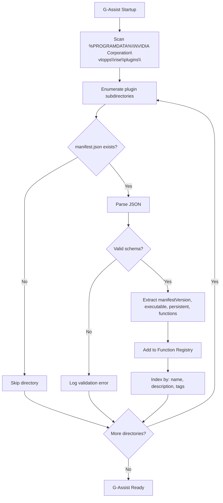
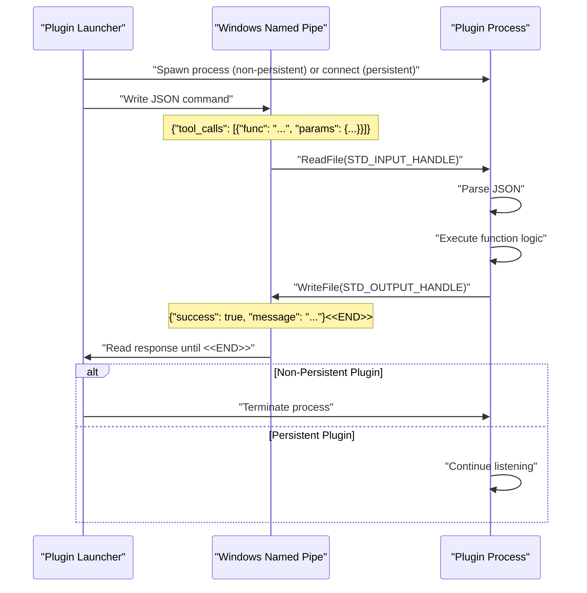
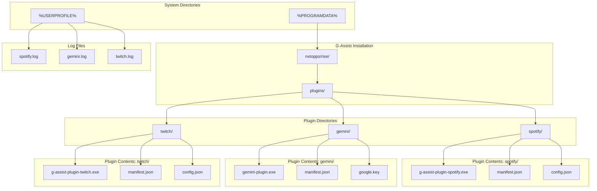
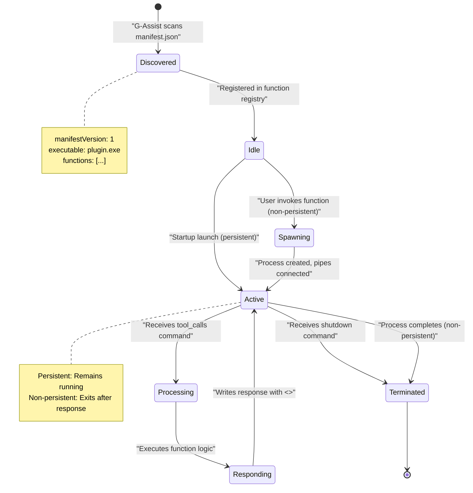

<!-- source: DeepWiki mcp.deepwiki.com · repo NVIDIA/G-Assist · page 7 Reference · fetched 2026-10-26 -->

# Reference

<details>
<summary>Relevant source files</summary>

The following files were used as context for generating this wiki page:

- [README.md](README.md)
- [api/bindings/python/README.md](api/bindings/python/README.md)
- [plugins/examples/twitch/README.md](plugins/examples/twitch/README.md)

</details>


This page provides technical reference documentation for developers building G-Assist plugins. It contains complete specifications for manifest files, communication protocols, and system directory structures. This material is intended as a lookup reference rather than a tutorial.

For implementation guides and examples, see [Plugin Development Guide](#5). For information about the communication architecture, see [Communication Protocol](#3.3). For details about plugin invocation methods, see [Plugin Invocation Methods](#3.4).

## Manifest Schema

The `manifest.json` file defines a plugin's capabilities and interface with G-Assist. The system scans all `manifest.json` files in the plugins directory at startup to build the function registry.

### Schema Specification

| Field | Type | Required | Description |
|-------|------|----------|-------------|
| `manifestVersion` | integer | Yes | Schema version, currently `1` |
| `executable` | string | Yes | Name of the plugin executable file |
| `persistent` | boolean | Yes | If `true`, plugin remains running; if `false`, spawned per-invocation |
| `functions` | array | Yes | Array of function definitions exposed by the plugin |

### Function Definition Schema

Each entry in the `functions` array must contain:

| Field | Type | Required | Description |
|-------|------|----------|-------------|
| `name` | string | Yes | Function identifier used in `tool_calls` |
| `description` | string | Yes | Natural language description for AI model matching |
| `tags` | array | Yes | Keywords for zero-shot function discovery |
| `properties` | object | Yes | Parameter schema defining function inputs |

### Properties Schema

The `properties` object defines parameters using a nested structure:

| Field | Type | Required | Description |
|-------|------|----------|-------------|
| `<param_name>` | object | Yes | Parameter definition keyed by parameter name |
| `<param_name>.type` | string | Yes | Data type: `"string"`, `"integer"`, `"boolean"`, `"array"`, `"object"` |
| `<param_name>.description` | string | Yes | Natural language description for parameter extraction |

### Complete Manifest Example

```json
{
  "manifestVersion": 1,
  "executable": "g-assist-plugin-twitch.exe",
  "persistent": false,
  "functions": [
    {
      "name": "check_twitch_live_status",
      "description": "Checks if a Twitch user is live and retrieves stream details.",
      "tags": ["twitch", "live_status"],
      "properties": {
        "username": {
          "type": "string",
          "description": "The Twitch username to check."
        }
      }
    }
  ]
}
```

**Sources:** [README.md:152-158](), [plugins/examples/twitch/README.md:103-122]()

### Manifest Processing Flow



**Sources:** [README.md:165-166](), [plugins/examples/twitch/README.md:103-122]()

## Command and Response Formats

G-Assist communicates with plugins using JSON messages over Windows Named Pipes. All messages follow standardized schemas.

### Command Format

Commands sent from G-Assist to plugins use the following structure:

```json
{
  "tool_calls": [
    {
      "func": "function_name",
      "params": {
        "param1": "value1",
        "param2": "value2"
      }
    }
  ]
}
```

| Field | Type | Description |
|-------|------|-------------|
| `tool_calls` | array | Array of function invocations, typically contains one element |
| `tool_calls[].func` | string | Function name matching a `name` field in `manifest.json` |
| `tool_calls[].params` | object | Parameters matching the function's `properties` schema |

### Response Format

Plugin responses must follow this schema:

```json
{
  "success": true,
  "message": "Operation completed successfully"
}
```

| Field | Type | Required | Description |
|-------|------|----------|-------------|
| `success` | boolean | Yes | `true` if operation succeeded, `false` otherwise |
| `message` | string | Yes | Human-readable result or error message |

### Message Termination

All response messages must append the `<<END>>` marker immediately after the JSON object:

```
{"success": true, "message": "Result text"}<<END>>
```

The marker signals message completion to the pipe reader. Messages without this marker will cause G-Assist to hang waiting for completion.

**Sources:** [plugins/examples/twitch/README.md:381-399](), [plugins/examples/twitch/README.md:369-372]()

### Special Command: Shutdown

All plugins must handle the shutdown command:

```json
{
  "tool_calls": [
    {
      "func": "shutdown",
      "params": {}
    }
  ]
}
```

When received, the plugin should terminate gracefully. No response is required.

**Sources:** [plugins/examples/twitch/README.md:271-295]()

### Communication Protocol Constants

For plugins implemented in Python using `ctypes`, the following constants are required:

| Constant | Value | Description |
|----------|-------|-------------|
| `STD_INPUT_HANDLE` | `-10` | Windows handle for stdin pipe |
| `STD_OUTPUT_HANDLE` | `-11` | Windows handle for stdout pipe |
| `BUFFER_SIZE` | `4096` | Buffer size in bytes for pipe read operations |

**Sources:** [plugins/examples/twitch/README.md:374-379]()

### Pipe Communication Diagram



**Sources:** [plugins/examples/twitch/README.md:299-380](), [README.md:167-191]()

## Directory Structure

### Standard Installation Paths

G-Assist uses standardized directory locations across the Windows system:

```
%PROGRAMDATA%\NVIDIA Corporation\nvtopps\rise\
├── plugins\
│   ├── spotify\
│   │   ├── g-assist-plugin-spotify.exe
│   │   ├── manifest.json
│   │   └── config.json
│   ├── gemini\
│   │   ├── gemini-plugin.exe
│   │   ├── manifest.json
│   │   └── google.key
│   └── twitch\
│       ├── g-assist-plugin-twitch.exe
│       ├── manifest.json
│       └── config.json
└── (other G-Assist core files)

%USERPROFILE%\
├── twitch.log
├── spotify.log
└── (plugin log files)
```

**Sources:** [plugins/examples/twitch/README.md:52-59](), [plugins/examples/twitch/README.md:154-161]()

### Directory Path Reference

| Path | Environment Variable | Purpose |
|------|---------------------|---------|
| `%PROGRAMDATA%\NVIDIA Corporation\nvtopps\rise\plugins\` | `%PROGRAMDATA%` | Plugin installation root directory |
| `%PROGRAMDATA%\NVIDIA Corporation\nvtopps\rise\plugins\<plugin-name>\` | `%PROGRAMDATA%` | Individual plugin directory |
| `%USERPROFILE%\` | `%USERPROFILE%` | Plugin log file location |

### Plugin Directory Contents

Each plugin directory must contain:

| File | Required | Description |
|------|----------|-------------|
| `<plugin-name>.exe` | Yes | Compiled plugin executable (name must match `manifest.json` `executable` field) |
| `manifest.json` | Yes | Plugin capability definition |
| `config.json` | No | Configuration data, API keys, credentials (must be in `.gitignore`) |
| `*.key` | No | API key files for services requiring separate key storage |
| Additional DLLs | No | Runtime dependencies not included in PyInstaller bundle |

**Sources:** [README.md:143-159](), [plugins/examples/twitch/README.md:52-60]()

### Directory Resolution in Plugin Code

Plugins should construct paths using environment variables to ensure cross-environment compatibility:

```python
import os

# Configuration file path
CONFIG_FILE = os.path.join(
    os.environ.get("PROGRAMDATA", "."),
    r'NVIDIA Corporation\nvtopps\rise\plugins\<plugin-name>',
    'config.json'
)

# Log file path
LOG_FILE = os.path.join(
    os.environ.get("USERPROFILE", "."), 
    '<plugin-name>.log'
)
```

**Sources:** [plugins/examples/twitch/README.md:154-161]()

### Build Output Structure

The PyInstaller build process generates the following structure in the `dist\` directory:

```
dist\
└── <plugin-name>\
    ├── <plugin-name>.exe
    ├── manifest.json    (copied from source)
    ├── config.json      (copied from source)
    └── (bundled dependencies)
```

This entire directory should be copied to the G-Assist plugins path for deployment.

**Sources:** [plugins/examples/twitch/README.md:51-59](), [plugins/examples/twitch/README.md:449-484]()

### Directory Structure Diagram



**Sources:** [README.md:143-159](), [plugins/examples/twitch/README.md:52-59]()

## Configuration File Format

The `config.json` file stores plugin-specific configuration data, typically API credentials and service endpoints.

### Standard Structure

```json
{
  "API_KEY": "your_api_key_here",
  "CLIENT_ID": "your_client_id",
  "CLIENT_SECRET": "your_client_secret",
  "ENDPOINT_URL": "https://api.example.com/v1"
}
```

### Security Requirements

- **MUST** be added to `.gitignore` to prevent credential exposure
- **MUST** reside in the plugin directory alongside `manifest.json` and the executable
- **SHOULD** be documented in plugin README with example structure
- **SHOULD NOT** contain production credentials in repository

### Loading Configuration in Python

```python
import json
import os

CONFIG_FILE = os.path.join(
    os.environ.get("PROGRAMDATA", "."),
    r'NVIDIA Corporation\nvtopps\rise\plugins\<plugin-name>',
    'config.json'
)

def load_config():
    """Load configuration from config.json"""
    try:
        if os.path.exists(CONFIG_FILE):
            with open(CONFIG_FILE, "r") as file:
                return json.load(file)
    except Exception as e:
        logging.error(f"Error loading config: {e}")
    return {}
```

**Sources:** [plugins/examples/twitch/README.md:124-130](), [plugins/examples/twitch/README.md:170-179]()

## Plugin Lifecycle States



**Sources:** [README.md:152-158](), [plugins/examples/twitch/README.md:271-295]()

## Error Response Format

When operations fail, plugins should return structured error responses:

```json
{
  "success": false,
  "message": "Detailed error description"
}
```

### Error Handling Best Practices

| Scenario | Recommended Response |
|----------|---------------------|
| Missing parameters | `"success": false, "message": "Required parameter '<param>' not provided"` |
| API authentication failure | `"success": false, "message": "Failed to authenticate with <service>"` |
| Network timeout | `"success": false, "message": "Request timed out after <n> seconds"` |
| Invalid parameter value | `"success": false, "message": "Invalid value for '<param>': expected <type>"` |
| Service unavailable | `"success": false, "message": "<Service> is currently unavailable"` |

All error messages are displayed to the user by G-Assist, so they should be clear and actionable.

**Sources:** [plugins/examples/twitch/README.md:393-399](), [plugins/examples/twitch/README.md:262-268]()

## Data Type Reference

### Manifest Property Types

The `properties` schema supports the following JSON Schema data types:

| Type | Example Value | Use Case |
|------|---------------|----------|
| `"string"` | `"hello world"` | Text parameters, usernames, URLs |
| `"integer"` | `42` | Numeric parameters, counts, IDs |
| `"boolean"` | `true` or `false` | Flags, toggles |
| `"array"` | `["item1", "item2"]` | Lists of values |
| `"object"` | `{"key": "value"}` | Nested structures |

### Parameter Extraction

The G-Assist inference engine extracts parameters from natural language commands based on the `description` field in the manifest. For example:

**Manifest:**
```json
{
  "properties": {
    "username": {
      "type": "string",
      "description": "The Twitch username to check."
    }
  }
}
```

**User Command:** "Is ninja live on Twitch?"

**Extracted Parameters:**
```json
{
  "username": "ninja"
}
```

**Sources:** [README.md:167-191](), [plugins/examples/twitch/README.md:103-122]()

## Plugin Invocation Method Reference

### Zero-Shot Function Calling

G-Assist automatically selects the appropriate plugin and function based on user intent.

**Command Prefix:** `/fc` (function calling mode)

**Example:**
```
User: /fc What are the top upcoming games for 2025?
```

**Internal Processing:**
1. Inference engine analyzes user intent
2. Matches intent to function descriptions and tags in registry
3. Selects most appropriate plugin
4. Extracts parameters from natural language
5. Constructs `tool_calls` command
6. Sends to plugin via pipe

### Direct Plugin Invocation

User explicitly specifies the plugin name.

**Command Prefix:** `Hey <plugin-name>,` or `/<plugin-name>`

**Examples:**
```
User: Hey logiled, change my keyboard lights to green
User: /logiled change my keyboard lights to green
```

**Internal Processing:**
1. Parse plugin name from command prefix
2. Lookup plugin in registry
3. Inference engine determines function from plugin's manifest
4. Extracts parameters
5. Constructs `tool_calls` command
6. Sends to plugin via pipe

**Invocation Performance Comparison:**

| Method | Latency | Use Case |
|--------|---------|----------|
| Zero-shot | Higher (requires full intent analysis) | Exploratory queries, unknown plugin |
| Direct | Lower (plugin pre-selected) | Known plugin, frequent operations |

**Sources:** [README.md:167-191]()

---

