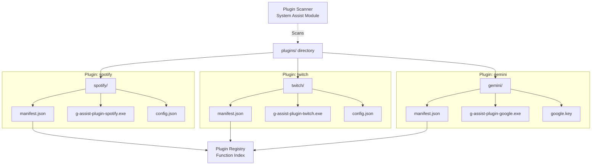
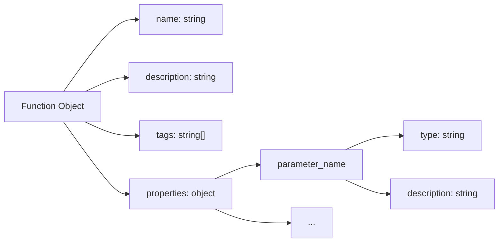
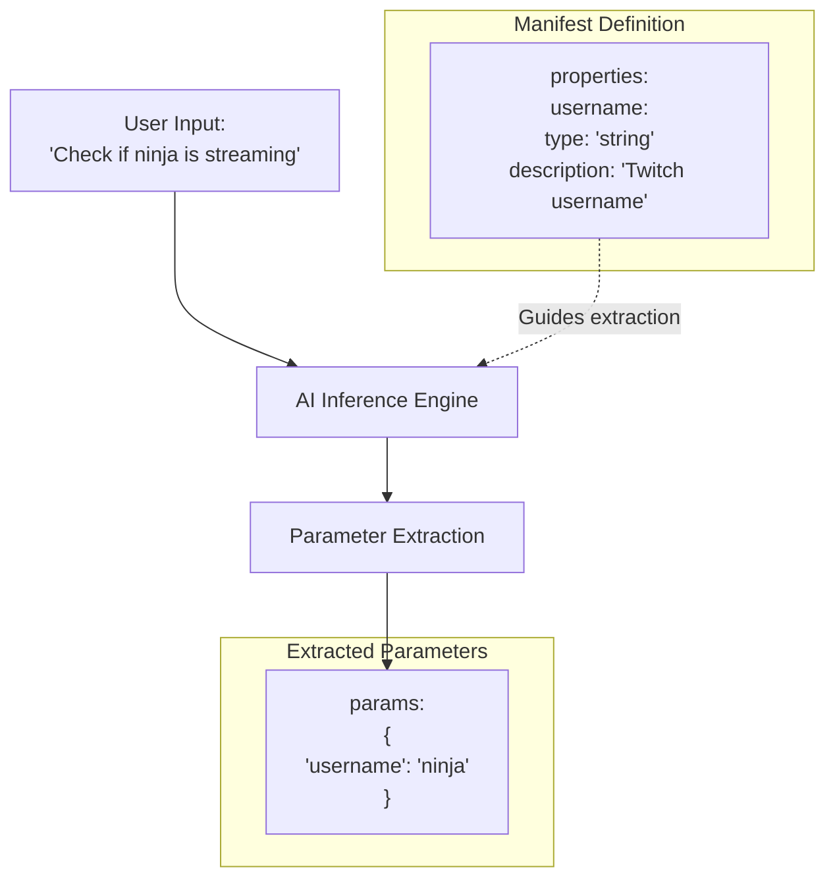
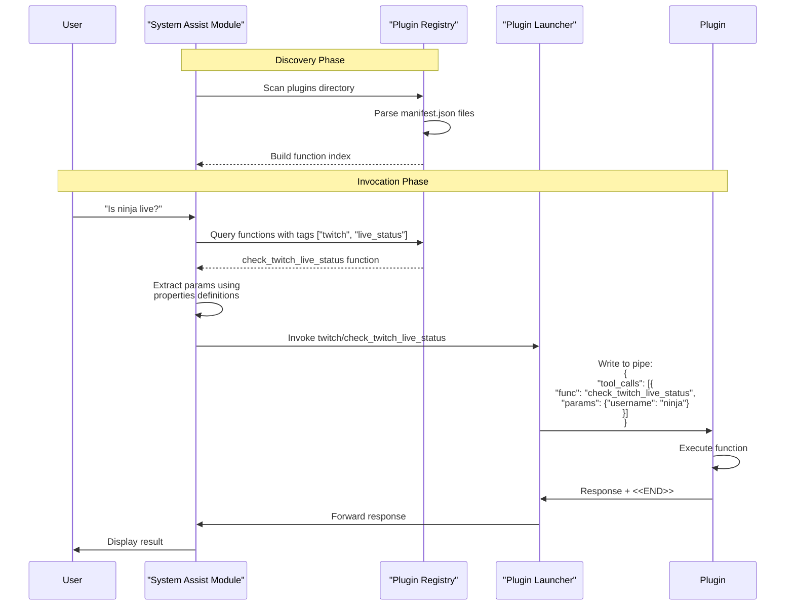
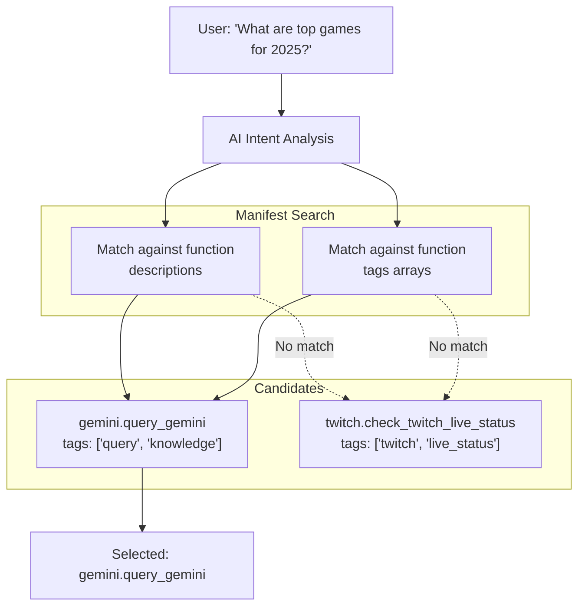
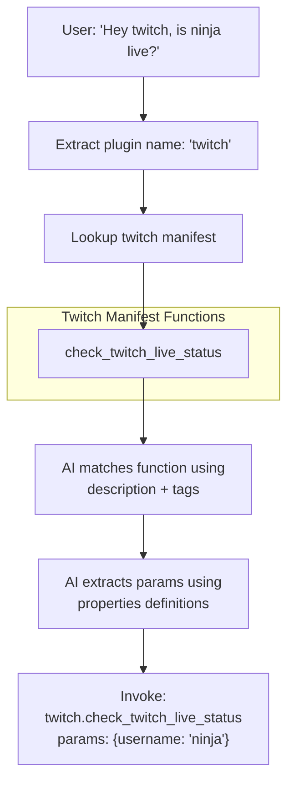
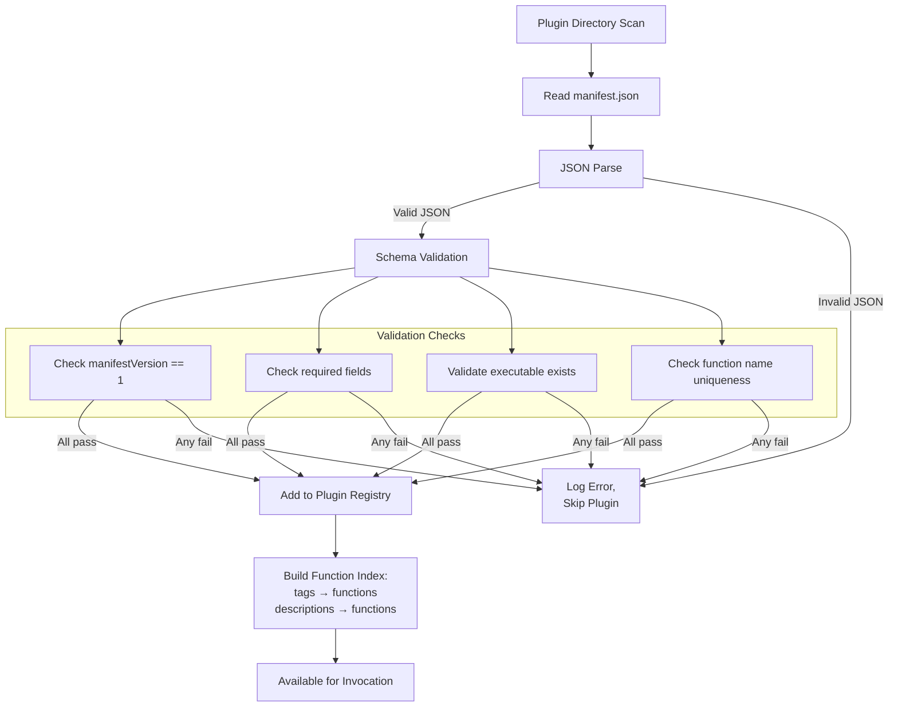

<!-- source: DeepWiki mcp.deepwiki.com · repo NVIDIA/G-Assist · page 7.1 Manifest Schema · fetched 2026-10-26 -->

# Manifest Schema

<details>
<summary>Relevant source files</summary>

The following files were used as context for generating this wiki page:

- [README.md](README.md)
- [api/bindings/python/README.md](api/bindings/python/README.md)
- [plugins/examples/gemini/.gitattributes](plugins/examples/gemini/.gitattributes)
- [plugins/examples/gemini/Release/g-assist-plugin-google.exe](plugins/examples/gemini/Release/g-assist-plugin-google.exe)
- [plugins/examples/gemini/Release/manifest.json](plugins/examples/gemini/Release/manifest.json)
- [plugins/examples/gemini/gemini.py](plugins/examples/gemini/gemini.py)
- [plugins/examples/gemini/manifest.json](plugins/examples/gemini/manifest.json)
- [plugins/examples/gemini/requirements.txt](plugins/examples/gemini/requirements.txt)
- [plugins/examples/twitch/README.md](plugins/examples/twitch/README.md)

</details>


This document provides the complete technical specification of the `manifest.json` schema. The manifest file is the contract between G-Assist plugins and the G-Assist core system, defining plugin capabilities, function signatures, and runtime behavior. For information about implementing plugin functionality, see [Plugin Structure and Files](#5.2). For details on command and response formats, see [Command and Response Formats](#7.2).

## Overview

The `manifest.json` file enables G-Assist to discover and understand plugin capabilities without executing plugin code. At startup, G-Assist scans all plugin directories and parses their manifests to build a function registry that maps user intents to available plugin functions.

Each plugin directory must contain exactly one `manifest.json` file at its root. The System Assist Module uses the manifest to:

- Discover the plugin's executable name
- Understand available functions and their parameters
- Match user queries to appropriate plugin functions via AI-driven intent analysis
- Determine plugin lifecycle behavior (persistent vs non-persistent)

**Sources**: [README.md:142-159](), [README.md:165-191]()

## Manifest Location and Discovery

G-Assist discovers plugins by scanning the plugins directory at startup:



**Directory Structure**:
```
%PROGRAMDATA%\NVIDIA Corporation\nvtopps\rise\plugins\
└── <plugin-name>/
    ├── manifest.json       # Required: Plugin definition
    ├── <executable>.exe    # Required: Plugin executable (name from manifest)
    └── config.json         # Optional: Runtime configuration
```

**Sources**: [README.md:142-159](), [plugins/examples/twitch/README.md:52-59]()

## Root Schema Properties

The manifest schema consists of the following root-level properties:

| Property | Type | Required | Description |
|----------|------|----------|-------------|
| `manifestVersion` | integer | Yes | Schema version. Currently must be `1`. |
| `executable` | string | Yes | Name of the plugin executable file. Must match actual file in plugin directory. |
| `persistent` | boolean | Yes | If `true`, plugin runs continuously. If `false`, plugin is spawned per-invocation. |
| `passthrough` | boolean | No | If `true`, enables special routing behavior for the plugin. |
| `functions` | array | Yes | Array of function definition objects. Must contain at least one function. |

### Example Root Structure

```json
{
  "manifestVersion": 1,
  "executable": "g-assist-plugin-twitch.exe",
  "persistent": false,
  "functions": [...]
}
```

**Sources**: [plugins/examples/twitch/README.md:103-122](), [plugins/examples/gemini/manifest.json:1-23]()

## Function Definition Schema

Each object in the `functions` array defines a callable function that G-Assist can invoke. The System Assist Module's inference engine uses function definitions to match user intents to appropriate plugin capabilities.

### Function Schema Structure



### Function Properties

| Property | Type | Required | Description |
|----------|------|----------|-------------|
| `name` | string | Yes | Function identifier. Used in tool_calls. Must be unique within plugin. |
| `description` | string | Yes | Natural language description of function purpose. Used by AI for intent matching. |
| `tags` | string[] | Yes | Keywords for search and discovery. Used in zero-shot function calling. |
| `properties` | object | Yes | Parameter definitions. Keys are parameter names, values are parameter schemas. |

**Sources**: [README.md:152-157](), [plugins/examples/twitch/README.md:108-120]()

## Parameter Schema

Each parameter in the `properties` object defines a function input. Parameter names become keys in the `params` object passed during function invocation.

### Parameter Properties

| Property | Type | Required | Description |
|----------|------|----------|-------------|
| `type` | string | Yes | Parameter data type. Supported: `"string"`, `"number"`, `"boolean"`, `"object"`, `"array"`. |
| `description` | string | Yes | Natural language description. Used by AI to extract parameter values from user input. |

### Parameter Type Mappings

The `type` field specifies how G-Assist's inference engine interprets and extracts parameter values:



**Sources**: [plugins/examples/twitch/README.md:113-118](), [plugins/examples/gemini/manifest.json:11-20]()

## Complete Schema Examples

### Example 1: Twitch Plugin (Simple Single-Parameter Function)

```json
{
  "manifestVersion": 1,
  "executable": "g-assist-plugin-twitch.exe",
  "persistent": false,
  "functions": [
    {
      "name": "check_twitch_live_status",
      "description": "Checks if a Twitch user is live and retrieves stream details.",
      "tags": ["twitch", "live_status"],
      "properties": {
        "username": {
          "type": "string",
          "description": "The Twitch username to check."
        }
      }
    }
  ]
}
```

**Sources**: [plugins/examples/twitch/README.md:103-122]()

### Example 2: Gemini Plugin (Multi-Parameter Function with Optional Fields)

```json
{
  "manifestVersion": 1,
  "executable": "g-assist-plugin-google.exe",
  "persistent": false,
  "passthrough": true,
  "functions": [
    {
      "name": "query_gemini",
      "description": "Google/Gemini tool search for real time access of general topic queries including but not limited to gaming wiki queries, weather, news, food, etc.",
      "tags": ["gemini", "google", "chat", "question", "answers", "query", "knowledge", "queries"],
      "properties": {
        "input": {
          "type": "string",
          "description": "the user's input"
        },
        "game": {
          "type": "string",
          "description": "an optional parameter that specifies which game is currently being played"
        }
      }
    }
  ]
}
```

**Sources**: [plugins/examples/gemini/manifest.json:1-23]()

## Manifest-to-Invocation Mapping

The manifest defines the contract between G-Assist and the plugin. When G-Assist invokes a function, it transforms user input into a structured command using the manifest as a schema:



**Command Structure Generated from Manifest**:

The `tool_calls` array contains function invocations derived from the manifest:

```json
{
  "tool_calls": [
    {
      "func": "check_twitch_live_status",
      "params": {
        "username": "ninja"
      }
    }
  ]
}
```

Where:
- `func` comes from the `name` field in the function definition
- `params` keys come from `properties` keys in the function definition
- Parameter values are extracted by AI using `description` fields as guidance

**Sources**: [README.md:165-191](), [plugins/examples/twitch/README.md:381-391]()

## Function Discovery and Matching

G-Assist uses two methods to match user input to functions, both driven by manifest data:

### Zero-Shot Function Calling

The AI model analyzes user intent and automatically selects the best matching function using:
- Function `description` fields
- Function `tags` arrays
- Parameter `description` fields



**Sources**: [README.md:169-178]()

### Direct Plugin Invocation

User explicitly names the plugin, then AI matches function within that plugin's manifest:



**Sources**: [README.md:179-191]()

## Special Properties

### manifestVersion

Indicates the schema version. Must be set to `1` for current G-Assist implementations. Future versions may introduce breaking changes requiring different version numbers.

### persistent

Controls plugin lifecycle management:

| Value | Behavior | Use Case |
|-------|----------|----------|
| `false` | Plugin is spawned when invoked, terminated after response | Stateless operations (API queries, calculations) |
| `true` | Plugin runs continuously throughout G-Assist lifecycle | Stateful operations (monitoring, event listeners, hardware control) |

**Examples**:
- Twitch plugin uses `persistent: false` - spawned per status check
- Hardware control plugins typically use `persistent: true` - maintain device connections

**Sources**: [README.md:157](), [plugins/examples/twitch/README.md:107](), [plugins/examples/gemini/manifest.json:4]()

### passthrough

Optional property that enables special routing behavior. When `passthrough: true`, the plugin may receive additional context or system information beyond standard parameters.

**Example**: The Gemini plugin uses `passthrough: true` to receive full conversation history and system information.

**Sources**: [plugins/examples/gemini/manifest.json:5]()

## Validation Rules

The manifest must satisfy these constraints for successful plugin discovery:

1. **File Format**: Valid JSON with UTF-8 encoding
2. **Required Fields**: `manifestVersion`, `executable`, `persistent`, `functions` must be present
3. **Version Constraint**: `manifestVersion` must equal `1`
4. **Executable Match**: `executable` value must match an actual file in the plugin directory
5. **Function Array**: `functions` must be non-empty array
6. **Function Uniqueness**: All function `name` values must be unique within the plugin
7. **Parameter Names**: Parameter keys in `properties` must be valid identifiers (no spaces, special characters)
8. **Required Function Fields**: Each function must have `name`, `description`, `tags`, and `properties`

**Invalid Example** (duplicate function names):
```json
{
  "functions": [
    {"name": "query", ...},
    {"name": "query", ...}  // ERROR: Duplicate name
  ]
}
```

**Sources**: [README.md:142-159](), [plugins/examples/twitch/README.md:103-122]()

## Manifest Processing Pipeline



**Sources**: [README.md:165-166]()

## Tags Best Practices

Tags enable effective zero-shot function calling. The inference engine uses tags to match user intents to functions.

**Effective Tag Strategies**:

1. **Domain Keywords**: Specific to the service/API (e.g., `"twitch"`, `"spotify"`, `"weather"`)
2. **Action Verbs**: Describe what the function does (e.g., `"play"`, `"search"`, `"check"`)
3. **Concept Terms**: Related concepts (e.g., `"live_status"`, `"streaming"`, `"music"`)
4. **Synonym Coverage**: Alternative terms users might say (e.g., `"query"`, `"question"`, `"ask"`)

**Example Tag Array**:
```json
"tags": ["gemini", "google", "chat", "question", "answers", "query", "knowledge", "queries"]
```

This covers:
- Service names: `"gemini"`, `"google"`
- Action types: `"chat"`, `"query"`
- Alternative terms: `"question"`, `"answers"`, `"queries"`
- Domain: `"knowledge"`

**Sources**: [plugins/examples/gemini/manifest.json:10](), [plugins/examples/twitch/README.md:112]()

## Relationship to Command Protocol

The manifest schema defines the *interface*, while the command protocol defines the *runtime behavior*. For details on how functions defined in the manifest are invoked at runtime, see [Command and Response Formats](#7.2).

**Manifest defines**: Available functions, parameter schemas, metadata
**Command protocol uses**: Function names and parameter structures from manifest

**Sources**: [README.md:142-159](), [plugins/examples/twitch/README.md:381-399]()

---

