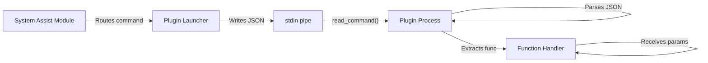
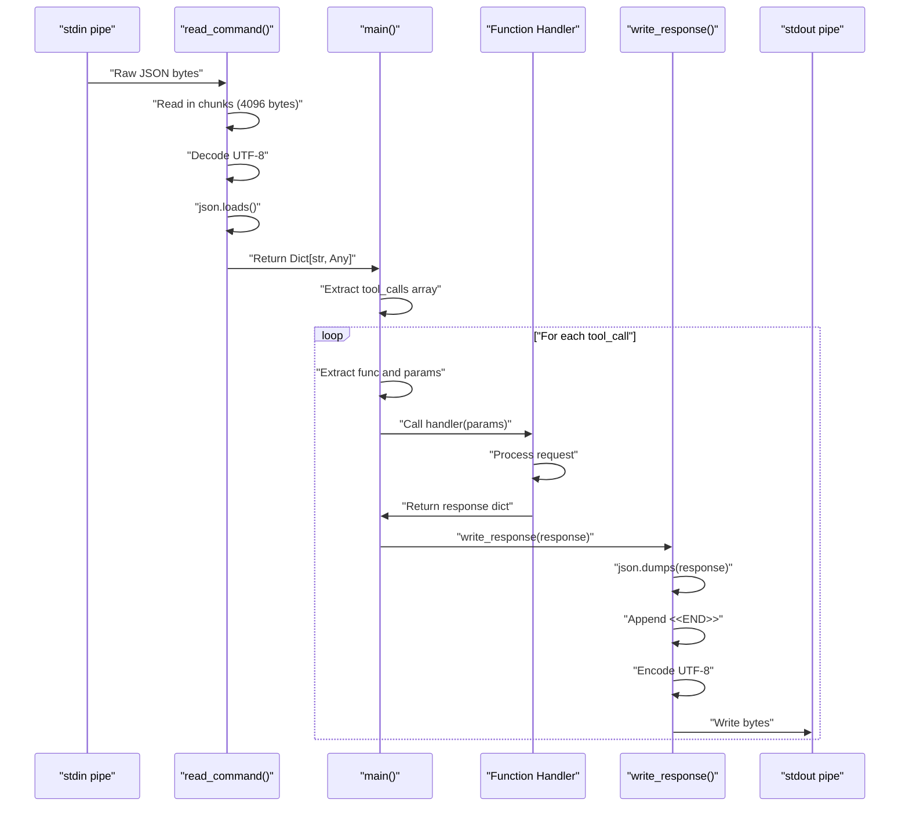
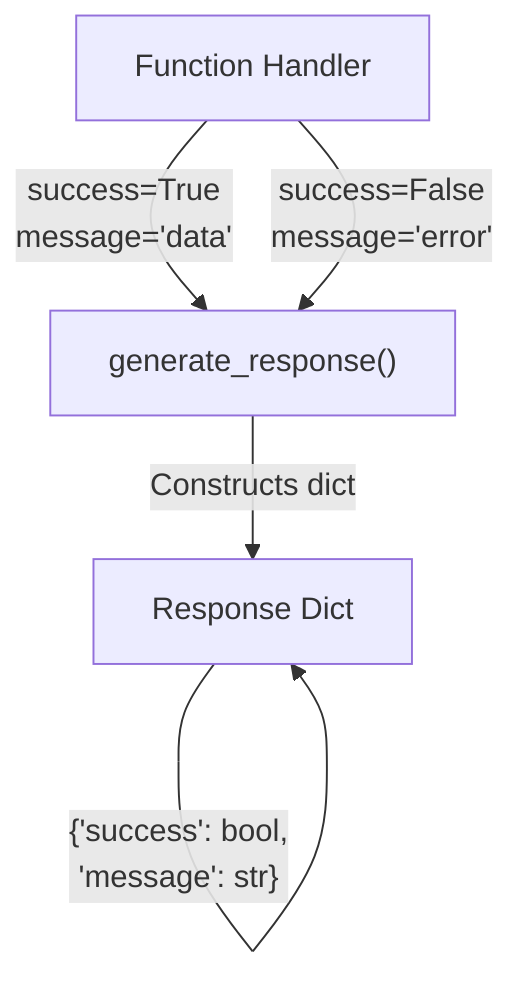
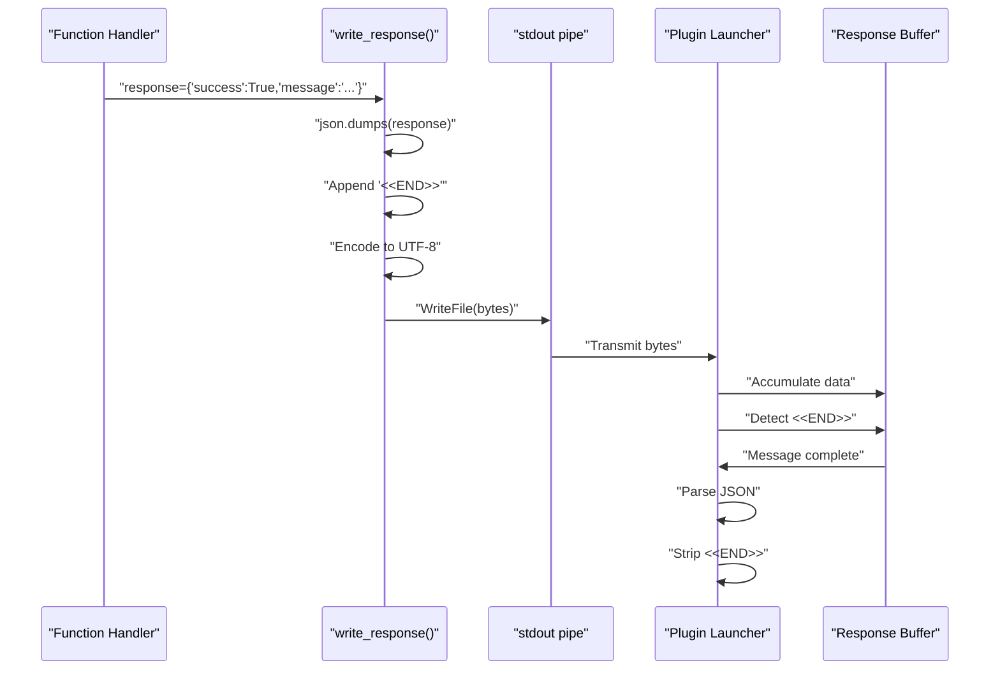
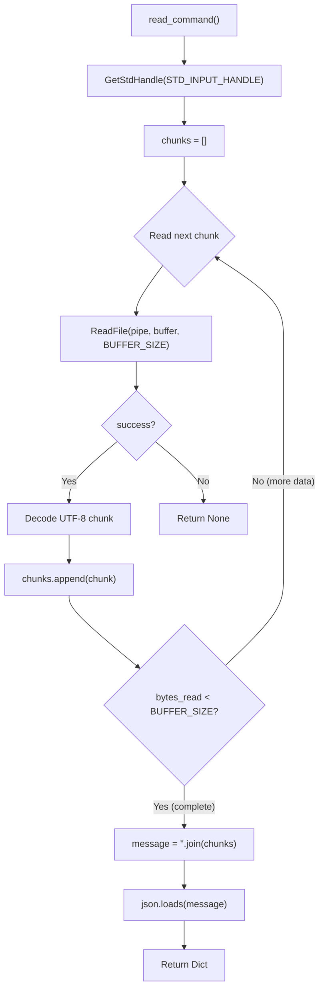
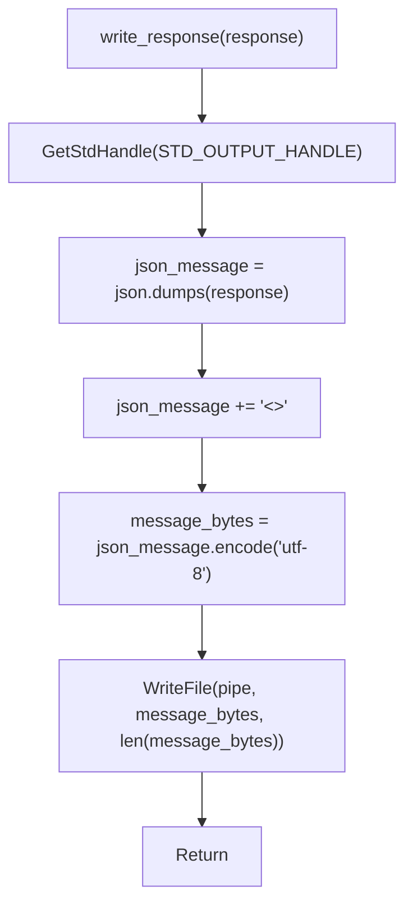
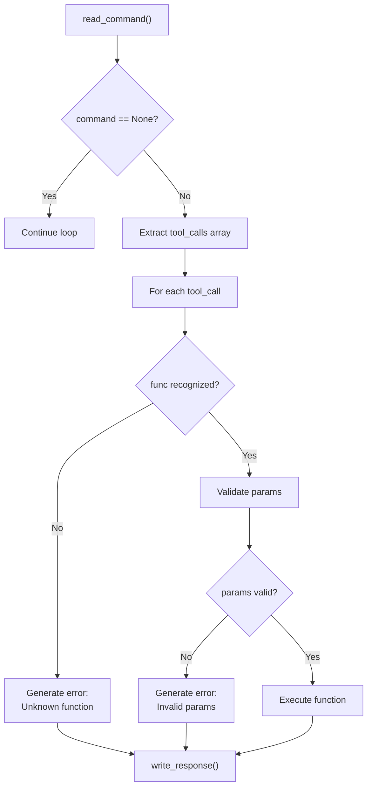
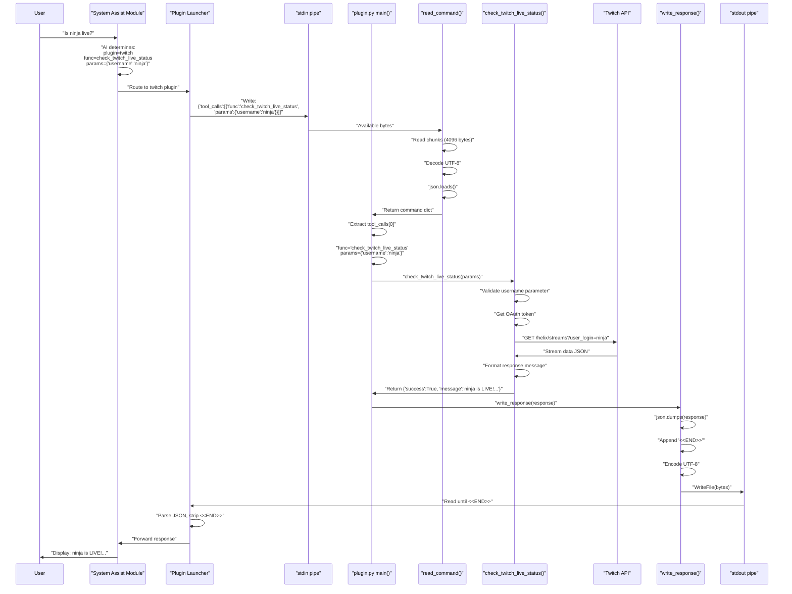

<!-- source: DeepWiki mcp.deepwiki.com · repo NVIDIA/G-Assist · page 7.2 Command and Response Formats · fetched 2026-10-26 -->

# Command and Response Formats

<details>
<summary>Relevant source files</summary>

The following files were used as context for generating this wiki page:

- [README.md](README.md)
- [api/bindings/python/README.md](api/bindings/python/README.md)
- [plugins/examples/twitch/README.md](plugins/examples/twitch/README.md)
- [plugins/examples/twitch/plugin.py](plugins/examples/twitch/plugin.py)

</details>


This page documents the JSON message formats used for communication between G-Assist and plugins via Windows Named Pipes. These formats define the structure of commands sent from G-Assist to plugins and responses returned from plugins to G-Assist.

**Scope**: This page covers the low-level message schemas and the `<<END>>` marker protocol. For information about the Windows Named Pipes IPC mechanism itself, see [Communication Protocol](#3.3). For information about how commands are defined in manifest.json, see [Manifest Schema](#7.1). For implementation guidance on reading and writing these messages in plugin code, see [Implementing Command Handlers](#5.3).

## Command Message Format

Commands are JSON objects sent from G-Assist to plugins through stdin pipes. Each command contains one or more function calls with their associated parameters.

### Command Schema

```json
{
  "tool_calls": [
    {
      "func": "function_name",
      "params": {
        "param1": "value1",
        "param2": "value2"
      }
    }
  ]
}
```

### Field Descriptions

| Field | Type | Required | Description |
|-------|------|----------|-------------|
| `tool_calls` | Array | Yes | Array of function calls to execute. May contain multiple calls for batch processing. |
| `tool_calls[].func` | String | Yes | The name of the function to execute. Must match a function name defined in the plugin's manifest.json. |
| `tool_calls[].params` | Object | No | Dictionary of parameter key-value pairs. Keys must match the parameter names defined in the function's properties schema in manifest.json. |

### Command Flow Diagram



**Sources**: [README.md:162-190](), [plugins/examples/twitch/README.md:381-391](), [plugins/examples/twitch/plugin.py:237-296]()

### Command Examples

#### Single Function Call

```json
{
  "tool_calls": [
    {
      "func": "check_twitch_live_status",
      "params": {
        "username": "nvidia"
      }
    }
  ]
}
```

#### Function Call Without Parameters

```json
{
  "tool_calls": [
    {
      "func": "initialize",
      "params": {}
    }
  ]
}
```

#### Multiple Function Calls

```json
{
  "tool_calls": [
    {
      "func": "get_weather_info",
      "params": {
        "location": "San Francisco"
      }
    },
    {
      "func": "get_forecast",
      "params": {
        "location": "San Francisco",
        "days": 7
      }
    }
  ]
}
```

**Sources**: [plugins/examples/twitch/README.md:381-391](), [plugins/examples/twitch/plugin.py:248-258]()

### Plugin Command Processing

The typical pattern for processing commands in plugin code:



**Sources**: [plugins/examples/twitch/plugin.py:237-296](), [plugins/examples/twitch/plugin.py:297-325](), [plugins/examples/twitch/plugin.py:348-393]()

## Response Message Format

Responses are JSON objects returned from plugins to G-Assist through stdout pipes. Every response must include a `success` field and should include a `message` field for user-facing output.

### Response Schema

```json
{
  "success": true,
  "message": "Operation completed successfully"
}
```

### Field Descriptions

| Field | Type | Required | Description |
|-------|------|----------|-------------|
| `success` | Boolean | Yes | Indicates whether the operation completed successfully. `true` for success, `false` for failures or errors. |
| `message` | String | Recommended | Human-readable message displayed to the user in the G-Assist interface. Should provide meaningful feedback about the operation result. |

### Response Examples

#### Success Response with Data

```json
{
  "success": true,
  "message": "ninja is LIVE!\nTitle: Friday Fortnite!\nGame: Fortnite\nViewers: 45,231\nStarted At: 2024-03-14T12:34:56Z"
}
```

#### Success Response (Simple)

```json
{
  "success": true,
  "message": "Plugin initialized successfully"
}
```

#### Error Response

```json
{
  "success": false,
  "message": "Failed to authenticate with Twitch"
}
```

#### Error Response with Missing Parameter

```json
{
  "success": false,
  "message": "Missing required parameter: username"
}
```

**Sources**: [plugins/examples/twitch/README.md:262-268](), [plugins/examples/twitch/README.md:393-399](), [plugins/examples/twitch/plugin.py:156-169](), [plugins/examples/twitch/plugin.py:171-236]()

### Response Generation Pattern

Plugins typically implement a helper function for standardized response generation:



**Sources**: [plugins/examples/twitch/plugin.py:156-169]()

## The <<END>> Marker Protocol

All responses written to stdout must be terminated with the `<<END>>` marker. This sentinel value signals the end of a message and allows the reader to distinguish between complete and incomplete transmissions.

### Protocol Specification

| Aspect | Specification |
|--------|---------------|
| **Marker Format** | Literal string `<<END>>` appended immediately after JSON |
| **Encoding** | UTF-8 encoded as part of the message bytes |
| **Position** | Always at the end of the response, no whitespace between JSON and marker |
| **Purpose** | Signals message completion to the pipe reader |
| **Required** | Yes - responses without this marker may not be processed |

### Message Termination Flow



**Sources**: [plugins/examples/twitch/README.md:352-355](), [plugins/examples/twitch/README.md:369-373](), [plugins/examples/twitch/plugin.py:297-325]()

### Implementation Example

The write_response() function demonstrates proper marker usage:

```python
# From plugins/examples/twitch/plugin.py:297-325
def write_response(response: Response) -> None:
    pipe = windll.kernel32.GetStdHandle(STD_OUTPUT_HANDLE)
    json_message = json.dumps(response) + '<<END>>'  # Append marker
    message_bytes = json_message.encode('utf-8')
    
    bytes_written = wintypes.DWORD()
    windll.kernel32.WriteFile(
        pipe,
        message_bytes,
        len(message_bytes),
        bytes_written,
        None
    )
```

**Complete Message Format**:
```
{"success":true,"message":"ninja is LIVE!\nTitle: Friday Fortnite!\nGame: Fortnite\nViewers: 45,231"}<<END>>
```

**Sources**: [plugins/examples/twitch/plugin.py:297-325](), [plugins/examples/twitch/README.md:345-367]()

## Message Reading and Writing Implementation

Plugins must implement pipe I/O functions to read commands and write responses. The reference implementation uses Windows kernel32 API through ctypes.

### Reading Commands from stdin

Commands are read in chunks to handle messages larger than the buffer size. The read loop continues until fewer bytes than the buffer size are read, indicating message completion.



**Key Constants**:
- `STD_INPUT_HANDLE = -10`: Windows constant for stdin handle
- `BUFFER_SIZE = 4096`: Chunk size in bytes for reading

**Sources**: [plugins/examples/twitch/plugin.py:237-296](), [plugins/examples/twitch/plugin.py:40-48](), [plugins/examples/twitch/README.md:299-367]()

### Writing Responses to stdout

Responses are written as a single operation, with the JSON message and `<<END>>` marker encoded together.



**Key Constants**:
- `STD_OUTPUT_HANDLE = -11`: Windows constant for stdout handle

**Sources**: [plugins/examples/twitch/plugin.py:297-325](), [plugins/examples/twitch/plugin.py:40-48]()

### Buffer Size Considerations

| Buffer Size | Read Behavior | Write Behavior |
|-------------|---------------|----------------|
| 4096 bytes | Standard chunk size. Loop continues reading until `message_bytes.value < BUFFER_SIZE` | Single atomic write operation regardless of message size |
| < 4096 bytes | Indicates last chunk of message | N/A - writes are not chunked |
| \> 4096 bytes | Multiple read iterations required | Entire message written at once by kernel |

**Sources**: [plugins/examples/twitch/plugin.py:47-48](), [plugins/examples/twitch/plugin.py:264-283]()

## Error Handling and Validation

### Command Validation

Plugins should validate incoming commands before processing:



**Sources**: [plugins/examples/twitch/plugin.py:348-393]()

### Common Error Response Patterns

| Error Condition | Success Value | Message Example | Code Reference |
|----------------|---------------|-----------------|----------------|
| Missing required parameter | `false` | `"Missing required parameter: username"` | [plugin.py:200]() |
| Authentication failure | `false` | `"Failed to authenticate with Twitch"` | [plugin.py:205]() |
| API request failure | `false` | `"Failed to check Twitch live status"` | [plugin.py:235]() |
| Unknown function | `false` | `"Unknown function call"` | [plugin.py:390]() |
| JSON parsing error | N/A - logged only | Logged but no response sent | [plugin.py:289-292]() |
| Pipe read error | N/A - logged only | Logged but no response sent | [plugin.py:276-277]() |

### Error Handling Example

From the Twitch plugin's parameter validation:

```python
# From plugins/examples/twitch/plugin.py:196-205
username = params.get("username")

if not username:
    return generate_response(False, "Missing required parameter: username")

if not oauth_token:
    oauth_token = get_oauth_token()
    if not oauth_token:
        return generate_response(False, "Failed to authenticate with Twitch")
```

**Sources**: [plugins/examples/twitch/plugin.py:171-236](), [plugins/examples/twitch/plugin.py:156-169]()

## Message Flow: Complete Example

This diagram shows the complete lifecycle of a command and response exchange:



**Sources**: [README.md:169-190](), [plugins/examples/twitch/plugin.py:348-393](), [plugins/examples/twitch/plugin.py:171-236](), [plugins/examples/twitch/plugin.py:237-296](), [plugins/examples/twitch/plugin.py:297-325]()

## Summary

### Command Format
- JSON object with `tool_calls` array
- Each tool_call contains `func` (function name) and `params` (parameters dictionary)
- Read from stdin pipe in 4096-byte chunks
- UTF-8 encoded

### Response Format
- JSON object with required `success` boolean and recommended `message` string
- Must be terminated with `<<END>>` marker
- Written to stdout pipe as single operation
- UTF-8 encoded

### Protocol Rules
1. Commands: No termination marker required (message size implicitly determined by pipe reads)
2. Responses: **Always** append `<<END>>` marker
3. Encoding: UTF-8 for all messages
4. Errors: Return `{"success": false, "message": "error description"}`
5. Buffer: 4096 bytes standard chunk size for reading

**Sources**: [plugins/examples/twitch/plugin.py:1-397](), [plugins/examples/twitch/README.md:1-503](), [README.md:143-190]()

---

