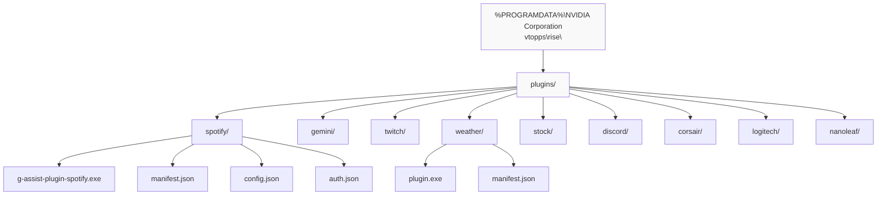
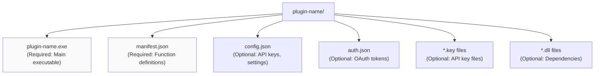
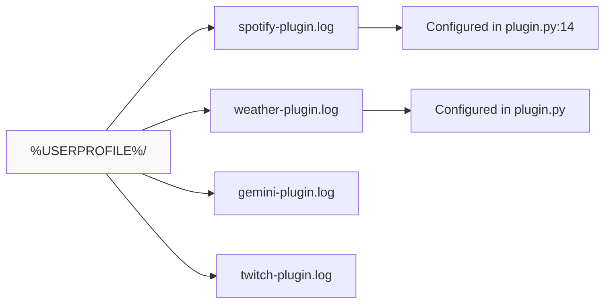
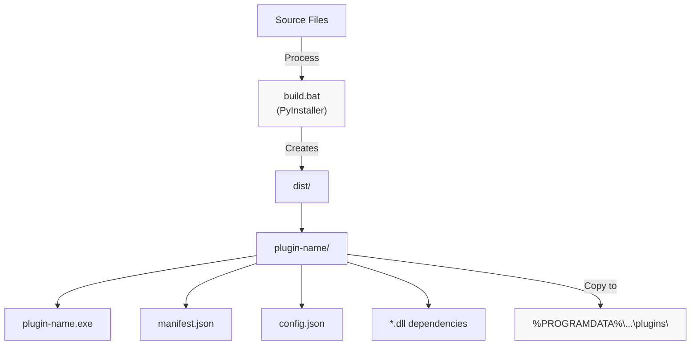
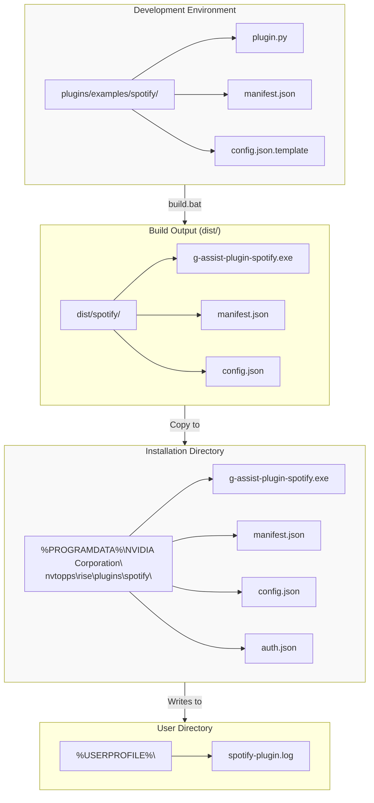
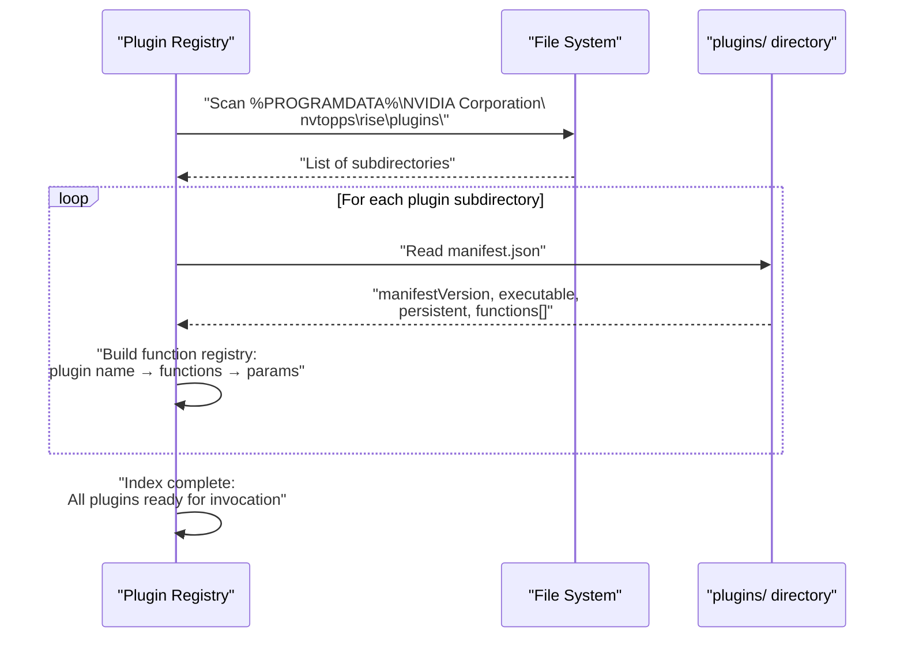

<!-- source: DeepWiki mcp.deepwiki.com · repo NVIDIA/G-Assist · page 7.3 Directory Structure · fetched 2026-10-26 -->

# Directory Structure

<details>
<summary>Relevant source files</summary>

The following files were used as context for generating this wiki page:

- [plugins/examples/spotify/README.md](plugins/examples/spotify/README.md)
- [plugins/examples/spotify/plugin.py](plugins/examples/spotify/plugin.py)
- [plugins/examples/weather/README.md](plugins/examples/weather/README.md)

</details>


This page documents the standard directory layout for G-Assist installation, plugin directories, and file locations. Understanding this structure is essential for plugin deployment, debugging, and configuration management.

For information about plugin file contents and structure, see [Plugin Structure and Files](#5.2). For manifest file specifications, see [Manifest Schema](#7.1).

## Overview

G-Assist uses a standardized directory hierarchy with well-defined locations for:
- Core system files under `%PROGRAMDATA%`
- Plugin executables and configuration under the plugins directory
- User-specific logs under `%USERPROFILE%`
- Build artifacts in the `dist/` folder during development

## Installation Root Directory

The G-Assist system installs to a standard Windows location using environment variables:

```
%PROGRAMDATA%\NVIDIA Corporation\nvtopps\rise\
```

On typical Windows installations, this resolves to:
```
C:\ProgramData\NVIDIA Corporation\nvtopps\rise\
```

**Sources:** [plugins/examples/spotify/plugin.py:142-143](), [plugins/examples/spotify/README.md:64-65]()

### Directory Tree Structure



**Sources:** [plugins/examples/spotify/README.md:62-65](), [plugins/examples/weather/README.md:44-46]()

## Plugins Directory

All plugins are installed under a common directory:

```
%PROGRAMDATA%\NVIDIA Corporation\nvtopps\rise\plugins\
```

This directory is scanned by the Plugin Registry at startup to discover available plugins through their `manifest.json` files.

### Directory Structure Details

Each plugin occupies its own subdirectory named after the plugin:

| Plugin | Directory Path | Executable Name |
|--------|---------------|-----------------|
| Spotify | `plugins/spotify/` | `g-assist-plugin-spotify.exe` |
| Gemini | `plugins/gemini/` | `gemini-plugin.exe` |
| Twitch | `plugins/twitch/` | `g-assist-plugin-twitch.exe` |
| Weather | `plugins/weather/` | `plugin.exe` |
| Stock | `plugins/stock/` | `plugin.exe` |
| Discord | `plugins/discord/` | `plugin.exe` |

**Sources:** [plugins/examples/spotify/README.md:62-65](), [plugins/examples/weather/README.md:44-46](), High-level Diagram 5

## Individual Plugin Directory Layout

Each plugin directory contains a standard set of files:



**Sources:** [plugins/examples/spotify/README.md:62-68](), [plugins/examples/weather/README.md:44-51]()

### Required Files

#### Executable File
- **Purpose:** Standalone plugin process that communicates via Named Pipes
- **Naming:** Plugin-specific (e.g., `g-assist-plugin-spotify.exe`, `plugin.exe`)
- **Created by:** PyInstaller during `build.bat` execution
- **Source:** Built from `plugin.py`

**Sources:** [plugins/examples/spotify/README.md:57-59]()

#### manifest.json
- **Purpose:** Declares plugin capabilities and function signatures
- **Required fields:** `manifestVersion`, `executable`, `persistent`, `functions`
- **Used by:** Plugin Registry for discovery and function matching
- **Location example:** `%PROGRAMDATA%\NVIDIA Corporation\nvtopps\rise\plugins\spotify\manifest.json`

For complete manifest specification, see [Manifest Schema](#7.1).

**Sources:** High-level Diagram 5, [plugins/examples/spotify/README.md:245-258]()

### Optional Configuration Files

#### config.json
- **Purpose:** Stores API credentials and user-configurable settings
- **Security:** Contains sensitive data (client IDs, secrets, usernames)
- **Access:** Read by plugin executable at runtime
- **Path construction:** `os.path.join(os.environ.get("PROGRAMDATA", "."), "NVIDIA Corporation", "nvtopps", "rise", "plugins", "spotify", "config.json")`

Example structure for Spotify plugin:
```json
{
    "client_id": "<Your Client ID>",
    "client_secret": "<Your Client Secret>",
    "username": "<Your Spotify Username>"
}
```

**Sources:** [plugins/examples/spotify/README.md:40-47](), [plugins/examples/spotify/plugin.py:142](), [plugins/examples/spotify/plugin.py:166-177]()

#### auth.json
- **Purpose:** Stores OAuth tokens and authentication state
- **Lifecycle:** Created after first authorization, updated on token refresh
- **Path construction:** `os.path.join(os.environ.get("PROGRAMDATA", "."), "NVIDIA Corporation", "nvtopps", "rise", "plugins", "spotify", "auth.json")`

Example structure:
```json
{
    "access_token": "...",
    "refresh_token": "..."
}
```

**Sources:** [plugins/examples/spotify/README.md:98-109](), [plugins/examples/spotify/plugin.py:143](), [plugins/examples/spotify/plugin.py:1128-1140]()

#### API Key Files
- **Format:** `.key` files (e.g., `google.key` for Gemini plugin)
- **Purpose:** Store API keys separately from config.json
- **Usage:** Plugin-specific, loaded at runtime

**Sources:** High-level Diagram 5

## Log File Locations

Plugin logs are stored in the user profile directory:

```
%USERPROFILE%\<plugin-name>-plugin.log
```

On typical Windows installations, this resolves to:
```
C:\Users\<username>\<plugin-name>-plugin.log
```

### Log File Mapping



### Log File Configuration

Plugins configure logging using the `LOG_FILE` variable:

```python
LOG_FILE = os.path.join(os.environ.get("USERPROFILE", "."), 'spotify-plugin.log')
logging.basicConfig(filename=LOG_FILE, level=logging.INFO, 
                    format="%(asctime)s - %(levelname)s - %(message)s")
```

**Sources:** [plugins/examples/spotify/plugin.py:14-15](), [plugins/examples/spotify/README.md:135-139](), [plugins/examples/weather/README.md:70-74]()

## Build Output Directory Structure

During plugin development, the `build.bat` script creates a `dist/` folder containing deployment-ready files:



**Sources:** [plugins/examples/spotify/README.md:55-59](), [plugins/examples/weather/README.md:28-39]()

### Build Process File Locations

| Stage | Directory | Purpose |
|-------|-----------|---------|
| Source | `plugins/examples/<plugin-name>/` | Development files |
| Virtual Environment | `plugins/examples/<plugin-name>/venv/` | Isolated dependencies |
| Build Script | `plugins/examples/<plugin-name>/build.bat` | PyInstaller packaging |
| Build Output | `plugins/examples/<plugin-name>/dist/<plugin-name>/` | Deployment artifacts |
| Installation | `%PROGRAMDATA%\NVIDIA Corporation\nvtopps\rise\plugins\<plugin-name>/` | Runtime location |

**Sources:** [plugins/examples/spotify/README.md:49-68](), [plugins/examples/weather/README.md:28-46]()

## Environment Variables Used

G-Assist plugins use standard Windows environment variables for path resolution:

| Variable | Purpose | Example Value |
|----------|---------|---------------|
| `%PROGRAMDATA%` | System-wide application data | `C:\ProgramData` |
| `%USERPROFILE%` | User-specific profile directory | `C:\Users\<username>` |

### Path Construction Pattern

Plugins construct paths using `os.environ.get()` with fallback values:

```python
# Configuration file path
CONFIG_FILE = os.path.join(
    os.environ.get("PROGRAMDATA", "."), 
    "NVIDIA Corporation", 
    "nvtopps", 
    "rise", 
    "plugins", 
    "spotify", 
    "config.json"
)

# Log file path
LOG_FILE = os.path.join(
    os.environ.get("USERPROFILE", "."), 
    'spotify-plugin.log'
)
```

**Sources:** [plugins/examples/spotify/plugin.py:14](), [plugins/examples/spotify/plugin.py:142-143]()

## Directory Access and Permissions

### Plugin Installation Directory
- **Location:** `%PROGRAMDATA%\NVIDIA Corporation\nvtopps\rise\plugins\`
- **Access Level:** Typically requires administrator privileges for installation
- **Runtime Access:** Plugins read configuration files with standard user permissions
- **Best Practice:** Close all G-Assist clients before copying files to this directory

**Sources:** [plugins/examples/spotify/README.md:66-67](), [plugins/examples/weather/README.md:42-51]()

### User Log Directory
- **Location:** `%USERPROFILE%\`
- **Access Level:** Standard user permissions
- **Write Access:** Plugins write logs without elevation
- **Purpose:** Separate from system files for easier debugging

**Sources:** [plugins/examples/spotify/README.md:135-139](), [plugins/examples/weather/README.md:70-74]()

## Complete Directory Example: Spotify Plugin

This diagram shows the complete file structure for an installed Spotify plugin, mapping source locations to runtime locations:



**Sources:** [plugins/examples/spotify/README.md:49-68](), [plugins/examples/spotify/plugin.py:14](), [plugins/examples/spotify/plugin.py:142-143]()

## Path Resolution Functions

Plugins typically implement helper functions to locate configuration and authentication files:

### Configuration File Loading
```python
def get_client_id(config_file: str) -> str | None:
    """Loads the client_id from the configuration file."""
    id = None
    if os.path.exists(config_file):
        with open(config_file, 'r') as file:
            data = json.load(file)
            if 'client_id' in data:
                id = data['client_id']
    return id
```

**Sources:** [plugins/examples/spotify/plugin.py:328-343]()

### Authentication State Management
```python
def get_auth_state(auth_file: str) -> tuple[str | None, str | None]:
    """Gets the access and refresh tokens from the auth file."""
    if os.path.exists(auth_file):
        with open(auth_file, 'r') as file:
            data = json.load(file)
            access_token = data.get('access_token')
            refresh_token = data.get('refresh_token')
            return access_token, refresh_token
    return None, None
```

**Sources:** [plugins/examples/spotify/plugin.py:266-325]()

## Plugin Discovery and Registration

The Plugin Registry scans the plugins directory at startup to build an index of available functions:



**Sources:** High-level Diagram 5, [plugins/examples/spotify/README.md:62-65]()

## Summary

The G-Assist directory structure follows these key principles:

1. **System Files:** Centralized under `%PROGRAMDATA%\NVIDIA Corporation\nvtopps\rise\plugins\`
2. **Plugin Isolation:** Each plugin has its own subdirectory with all required files
3. **User Data:** Logs stored in `%USERPROFILE%` for easy access without elevation
4. **Configuration Separation:** Sensitive credentials in `config.json`, runtime state in `auth.json`
5. **Build Artifacts:** Intermediate `dist/` folder before deployment to system directory
6. **Discovery Pattern:** Plugin Registry scans for `manifest.json` files at startup

For details on manifest file contents, see [Manifest Schema](#7.1). For deployment procedures, see [Building and Deployment](#5.4).

---

