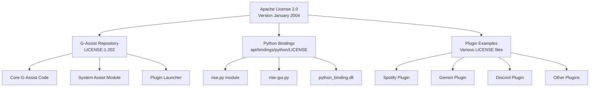
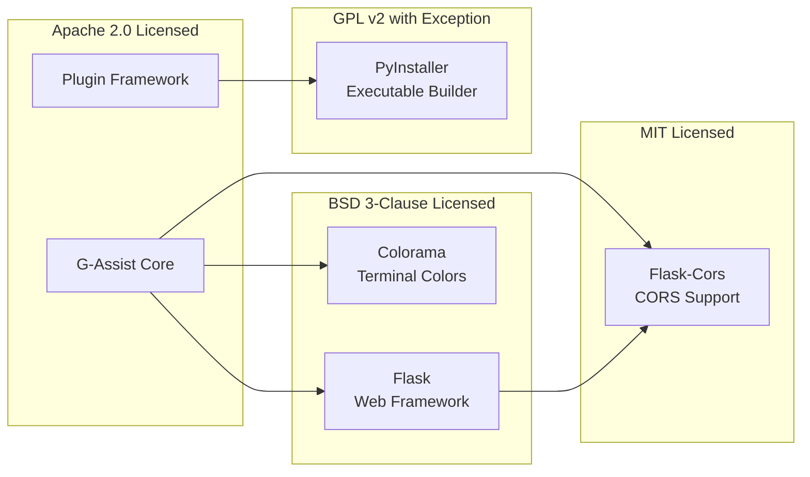
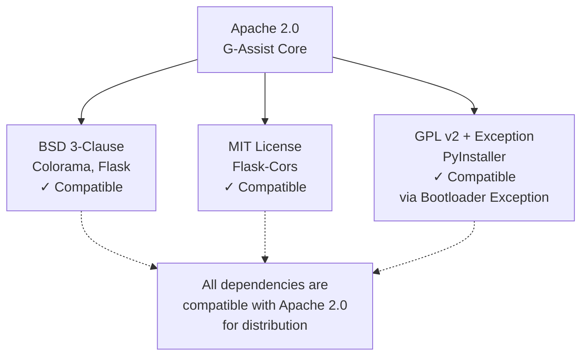
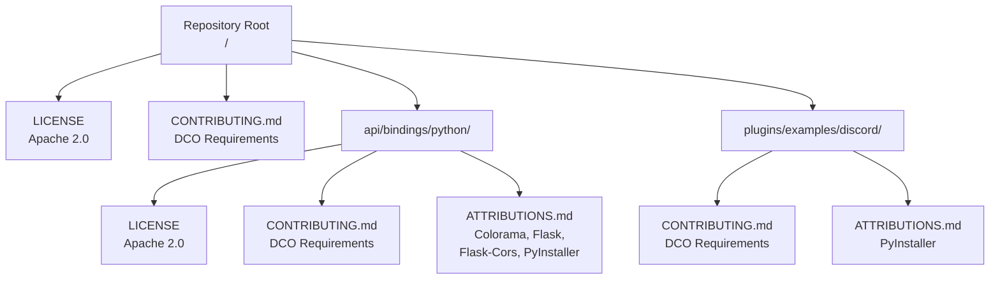

<!-- source: DeepWiki mcp.deepwiki.com · repo NVIDIA/G-Assist · page 9 License and Legal · fetched 2026-10-26 -->

# License and Legal

<details>
<summary>Relevant source files</summary>

The following files were used as context for generating this wiki page:

- [CONTRIBUTING.md](CONTRIBUTING.md)
- [LICENSE](LICENSE)
- [api/bindings/python/ATTRIBUTIONS.md](api/bindings/python/ATTRIBUTIONS.md)
- [api/bindings/python/CONTRIBUTING.md](api/bindings/python/CONTRIBUTING.md)
- [api/bindings/python/LICENSE](api/bindings/python/LICENSE)
- [plugins/examples/discord/.gitignore](plugins/examples/discord/.gitignore)
- [plugins/examples/discord/ATTRIBUTIONS.md](plugins/examples/discord/ATTRIBUTIONS.md)
- [plugins/examples/discord/CONTRIBUTING.md](plugins/examples/discord/CONTRIBUTING.md)
- [plugins/examples/discord/README.md](plugins/examples/discord/README.md)

</details>


This document provides a comprehensive overview of the licensing terms, third-party attributions, and legal requirements for the G-Assist project. It covers the main project license, contribution requirements, and all open-source dependencies used throughout the codebase.

For information about contributing code to the project, see [Contributing](#8).

---

## Main Project License

The G-Assist project is licensed under the **Apache License, Version 2.0** (January 2004). This license applies to all source code, documentation, and plugin examples included in the repository unless otherwise specified.

### License Location

The full license text is located at [LICENSE:1-202]().

### Key Terms

The Apache License 2.0 grants users the following permissions:

| Permission | Description |
|------------|-------------|
| **Use** | Freedom to use the software for any purpose |
| **Modification** | Right to modify the source code |
| **Distribution** | Ability to distribute original or modified versions |
| **Patent Grant** | Express patent license from contributors |
| **Commercial Use** | No restrictions on commercial applications |

### Redistribution Requirements

When distributing the Work or Derivative Works, you must:

1. Include a copy of the Apache License 2.0 [LICENSE:95-96]()
2. Mark modified files with prominent notices [LICENSE:98-99]()
3. Retain copyright, patent, trademark, and attribution notices [LICENSE:101-105]()
4. Include a copy of the NOTICE file if present [LICENSE:107-122]()

### Warranty Disclaimer

The software is provided "AS IS" without warranties of any kind [LICENSE:144-152]():
- No warranty of MERCHANTABILITY
- No warranty of FITNESS FOR A PARTICULAR PURPOSE
- No warranty of TITLE or NON-INFRINGEMENT

### License Diagram



**Sources:** [LICENSE:1-202](), [api/bindings/python/LICENSE:1-202]()

---

## Contribution Requirements

All contributions to the G-Assist project must comply with the **Developer Certificate of Origin (DCO)** requirement.

### Developer Certificate of Origin (DCO)

The DCO is a legally binding statement that certifies you have the right to submit your contribution under the project's license [CONTRIBUTING.md:12-51]().

#### DCO Version 1.1

The full DCO text is located at [CONTRIBUTING.md:25-51](). By signing off on your commits, you certify that:

1. **(a)** The contribution was created in whole or in part by you and you have the right to submit it under the open source license
2. **(b)** The contribution is based upon previous work covered under an appropriate open source license
3. **(c)** The contribution was provided to you by another person who certified (a), (b), or (c)
4. **(d)** You understand the contribution is public and will be maintained indefinitely

### Sign-Off Process

All commits must be signed off using the `--signoff` or `-s` flag [CONTRIBUTING.md:16-23]():

```bash
git commit -s -m "Add cool feature."
```

This appends the following to your commit message:

```
Signed-off-by: Your Name <your@email.com>
```

### Enforcement

**Any contribution containing commits that are not signed-off will not be accepted** [CONTRIBUTING.md:14]().

### Contributing Locations

The DCO requirement applies across all repository locations:

| Location | DCO File | Status |
|----------|----------|--------|
| Root repository | [CONTRIBUTING.md:1-53]() | Required |
| Python bindings | [api/bindings/python/CONTRIBUTING.md:1-51]() | Required |
| Discord plugin | [plugins/examples/discord/CONTRIBUTING.md:1-52]() | Required |

**Sources:** [CONTRIBUTING.md:1-53](), [api/bindings/python/CONTRIBUTING.md:1-51](), [plugins/examples/discord/CONTRIBUTING.md:1-52]()

---

## Third-Party Dependencies and Attributions

G-Assist uses several open-source libraries. All third-party attributions are documented in `ATTRIBUTIONS.md` files throughout the repository.

### Python Bindings Dependencies

The Python bindings module located at `api/bindings/python/` uses the following third-party libraries [api/bindings/python/ATTRIBUTIONS.md:1-1278]():

#### Colorama

- **License:** BSD 3-Clause "New" or "Revised" License
- **Copyright:** Copyright (c) 2010 Jonathan Hartley
- **Purpose:** Terminal color formatting for the interactive chat interface
- **License Text:** [api/bindings/python/ATTRIBUTIONS.md:6-36]()

#### Flask

- **License:** BSD 3-Clause "New" or "Revised" License  
- **Copyright:** Copyright 2010 Pallets
- **Purpose:** Web server framework for `rise-gui.py`
- **License Text:** [api/bindings/python/ATTRIBUTIONS.md:38-69]()

#### Flask-Cors

- **License:** MIT License
- **Copyright:** Copyright (C) 2025 Cory Dolphin
- **Purpose:** Cross-Origin Resource Sharing (CORS) support for Flask web server
- **License Text:** [api/bindings/python/ATTRIBUTIONS.md:71-81]()

#### PyInstaller

- **License:** GNU General Public License v2 with Bootloader Exception
- **Copyright:** Copyright (c) 2010-2023, PyInstaller Development Team
- **Purpose:** Packaging Python applications into standalone executables
- **License Text:** [api/bindings/python/ATTRIBUTIONS.md:83-494]()
- **Special Note:** The bootloader exception allows linking compiled bootloader files into combinations with other programs without GPL restrictions [api/bindings/python/ATTRIBUTIONS.md:102-111]()

### Plugin Dependencies

The Discord plugin example uses PyInstaller for building standalone executables [plugins/examples/discord/ATTRIBUTIONS.md:1-646]().

### Dependency License Matrix



**Sources:** [api/bindings/python/ATTRIBUTIONS.md:1-1278](), [plugins/examples/discord/ATTRIBUTIONS.md:1-646]()

---

## License Compliance Requirements

### For Users

When using G-Assist, you automatically receive:
- Perpetual, worldwide, royalty-free copyright license [LICENSE:67-72]()
- Patent license for contributions [LICENSE:74-88]()
- Freedom to use, modify, and distribute under Apache 2.0 terms

### For Developers

When developing plugins or modifications:

1. **Include License Notice:** Add Apache 2.0 license header to new files
2. **Mark Modifications:** Document changes to existing files [LICENSE:98-99]()
3. **Preserve Attributions:** Retain all copyright and attribution notices [LICENSE:101-105]()
4. **Sign Commits:** Use DCO sign-off for all contributions [CONTRIBUTING.md:16-19]()

### For Distributors

When distributing G-Assist or derivative works:

1. **Distribute License:** Include a copy of the Apache License 2.0 [LICENSE:95-96]()
2. **Provide NOTICE:** Include attribution notices if present [LICENSE:107-122]()
3. **Document Changes:** Mark all modified files [LICENSE:98-99]()
4. **Include Dependencies:** Provide attributions for all third-party libraries

### License Compatibility



**Sources:** [LICENSE:1-202](), [api/bindings/python/ATTRIBUTIONS.md:1-1278]()

---

## File Structure and License Locations

The following table shows where license and attribution files are located throughout the repository:

| Path | File Type | Purpose |
|------|-----------|---------|
| `/LICENSE` | Apache 2.0 License | Main project license [LICENSE:1-202]() |
| `/CONTRIBUTING.md` | DCO Guidelines | Contribution requirements [CONTRIBUTING.md:1-53]() |
| `/api/bindings/python/LICENSE` | Apache 2.0 License | Python bindings license [api/bindings/python/LICENSE:1-202]() |
| `/api/bindings/python/CONTRIBUTING.md` | DCO Guidelines | Python bindings contributions [api/bindings/python/CONTRIBUTING.md:1-51]() |
| `/api/bindings/python/ATTRIBUTIONS.md` | Third-Party Licenses | Python dependencies [api/bindings/python/ATTRIBUTIONS.md:1-1278]() |
| `/plugins/examples/discord/ATTRIBUTIONS.md` | Third-Party Licenses | Discord plugin dependencies [plugins/examples/discord/ATTRIBUTIONS.md:1-646]() |
| `/plugins/examples/discord/CONTRIBUTING.md` | DCO Guidelines | Discord plugin contributions [plugins/examples/discord/CONTRIBUTING.md:1-52]() |

### License File Structure Diagram



**Sources:** [LICENSE:1-202](), [CONTRIBUTING.md:1-53](), [api/bindings/python/LICENSE:1-202](), [api/bindings/python/CONTRIBUTING.md:1-51](), [api/bindings/python/ATTRIBUTIONS.md:1-1278](), [plugins/examples/discord/ATTRIBUTIONS.md:1-646](), [plugins/examples/discord/CONTRIBUTING.md:1-52]()

---

## Important Legal Notices

### Trademark Notice

The Apache License does not grant permission to use trade names, trademarks, service marks, or product names of NVIDIA Corporation, except as required for reasonable and customary use in describing the origin of the work [LICENSE:139-142]().

### Patent Litigation Clause

If you institute patent litigation alleging that the Work constitutes patent infringement, any patent licenses granted under this License terminate as of the date the litigation is filed [LICENSE:82-88]().

### No Warranty

The software is provided without any warranty [LICENSE:144-152](). Users assume all risks associated with using or redistributing the Work.

### Limitation of Liability

No contributor shall be liable for damages arising from the use or inability to use the Work, including but not limited to:
- Loss of goodwill
- Work stoppage
- Computer failure or malfunction
- Commercial damages or losses

See [LICENSE:154-164]() for complete limitation of liability terms.

---

## Summary

| Component | License | DCO Required | Attribution File |
|-----------|---------|--------------|------------------|
| G-Assist Core | Apache 2.0 | Yes | N/A |
| Python Bindings | Apache 2.0 | Yes | ATTRIBUTIONS.md |
| Plugin Examples | Apache 2.0 | Yes | ATTRIBUTIONS.md (per plugin) |
| Colorama | BSD 3-Clause | N/A | Python bindings ATTRIBUTIONS.md |
| Flask | BSD 3-Clause | N/A | Python bindings ATTRIBUTIONS.md |
| Flask-Cors | MIT | N/A | Python bindings ATTRIBUTIONS.md |
| PyInstaller | GPL v2 + Exception | N/A | Multiple ATTRIBUTIONS.md files |

**Sources:** [LICENSE:1-202](), [CONTRIBUTING.md:1-53](), [api/bindings/python/ATTRIBUTIONS.md:1-1278](), [plugins/examples/discord/ATTRIBUTIONS.md:1-646]()