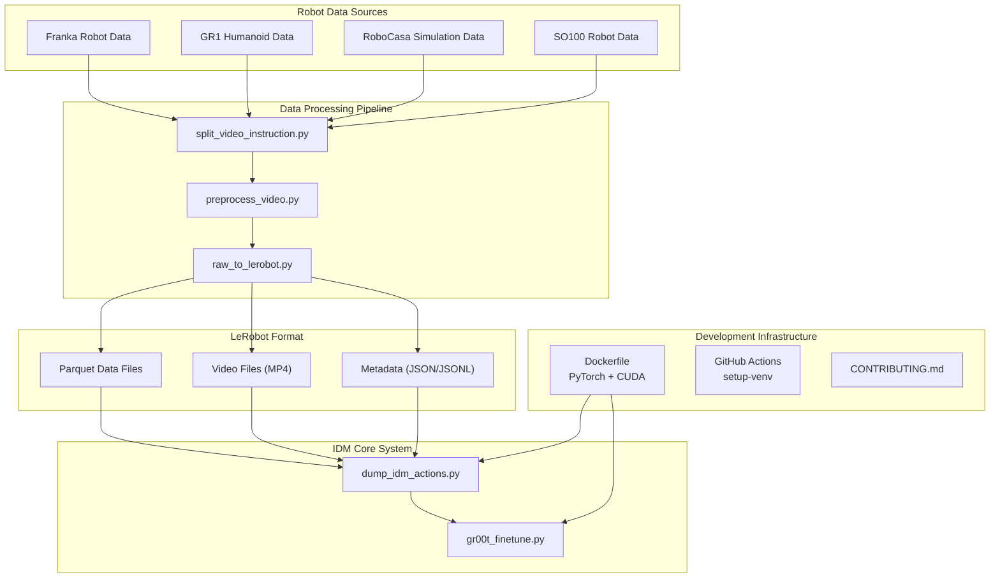
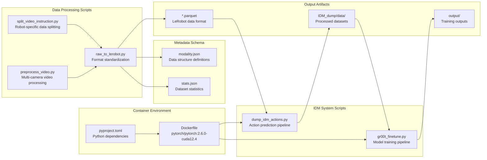
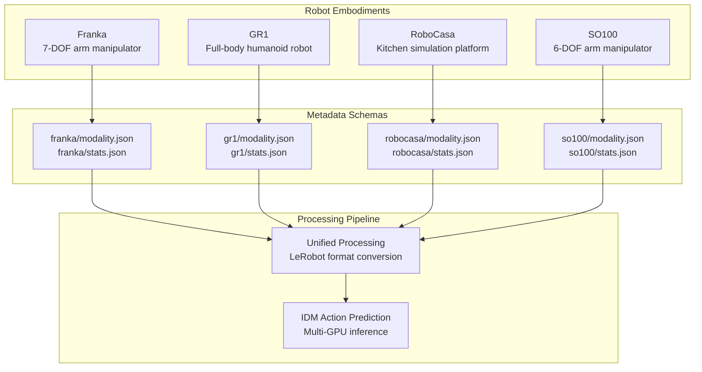

<!-- source: DeepWiki mcp.deepwiki.com · repo NVIDIA/GR00T-Dreams · page 1 Overview · fetched 2026-10-26 -->

# Overview

Relevant source files

The following files were used as context for generating this wiki page:

- [.gitignore](.gitignore)
- [CONTRIBUTING.md](CONTRIBUTING.md)
- [Dockerfile](Dockerfile)

This document provides a high-level introduction to the NVIDIA Isaac-GR00T repository, explaining its purpose as a multi-robot instruction-driven model system and outlining the key architectural components. For detailed setup instructions, see [Development Setup](#2.1). For specific robot configurations, see [Robot Embodiments](#5). For deep technical details on the core system, see [Core IDM System](#3).

## Purpose and Scope

The NVIDIA Isaac-GR00T repository is a comprehensive system for training and deploying instruction-following robots across multiple embodiments using Inverse Dynamics Models (IDM). The system processes raw robot demonstration data, converts it to standardized formats, and uses IDM-based approaches to generate robotic actions for various robot platforms including Franka arms, GR1 humanoids, RoboCasa simulations, and SO100 manipulators.

The repository provides:
- Multi-robot data processing pipelines that standardize diverse robot data formats
- IDM-based action prediction and model finetuning capabilities  
- LeRobot format conversion for interoperability with robotics frameworks
- Containerized development environment with PyTorch and CUDA support
- Professional CI/CD infrastructure for collaborative development

## System Architecture

### High-Level Architecture Overview

**Sources:** [Dockerfile:1-39](), [CONTRIBUTING.md:1-187](), [.gitignore:121-125]()

### Core Components and Code Mapping

**Sources:** [Dockerfile:22-24](), [.gitignore:122-125]()

## Development Environment  

The system is designed to run in a containerized environment built on PyTorch with CUDA support. The development stack includes:

| Component | Version/Details |
|-----------|----------------|
| Base Image | `pytorch/pytorch:2.6.0-cuda12.4-cudnn9-devel` |
| Python Environment | Python 3.10 with conda/miniconda |
| Key Dependencies | PyTorch 2.5.1, OpenCV 4.8.0, flash_attn 2.7.1 |
| Development Tools | Git LFS, wandb, gpustat |

The [Dockerfile:1-39]() establishes the complete development environment with system dependencies, Python packages, and workspace configuration. The container includes video processing libraries (`ffmpeg`, `libgl1-mesa-glx`) and development utilities (`vim`, `tmux`, `htop`).

**Sources:** [Dockerfile:1-39]()

## Multi-Robot Support

The system supports four distinct robot embodiments, each with specialized data processing and metadata schemas:

**Sources:** [.gitignore:122]()

## Data Processing Workflow

The core data processing workflow transforms raw robot demonstrations into standardized formats suitable for IDM training:

1. **Data Splitting**: `split_video_instruction.py` separates robot-specific data
2. **Video Preprocessing**: `preprocess_video.py` handles multi-camera video processing and format standardization  
3. **Format Conversion**: `raw_to_lerobot.py` converts to LeRobot parquet format with metadata generation
4. **IDM Processing**: `dump_idm_actions.py` generates action predictions using pre-trained IDM models
5. **Model Finetuning**: `gr00t_finetune.py` performs distributed training for robot-specific models

The system generates artifacts in `IDM_dump/data/` and `output/` directories, with temporary processing files managed through `.gitignore` patterns.

**Sources:** [.gitignore:122-125]()

## Development Infrastructure

The repository includes comprehensive development infrastructure:

- **Issue Management**: Structured GitHub issue templates for bug reports, feature requests, and documentation
- **CI/CD Pipeline**: GitHub Actions workflow with automated environment setup (`setup-venv`)  
- **Code Quality**: Integration with `isort`, `black`, `ruff`, `mypy`, and `pytest` for consistent code standards
- **Containerization**: Docker-based development environment ensuring reproducible builds
- **Git Configuration**: LFS support for large model files and proper artifact exclusion

The [CONTRIBUTING.md:32-147]() provides detailed workflows for fork-based development, testing procedures, and pull request guidelines.

**Sources:** [CONTRIBUTING.md:1-187](), [Dockerfile:1-39](), [.gitignore:1-125]()

## Getting Started

To begin working with the system:

1. **Environment Setup**: Follow [Development Setup](#2.1) for Docker container and virtual environment configuration
2. **Data Processing**: See [Data Processing Pipeline](#4) for converting robot demonstration data  
3. **Robot Configuration**: Consult [Robot Embodiments](#5) for robot-specific setup and processing
4. **IDM Training**: Reference [Core IDM System](#3) for model training and action prediction workflows
5. **Contributing**: Review [Contributing Guidelines](#2.2) for development workflow and code standards

The system is designed for researchers and developers working on instruction-following robotics across multiple robot platforms, with emphasis on scalable data processing and standardized model training pipelines.

**Sources:** [CONTRIBUTING.md:70-90](), [Dockerfile:19-39]()

---

