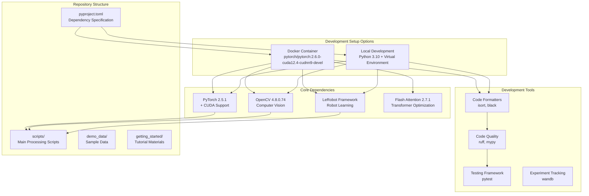
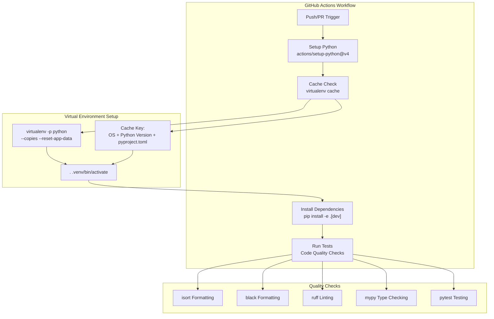

<!-- source: DeepWiki mcp.deepwiki.com · repo NVIDIA/GR00T-Dreams · page 2 Getting Started · fetched 2026-10-26 -->

# Getting Started

<details>
<summary>Relevant source files</summary>

The following files were used as context for generating this wiki page:

- [.github/actions/setup-venv/action.yml](.github/actions/setup-venv/action.yml)
- [CONTRIBUTING.md](CONTRIBUTING.md)
- [Dockerfile](Dockerfile)

</details>


This page provides an overview of how to set up your development environment and begin contributing to the NVIDIA Isaac-GR00T repository. It covers the initial setup process, development workflow, and contribution guidelines at a high level. For detailed setup instructions, see [Development Setup](#2.1). For comprehensive contribution guidelines, see [Contributing Guidelines](#2.2).

## Purpose and Scope

The Getting Started guide helps developers:
- Set up a working development environment for the Isaac-GR00T system
- Understand the available setup options (Docker vs local development)
- Navigate the contribution workflow
- Access the development infrastructure and tools

This page focuses on environment setup and development workflow. For information about the core IDM system architecture, see [Core IDM System](#3). For robot-specific configurations, see [Robot Embodiments](#5).

## Setup Options Overview

The Isaac-GR00T repository supports two primary development approaches:

### Docker-based Development
The repository provides a complete Docker environment with all dependencies pre-configured. This approach ensures consistency across different development machines and simplifies dependency management.

### Local Development
For developers who prefer local development, the repository supports Python virtual environments with detailed dependency specifications in `pyproject.toml`.

## Development Environment Architecture



Sources: [Dockerfile:1-39](), [CONTRIBUTING.md:70-86]()

## GitHub Actions Integration

The repository includes automated CI/CD infrastructure that mirrors the local development setup:



Sources: [.github/actions/setup-venv/action.yml:1-57](), [CONTRIBUTING.md:122-142]()

## Contribution Workflow

The repository follows a standard GitHub fork-and-pull-request workflow with automated quality checks:

| Stage | Action | Tools/Commands |
|-------|--------|----------------|
| **Setup** | Fork repository and clone locally | `git clone`, `git remote add upstream` |
| **Environment** | Create Python virtual environment | `conda create -n isaac-gr00t python=3.10` |
| **Dependencies** | Install project in editable mode | `pip install -e .[dev]` |
| **Development** | Create feature branch | `git checkout -b BRANCH` |
| **Quality** | Format and lint code | `isort .`, `black .`, `ruff check .` |
| **Testing** | Run test suite | `pytest -v tests/` |
| **Submission** | Create pull request | GitHub PR with clear description |

## Key Development Commands

Once your environment is set up, these are the essential commands for development:

```bash
# Code formatting
isort .
black .

# Code quality checks
ruff check .

# Type checking (if applicable)
mypy .

# Run tests
pytest -v tests/

# Install in editable mode
pip install -e .[dev]
```

## Environment Variables and Configuration

The Docker environment sets up several important environment variables:

| Variable | Value | Purpose |
|----------|-------|---------|
| `PYTHONPATH` | `/workspace:${PYTHONPATH}` | Python module resolution |
| `DEBIAN_FRONTEND` | `noninteractive` | Non-interactive package installation |
| `WORKDIR` | `/workspace` | Primary working directory |

## Next Steps

After completing the initial setup:

1. **Detailed Setup**: Follow the comprehensive setup instructions in [Development Setup](#2.1)
2. **Contributing**: Review the full contribution guidelines in [Contributing Guidelines](#2.2)
3. **Understanding the System**: Explore the [Core IDM System](#3) to understand the architecture
4. **Data Processing**: Learn about the [Data Processing Pipeline](#4) for working with robot data
5. **Robot Support**: Review [Robot Embodiments](#5) for robot-specific configurations

## Dependencies and System Requirements

The Isaac-GR00T system requires:
- **Python**: 3.10 (specified in virtual environment setup)
- **CUDA**: 12.4 (for GPU acceleration)
- **PyTorch**: 2.5.1+ with CUDA support
- **System Libraries**: OpenGL, Vulkan development libraries
- **Development Tools**: Git, Git LFS, FFmpeg

The complete dependency specification is maintained in `pyproject.toml` and the Docker environment provides all system-level dependencies pre-configured.

Sources: [CONTRIBUTING.md:1-187](), [Dockerfile:1-39](), [.github/actions/setup-venv/action.yml:1-57]()

---

