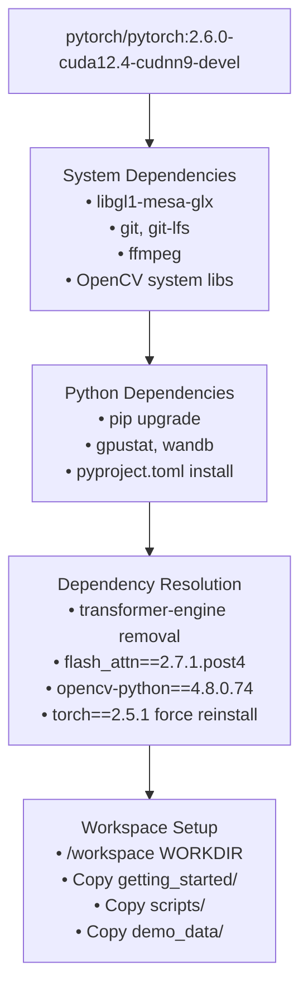
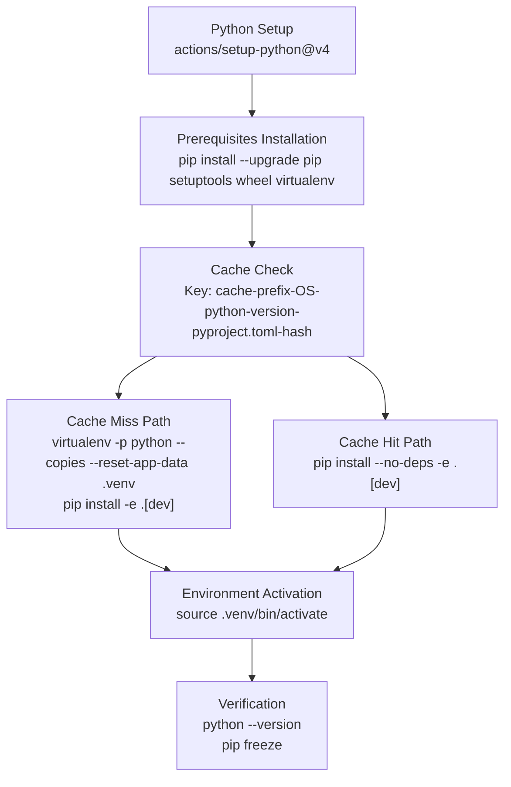
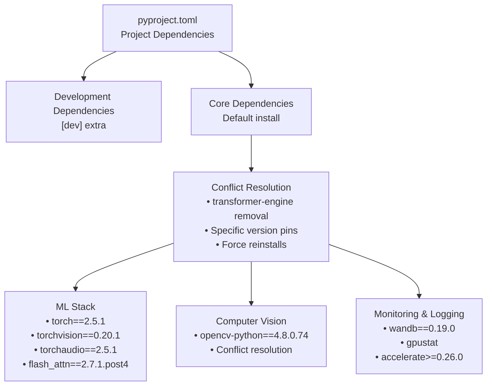

<!-- source: DeepWiki mcp.deepwiki.com · repo NVIDIA/GR00T-Dreams · page 2.1 Development Setup · fetched 2026-10-26 -->

# Development Setup

<details>
<summary>Relevant source files</summary>

The following files were used as context for generating this wiki page:

- [.github/actions/setup-venv/action.yml](.github/actions/setup-venv/action.yml)
- [.gitignore](.gitignore)
- [Dockerfile](Dockerfile)

</details>


This document provides detailed instructions for configuring the development environment for the NVIDIA Isaac-GR00T repository. It covers Docker-based development setup, local virtual environment configuration, and dependency management required for the IDM (Inverse Dynamics Model) system and multi-robot data processing pipeline.

For information about contributing code and development workflow, see [Contributing Guidelines](#2.2). For robot-specific setup procedures, see [Robot Embodiments](#5).

## Setup Options Overview

The repository supports two primary development environment configurations:

| Setup Method | Use Case | Key Benefits |
|--------------|----------|--------------|
| Docker Container | Production-like development, GPU workflows | Consistent environment, CUDA support, isolated dependencies |
| Local Virtual Environment | Rapid development, debugging | Fast iteration, native IDE integration, easier debugging |

## Docker Environment Setup

The Docker-based setup provides a complete development environment with PyTorch, CUDA support, and all required dependencies pre-configured.

### Docker Architecture



### Docker Build Process

The Docker environment is defined in [Dockerfile:1-39]() and includes:

1. **Base Image**: PyTorch 2.6.0 with CUDA 12.4 and cuDNN 9 support
2. **System Dependencies Installation**: [Dockerfile:6-15]()
   - Graphics libraries (`libgl1-mesa-glx`)
   - Development tools (`git`, `cmake`, `build-essential`)
   - Media processing (`ffmpeg`)
   - OpenCV system dependencies

3. **Python Environment Setup**: [Dockerfile:17-32]()
   - Package manager upgrades
   - Monitoring tools (`gpustat`, `wandb==0.19.0`)
   - Project dependencies from `pyproject.toml`

4. **Dependency Conflict Resolution**: [Dockerfile:25-32]()
   - Removes conflicting `transformer-engine`
   - Installs specific versions of critical packages
   - Force reinstalls PyTorch stack with compatible versions

### Docker Usage

```bash
# Build the Docker image
docker build -t gr00t-dreams .

# Run with GPU support and volume mounting
docker run --gpus all -v $(pwd):/workspace -it gr00t-dreams bash
```

Sources: [Dockerfile:1-39]()

## Local Virtual Environment Setup

The repository includes automated virtual environment setup through GitHub Actions that can be replicated locally.

### Virtual Environment Architecture



### Setup Process

The virtual environment setup follows the process defined in [.github/actions/setup-venv/action.yml:1-57]():

1. **Python Installation**: [.github/actions/setup-venv/action.yml:14-17]()
   - Uses `actions/setup-python@v4`
   - Configurable Python version via input parameter

2. **Prerequisites Installation**: [.github/actions/setup-venv/action.yml:19-23]()
   - Upgrades `pip`, `setuptools`, `wheel`, `virtualenv`

3. **Cache Management**: [.github/actions/setup-venv/action.yml:29-33]()
   - Cache key includes OS, Python version, and `pyproject.toml` hash
   - Cached path: `.venv` directory

4. **Environment Creation**: 
   - **Without cache**: [.github/actions/setup-venv/action.yml:35-41]()
     - Creates new virtual environment with `--copies --reset-app-data`
     - Installs project with development dependencies: `pip install -e .[dev]`
   
   - **With cache**: [.github/actions/setup-venv/action.yml:43-48]()
     - Installs without dependencies: `pip install --no-deps -e .[dev]`

5. **Verification**: [.github/actions/setup-venv/action.yml:50-56]()
   - Displays Python version and package list

### Local Setup Commands

```bash
# Create virtual environment
python -m virtualenv -p $(which python) --copies --reset-app-data .venv

# Activate environment
source .venv/bin/activate

# Install development dependencies
pip install -e .[dev]
```

Sources: [.github/actions/setup-venv/action.yml:1-57]()

## Development Dependencies

### Dependency Management Strategy



### Critical Dependency Versions

The Docker setup specifies exact versions for compatibility:

| Package | Version | Reason |
|---------|---------|---------|
| `torch` | 2.5.1 | Force reinstall for compatibility |
| `flash_attn` | 2.7.1.post4 | Replaces transformer-engine |
| `opencv-python` | 4.8.0.74 | Resolves OpenCV conflicts |
| `wandb` | 0.19.0 | Experiment tracking |
| `accelerate` | >=0.26.0 | Distributed training support |
| `numpy` | 1.26.4 | Numerical computing compatibility |

Sources: [Dockerfile:17-38]()

## Environment Verification

### Verification Checklist

After setup completion, verify the environment using these steps:

1. **Python Environment**: 
   ```bash
   python --version  # Should show configured version
   which python      # Should point to virtual environment
   ```

2. **Core Dependencies**:
   ```bash
   pip freeze | grep torch     # Verify PyTorch installation
   pip freeze | grep opencv    # Verify OpenCV installation
   pip freeze | grep wandb     # Verify monitoring tools
   ```

3. **GPU Support** (if applicable):
   ```bash
   python -c "import torch; print(torch.cuda.is_available())"
   gpustat  # Should show GPU information
   ```

### Excluded Files and Directories

The development setup excludes certain files and directories via [.gitignore:1-125]():

| Category | Patterns | Purpose |
|----------|----------|---------|
| Python artifacts | `__pycache__`, `*.pyc`, `*.egg-info` | Build artifacts |
| Development tools | `.venv/`, `.mypy_cache`, `.ruff_cache/` | Tool caches |
| IDE files | `.vscode/`, `.idea`, `pyrightconfig.json` | Editor configs |
| Data directories | `demo_data/`, `output/`, `IDM_dump/data/` | Large data files |
| ML outputs | `wandb`, `.hydra/`, `eval_output/` | Training artifacts |

Sources: [.gitignore:1-125]()

## Next Steps

After completing the development setup:

1. Review [Contributing Guidelines](#2.2) for code quality standards and workflow
2. Explore [Core IDM System](#3) for understanding the main processing pipeline  
3. Check [Robot Embodiments](#5) for robot-specific setup requirements
4. Refer to [Data Processing Pipeline](#4) for data processing workflows

Sources: [.github/actions/setup-venv/action.yml:1-57](), [Dockerfile:1-39](), [.gitignore:1-125]()

---

