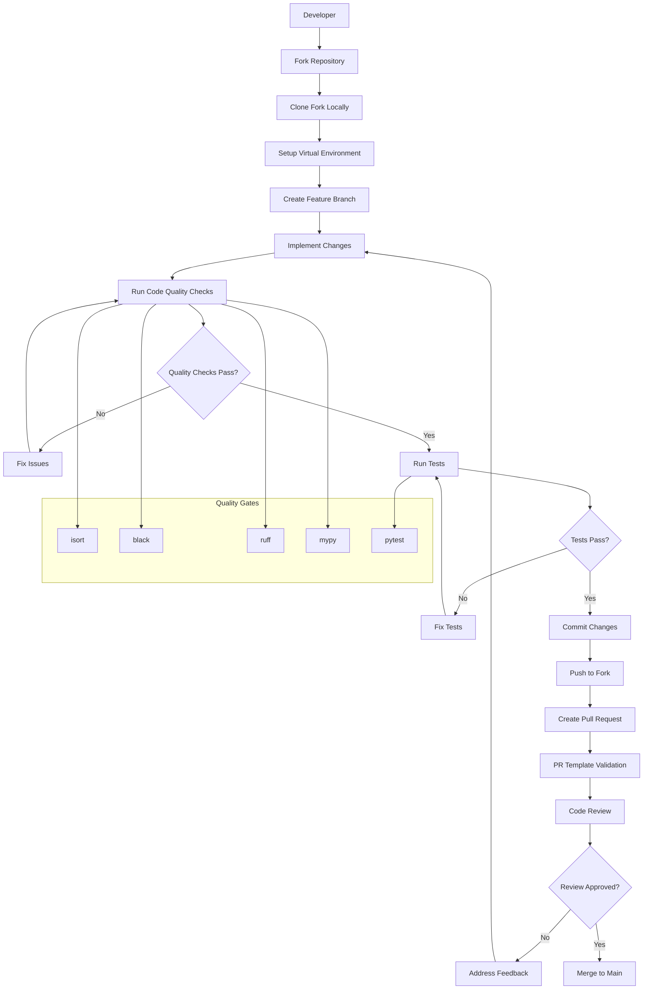
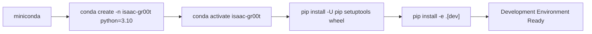
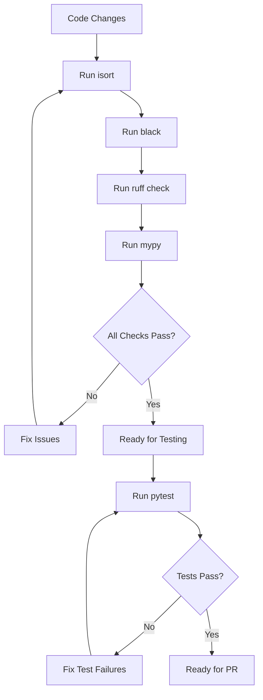
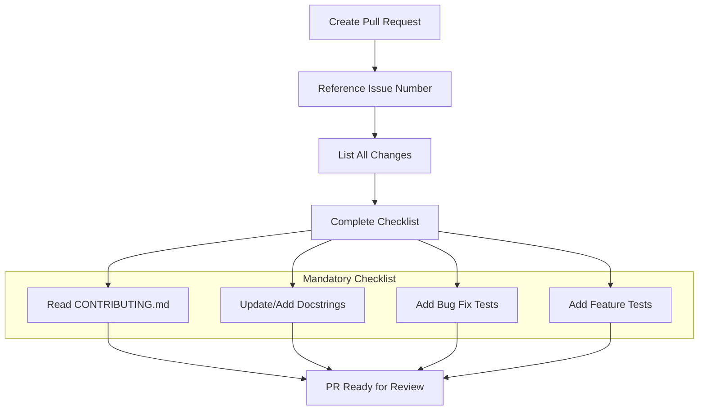
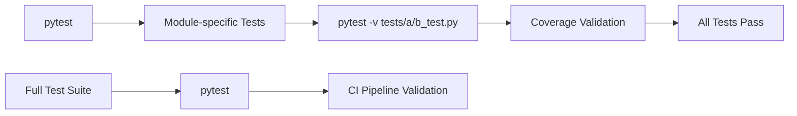

<!-- source: DeepWiki mcp.deepwiki.com · repo NVIDIA/GR00T-Dreams · page 2.2 Contributing Guidelines · fetched 2026-10-26 -->

# Contributing Guidelines

<details>
<summary>Relevant source files</summary>

The following files were used as context for generating this wiki page:

- [.github/pull_request_template.md](.github/pull_request_template.md)
- [CONTRIBUTING.md](CONTRIBUTING.md)

</details>


This document provides comprehensive guidelines for contributing code to the NVIDIA Isaac-GR00T repository. It covers the complete development workflow from initial setup through pull request submission, including code quality standards, testing requirements, and development best practices.

For information about setting up the development environment and dependencies, see [Development Setup](#2.1). For details about the CI/CD pipeline and automated testing infrastructure, see [CI/CD Pipeline](#6.2).

## Contributing Workflow Overview

The contributing process follows a standard GitHub fork-and-pull-request workflow with specific quality gates and testing requirements.

### Development Process Flow



Sources: [CONTRIBUTING.md:32-147](), [.github/pull_request_template.md:1-18]()

## Initial Setup Requirements

### Repository Setup

Contributors must follow a specific fork-and-clone workflow to maintain proper upstream tracking.

| Step | Command | Purpose |
|------|---------|---------|
| Fork Repository | Web interface | Create personal copy on GitHub |
| Clone Fork | `git clone https://github.com/USERNAME/Isaac-GR00T.git` | Local development copy |
| Add Upstream | `git remote add upstream https://github.com/NVIDIA/Isaac-GR00T.git` | Track main repository |
| Verify Remotes | `git remote -v` | Confirm upstream configuration |

Sources: [CONTRIBUTING.md:40-68]()

### Python Environment Setup

The project requires Python 3.10 with a virtual environment for dependency isolation:



The editable installation (`-e` flag) creates symbolic links enabling immediate reflection of code changes in the virtual environment.

Sources: [CONTRIBUTING.md:70-89]()

## Code Quality Standards

### Formatting and Linting Tools

The project enforces strict code quality standards through automated tools that must pass before PR submission:

| Tool | Purpose | Command | Configuration |
|------|---------|---------|---------------|
| `isort` | Import sorting | `isort .` | Alphabetical import organization |
| `black` | Code formatting | `black .` | PEP 8 compliant formatting |
| `ruff` | Linting | `ruff check .` | Code quality analysis |
| `mypy` | Type checking | `mypy` | Static type validation |

### Pre-commit Workflow



Many IDEs support these formatters as plugins for automatic execution on file save. The CI system runs identical checks to ensure consistency.

Sources: [CONTRIBUTING.md:124-137]()

## Pull Request Process

### PR Template Requirements

All pull requests must use the provided template and complete the mandatory checklist:



The template enforces linking to issues using "Fixes #" or "Closes #" syntax for automatic issue closure upon merge.

Sources: [.github/pull_request_template.md:1-18]()

### Branch Management Strategy

Contributors must follow specific branching practices to maintain repository cleanliness:

| Practice | Command | Rationale |
|----------|---------|-----------|
| Avoid direct main commits | `git checkout -b BRANCH` | Maintain clean main branch |
| Sync before branching | `git pull --rebase upstream main` | Prevent merge conflicts |
| Push with upstream tracking | `git push -u origin BRANCH` | Enable PR creation |

Sources: [CONTRIBUTING.md:104-116]()

## Testing Requirements

### Test Coverage Standards

The project maintains high test coverage standards requiring comprehensive test additions for all contributions:

- **Bug fixes**: Must include tests that fail without the fix
- **New features**: Must include tests covering new functionality sufficiently
- **Existing functionality changes**: Must update corresponding tests

### Test Execution



Contributors should run tests locally before PR submission to accelerate the review process.

Sources: [CONTRIBUTING.md:136-142]()

## Fork Synchronization

### Keeping Fork Updated

Regular synchronization with the upstream repository prevents merge conflicts and ensures current codebase alignment:

```bash
git checkout main
git pull --rebase upstream main
git push
```

This three-command sequence updates the local main branch, applies upstream changes, and propagates updates to the forked repository.

Sources: [CONTRIBUTING.md:92-102]()

## Developer Certificate of Origin

All contributions require adherence to the Developer Certificate of Origin (DCO) version 1.1, which certifies contributor rights to submit code under the project's open source license. The DCO covers four key areas:

1. **Original work**: Contributor created the work with submission rights
2. **Derivative work**: Based on appropriately licensed previous work
3. **Third-party contributions**: Received from certified contributors
4. **Public record understanding**: Acceptance of permanent public contribution record

The DCO ensures legal compliance for all contributions and maintains project integrity for redistribution under open source licenses.

Sources: [CONTRIBUTING.md:149-186]()

---

