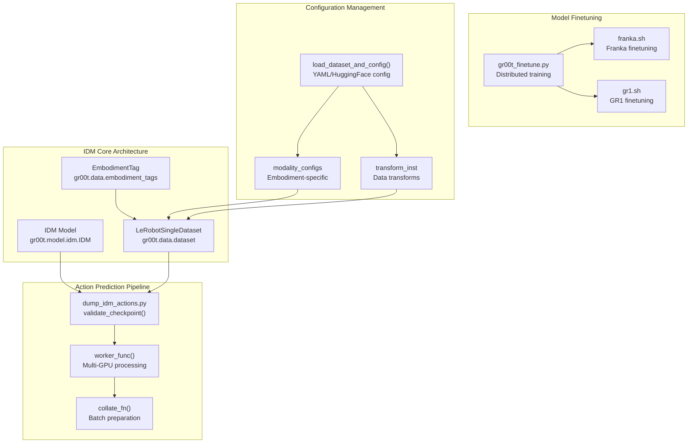
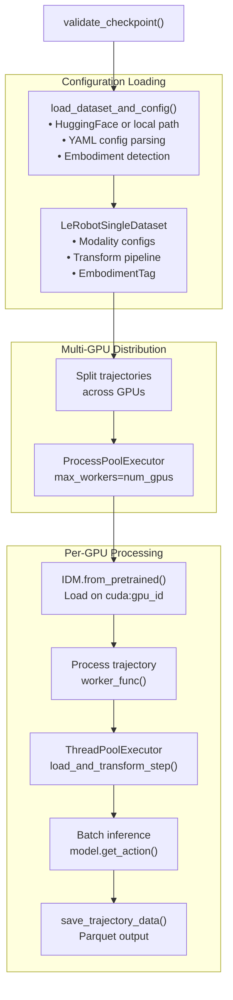
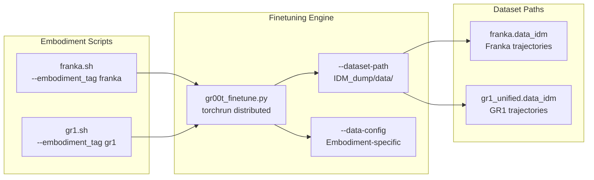
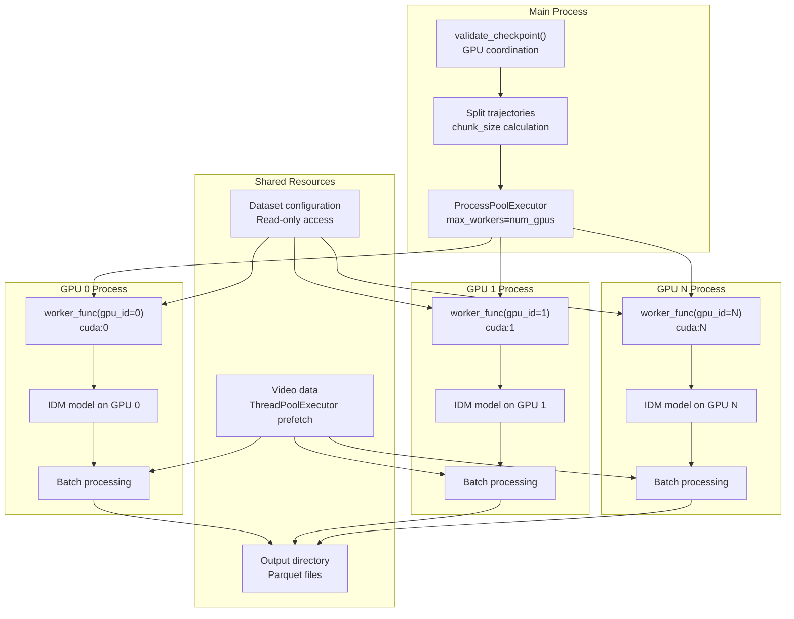
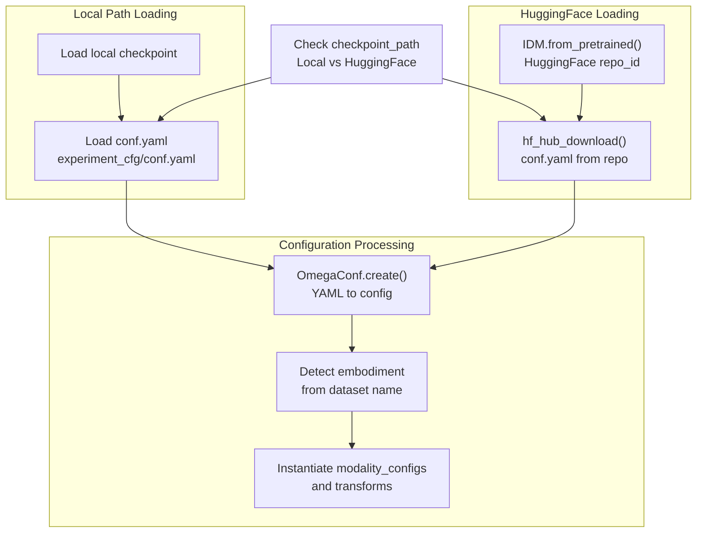

<!-- source: DeepWiki mcp.deepwiki.com · repo NVIDIA/GR00T-Dreams · page 3 Core IDM System · fetched 2026-10-26 -->

# Core IDM System

Relevant source files

The following files were used as context for generating this wiki page:

- [IDM_dump/dump_idm_actions.py](IDM_dump/dump_idm_actions.py)
- [IDM_dump/raw_to_lerobot.py](IDM_dump/raw_to_lerobot.py)
- [IDM_dump/scripts/finetune/franka.sh](IDM_dump/scripts/finetune/franka.sh)
- [IDM_dump/scripts/finetune/gr1.sh](IDM_dump/scripts/finetune/gr1.sh)

## Purpose and Scope

The Core IDM System implements the Inverse Dynamics Model (IDM) for robotic action prediction and model finetuning across multiple robot embodiments. This system serves as the central processing engine for converting raw robot demonstrations into actionable predictions and training improved models.

This document covers the IDM architecture, action prediction pipeline, and finetuning capabilities. For data preprocessing and format conversion, see [Data Processing Pipeline](#4). For robot-specific configurations, see [Robot Embodiments](#5).

## IDM Architecture Overview

The IDM system consists of three primary components: action prediction, model finetuning, and multi-GPU processing orchestration. The system is designed to handle large-scale datasets across different robot embodiments using distributed processing.

### Core IDM Components

**Sources:** [IDM_dump/dump_idm_actions.py:1-476](), [IDM_dump/scripts/finetune/franka.sh:1-2](), [IDM_dump/scripts/finetune/gr1.sh:1-3]()

## Action Prediction Pipeline

The action prediction pipeline processes robot trajectories through the IDM model to generate predicted actions. The system supports both local checkpoints and HuggingFace model repositories.

### IDM Action Prediction Workflow

**Sources:** [IDM_dump/dump_idm_actions.py:298-382](), [IDM_dump/dump_idm_actions.py:141-297]()

### Data Processing and Batch Preparation

The system implements efficient data loading with video preprocessing and batch collation for GPU inference:

| Component | Function | Key Features |
|-----------|----------|--------------|
| `get_step_data()` | [IDM_dump/dump_idm_actions.py:113-127]() | Extracts state, action, language data |
| `load_and_transform_step()` | [IDM_dump/dump_idm_actions.py:176-191]() | Video frame extraction and transforms |
| `collate_fn()` | [IDM_dump/dump_idm_actions.py:100-111]() | Batch tensor preparation for GPU |
| `get_all_frames_and_timestamps()` | [IDM_dump/dump_idm_actions.py:199]() | Video backend processing |

**Sources:** [IDM_dump/dump_idm_actions.py:100-127](), [IDM_dump/dump_idm_actions.py:176-200]()

## Model Finetuning System

The IDM system supports distributed model finetuning across different robot embodiments using the `gr00t_finetune.py` script with embodiment-specific configurations.

### Finetuning Configuration

**Sources:** [IDM_dump/scripts/finetune/franka.sh:1-2](), [IDM_dump/scripts/finetune/gr1.sh:1-3]()

### Embodiment-Specific Processing

The system automatically detects and configures processing parameters based on the dataset embodiment:

| Embodiment | EmbodimentTag | Data Config | Features |
|------------|---------------|-------------|----------|
| Franka | `EmbodimentTag.FRANKA` | `franka` | 7-DOF arm control |
| GR1 | `EmbodimentTag.GR1_unified` | `gr1_arms_waist` | Humanoid body control |
| SO100 | `EmbodimentTag.SO100` | `so100` | 6-DOF arm control |
| RoboCasa | `EmbodimentTag.ROBOCASA` | `robocasa` | Kitchen simulation |

**Sources:** [IDM_dump/dump_idm_actions.py:78-87]()

## Multi-GPU Processing Architecture

The IDM system implements efficient multi-GPU processing for large-scale action prediction using process-based parallelism with CUDA device assignment.

### GPU Processing Distribution

**Sources:** [IDM_dump/dump_idm_actions.py:308-382](), [IDM_dump/dump_idm_actions.py:141-297]()

### Performance Optimization Features

The system includes several optimization strategies for efficient processing:

- **Process-based Parallelism**: Uses `multiprocessing.set_start_method("spawn")` for GPU isolation
- **ThreadPoolExecutor Prefetching**: Concurrent video frame loading within each GPU process
- **Batch Processing**: Configurable batch sizes for memory optimization
- **CUDA Memory Management**: Automatic `torch.cuda.empty_cache()` after processing
- **Chunked Output**: Trajectories saved in chunks to prevent memory overflow

**Sources:** [IDM_dump/dump_idm_actions.py:436](), [IDM_dump/dump_idm_actions.py:203-212](), [IDM_dump/dump_idm_actions.py:380-381](), [IDM_dump/dump_idm_actions.py:129-137]()

## Configuration and Model Loading

The IDM system supports flexible model loading from both local checkpoints and HuggingFace repositories with automatic configuration detection.

### Model Loading Pipeline

**Sources:** [IDM_dump/dump_idm_actions.py:22-97](), [IDM_dump/dump_idm_actions.py:156-162]()

---

