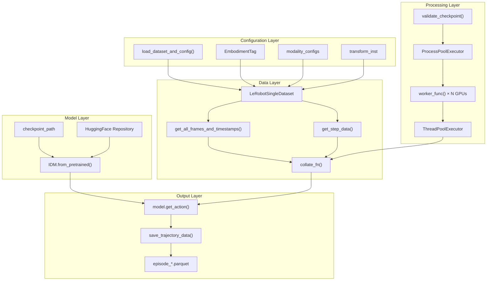
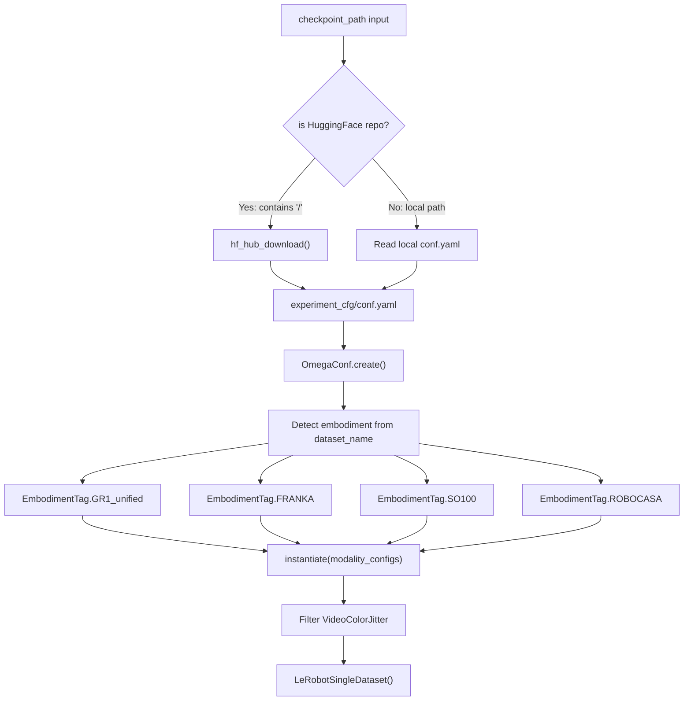
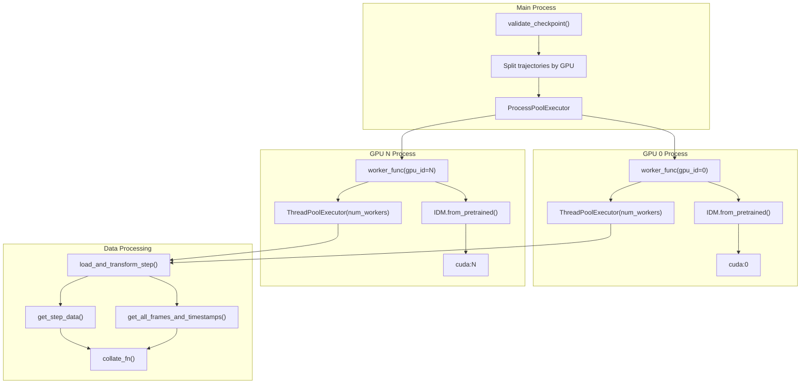
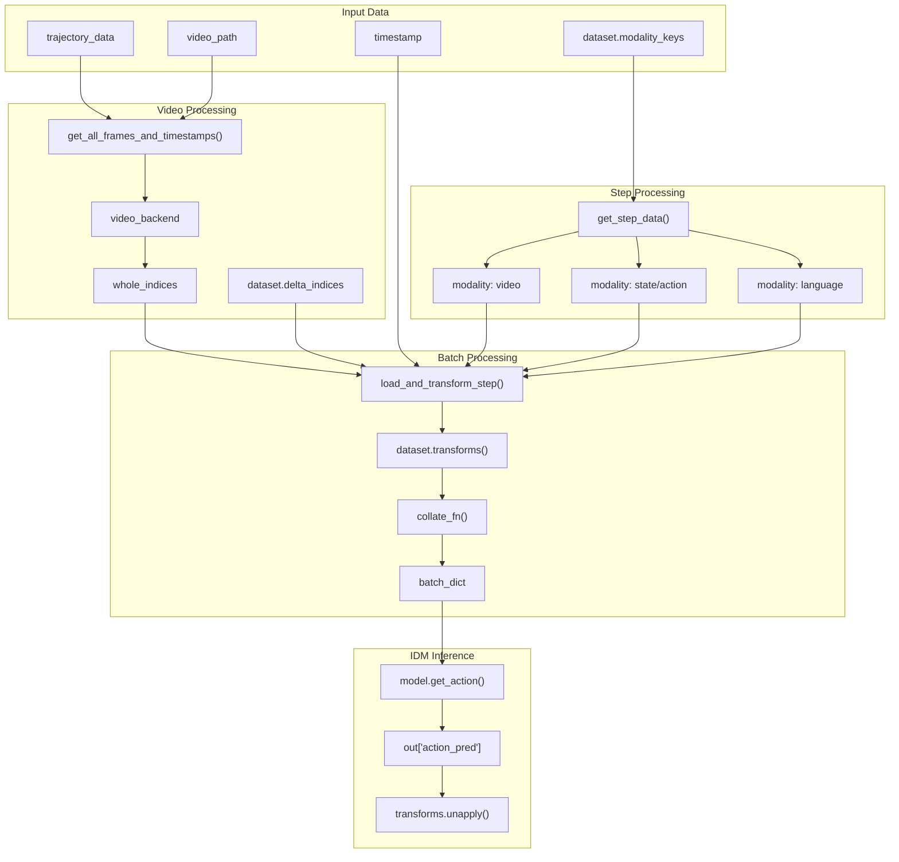
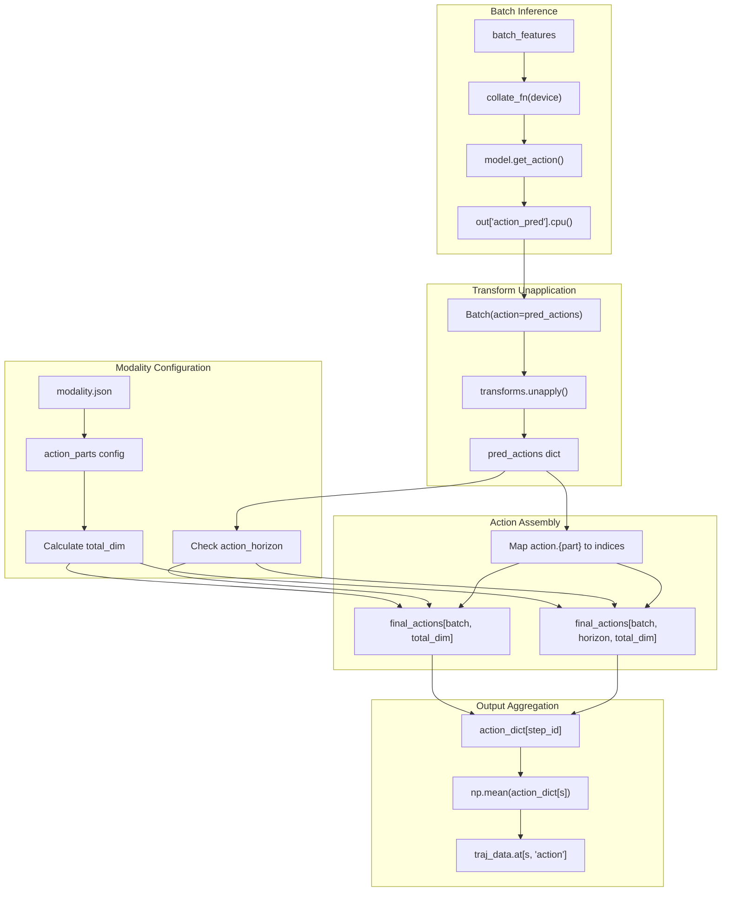
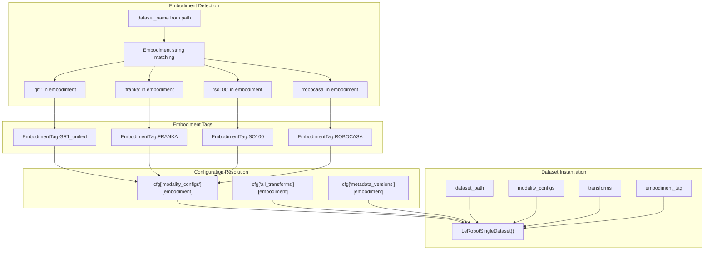

<!-- source: DeepWiki mcp.deepwiki.com · repo NVIDIA/GR00T-Dreams · page 3.1 IDM Architecture · fetched 2026-10-26 -->

# IDM Architecture

<details>
<summary>Relevant source files</summary>

The following files were used as context for generating this wiki page:

- [IDM_dump/dump_idm_actions.py](IDM_dump/dump_idm_actions.py)
- [IDM_dump/raw_to_lerobot.py](IDM_dump/raw_to_lerobot.py)

</details>


## Purpose and Scope

This document covers the core architecture of the Inverse Dynamics Model (IDM) system within the NVIDIA Isaac-GR00T repository. The IDM system is responsible for predicting robot actions from observation data across multiple robot embodiments, utilizing distributed GPU processing for efficient inference.

For information about specific robot embodiment configurations, see [Supported Robots Overview](#5.1). For details on data preprocessing before IDM processing, see [Data Processing Pipeline](#4). For model finetuning procedures, see [Model Finetuning](#3.3).

## Core IDM Components

The IDM architecture consists of several key components that work together to provide scalable action prediction across different robot platforms:

| Component | Primary Class/Function | Purpose |
|-----------|----------------------|---------|
| Model Loading | `IDM.from_pretrained()` | Load pre-trained IDM models from checkpoints or HuggingFace repos |
| Dataset Interface | `LeRobotSingleDataset` | Handle robot data with modality-specific processing |
| Multi-GPU Coordinator | `validate_checkpoint()` | Orchestrate distributed processing across GPUs |
| Worker Processes | `worker_func()` | Execute IDM inference on individual GPU devices |
| Data Collation | `collate_fn()` | Batch processing for efficient GPU utilization |
| Configuration Management | `load_dataset_and_config()` | Handle embodiment-specific configurations |

Sources: [IDM_dump/dump_idm_actions.py:16](), [IDM_dump/dump_idm_actions.py:89](), [IDM_dump/dump_idm_actions.py:298](), [IDM_dump/dump_idm_actions.py:141](), [IDM_dump/dump_idm_actions.py:100](), [IDM_dump/dump_idm_actions.py:22]()

## Architecture Overview

The IDM system follows a distributed processing architecture that can handle multiple robot embodiments simultaneously:

### IDM Processing Architecture



Sources: [IDM_dump/dump_idm_actions.py:22-97](), [IDM_dump/dump_idm_actions.py:141-297](), [IDM_dump/dump_idm_actions.py:298-382]()

## Model Loading and Configuration

The IDM system supports flexible model loading from both local checkpoints and HuggingFace repositories:

### Model Loading Pipeline



The configuration loading process handles both local and remote model sources. The system automatically detects the robot embodiment and applies appropriate modality configurations:

```python
# Embodiment detection logic
if "gr1" in embodiment:
    embodiment_tag = EmbodimentTag.GR1_unified
elif "franka" in embodiment:
    embodiment_tag = EmbodimentTag.FRANKA
elif "so100" in embodiment:
    embodiment_tag = EmbodimentTag.SO100
elif "robocasa" in embodiment:
    embodiment_tag = EmbodimentTag.ROBOCASA
```

Sources: [IDM_dump/dump_idm_actions.py:22-97](), [IDM_dump/dump_idm_actions.py:78-87]()

## Multi-GPU Processing Pipeline

The IDM system implements a sophisticated multi-GPU processing pipeline that distributes trajectory processing across available GPUs:

### Multi-GPU Coordination



The trajectory distribution logic ensures balanced workload across GPUs:

```python
# GPU workload distribution
chunk_size = (len(trajectory_ids) + num_gpus - 1) // num_gpus
tasks_by_gpu = {}
for i in range(num_gpus):
    start = i * chunk_size
    end = min(start + chunk_size, len(trajectory_ids))
    gpu_traj_list = trajectory_ids[start:end]
    tasks_by_gpu[i] = gpu_traj_list
```

Sources: [IDM_dump/dump_idm_actions.py:298-382](), [IDM_dump/dump_idm_actions.py:331-341](), [IDM_dump/dump_idm_actions.py:344-361]()

## Data Flow and Processing

The IDM system processes robot trajectory data through several stages, from raw video and state data to predicted actions:

### Data Processing Flow



The system handles different data modalities through specialized processing functions:

- **Video modality**: Extracts frames using `get_all_frames_and_timestamps()` with configurable video backends
- **State/Action modality**: Retrieves robot state and action data via `get_state_or_action()`
- **Language modality**: Processes natural language instructions through `get_language()`

Sources: [IDM_dump/dump_idm_actions.py:113-127](), [IDM_dump/dump_idm_actions.py:176-191](), [IDM_dump/dump_idm_actions.py:194-201]()

## Action Prediction and Output Processing

The IDM system performs action prediction with sophisticated post-processing to handle different action spaces and horizons:

### Action Processing Pipeline



The action assembly process handles variable action dimensions and temporal horizons based on modality configuration:

```python
# Action dimension calculation
for part, indices in action_parts.items():
    total_dim = max(total_dim, indices.get('end', 0))

# Action horizon detection  
if len(pred_actions[sample_key].shape) == 3:
    has_horizon = True
    batch_size, action_horizon, _ = pred_actions[sample_key].shape
```

Sources: [IDM_dump/dump_idm_actions.py:214-297](), [IDM_dump/dump_idm_actions.py:227-274](), [IDM_dump/dump_idm_actions.py:277-292]()

## Integration with Robot Embodiments

The IDM architecture seamlessly integrates with multiple robot embodiments through the `EmbodimentTag` system and embodiment-specific configurations:

### Embodiment Integration Architecture



Each robot embodiment has specific configuration requirements that are automatically resolved:

| Embodiment | EmbodimentTag | Configuration Key | Special Processing |
|------------|---------------|------------------|-------------------|
| GR1 Humanoid | `EmbodimentTag.GR1_unified` | `"gr1"` | Full body control, body segmentation |
| Franka Robot | `EmbodimentTag.FRANKA` | `"franka"` | 7-DOF arm control, end-effector focus |
| SO100 Robot | `EmbodimentTag.SO100` | `"so100"` | 6-DOF arm control, relative actions |
| RoboCasa | `EmbodimentTag.ROBOCASA` | `"robocasa"` | Kitchen simulation, multi-view cameras |

Sources: [IDM_dump/dump_idm_actions.py:78-87](), [IDM_dump/dump_idm_actions.py:48-58](), [IDM_dump/dump_idm_actions.py:89-96]()

---

