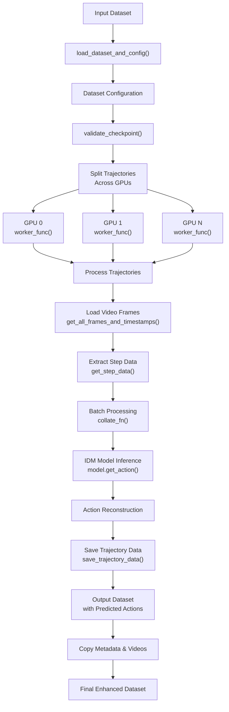
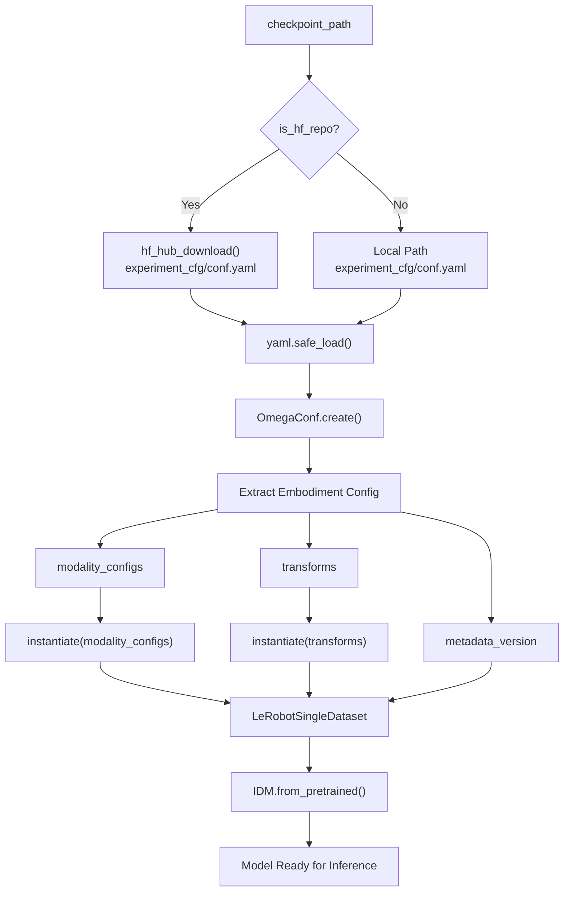
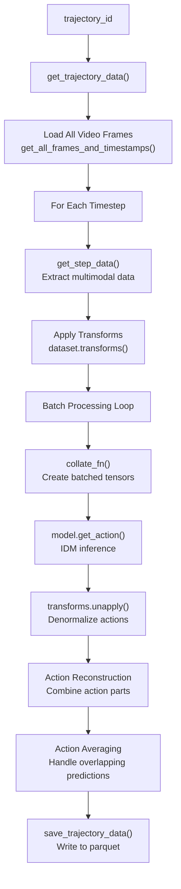
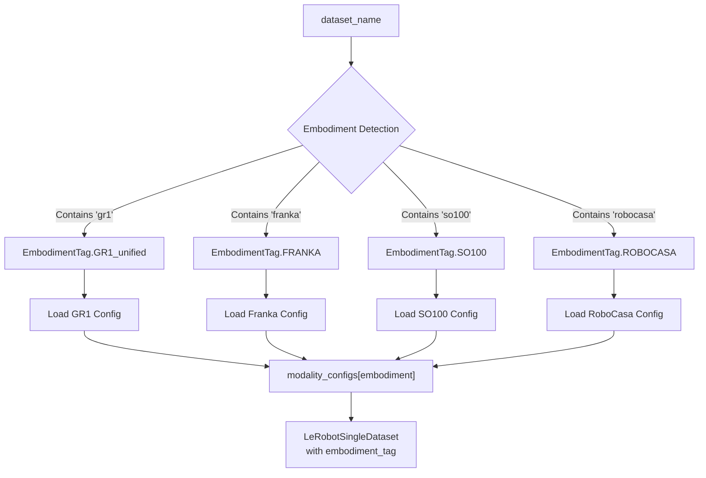
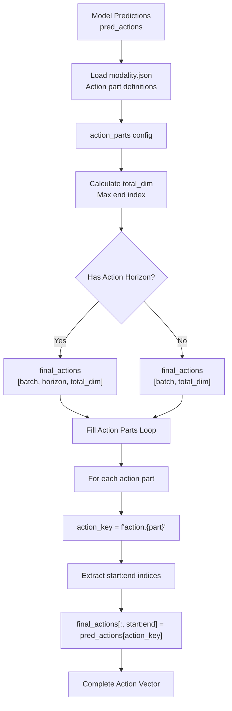
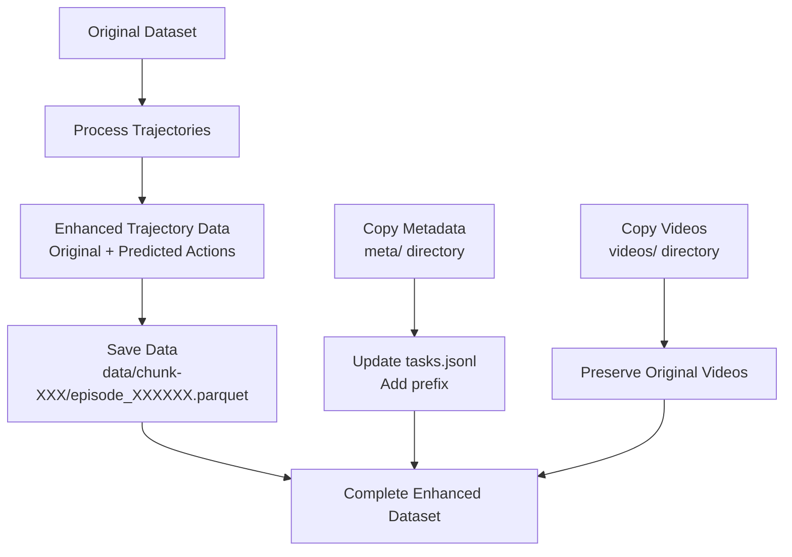

<!-- source: DeepWiki mcp.deepwiki.com · repo NVIDIA/GR00T-Dreams · page 3.2 Action Prediction · fetched 2026-10-26 -->

# Action Prediction

Relevant source files

The following files were used as context for generating this wiki page:

- [IDM_dump/dump_idm_actions.py](IDM_dump/dump_idm_actions.py)

This document covers the IDM (Inverse Dynamics Model) action prediction pipeline, which generates predicted actions for robot trajectories using pre-trained models. The system processes existing LeRobot datasets and augments them with IDM-predicted actions, supporting multi-GPU parallel processing and multiple robot embodiments.

For information about IDM model architecture, see [IDM Architecture](#3.1). For guidance on training and finetuning IDM models, see [Model Finetuning](#3.3).

## Overview

The action prediction system takes existing robot demonstration datasets and generates predicted actions using trained IDM models. This creates "dreamed" action sequences that can be used for model training, data augmentation, or analysis purposes.

**Action Prediction Pipeline Architecture**

Sources: [IDM_dump/dump_idm_actions.py:298-382]()

## Core Components

### Model Loading and Configuration

The system supports loading IDM models from both local checkpoints and HuggingFace model repositories. Configuration is loaded from YAML files that specify modality configurations, transforms, and embodiment-specific settings.

**Model and Configuration Loading Flow**

Sources: [IDM_dump/dump_idm_actions.py:22-97]()

### Multi-GPU Parallel Processing

The system distributes trajectory processing across multiple GPUs using process-based parallelism. Each GPU process loads its own model instance and processes a subset of trajectories independently.

| Component | Function | Description |
|-----------|----------|-------------|
| `validate_checkpoint()` | Main orchestrator | Splits trajectories across GPUs and manages worker processes |
| `worker_func()` | GPU worker | Processes assigned trajectories on a specific GPU |
| `ProcessPoolExecutor` | Process manager | Manages parallel GPU processes |
| `ThreadPoolExecutor` | Data loading | Handles concurrent data loading within each GPU process |

Sources: [IDM_dump/dump_idm_actions.py:298-382](), [IDM_dump/dump_idm_actions.py:141-297]()

### Data Processing Pipeline

Each trajectory undergoes a multi-step processing pipeline that extracts multimodal data, applies transforms, and generates action predictions.

**Per-Trajectory Processing Pipeline**

Sources: [IDM_dump/dump_idm_actions.py:165-292]()

## Embodiment Support

The system supports multiple robot embodiments through configuration-driven processing. Each embodiment has specific modality configurations and action space definitions.

### Supported Embodiments

| Embodiment | Tag | Action Space | Key Features |
|------------|-----|--------------|--------------|
| Franka | `EmbodimentTag.FRANKA` | 7-DOF arm + gripper | End-effector control, multiple camera views |  
| GR1 | `EmbodimentTag.GR1_unified` | Full humanoid body | Body part segmentation, ego-centric view |
| RoboCasa | `EmbodimentTag.ROBOCASA` | Base + arm motion | Kitchen simulation, multi-view cameras |
| SO100 | `EmbodimentTag.SO100` | 6-DOF arm | Relative actions, webcam input |

**Embodiment Configuration Resolution**

Sources: [IDM_dump/dump_idm_actions.py:78-95]()

## Action Reconstruction

The system reconstructs complete action vectors from model predictions by combining action parts according to the modality configuration. This handles cases where models predict different action components separately.

### Action Space Assembly

Sources: [IDM_dump/dump_idm_actions.py:227-275]()

## Video Processing Integration

The action prediction system integrates with video processing to handle multi-camera robot demonstrations. Videos are loaded once per trajectory and indexed efficiently for batch processing.

### Video Data Management

| Component | Purpose | Implementation |
|-----------|---------|----------------|
| `get_all_frames_and_timestamps()` | Load complete video | Extracts all frames and timestamps upfront |
| `video_data` dictionary | Frame caching | Stores frames for all camera views per trajectory |
| `delta_indices` | Temporal indexing | Maps model input requirements to frame indices |
| `ThreadPoolExecutor` | Concurrent loading | Parallelizes data loading within GPU processes |

Sources: [IDM_dump/dump_idm_actions.py:194-201](), [IDM_dump/dump_idm_actions.py:176-191]()

## Output Generation

The system generates enhanced datasets by augmenting original trajectory data with predicted actions. Output preserves the original LeRobot dataset structure while adding IDM predictions.

### Output Dataset Structure

The system automatically adds a `<DREAM>` prefix to task descriptions in the output dataset to distinguish IDM-predicted trajectories from original demonstrations.

Sources: [IDM_dump/dump_idm_actions.py:384-428](), [IDM_dump/dump_idm_actions.py:129-137]()

## Usage and Configuration

### Command Line Interface

The action prediction system is invoked through the main script with configurable parameters for different processing scenarios.

| Parameter | Purpose | Default | Description |
|-----------|---------|---------|-------------|
| `--checkpoint` | Model path | Required | Local path or HuggingFace model ID |
| `--dataset` | Input dataset | Required | Path to LeRobot dataset directory |
| `--output_dir` | Output location | Optional | Directory for enhanced dataset |
| `--num_gpus` | Parallel processing | 8 | Number of GPUs for parallel processing |
| `--batch_size` | Inference batching | 32 | Batch size for model inference |
| `--max_episodes` | Processing limit | None | Limit number of episodes processed |
| `--num_workers` | Data loading | 16 | Worker threads per GPU for data loading |
| `--video_indices` | Frame selection | None | Override video frame indices |

Sources: [IDM_dump/dump_idm_actions.py:434-476]()

---

