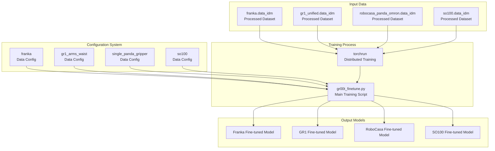
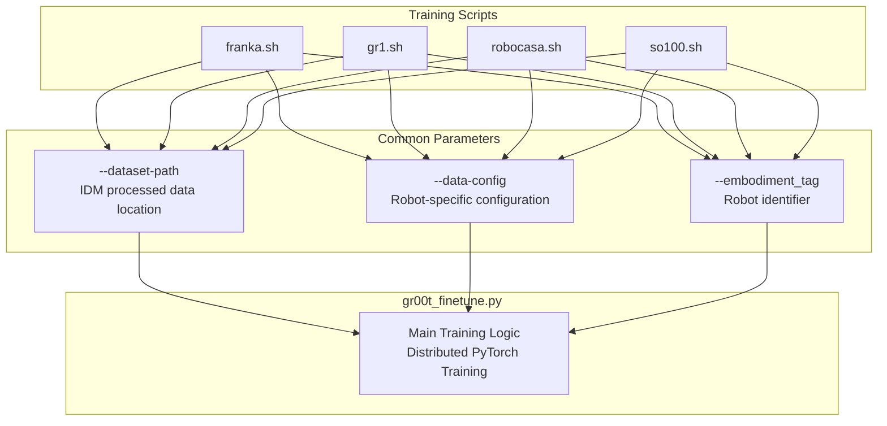

<!-- source: DeepWiki mcp.deepwiki.com · repo NVIDIA/GR00T-Dreams · page 3.3 Model Finetuning · fetched 2026-10-26 -->

# Model Finetuning

<details>
<summary>Relevant source files</summary>

The following files were used as context for generating this wiki page:

- [IDM_dump/scripts/finetune/franka.sh](IDM_dump/scripts/finetune/franka.sh)
- [IDM_dump/scripts/finetune/gr1.sh](IDM_dump/scripts/finetune/gr1.sh)
- [IDM_dump/scripts/finetune/robocasa.sh](IDM_dump/scripts/finetune/robocasa.sh)
- [IDM_dump/scripts/finetune/so100.sh](IDM_dump/scripts/finetune/so100.sh)

</details>


## Purpose and Scope

The Model Finetuning system enables training and adaptation of Inverse Dynamics Models (IDM) for different robot embodiments using processed datasets. This system provides distributed training capabilities with robot-specific configurations to optimize models for each supported platform.

For information about the underlying IDM architecture, see [IDM Architecture](#3.1). For details on data preparation through action prediction, see [Action Prediction](#3.2). For robot-specific implementation details, see the individual robot documentation in [Robot Embodiments](#5).

## Finetuning Architecture

The finetuning system operates on IDM-processed datasets to create embodiment-specific models through distributed PyTorch training.



**Sources:** [IDM_dump/scripts/finetune/franka.sh:1-1](), [IDM_dump/scripts/finetune/gr1.sh:2-2](), [IDM_dump/scripts/finetune/robocasa.sh:1-1](), [IDM_dump/scripts/finetune/so100.sh:1-1]()

## Robot-Specific Training Scripts

Each robot embodiment has a dedicated shell script that configures the finetuning process with appropriate parameters.



**Sources:** [IDM_dump/scripts/finetune/franka.sh:1-1](), [IDM_dump/scripts/finetune/gr1.sh:2-2](), [IDM_dump/scripts/finetune/robocasa.sh:1-1](), [IDM_dump/scripts/finetune/so100.sh:1-1]()

## Configuration Parameters

Each robot embodiment uses specific configuration parameters tailored to its hardware characteristics and control requirements.

| Robot | Dataset Path | Data Config | Embodiment Tag |
|-------|-------------|-------------|----------------|
| Franka | `IDM_dump/data/franka.data_idm` | `franka` | `franka` |
| GR1 | `IDM_dump/data/gr1_unified.data_idm` | `gr1_arms_waist` | `gr1` |
| RoboCasa | `IDM_dump/data/robocasa_panda_omron.data_idm` | `single_panda_gripper` | `robocasa_panda_omron` |
| SO100 | `IDM_dump/data/so100.data_idm` | `so100` | `so100` |

### Key Configuration Elements

- **Dataset Path**: Points to the `.data_idm` format datasets generated by the IDM action prediction pipeline
- **Data Config**: Specifies the robot's kinematic and control configuration
- **Embodiment Tag**: Unique identifier used for model naming and output organization

**Sources:** [IDM_dump/scripts/finetune/franka.sh:1-1](), [IDM_dump/scripts/finetune/gr1.sh:2-2](), [IDM_dump/scripts/finetune/robocasa.sh:1-1](), [IDM_dump/scripts/finetune/so100.sh:1-1]()

## Distributed Training Process

The finetuning system leverages PyTorch's distributed training capabilities through the `torchrun` command for scalable model training across multiple GPUs.

### Training Command Structure

All finetuning scripts follow the same command pattern:

```bash
PYTHONPATH=. torchrun scripts/gr00t_finetune.py \
  --dataset-path <path_to_idm_data> \
  --data-config <robot_config> \
  --embodiment_tag <robot_tag>
```

### Environment Configuration

- **PYTHONPATH**: Set to current directory to ensure proper module resolution
- **torchrun**: PyTorch distributed training launcher for multi-GPU processing
- **scripts/gr00t_finetune.py**: Main training script handling model loading, training loops, and checkpointing

**Sources:** [IDM_dump/scripts/finetune/franka.sh:1-1](), [IDM_dump/scripts/finetune/gr1.sh:2-2](), [IDM_dump/scripts/finetune/robocasa.sh:1-1](), [IDM_dump/scripts/finetune/so100.sh:1-1]()

## Robot-Specific Configurations

### Franka Configuration
- Uses standard `franka` data configuration for 7-DOF arm control
- Single embodiment tag matching the robot type

### GR1 Humanoid Configuration  
- Employs `gr1_arms_waist` configuration for coordinated upper body control
- Processes unified dataset combining multiple body segments
- Uses simplified `gr1` embodiment tag

### RoboCasa Configuration
- Implements `single_panda_gripper` configuration for manipulation tasks
- Specific to `robocasa_panda_omron` embodiment variant
- Optimized for kitchen simulation environment

### SO100 Configuration
- Uses dedicated `so100` configuration for 6-DOF arm operation
- Direct mapping between data config and embodiment tag

**Sources:** [IDM_dump/scripts/finetune/franka.sh:1-1](), [IDM_dump/scripts/finetune/gr1.sh:2-2](), [IDM_dump/scripts/finetune/robocasa.sh:1-1](), [IDM_dump/scripts/finetune/so100.sh:1-1]()

---

