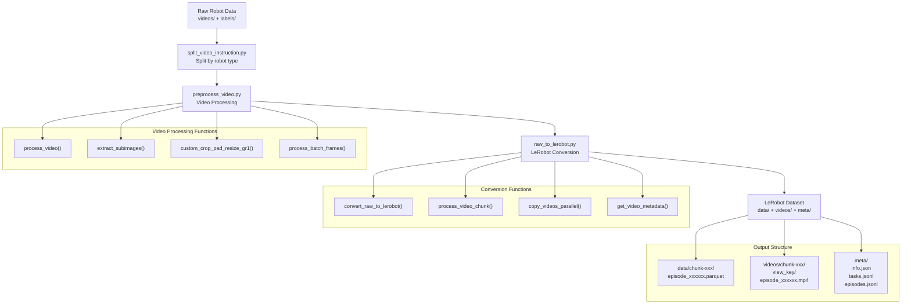
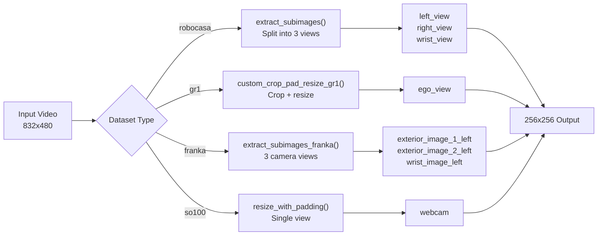
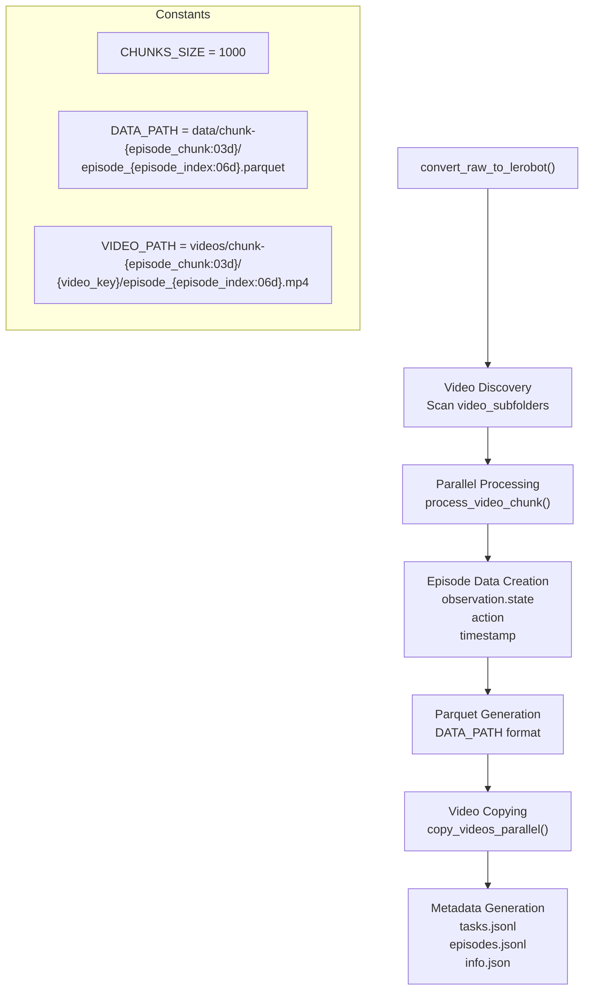
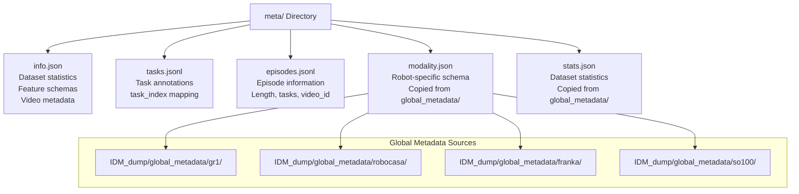

<!-- source: DeepWiki mcp.deepwiki.com · repo NVIDIA/GR00T-Dreams · page 4 Data Processing Pipeline · fetched 2026-10-26 -->

# Data Processing Pipeline

<details>
<summary>Relevant source files</summary>

The following files were used as context for generating this wiki page:

- [IDM_dump/preprocess_video.py](IDM_dump/preprocess_video.py)
- [IDM_dump/raw_to_lerobot.py](IDM_dump/raw_to_lerobot.py)
- [IDM_dump/scripts/preprocess/franka.sh](IDM_dump/scripts/preprocess/franka.sh)
- [IDM_dump/scripts/preprocess/gr1.sh](IDM_dump/scripts/preprocess/gr1.sh)

</details>


This document covers the comprehensive data processing pipeline that transforms raw robot demonstration data into the standardized LeRobot format. The pipeline handles video preprocessing, multi-camera extraction, parallel processing, and metadata generation across multiple robot embodiments including Franka, GR1, RoboCasa, and SO100.

For information about IDM action prediction that operates on processed datasets, see [Action Prediction](#3.2). For robot-specific configuration details, see [Robot Embodiments](#5).

## Pipeline Architecture

The data processing pipeline consists of three main stages that transform raw robot data into training-ready datasets:

### Complete Pipeline Flow



Sources: [IDM_dump/preprocess_video.py:175-245](), [IDM_dump/raw_to_lerobot.py:170-383](), [IDM_dump/scripts/preprocess/franka.sh:1-30](), [IDM_dump/scripts/preprocess/gr1.sh:1-26]()

## Video Preprocessing System

The video preprocessing system in `preprocess_video.py` handles multi-camera extraction, robot-specific transformations, and parallel processing for large datasets.

### Robot-Specific Processing



Sources: [IDM_dump/preprocess_video.py:131-173](), [IDM_dump/preprocess_video.py:15-81](), [IDM_dump/preprocess_video.py:111-129]()

### Parallel Processing Architecture

The video preprocessing system uses multi-level parallelization for efficient processing:

| Component | Function | Parallelization |
|-----------|----------|-----------------|
| Directory Processing | `process_directory()` | ThreadPoolExecutor for subdirectories |
| Video Processing | `process_video()` | Multiprocessing Pool |
| Frame Processing | `process_batch_frames()` | Batch processing (32 frames) |

The system uses `concurrent.futures.ThreadPoolExecutor` for I/O-bound subdirectory processing and `multiprocessing.Pool` for CPU-intensive video processing tasks.

Sources: [IDM_dump/preprocess_video.py:290-317](), [IDM_dump/preprocess_video.py:218-245]()

## LeRobot Data Conversion

The `raw_to_lerobot.py` module converts preprocessed video data into the standardized LeRobot format with proper metadata generation.

### Conversion Process Flow



Sources: [IDM_dump/raw_to_lerobot.py:170-383](), [IDM_dump/raw_to_lerobot.py:20-22]()

### Multi-Robot Data Schema

The conversion system handles different robot embodiments with specific annotation sources and data schemas:

| Robot | Embodiment ID | Annotation Source | Action Shape |
|-------|---------------|-------------------|--------------|
| RoboCasa | `robocasa_panda_omron` | `human.action.task_description` | (44,) |
| GR1 | `gr1_unified` | `human.coarse_action` | (44,) |
| Franka | `franka` | `language.language_instruction` | (44,) |
| SO100 | `so100` | `human.task_description` | (44,) |

Sources: [IDM_dump/raw_to_lerobot.py:458-466]()

## Metadata Management System

The pipeline generates comprehensive metadata for dataset management and model training:

### Metadata Files Structure



Sources: [IDM_dump/raw_to_lerobot.py:327-381](), [IDM_dump/raw_to_lerobot.py:502-507]()

### Video Metadata Extraction

The `get_video_metadata()` function uses `ffprobe` to extract video properties for each camera view:

```python
# Extracted metadata structure
{
    "dtype": "video",
    "shape": [height, width, 3],
    "names": ["height", "width", "channel"],
    "video_info": {
        "video.fps": fps,
        "video.codec": codec_name,
        "video.pix_fmt": pixel_format,
        "video.is_depth_map": False
    }
}
```

Sources: [IDM_dump/raw_to_lerobot.py:25-56]()

## Performance Optimization

The pipeline implements several optimization strategies for handling large-scale datasets:

### Parallel Processing Configuration

| Process Type | Implementation | Configuration |
|--------------|----------------|---------------|
| Video Preprocessing | `multiprocessing.Pool` | `num_workers = cpu_count() // 2` |
| Data Conversion | `multiprocessing.Pool` | Chunked video processing |
| Video Copying | `ThreadPoolExecutor` | `max_workers = min(32, num_workers)` |
| Batch Processing | In-memory batching | `batch_size = 32 frames` |

### Memory Management

The system uses batch processing in `process_batch_frames()` to control memory usage during video processing, processing 32 frames at a time before writing to output videos.

Sources: [IDM_dump/preprocess_video.py:218-232](), [IDM_dump/raw_to_lerobot.py:130-143](), [IDM_dump/raw_to_lerobot.py:322-324]()

## Pipeline Execution Scripts

The complete pipeline execution is orchestrated through shell scripts for each robot embodiment:

### Franka Pipeline Example

```bash
# 1. Split video by robot type
python IDM_dump/split_video_instruction.py --source_dir "" --output_dir "IDM_dump/data/franka_data"

# 2. Preprocess videos
python IDM_dump/preprocess_video.py --src_dir "IDM_dump/data/franka_data" --dst_dir "IDM_dump/data/franka_data_split" --dataset franka --original_width 672 --original_height 376

# 3. Convert to LeRobot format
python IDM_dump/raw_to_lerobot.py --input_dir "IDM_dump/data/franka_data_split" --output_dir "IDM_dump/data/franka.data" --cosmos_predict2

# 4. Generate IDM actions
python IDM_dump/dump_idm_actions.py --checkpoint "seonghyeonye/IDM_franka" --dataset "IDM_dump/data/franka.data" --output_dir "IDM_dump/data/franka.data_idm" --num_gpus 8 --video_indices "0 8"
```

Sources: [IDM_dump/scripts/preprocess/franka.sh:1-30](), [IDM_dump/scripts/preprocess/gr1.sh:1-26]()

---

