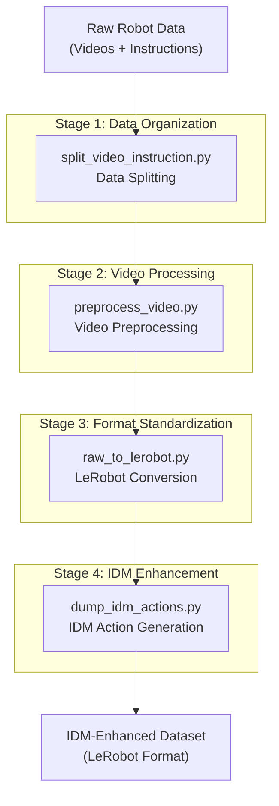
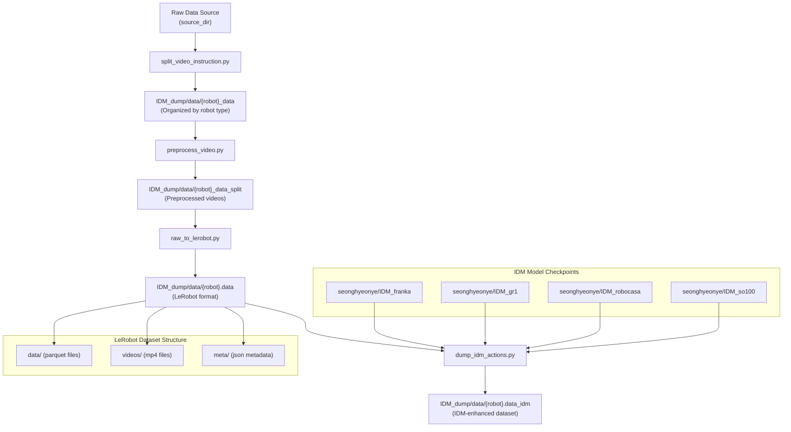
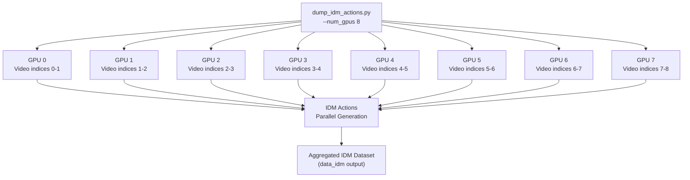

<!-- source: DeepWiki mcp.deepwiki.com · repo NVIDIA/GR00T-Dreams · page 4.1 Pipeline Overview · fetched 2026-10-26 -->

# Pipeline Overview

Relevant source files

The following files were used as context for generating this wiki page:

- [IDM_dump/scripts/preprocess/franka.sh](IDM_dump/scripts/preprocess/franka.sh)
- [IDM_dump/scripts/preprocess/gr1.sh](IDM_dump/scripts/preprocess/gr1.sh)

This document provides a high-level overview of the complete data processing pipeline that transforms raw robot demonstration data into processed datasets suitable for IDM (Inverse Dynamics Model) training and inference. The pipeline handles multi-robot embodiments and converts proprietary data formats into the standardized LeRobot format.

For detailed information about specific pipeline stages, see [Video Preprocessing](#4.2), [LeRobot Data Conversion](#4.3), and [Metadata Management](#4.4). For robot-specific configurations, see [Robot Embodiments](#5).

## Pipeline Architecture

The data processing pipeline consists of four sequential stages that transform raw robot data into IDM-enhanced datasets:

**Four-Stage Pipeline Flow**

Sources: [IDM_dump/scripts/preprocess/franka.sh:1-30](), [IDM_dump/scripts/preprocess/gr1.sh:1-26]()

## Pipeline Stages

### Stage 1: Data Splitting
The `split_video_instruction.py` script organizes raw robot data by separating videos and instruction labels into structured directories for each robot embodiment.

| Parameter | Purpose | Example Value |
|-----------|---------|---------------|
| `--source_dir` | Raw data location | `""` |
| `--output_dir` | Organized data output | `"IDM_dump/data/franka_data"` |

### Stage 2: Video Preprocessing  
The `preprocess_video.py` script handles robot-specific video transformations including resizing, cropping, and multi-camera extraction.

| Parameter | Purpose | Franka Example | GR1 Example |
|-----------|---------|----------------|-------------|
| `--src_dir` | Input directory | `"IDM_dump/data/franka_data"` | `"IDM_dump/data/gr1_data"` |
| `--dst_dir` | Output directory | `"IDM_dump/data/franka_data_split"` | `"IDM_dump/data/gr1_data_split"` |
| `--dataset` | Robot type | `franka` | `gr1` |
| `--original_width` | Video width | `672` | Not specified |
| `--original_height` | Video height | `376` | Not specified |

### Stage 3: LeRobot Conversion
The `raw_to_lerobot.py` script converts preprocessed data into the standardized LeRobot format with parquet files and JSON metadata.

| Parameter | Purpose | Example Value |
|-----------|---------|---------------|
| `--input_dir` | Preprocessed data | `"IDM_dump/data/franka_data_split"` |
| `--output_dir` | LeRobot dataset | `"IDM_dump/data/franka.data"` |
| `--cosmos_predict2` | Prediction mode flag | Present in all examples |

### Stage 4: IDM Action Generation
The `dump_idm_actions.py` script loads pre-trained IDM models and generates action predictions for the dataset using multi-GPU processing.

| Parameter | Purpose | Franka Example | GR1 Example |
|-----------|---------|----------------|-------------|
| `--checkpoint` | Model checkpoint | `"seonghyeonye/IDM_franka"` | `"seonghyeonye/IDM_gr1"` |
| `--dataset` | Input dataset | `"IDM_dump/data/franka.data"` | `"IDM_dump/data/gr1_unified.data"` |
| `--output_dir` | IDM-enhanced output | `"IDM_dump/data/franka.data_idm"` | `"IDM_dump/data/gr1_unified.data_idm"` |
| `--num_gpus` | GPU count | `8` | `8` |
| `--video_indices` | Processing range | `"0 8"` | `"0 8"` |

Sources: [IDM_dump/scripts/preprocess/franka.sh:6-11](), [IDM_dump/scripts/preprocess/franka.sh:15-19](), [IDM_dump/scripts/preprocess/franka.sh:21-27](), [IDM_dump/scripts/preprocess/gr1.sh:5-8](), [IDM_dump/scripts/preprocess/gr1.sh:11-15](), [IDM_dump/scripts/preprocess/gr1.sh:17-22]()

## Data Flow and Directory Structure

**Pipeline Data Flow with Directory Mapping**

Sources: [IDM_dump/scripts/preprocess/franka.sh:1-30](), [IDM_dump/scripts/preprocess/gr1.sh:1-26]()

## Robot-Specific Pipeline Variations

The pipeline adapts to different robot embodiments through configuration parameters and robot-specific preprocessing:

### Franka Robot Pipeline
- Requires explicit video dimensions: `--original_width 672 --original_height 376`
- Uses `seonghyeonye/IDM_franka` checkpoint
- Outputs to `franka.data` and `franka.data_idm` directories

### GR1 Humanoid Pipeline  
- No explicit video dimensions specified (uses defaults)
- Uses `seonghyeonye/IDM_gr1` checkpoint
- Outputs to `gr1_unified.data` and `gr1_unified.data_idm` directories

### Common Pipeline Parameters
- All robots use `--cosmos_predict2` flag during LeRobot conversion
- Multi-GPU processing with `--num_gpus 8`
- Video processing range `--video_indices "0 8"`

Sources: [IDM_dump/scripts/preprocess/franka.sh:10-11](), [IDM_dump/scripts/preprocess/franka.sh:22-23](), [IDM_dump/scripts/preprocess/gr1.sh:8](), [IDM_dump/scripts/preprocess/gr1.sh:18-19]()

## Parallel Processing Architecture

The pipeline supports distributed processing across multiple stages:

**Multi-GPU IDM Processing**

Sources: [IDM_dump/scripts/preprocess/franka.sh:25-26](), [IDM_dump/scripts/preprocess/gr1.sh:21-22]()

## Pipeline Execution

The complete pipeline executes as a sequence of Python scripts with specific parameter configurations for each robot embodiment. Each stage produces intermediate datasets that serve as input to the subsequent stage, ensuring data traceability and enabling incremental processing.

The final output is an IDM-enhanced dataset in LeRobot format, ready for model training and inference across different robot embodiments.

---

