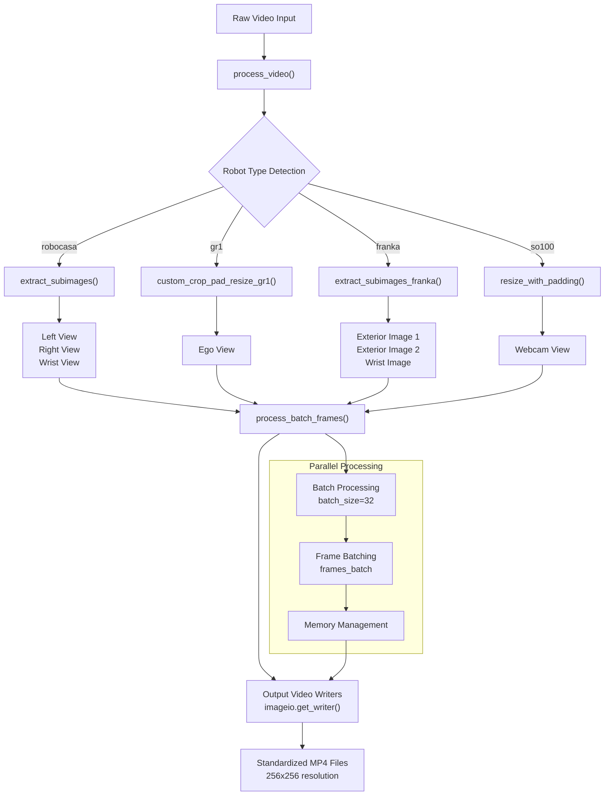
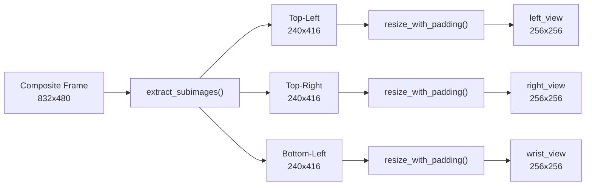
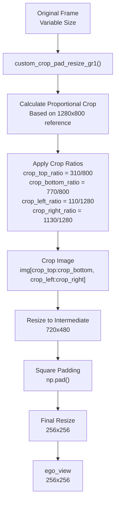
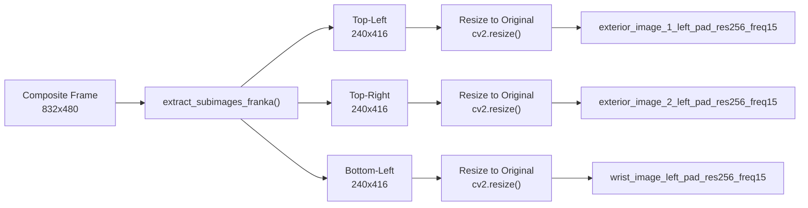
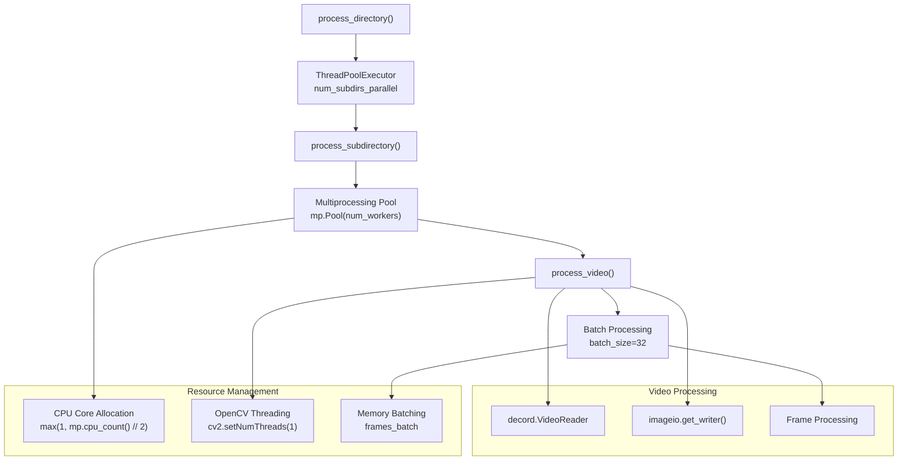

<!-- source: DeepWiki mcp.deepwiki.com · repo NVIDIA/GR00T-Dreams · page 4.2 Video Preprocessing · fetched 2026-10-26 -->

# Video Preprocessing

<details>
<summary>Relevant source files</summary>

The following files were used as context for generating this wiki page:

- [IDM_dump/preprocess_video.py](IDM_dump/preprocess_video.py)

</details>


This document covers the video preprocessing pipeline that transforms raw robot video data into standardized, multi-camera formats suitable for training and inference. The preprocessing system handles multiple robot embodiments with different camera configurations and video formats.

For information about the complete data processing pipeline, see [Pipeline Overview](#4.1). For details on converting preprocessed data to LeRobot format, see [LeRobot Data Conversion](#4.3).

## Purpose and Capabilities

The video preprocessing system performs several key operations:

- **Multi-camera extraction**: Splits composite videos into separate camera streams
- **Standardized resizing**: Converts videos to consistent 256x256 resolution
- **Aspect ratio preservation**: Uses padding to maintain original proportions
- **Robot-specific processing**: Applies custom transformations for each robot type
- **Parallel processing**: Utilizes multiprocessing for efficient batch operations
- **Directory structure maintenance**: Preserves organizational hierarchy during processing

## Supported Robot Types

The preprocessing system supports four distinct robot embodiments, each with unique video processing requirements:

| Robot Type | Camera Configuration | Output Resolution | Special Processing |
|------------|---------------------|-------------------|-------------------|
| RoboCasa   | Multi-view composite | 256x256 per view | Subimage extraction |
| GR1        | Single ego-centric  | 256x256          | Custom crop/pad/resize |
| Franka     | Multi-view composite | 256x256 per view | Subimage extraction |
| SO100      | Single webcam       | 256x256          | Standard resize with padding |

## Video Processing Pipeline

The preprocessing pipeline follows a systematic approach to transform raw videos into standardized formats:



Sources: [IDM_dump/preprocess_video.py:175-245]()

## Robot-Specific Processing Details

### RoboCasa Processing

RoboCasa videos contain composite frames that need to be split into multiple camera views:



Sources: [IDM_dump/preprocess_video.py:131-148](), [IDM_dump/preprocess_video.py:155-159]()

### GR1 Humanoid Processing

GR1 videos require specialized cropping to focus on the robot's perspective:



Sources: [IDM_dump/preprocess_video.py:15-80](), [IDM_dump/preprocess_video.py:160-162]()

### Franka Robot Processing

Franka processing extracts multiple camera views and resizes them to original dimensions before final processing:



Sources: [IDM_dump/preprocess_video.py:111-128](), [IDM_dump/preprocess_video.py:163-167]()

## Parallel Processing Architecture

The system implements a multi-level parallel processing strategy for efficient video processing:



Sources: [IDM_dump/preprocess_video.py:290-316](), [IDM_dump/preprocess_video.py:218-244](), [IDM_dump/preprocess_video.py:339-340]()

## Configuration and Command Line Interface

The preprocessing system provides extensive configuration options through command-line arguments:

### Key Parameters

| Parameter | Default | Description |
|-----------|---------|-------------|
| `--src_dir` | `/mnt/amlfs-01/home/seonghyeony/data/dreams_robocasa_70K_0228` | Source directory containing videos |
| `--dst_dir` | `/mnt/amlfs-01/home/seonghyeony/data/dreams_robocasa_70K_0228_split` | Destination directory for processed videos |
| `--workers` | 8 | Number of worker processes |
| `--parallel_subdirs` | 1 | Number of subdirectories to process in parallel |
| `--batch_size` | 32 | Number of frames to process in a batch |
| `--dataset` | `robocasa` | Dataset type (robocasa, gr1, franka, so100) |
| `--recursive` | False | Process subdirectories recursively |
| `--original_width` | 1280 | Original width of the video |
| `--original_height` | 800 | Original height of the video |

### Processing Modes

The system supports both flat and recursive directory processing:

- **Flat mode**: Processes all videos in a single directory level
- **Recursive mode**: Maintains directory structure while processing subdirectories

Sources: [IDM_dump/preprocess_video.py:318-344]()

## Output Structure

The preprocessing system generates organized output directories based on robot type and camera configuration:

### Directory Structure by Robot Type

**RoboCasa Output:**
```
dst_dir/
├── videos/
│   ├── observation.images.left_view/
│   ├── observation.images.right_view/
│   └── observation.images.wrist_view/
└── labels/
```

**GR1 Output:**
```
dst_dir/
├── videos/
│   └── observation.images.ego_view/
└── labels/
```

**Franka Output:**
```
dst_dir/
├── videos/
│   ├── observation.images.exterior_image_1_left_pad_res256_freq15/
│   ├── observation.images.exterior_image_2_left_pad_res256_freq15/
│   └── observation.images.wrist_image_left_pad_res256_freq15/
└── labels/
```

**SO100 Output:**
```
dst_dir/
├── videos/
│   └── observation.images.webcam/
└── labels/
```

Sources: [IDM_dump/preprocess_video.py:180-199](), [IDM_dump/preprocess_video.py:247-259]()

## Technical Implementation Details

### Video Reading and Writing

The system uses specialized libraries for efficient video processing:

- **Reading**: `decord.VideoReader` for fast video decoding
- **Writing**: `imageio.get_writer()` for MP4 output generation
- **Processing**: OpenCV (`cv2`) for image transformations

### Memory Management

Batch processing prevents memory overflow during large video processing:

```python
batch_size = 32  # Configurable batch size
frames_batch = []  # Frame accumulator
```

The system processes frames in batches and clears memory between batches to maintain stable resource usage.

### Aspect Ratio Preservation

The `resize_with_padding()` function ensures consistent output dimensions while preserving original aspect ratios:

1. Calculate target aspect ratio
2. Resize to fit within target dimensions
3. Add padding (black borders) to reach exact target size
4. Use `cv2.BORDER_CONSTANT` with zero padding

Sources: [IDM_dump/preprocess_video.py:82-109](), [IDM_dump/preprocess_video.py:204-244]()

---

