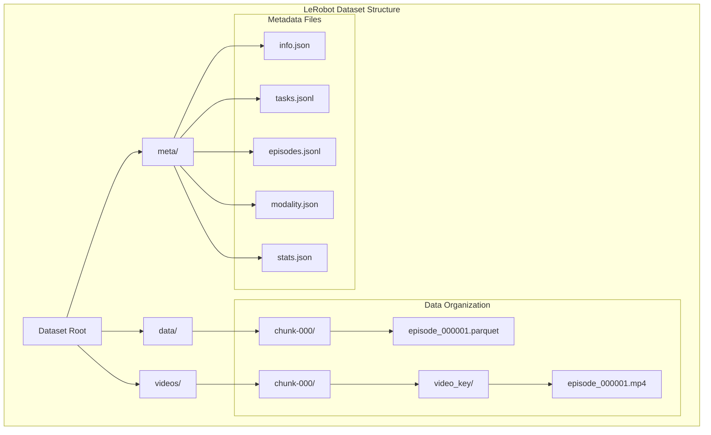
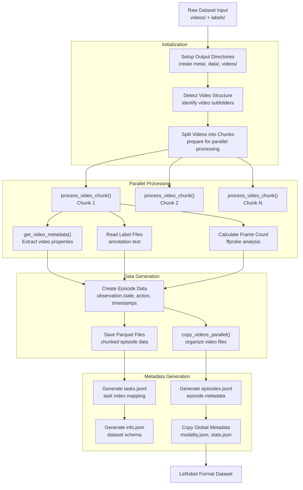
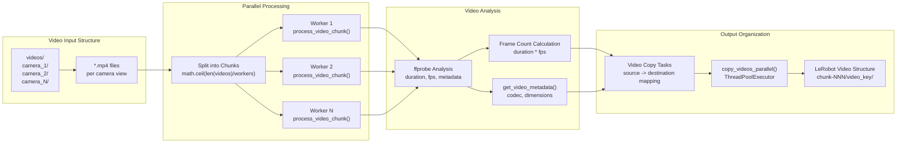
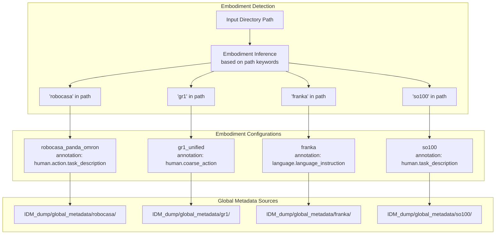
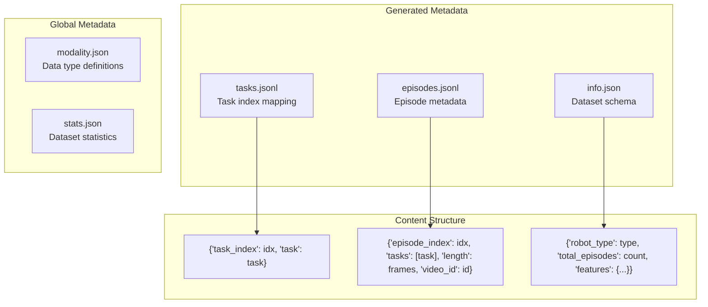

<!-- source: DeepWiki mcp.deepwiki.com · repo NVIDIA/GR00T-Dreams · page 4.3 LeRobot Data Conversion · fetched 2026-10-26 -->

# LeRobot Data Conversion

<details>
<summary>Relevant source files</summary>

The following files were used as context for generating this wiki page:

- [IDM_dump/raw_to_lerobot.py](IDM_dump/raw_to_lerobot.py)

</details>


This document covers the data conversion pipeline that transforms raw robot demonstration data into the standardized LeRobot format. This includes video processing, metadata generation, and multi-robot embodiment support.

For information about video preprocessing before conversion, see [Video Preprocessing](#4.2). For details about the generated metadata schemas, see [Metadata Management](#4.4).

## Overview

The LeRobot data conversion system transforms raw robot demonstration datasets into a standardized format that enables cross-platform training and evaluation. The conversion process handles multi-camera video data, action sequences, and task annotations while maintaining compatibility across different robot embodiments.

The core conversion functionality is implemented in `convert_raw_to_lerobot()` which processes raw datasets containing video files and text labels, generating structured parquet files and metadata in the LeRobot format.

Sources: [IDM_dump/raw_to_lerobot.py:170-184]()

## LeRobot Format Structure

The LeRobot format organizes data into a hierarchical structure with chunked episodes and standardized metadata:



The format uses fixed paths defined by constants:
- `DATA_PATH`: `"data/chunk-{episode_chunk:03d}/episode_{episode_index:06d}.parquet"`
- `VIDEO_PATH`: `"videos/chunk-{episode_chunk:03d}/{video_key}/episode_{episode_index:06d}.mp4"`
- `CHUNKS_SIZE`: 1000 episodes per chunk

Sources: [IDM_dump/raw_to_lerobot.py:20-22]()

## Conversion Process Flow

The conversion pipeline processes raw data through several stages with parallel processing for efficiency:

### Main Conversion Pipeline



Sources: [IDM_dump/raw_to_lerobot.py:170-184](), [IDM_dump/raw_to_lerobot.py:235-250]()

### Video Processing Pipeline

The video processing component handles multi-camera setups and parallel processing:



Sources: [IDM_dump/raw_to_lerobot.py:71-127](), [IDM_dump/raw_to_lerobot.py:130-142]()

## Episode Data Structure

Each episode is converted into a structured format with standardized fields:

### Episode Data Schema

| Field | Data Type | Description |
|-------|-----------|-------------|
| `observation.state` | `float32[44]` | Robot state vector (44 dimensions) |
| `action` | `float32[44]` | Action vector (44 dimensions) |
| `timestamp` | `float64` | Frame timestamps (i/fps) |
| `episode_index` | `int64` | Unique episode identifier |
| `index` | `int64` | Global frame index |
| `task_index` | `int64` | Task category index |
| `annotation.{source}` | `int64[1]` | Task annotation (embodiment-specific) |

The episode data creation process generates dummy state and action vectors filled with zeros, with timestamps calculated based on frame rate:

```python
episode_data = {
    "observation.state": [np.zeros(44, dtype=np.float32)] * frame_count,
    "action": [np.zeros(44, dtype=np.float32)] * frame_count,
    "timestamp": [i/fps for i in range(frame_count)],
    "episode_index": [episode_index] * frame_count,
    "index": np.arange(total_frames, total_frames + frame_count),
    "task_index": [annotation_to_index[annotation]] * frame_count,
    f"annotation.{annotation_source}": [[annotation_to_index[annotation]]] * frame_count
}
```

Sources: [IDM_dump/raw_to_lerobot.py:271-280]()

## Multi-Robot Embodiment Support

The conversion system supports multiple robot embodiments with specific configurations:

### Embodiment Configuration



### Embodiment-Specific Settings

| Embodiment | Annotation Source | Global Metadata Path |
|------------|-------------------|---------------------|
| `robocasa_panda_omron` | `human.action.task_description` | `IDM_dump/global_metadata/robocasa/` |
| `gr1_unified` | `human.coarse_action` | `IDM_dump/global_metadata/gr1/` |
| `franka` | `language.language_instruction` | `IDM_dump/global_metadata/franka/` |
| `so100` | `human.task_description` | `IDM_dump/global_metadata/so100/` |

Sources: [IDM_dump/raw_to_lerobot.py:446-466](), [IDM_dump/raw_to_lerobot.py:493-506]()

## Metadata Generation

The conversion process generates comprehensive metadata files for dataset introspection and compatibility:

### Metadata File Types



### Info.json Schema Structure

The `info.json` file contains comprehensive dataset metadata:

```json
{
    "robot_type": "dream",
    "total_episodes": 1000,
    "total_frames": 93000,
    "total_tasks": 50,
    "total_videos": 4,
    "chunks_size": 1000,
    "total_chunks": 1,
    "fps": 16,
    "data_path": "data/chunk-{episode_chunk:03d}/episode_{episode_index:06d}.parquet",
    "video_path": "videos/chunk-{episode_chunk:03d}/{video_key}/episode_{episode_index:06d}.mp4",
    "features": {
        "observation.state": {
            "dtype": "float32",
            "shape": [44],
            "names": ["motor_0", "motor_1", ..., "motor_43"]
        },
        "action": {
            "dtype": "float32", 
            "shape": [44],
            "names": ["motor_0", "motor_1", ..., "motor_43"]
        },
        "video_key": {
            "dtype": "video",
            "shape": [height, width, 3],
            "video_info": {...}
        }
    }
}
```

Sources: [IDM_dump/raw_to_lerobot.py:326-382]()

## Usage and Configuration

### Command Line Interface

The conversion script supports both single folder and multi-folder processing modes:

```bash
# Single folder conversion
python raw_to_lerobot.py \
    --input_dir /path/to/raw/data \
    --output_dir /path/to/lerobot/dataset \
    --fps 16 \
    --num_workers 16 \
    --embodiment franka

# Multi-folder processing  
python raw_to_lerobot.py \
    --input_dir /path/to/base/dir \
    --output_dir /path/to/output/base \
    --recursive \
    --cosmos_predict2 \
    --data_type dream
```

### Key Parameters

| Parameter | Description | Default |
|-----------|-------------|---------|
| `--input_dir` | Input directory with videos/ and labels/ | Required |
| `--output_dir` | Output directory for LeRobot dataset | Required |
| `--fps` | Video frame rate | 16 |
| `--num_workers` | Number of parallel workers | 16 |
| `--cosmos_predict2` | Fixed frame count mode (93 frames) | False |
| `--recursive` | Multi-folder processing mode | False |
| `--embodiment` | Robot embodiment type | Auto-detected |

### Processing Modes

The system supports two specialized processing modes:

1. **Standard Mode**: Variable frame counts based on video duration analysis
2. **Cosmos Predict2 Mode**: Fixed 93 frames per episode at 16 FPS for compatibility with specific video models

Sources: [IDM_dump/raw_to_lerobot.py:431-444](), [IDM_dump/raw_to_lerobot.py:467-491]()

---

