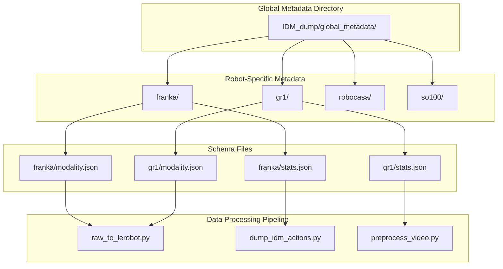
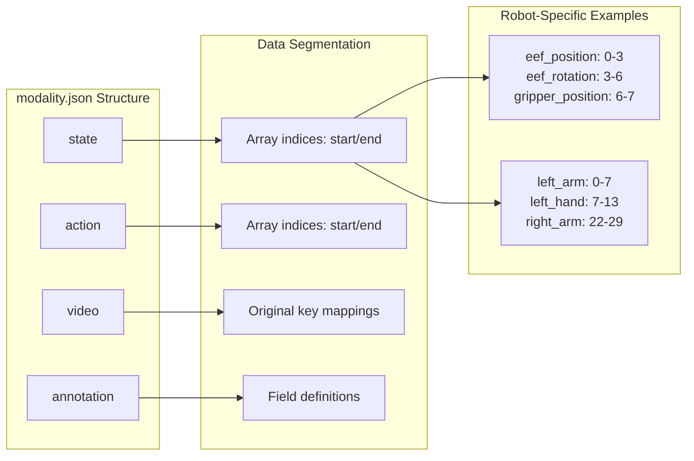
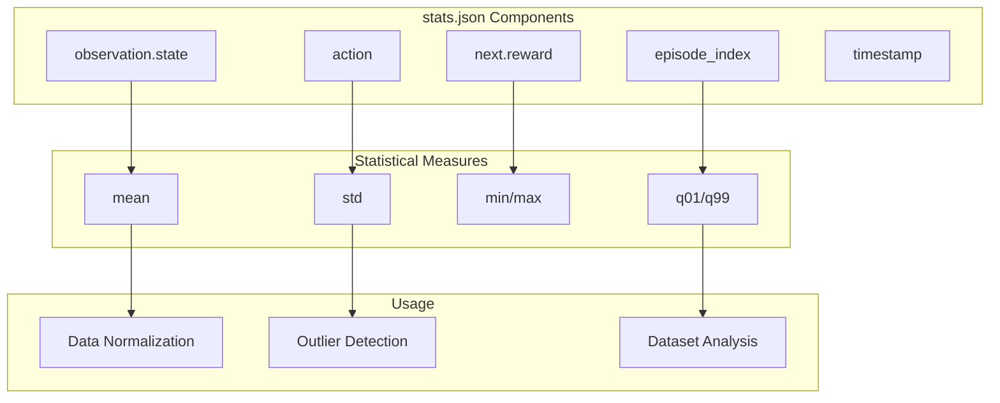
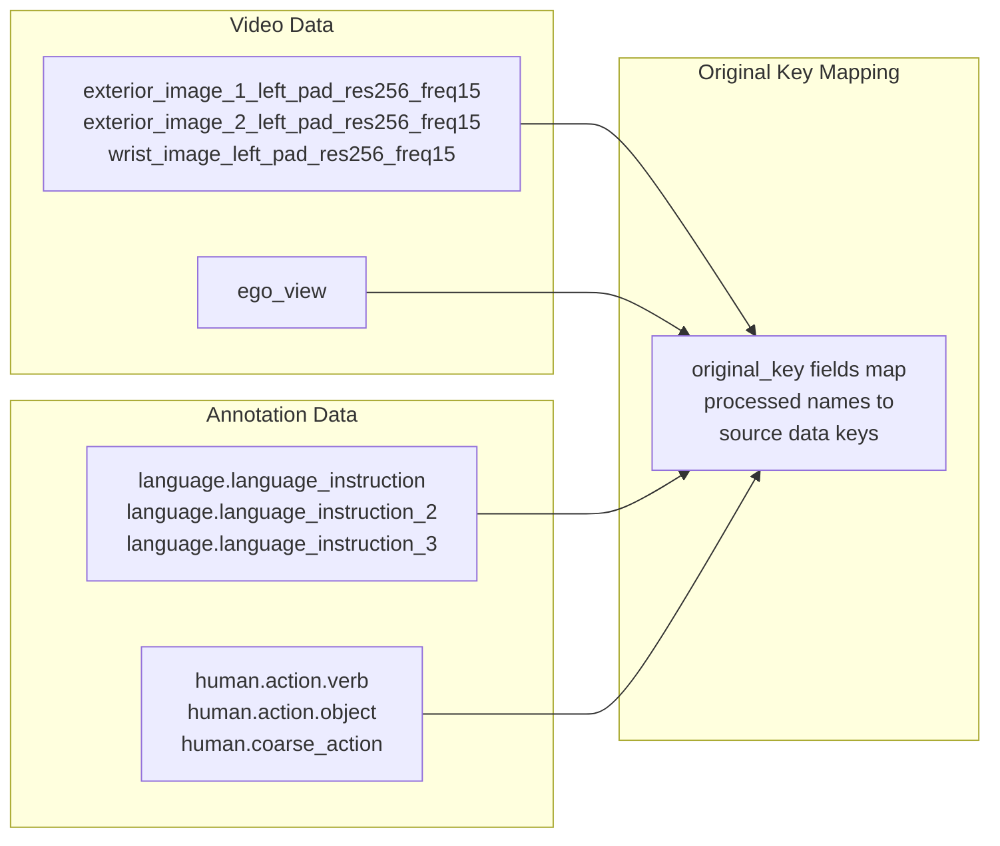

<!-- source: DeepWiki mcp.deepwiki.com · repo NVIDIA/GR00T-Dreams · page 4.4 Metadata Management · fetched 2026-10-26 -->

# Metadata Management

Relevant source files

The following files were used as context for generating this wiki page:

- [IDM_dump/global_metadata/franka/modality.json](IDM_dump/global_metadata/franka/modality.json)
- [IDM_dump/global_metadata/franka/stats.json](IDM_dump/global_metadata/franka/stats.json)
- [IDM_dump/global_metadata/gr1/modality.json](IDM_dump/global_metadata/gr1/modality.json)
- [IDM_dump/global_metadata/gr1/stats.json](IDM_dump/global_metadata/gr1/stats.json)

## Purpose and Scope

The metadata management system provides structured schema definitions and statistical summaries for robot datasets across different embodiments in the GR00T system. This system enables consistent data interpretation, validation, and processing by defining how raw sensor data, actions, and annotations are organized and what their statistical properties are.

For information about the broader data processing pipeline that uses this metadata, see [Pipeline Overview](#4.1). For robot-specific configurations that implement these metadata schemas, see [Robot Embodiments](#5).

## Metadata Architecture

The metadata management system consists of two primary components: modality schemas that define data structure and statistical summaries that capture dataset properties.

Sources: [IDM_dump/global_metadata/franka/modality.json:1-76](), [IDM_dump/global_metadata/gr1/modality.json:1-88]()

## Modality Schema System

The modality schema defines how multi-dimensional data arrays are segmented into meaningful components for each robot type. Each `modality.json` file specifies start and end indices for different data modalities.

### Schema Structure

Sources: [IDM_dump/global_metadata/franka/modality.json:2-20](), [IDM_dump/global_metadata/gr1/modality.json:2-35]()

### Franka Robot Schema

The Franka robot metadata defines a 7-DOF arm with end-effector control:

| Data Type | Component | Array Range | Special Properties |
|-----------|-----------|-------------|-------------------|
| state | eef_position | 0-3 | 3D position |
| state | eef_rotation | 3-6 | euler_angles_rpy |
| state | gripper_position | 6-7 | Single DOF |
| state | joint_position | 7-14 | 7 joints |
| action | eef_position_delta | 6-9 | absolute: false |
| action | gripper_velocity | 13-14 | Velocity control |

Sources: [IDM_dump/global_metadata/franka/modality.json:2-58]()

### GR1 Humanoid Schema

The GR1 humanoid uses body part segmentation for full-body control:

| Body Part | State Range | Action Range | DOF |
|-----------|-------------|--------------|-----|
| left_arm | 0-7 | 0-7 | 7 |
| left_hand | 7-13 | 7-13 | 6 |
| left_leg | 13-19 | 13-19 | 6 |
| neck | 19-22 | 19-22 | 3 |
| right_arm | 22-29 | 22-29 | 7 |
| right_hand | 29-35 | 29-35 | 6 |
| right_leg | 35-41 | 35-41 | 6 |
| waist | 41-44 | 41-44 | 3 |

Sources: [IDM_dump/global_metadata/gr1/modality.json:2-69]()

## Statistical Analysis System

The `stats.json` files contain comprehensive statistical analysis of dataset properties, including mean, standard deviation, minimum, maximum, and quantile values for all numeric fields.

### Statistical Structure

Sources: [IDM_dump/global_metadata/franka/stats.json:2-541](), [IDM_dump/global_metadata/gr1/stats.json:2-698]()

### Statistical Properties

The statistical summaries capture key dataset characteristics:

**Franka Dataset Statistics:**
- Total data points: 23,129,512 samples
- Episode range: 0-76,499 episodes  
- Mean episode duration: ~17.4 seconds
- Action space statistics for precise manipulation tasks

**GR1 Dataset Statistics:**
- Total data points: 4,624,261 samples
- Episode range: 0-12,266 episodes
- Mean episode duration: ~8.4 seconds  
- Full-body humanoid motion statistics

Sources: [IDM_dump/global_metadata/franka/stats.json:522-541](), [IDM_dump/global_metadata/gr1/stats.json:678-698]()

## Data Type Integration

The metadata system integrates multiple data modalities with consistent schema definitions:

Sources: [IDM_dump/global_metadata/franka/modality.json:59-75](), [IDM_dump/global_metadata/gr1/modality.json:70-87]()

## Metadata Usage Patterns

The metadata system enables consistent data processing across different robot embodiments:

### Schema Validation
The modality definitions ensure data arrays are properly segmented and interpreted according to each robot's specific capabilities and sensor configurations.

### Statistical Normalization  
The statistical summaries enable proper data normalization and outlier detection during training and inference phases.

### Cross-Robot Compatibility
The consistent metadata structure allows the same processing pipeline to handle different robot types by loading the appropriate schema files.

Sources: [IDM_dump/global_metadata/franka/modality.json:1-76](), [IDM_dump/global_metadata/franka/stats.json:1-542](), [IDM_dump/global_metadata/gr1/modality.json:1-88](), [IDM_dump/global_metadata/gr1/stats.json:1-698]()

---

