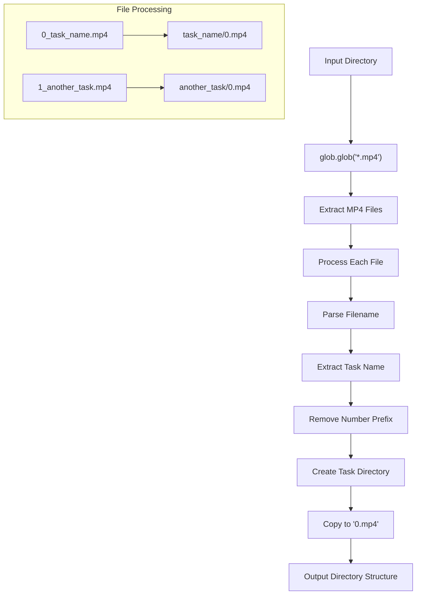
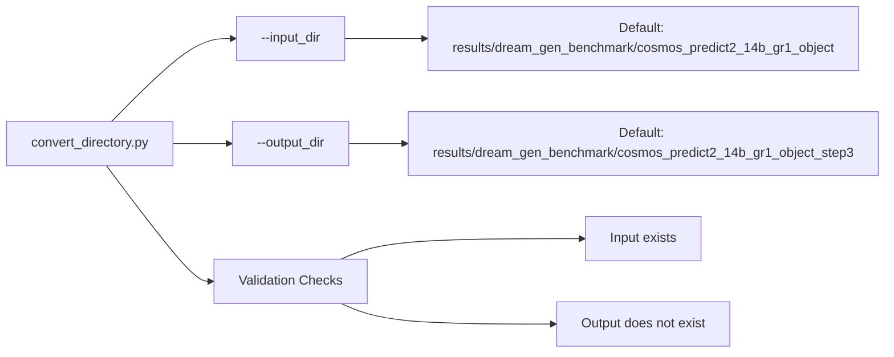
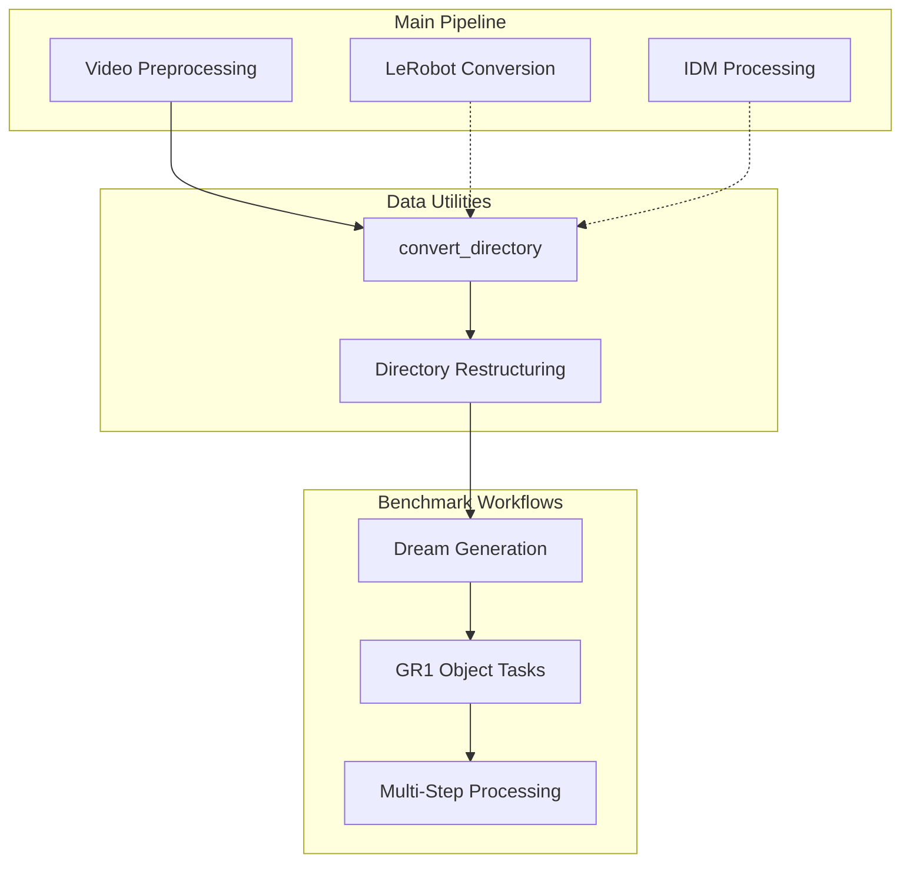

<!-- source: DeepWiki mcp.deepwiki.com · repo NVIDIA/GR00T-Dreams · page 4.5 Data Utilities · fetched 2026-10-26 -->

# Data Utilities

<details>
<summary>Relevant source files</summary>

The following files were used as context for generating this wiki page:

- [IDM_dump/convert_directory.py](IDM_dump/convert_directory.py)

</details>


This document covers additional data processing utilities that support the main data processing pipeline. These utilities handle specialized format transformations and directory structure conversions that are required at specific stages of the processing workflow.

For information about the main data processing pipeline, see [Pipeline Overview](#4.1). For video preprocessing and LeRobot data conversion, see [Video Preprocessing](#4.2) and [LeRobot Data Conversion](#4.3).

## Purpose and Scope

The data utilities provide supplementary tools for data format transformations and directory structure manipulations that are not part of the core processing pipeline but are essential for specific workflows, particularly benchmark data organization and multi-step processing scenarios.

## Directory Structure Conversion

The primary data utility is the directory structure conversion tool, which reorganizes video files between different processing steps in benchmark workflows.

### Conversion Process

The `convert_directory` function transforms flat directory structures into hierarchical task-based organizations:

**Input Structure (Step 2):**
```
results/dream_gen_benchmark/
└── cosmos_predict2_14b_gr1_object/
    ├── 0_Use_the_right_hand_to_pick_up_the_spatula_and_perform_a_serving_motion_from_the_bowl_onto_the_metal_plate.mp4
    ├── 1_Use_the_right_hand_to_close_lunch_box.mp4
    └── ...
```

**Output Structure (Step 3):**
```
results/dream_gen_benchmark/
└── cosmos_predict2_14b_gr1_object_step3/
    ├── Use_the_right_hand_to_pick_up_the_spatula_and_perform_a_serving_motion_from_the_bowl_onto_the_metal_plate/0.mp4
    ├── Use_the_right_hand_to_close_lunch_box/0.mp4
    └── ...
```

### Directory Transformation Flow



Sources: [IDM_dump/convert_directory.py:25-33]()

### Implementation Details

The conversion utility implements the following key operations:

| Operation | Function | Description |
|-----------|----------|-------------|
| File Discovery | `glob.glob()` | Locate all MP4 files in input directory |
| Name Parsing | `split("_", 1)[1]` | Extract task name by removing numeric prefix |
| Directory Creation | `os.makedirs()` | Create hierarchical directory structure |
| File Copy | `shutil.copy()` | Copy files to new locations |

### Command Line Interface

The utility provides a command-line interface with configurable input and output directories:



Sources: [IDM_dump/convert_directory.py:34-41]()

### Usage Context

The directory conversion utility is specifically designed for benchmark workflows involving the GR1 humanoid robot and dream generation processes. It bridges the gap between different processing steps where the directory organization requirements change.

**Typical Usage:**
- **Step 2**: Flat file structure with numbered task videos
- **Step 3**: Hierarchical structure organized by task categories
- **Use Case**: Dream generation benchmark processing for GR1 object manipulation tasks

### Safety Features

The utility includes several safety mechanisms:

| Safety Check | Implementation | Purpose |
|--------------|----------------|---------|
| Input Validation | `assert os.path.exists(args.input_dir)` | Ensure source directory exists |
| Output Protection | `assert not os.path.exists(args.output_dir)` | Prevent accidental overwrites |
| Directory Creation | `os.makedirs(exist_ok=True)` | Safe nested directory creation |

Sources: [IDM_dump/convert_directory.py:39-40]()

## Integration with Processing Pipeline

The data utilities complement the main processing pipeline by handling specialized organizational requirements:



Sources: [IDM_dump/convert_directory.py:1-18]()

The data utilities serve as bridge components that enable seamless transitions between different processing stages, particularly in benchmark and evaluation workflows where specific directory organizations are required for downstream tools and analysis frameworks.

---

