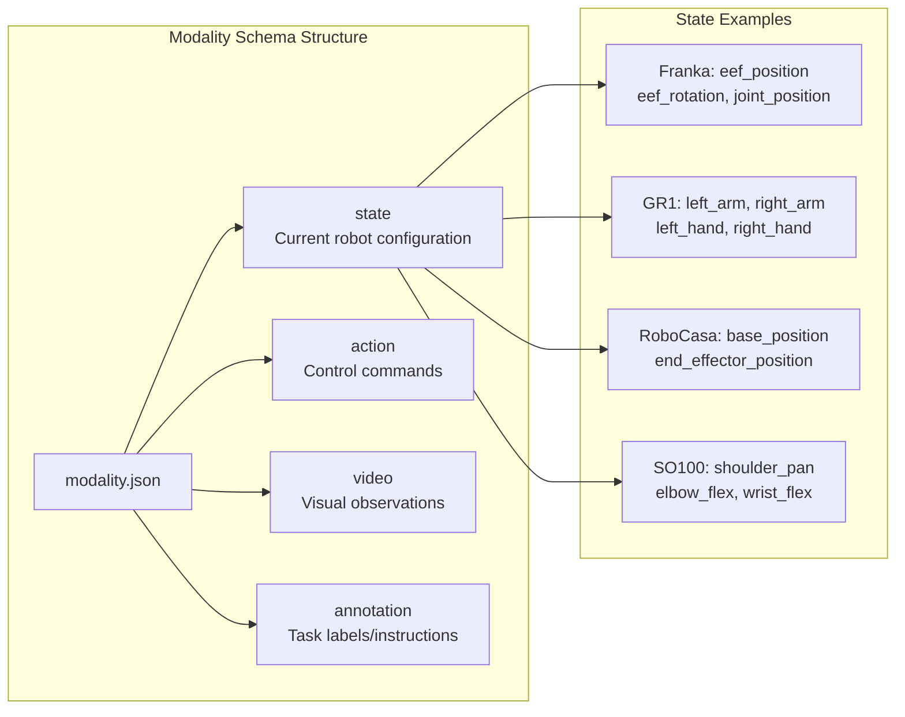
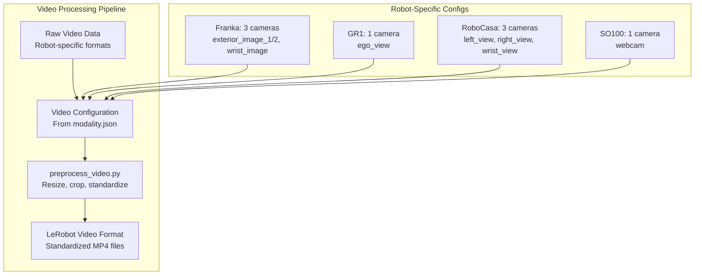

<!-- source: DeepWiki mcp.deepwiki.com · repo NVIDIA/GR00T-Dreams · page 5 Robot Embodiments · fetched 2026-10-26 -->

# Robot Embodiments

<details>
<summary>Relevant source files</summary>

The following files were used as context for generating this wiki page:

- [IDM_dump/global_metadata/franka/modality.json](IDM_dump/global_metadata/franka/modality.json)
- [IDM_dump/global_metadata/gr1/modality.json](IDM_dump/global_metadata/gr1/modality.json)
- [IDM_dump/global_metadata/robocasa/modality.json](IDM_dump/global_metadata/robocasa/modality.json)
- [IDM_dump/global_metadata/so100/modality.json](IDM_dump/global_metadata/so100/modality.json)

</details>


This document covers the multi-robot embodiment system in the NVIDIA Isaac-GR00T repository, which provides unified data processing and model training capabilities across different robot platforms. The system supports heterogeneous robot types through a configurable schema-based architecture that standardizes data formats while preserving robot-specific characteristics.

For detailed configuration and processing information for each specific robot, see the individual robot pages: [Franka Robot](#5.2), [GR1 Humanoid](#5.3), [RoboCasa Platform](#5.4), and [SO100 Robot](#5.5). For information about the data processing pipeline that operates on these embodiments, see [Data Processing Pipeline](#4).

## Multi-Robot Architecture Overview

The robot embodiments system provides a unified framework for processing data from different robot platforms while maintaining robot-specific configurations. Each supported robot has its own modality schema that defines the structure of state observations, actions, video streams, and annotations.

### Supported Robot Embodiments

| Robot | Type | DOF | Primary Use Case | Camera Views |
|-------|------|-----|------------------|--------------|
| Franka | Manipulator Arm | 7 + Gripper | Object manipulation | Exterior (2x), Wrist |
| GR1 | Humanoid | 44 (Full body) | Whole-body tasks | Ego-centric |
| RoboCasa | Mobile Manipulator | 7 + Base | Kitchen simulation | Left, Right, Wrist |
| SO100 | Desktop Arm | 6 | Tabletop manipulation | Webcam |

```mermaid
graph TB
    subgraph "Robot Embodiments"
        FRANKA[Franka<br/>"7-DOF Arm + Gripper"]
        GR1[GR1<br/>"44-DOF Humanoid"]
        ROBOCASA[RoboCasa<br/>"Mobile Base + 7-DOF Arm"]
        SO100[SO100<br/>"6-DOF Desktop Arm"]
    end
    
    subgraph "Modality Schemas"
        FRANKA_SCHEMA["franka/modality.json<br/>eef_position, eef_rotation<br/>gripper_position, joint_position"]
        GR1_SCHEMA["gr1/modality.json<br/>left_arm, right_arm, left_hand<br/>right_hand, legs, neck, waist"]
        ROBOCASA_SCHEMA["robocasa/modality.json<br/>base_position, end_effector<br/>joint_position, gripper_qpos"]
        SO100_SCHEMA["so100/modality.json<br/>shoulder_pan, shoulder_lift<br/>elbow_flex, wrist_flex"]
    end
    
    subgraph "Unified Processing Pipeline"
        PREPROCESS["preprocess_video.py<br/>Robot-specific transforms"]
        CONVERT["raw_to_lerobot.py<br/>Schema-driven conversion"]
        IDM_DUMP["dump_idm_actions.py<br/>Multi-robot inference"]
        FINETUNE["gr00t_finetune.py<br/>Embodiment-specific training"]
    end
    
    FRANKA --> FRANKA_SCHEMA
    GR1 --> GR1_SCHEMA
    ROBOCASA --> ROBOCASA_SCHEMA
    SO100 --> SO100_SCHEMA
    
    FRANKA_SCHEMA --> PREPROCESS
    GR1_SCHEMA --> PREPROCESS
    ROBOCASA_SCHEMA --> PREPROCESS
    SO100_SCHEMA --> PREPROCESS
    
    PREPROCESS --> CONVERT
    CONVERT --> IDM_DUMP
    IDM_DUMP --> FINETUNE
```

Sources: [IDM_dump/global_metadata/franka/modality.json:1-76](), [IDM_dump/global_metadata/gr1/modality.json:1-88](), [IDM_dump/global_metadata/robocasa/modality.json:1-108](), [IDM_dump/global_metadata/so100/modality.json:1-70]()

## Modality Schema System

The modality schema system defines the data structure for each robot embodiment through JSON configuration files. Each schema specifies four key modalities: `state`, `action`, `video`, and `annotation`. This standardized approach enables unified processing while accommodating robot-specific characteristics.

### Schema Structure

Each `modality.json` file contains:

- **State**: Robot's current configuration (joint positions, end-effector poses, etc.)
- **Action**: Control commands or target configurations
- **Video**: Camera feeds and visual observations
- **Annotation**: Task descriptions, instructions, or human labels



Sources: [IDM_dump/global_metadata/franka/modality.json:2-20](), [IDM_dump/global_metadata/gr1/modality.json:2-35](), [IDM_dump/global_metadata/robocasa/modality.json:2-54](), [IDM_dump/global_metadata/so100/modality.json:2-27]()

### State and Action Mapping

The schema defines precise tensor indices for each robot component using `start` and `end` fields. This enables efficient data packing and unpacking during processing.

| Robot | State Dimensions | Action Dimensions | Key Components |
|-------|------------------|-------------------|----------------|
| Franka | 14 | 28 | EEF pose, gripper, 7 joints |
| GR1 | 44 | 44 | 8 body segments (arms, hands, legs, etc.) |
| RoboCasa | 53 | 12 | Base, arm, gripper with absolute/relative poses |
| SO100 | 6 | 6 | 6-DOF arm with relative actions |

Sources: [IDM_dump/global_metadata/franka/modality.json:21-58](), [IDM_dump/global_metadata/gr1/modality.json:36-69](), [IDM_dump/global_metadata/robocasa/modality.json:55-90](), [IDM_dump/global_metadata/so100/modality.json:28-59]()

## Video Processing Configuration

Each robot embodiment defines its camera configuration through the `video` modality, specifying camera names and their corresponding data keys.

### Camera Configurations by Robot

**Franka**: Multiple external and wrist-mounted cameras
- `exterior_image_1_left_pad_res256_freq15`
- `exterior_image_2_left_pad_res256_freq15`  
- `wrist_image_left_pad_res256_freq15`

**GR1**: Single ego-centric view
- `ego_view`

**RoboCasa**: Multi-view kitchen setup
- `left_view`, `right_view`, `wrist_view`

**SO100**: Single webcam feed
- `webcam`



Sources: [IDM_dump/global_metadata/franka/modality.json:59-69](), [IDM_dump/global_metadata/gr1/modality.json:70-74](), [IDM_dump/global_metadata/robocasa/modality.json:91-101](), [IDM_dump/global_metadata/so100/modality.json:60-64]()

## Annotation Systems

Different robot embodiments use distinct annotation schemes tailored to their specific use cases and data collection methodologies.

### Annotation Types by Robot

**Franka**: Natural language instructions
- Multiple instruction variants (`language_instruction`, `language_instruction_2`, `language_instruction_3`)

**GR1**: Detailed human action annotations
- Action components: `verb`, `object`, `start_location`, `end_location`, `hand`
- Quality metrics: `rating`, `failure_code`, `validity`
- Action hierarchies: `coarse_action`, `fine_action`

**RoboCasa**: Task-oriented annotations
- `task_description`, `task_name`, `validity`

**SO100**: Simple task descriptions
- `task_description` (mapped from `task_index`)

Sources: [IDM_dump/global_metadata/franka/modality.json:70-75](), [IDM_dump/global_metadata/gr1/modality.json:75-87](), [IDM_dump/global_metadata/robocasa/modality.json:102-107](), [IDM_dump/global_metadata/so100/modality.json:65-69]()

## Integration with IDM Processing

The robot embodiment system integrates seamlessly with the IDM (Inverse Dynamics Model) processing pipeline. Each robot's modality schema enables the IDM system to understand the robot's state and action spaces for proper model training and inference.

The schema-driven approach allows the same codebase to process different robot types without hardcoded robot-specific logic, making the system extensible to new robot embodiments by simply adding new modality configuration files.

For detailed information about each specific robot embodiment, including processing pipelines, training configurations, and usage examples, refer to the individual robot documentation pages.

---

