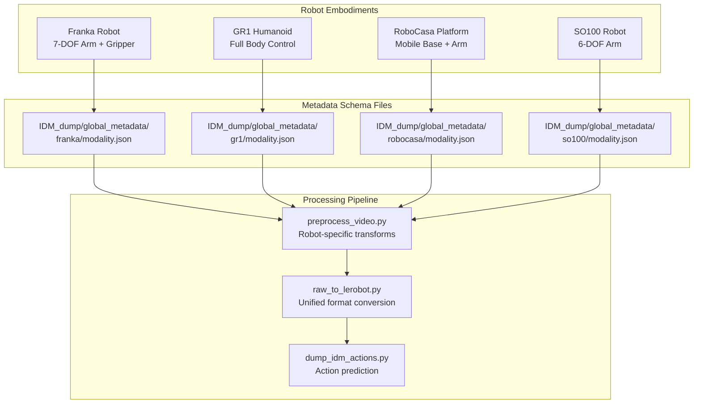
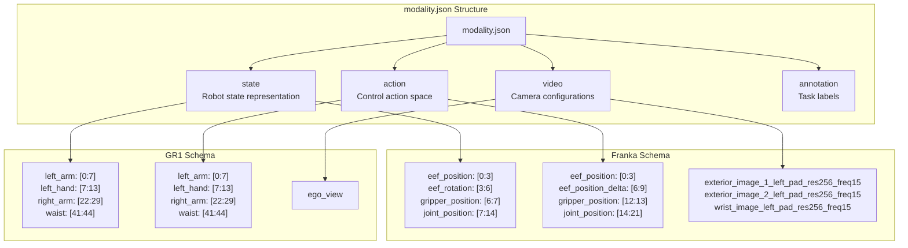
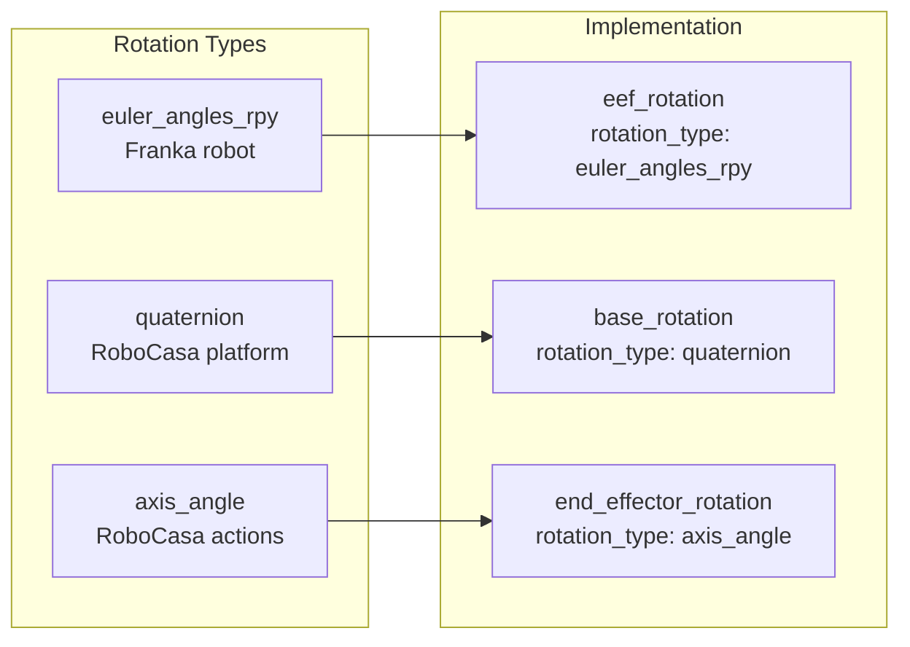

<!-- source: DeepWiki mcp.deepwiki.com · repo NVIDIA/GR00T-Dreams · page 5.1 Supported Robots Overview · fetched 2026-10-26 -->

# Supported Robots Overview

Relevant source files

The following files were used as context for generating this wiki page:

- [IDM_dump/global_metadata/franka/modality.json](IDM_dump/global_metadata/franka/modality.json)
- [IDM_dump/global_metadata/gr1/modality.json](IDM_dump/global_metadata/gr1/modality.json)
- [IDM_dump/global_metadata/robocasa/modality.json](IDM_dump/global_metadata/robocasa/modality.json)
- [IDM_dump/global_metadata/so100/modality.json](IDM_dump/global_metadata/so100/modality.json)

This document provides a comprehensive overview of the robot embodiments supported by the NVIDIA Isaac-GR00T system. The GR00T-Dreams repository implements a unified framework for processing data from multiple robot types, each with distinct hardware configurations, control schemas, and data modalities.

For detailed documentation on individual robots, see [Franka Robot](#5.2), [GR1 Humanoid](#5.3), [RoboCasa Platform](#5.4), and [SO100 Robot](#5.5). For information about the data processing pipeline that handles these robots, see [Data Processing Pipeline](#4).

## Robot Embodiment Architecture

The system supports four primary robot embodiments, each with distinct mechanical configurations and control paradigms:

**Sources:** [IDM_dump/global_metadata/franka/modality.json:1-76](), [IDM_dump/global_metadata/gr1/modality.json:1-88](), [IDM_dump/global_metadata/robocasa/modality.json:1-108](), [IDM_dump/global_metadata/so100/modality.json:1-70]()

## Robot Comparison Matrix

| Robot | DOF | Control Type | Camera Views | Primary Use Case |
|-------|-----|--------------|--------------|------------------|
| **Franka** | 7 | End-effector + Joint | 3 (exterior_1, exterior_2, wrist) | Manipulation tasks |
| **GR1** | 44 | Full body segments | 1 (ego_view) | Humanoid interaction |
| **RoboCasa** | 7 + Base | Mobile manipulation | 3 (left, right, wrist) | Kitchen simulation |
| **SO100** | 6 | Joint-level control | 1 (webcam) | Arm manipulation |

## Modality Schema Architecture

Each robot embodiment defines its data schema through `modality.json` files that specify state representation, action spaces, video configurations, and annotation formats:

**Sources:** [IDM_dump/global_metadata/franka/modality.json:2-20](), [IDM_dump/global_metadata/franka/modality.json:21-58](), [IDM_dump/global_metadata/gr1/modality.json:2-35](), [IDM_dump/global_metadata/gr1/modality.json:36-69]()

## Control Schema Specifications

### State and Action Dimensions

Each robot defines its state and action spaces through indexed arrays with specific semantic meanings:

| Robot | State Dims | Action Dims | Key Features |
|-------|------------|-------------|--------------|
| **Franka** | 14 | 28 | Absolute + relative control, Euler angles |
| **GR1** | 44 | 44 | Body segment control, humanoid kinematics |
| **RoboCasa** | 53 | 12 | Mobile base, quaternion rotations |
| **SO100** | 6 | 6 | Joint-level relative control |

### Rotation Representations

The system supports multiple rotation representations across different robots:

**Sources:** [IDM_dump/global_metadata/franka/modality.json:9-10](), [IDM_dump/global_metadata/robocasa/modality.json:9-10](), [IDM_dump/global_metadata/robocasa/modality.json:78-79]()

## Video Processing Configuration

Each robot embodiment specifies its camera configuration through the `video` section of `modality.json`:

### Camera View Mappings

| Robot | Camera Keys | Original Observation Keys |
|-------|-------------|---------------------------|
| **Franka** | `exterior_image_1_left_pad_res256_freq15` | `observation.images.exterior_image_1_left_pad_res256_freq15` |
| **Franka** | `wrist_image_left_pad_res256_freq15` | `observation.images.wrist_image_left_pad_res256_freq15` |
| **GR1** | `ego_view` | `observation.images.ego_view` |
| **RoboCasa** | `left_view`, `right_view`, `wrist_view` | `observation.images.{view}` |
| **SO100** | `webcam` | `observation.images.webcam` |

**Sources:** [IDM_dump/global_metadata/franka/modality.json:59-69](), [IDM_dump/global_metadata/gr1/modality.json:70-74](), [IDM_dump/global_metadata/robocasa/modality.json:91-101](), [IDM_dump/global_metadata/so100/modality.json:60-64]()

## Annotation Schema Variations

The annotation schemas vary significantly based on the robot's intended use case:

### Instruction-Following Robots (Franka)
- `language.language_instruction`: Primary task instruction
- `language.language_instruction_2`: Secondary instruction 
- `language.language_instruction_3`: Tertiary instruction

### Human Activity Recording (GR1)
- `human.action.verb`: Action verb classification
- `human.action.object`: Target object identification
- `human.action.hand`: Hand preference annotation
- `human.coarse_action`: High-level action category
- `human.validity`: Data quality validation

### Task-Oriented Simulation (RoboCasa)
- `human.action.task_description`: Natural language task description
- `human.action.task_name`: Structured task identifier
- `human.validity`: Data validation flag

### Simple Manipulation (SO100)
- `human.task_description`: Basic task description mapped from `task_index`

**Sources:** [IDM_dump/global_metadata/franka/modality.json:70-75](), [IDM_dump/global_metadata/gr1/modality.json:75-87](), [IDM_dump/global_metadata/robocasa/modality.json:102-106](), [IDM_dump/global_metadata/so100/modality.json:65-69]()

---

