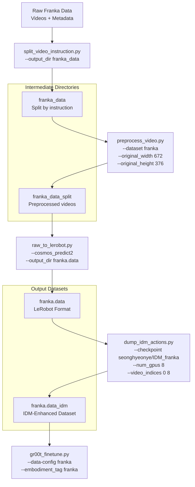

<!-- source: DeepWiki mcp.deepwiki.com · repo NVIDIA/GR00T-Dreams · page 5.2 Franka Robot · fetched 2026-10-26 -->

# Franka Robot

<details>
<summary>Relevant source files</summary>

The following files were used as context for generating this wiki page:

- [IDM_dump/global_metadata/franka/modality.json](IDM_dump/global_metadata/franka/modality.json)
- [IDM_dump/global_metadata/franka/stats.json](IDM_dump/global_metadata/franka/stats.json)
- [IDM_dump/scripts/finetune/franka.sh](IDM_dump/scripts/finetune/franka.sh)
- [IDM_dump/scripts/preprocess/franka.sh](IDM_dump/scripts/preprocess/franka.sh)

</details>


This document covers the Franka robot integration within the NVIDIA Isaac-GR00T system, including its data schema definition, processing pipeline, and model training configuration. The Franka robot is a 7-DOF robotic arm with gripper support and multi-camera vision capabilities.

For information about other supported robot embodiments, see [Supported Robots Overview](#5.1). For details about the overall data processing pipeline architecture, see [Pipeline Overview](#4.1).

## Robot Configuration

The Franka robot is configured as a 7-DOF robotic arm with end-effector control and gripper manipulation capabilities. The system supports both absolute and relative (delta) control modes for position and orientation commands.

### Hardware Specifications

| Component | Specification |
|-----------|---------------|
| Degrees of Freedom | 7-DOF arm joints |
| End-Effector | Position and orientation control |
| Gripper | Single DOF gripper with position and velocity control |
| Rotation Representation | Euler angles (roll-pitch-yaw) |
| Camera Configuration | 3 cameras: 2 exterior views + 1 wrist-mounted |

### Camera System

The Franka setup includes three camera views for comprehensive visual observation:

- `exterior_image_1_left_pad_res256_freq15`: First exterior camera view
- `exterior_image_2_left_pad_res256_freq15`: Second exterior camera view  
- `wrist_image_left_pad_res256_freq15`: Wrist-mounted camera

All cameras are configured with 256x256 resolution and 15 FPS sampling frequency.

Sources: [IDM_dump/global_metadata/franka/modality.json:59-69]()

## Data Schema

The Franka robot data schema defines four main modality categories: state observations, actions, video streams, and language annotations.

```mermaid
graph TB
    subgraph "modality.json Schema"
        STATE["state modality"]
        ACTION["action modality"]
        VIDEO["video modality"]
        ANNOTATION["annotation modality"]
    end
    
    subgraph "State Components"
        EEF_POS["eef_position<br/>[0:3]"]
        EEF_ROT["eef_rotation<br/>[3:6] euler_angles_rpy"]
        GRIP_POS["gripper_position<br/>[6:7]"]
        JOINT_POS["joint_position<br/>[7:14]"]
    end
    
    subgraph "Action Components"
        A_EEF_POS["eef_position<br/>[0:3]"]
        A_EEF_ROT["eef_rotation<br/>[3:6] euler_angles_rpy"]
        A_EEF_POS_DELTA["eef_position_delta<br/>[6:9] relative"]
        A_EEF_ROT_DELTA["eef_rotation_delta<br/>[9:12] relative"]
        A_GRIP_POS["gripper_position<br/>[12:13]"]
        A_GRIP_VEL["gripper_velocity<br/>[13:14]"]
        A_JOINT_POS["joint_position<br/>[14:21]"]
        A_JOINT_VEL["joint_velocity<br/>[21:28]"]
    end
    
    subgraph "Video Streams"
        EXT1["exterior_image_1_left_pad_res256_freq15"]
        EXT2["exterior_image_2_left_pad_res256_freq15"]
        WRIST["wrist_image_left_pad_res256_freq15"]
    end
    
    subgraph "Language Instructions"
        LANG1["language.language_instruction"]
        LANG2["language.language_instruction_2"]
        LANG3["language.language_instruction_3"]
    end
    
    STATE --> EEF_POS
    STATE --> EEF_ROT
    STATE --> GRIP_POS
    STATE --> JOINT_POS
    
    ACTION --> A_EEF_POS
    ACTION --> A_EEF_ROT
    ACTION --> A_EEF_POS_DELTA
    ACTION --> A_EEF_ROT_DELTA
    ACTION --> A_GRIP_POS
    ACTION --> A_GRIP_VEL
    ACTION --> A_JOINT_POS
    ACTION --> A_JOINT_VEL
    
    VIDEO --> EXT1
    VIDEO --> EXT2
    VIDEO --> WRIST
    
    ANNOTATION --> LANG1
    ANNOTATION --> LANG2
    ANNOTATION --> LANG3
```



### State Modality

The state observation vector contains 14 dimensions representing the robot's current configuration:

| Component | Indices | Description |
|-----------|---------|-------------|
| `eef_position` | [0:3] | End-effector position (x, y, z) |
| `eef_rotation` | [3:6] | End-effector rotation (roll, pitch, yaw) |
| `gripper_position` | [6:7] | Gripper opening position |
| `joint_position` | [7:14] | 7-DOF joint angles |

### Action Modality

The action vector contains 28 dimensions supporting both absolute and relative control:

| Component | Indices | Type | Description |
|-----------|---------|------|-------------|
| `eef_position` | [0:3] | Absolute | Target end-effector position |
| `eef_rotation` | [3:6] | Absolute | Target end-effector rotation |
| `eef_position_delta` | [6:9] | Relative | Position change commands |
| `eef_rotation_delta` | [9:12] | Relative | Rotation change commands |
| `gripper_position` | [12:13] | Absolute | Target gripper position |
| `gripper_velocity` | [13:14] | Velocity | Gripper velocity command |
| `joint_position` | [14:21] | Absolute | Target joint positions |
| `joint_velocity` | [21:28] | Velocity | Joint velocity commands |

Sources: [IDM_dump/global_metadata/franka/modality.json:1-58]()

## Dataset Statistics

The Franka dataset contains comprehensive statistical information for normalization and analysis purposes. Key statistics include:

### State Distribution

- **End-effector position range**: X: [-0.22, 0.86], Y: [-0.83, 0.82], Z: [-0.24, 1.01]
- **Joint position range**: Approximately ±2.7 radians for most joints
- **Gripper position**: Binary [0, 1] representing open/closed states
- **Dataset size**: 76,500 episodes with ~23M total frames

### Episode Characteristics

- **Average episode length**: ~261 frames
- **Maximum episode length**: 4,497 frames  
- **Timestamp range**: 0 to 300 seconds
- **Reward structure**: Sparse rewards with 0.33% success rate

Sources: [IDM_dump/global_metadata/franka/stats.json:1-541]()

## Processing Pipeline

The Franka data processing pipeline consists of four main stages: data splitting, video preprocessing, LeRobot conversion, and IDM action prediction.



### Stage 1: Data Splitting

The `split_video_instruction.py` script separates raw data by robot type and instruction categories.

### Stage 2: Video Preprocessing

Video preprocessing handles the Franka-specific camera configuration:
- **Original resolution**: 672x376 pixels
- **Target resolution**: 256x256 pixels (with padding)
- **Frame rate**: 15 FPS
- **Multi-camera processing**: Handles 3 simultaneous video streams

### Stage 3: LeRobot Conversion

The `raw_to_lerobot.py` script converts preprocessed data to the standardized LeRobot format:
- Generates parquet files for efficient data loading
- Creates metadata files compatible with the modality schema
- Enables `cosmos_predict2` feature for enhanced data processing

### Stage 4: IDM Action Prediction

The IDM processing stage uses the pre-trained `seonghyeonye/IDM_franka` checkpoint:
- **Multi-GPU processing**: Supports up to 8 GPUs
- **Video indexing**: Processes video indices 0-8
- **Output format**: Enhanced dataset with predicted actions

Sources: [IDM_dump/scripts/preprocess/franka.sh:1-29]()

## Model Training

Franka-specific model training uses the `gr00t_finetune.py` script with robot-specific configurations.

### Training Configuration

```bash
PYTHONPATH=. torchrun scripts/gr00t_finetune.py \
    --dataset-path "IDM_dump/data/franka.data_idm" \
    --data-config franka \
    --embodiment_tag "franka"
```

### Training Parameters

| Parameter | Value | Description |
|-----------|-------|-------------|
| `dataset-path` | `IDM_dump/data/franka.data_idm` | IDM-enhanced dataset path |
| `data-config` | `franka` | Robot-specific data configuration |
| `embodiment_tag` | `franka` | Identifier for model versioning |

The training process leverages the distributed training capabilities of PyTorch's `torchrun` for efficient multi-GPU training.

Sources: [IDM_dump/scripts/finetune/franka.sh:1-2]()

## Integration Points

The Franka robot integration connects with several core system components:

- **IDM Core System**: Uses pre-trained IDM models for action prediction (see [IDM Architecture](#3.1))
- **Data Processing Pipeline**: Follows the standardized processing workflow (see [Pipeline Overview](#4.1))
- **LeRobot Format**: Outputs data in the universal LeRobot format for interoperability (see [LeRobot Data Conversion](#4.3))
- **Metadata System**: Maintains robot-specific schemas and statistics (see [Metadata Management](#4.4))

Sources: [IDM_dump/global_metadata/franka/modality.json:1-75](), [IDM_dump/global_metadata/franka/stats.json:1-541](), [IDM_dump/scripts/preprocess/franka.sh:1-29](), [IDM_dump/scripts/finetune/franka.sh:1-2]()

---

