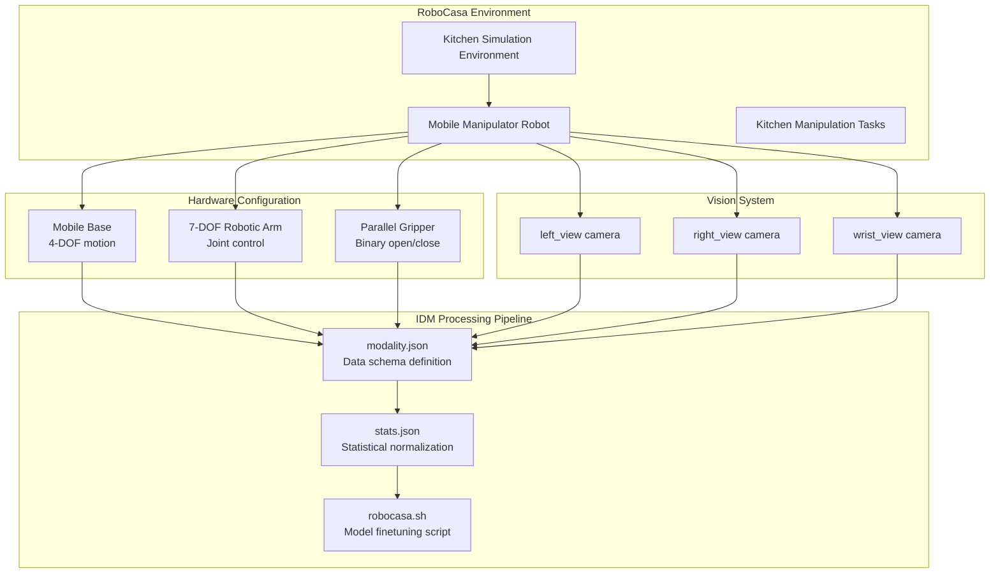
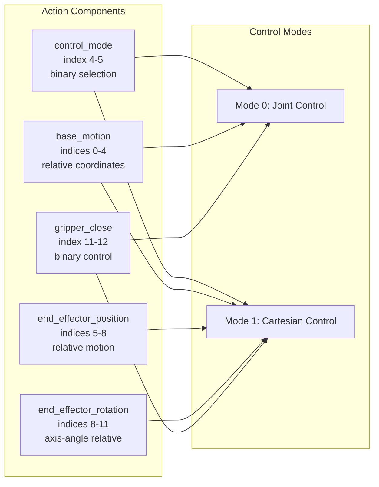
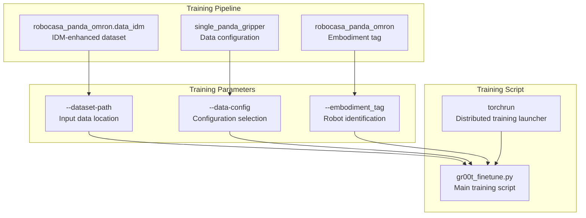

<!-- source: DeepWiki mcp.deepwiki.com · repo NVIDIA/GR00T-Dreams · page 5.4 RoboCasa Platform · fetched 2026-10-26 -->

# RoboCasa Platform

Relevant source files

The following files were used as context for generating this wiki page:

- [IDM_dump/global_metadata/robocasa/modality.json](IDM_dump/global_metadata/robocasa/modality.json)
- [IDM_dump/global_metadata/robocasa/stats.json](IDM_dump/global_metadata/robocasa/stats.json)
- [IDM_dump/scripts/finetune/robocasa.sh](IDM_dump/scripts/finetune/robocasa.sh)

This document covers the RoboCasa platform integration within the NVIDIA Isaac-GR00T system. RoboCasa is a simulation environment designed for kitchen manipulation tasks, featuring a mobile manipulator with multi-camera vision capabilities. This page details the data schema, action space configuration, video processing pipeline, and model training procedures specific to RoboCasa.

For information about other supported robot embodiments, see [Supported Robots Overview](#5.1). For general data processing pipeline details, see [Data Processing Pipeline](#4).

## Platform Overview

RoboCasa integrates as one of the supported robot embodiments in the IDM system, providing a simulated kitchen environment for manipulation tasks. The platform features a mobile base combined with a 7-DOF robotic arm and parallel gripper, equipped with multiple camera viewpoints for comprehensive scene observation.

**Sources:** [IDM_dump/global_metadata/robocasa/modality.json](), [IDM_dump/scripts/finetune/robocasa.sh]()

## Data Schema Configuration

The RoboCasa data schema is defined through a comprehensive modality configuration that specifies state representations, action spaces, video modalities, and annotation formats.

### State Representation

The robot state encompasses multiple coordinate frames and kinematic representations:

| Component | Dimensions | Index Range | Description |
|-----------|------------|-------------|-------------|
| `base_position` | 3 | 0-3 | Mobile base position in world coordinates |
| `base_rotation` | 4 | 3-7 | Base orientation as quaternion |
| `end_effector_position_absolute` | 3 | 7-10 | EE position in world frame |
| `end_effector_position_relative` | 3 | 10-13 | EE position relative to base |
| `end_effector_rotation_absolute` | 4 | 13-17 | EE orientation in world frame (quaternion) |
| `end_effector_rotation_relative` | 4 | 17-21 | EE orientation relative to base (quaternion) |
| `gripper_qpos` | 2 | 21-23 | Gripper joint positions |
| `gripper_qvel` | 2 | 23-25 | Gripper joint velocities |
| `joint_position` | 7 | 25-32 | Arm joint angles |
| `joint_position_cos` | 7 | 32-39 | Cosine of joint angles |
| `joint_position_sin` | 7 | 39-46 | Sine of joint angles |
| `joint_velocity` | 7 | 46-53 | Arm joint velocities |

**Sources:** [IDM_dump/global_metadata/robocasa/modality.json:2-54]()

### Action Space Configuration

The action space provides hierarchical control capabilities with multiple motion modes:

**Sources:** [IDM_dump/global_metadata/robocasa/modality.json:55-90]()

## Multi-Camera Vision System

RoboCasa employs a three-camera configuration providing comprehensive environmental awareness:

| Camera | Original Key | Purpose |
|--------|--------------|---------|
| `left_view` | `observation.images.left_view` | External left perspective |
| `right_view` | `observation.images.right_view` | External right perspective |
| `wrist_view` | `observation.images.wrist_view` | End-effector mounted camera |

The vision system integrates with the video preprocessing pipeline to generate multi-modal observations for the IDM training process.

**Sources:** [IDM_dump/global_metadata/robocasa/modality.json:91-101]()

## Statistical Data Profile

The dataset statistics reveal the operational characteristics and data distribution patterns:

### State Space Statistics

Key statistical insights from the RoboCasa dataset:

- **Base Position Range:** X: [0.31, 5.60] meters, Y: [-5.11, -0.49] meters, Z: [0.69, 0.83] meters
- **Joint Position Range:** 7-DOF arm with joint limits approximately [-3.10, 3.79] radians
- **End Effector Workspace:** Position range of approximately 6 meters in X, 5 meters in Y, 1.2 meters in Z
- **Gripper States:** Binary positions with continuous velocity feedback

### Action Space Statistics

The action statistics demonstrate the relative motion characteristics:

- **Base Motion:** Stationary (mean = 0.0, std = 0.0) indicating primarily manipulation-focused tasks
- **End Effector Motion:** Relative movements with standard deviations around 0.4 units
- **Gripper Control:** Binary actions with 35.6% average activation rate

**Sources:** [IDM_dump/global_metadata/robocasa/stats.json:2-599]()

## Model Training Configuration

The RoboCasa model training utilizes the distributed finetuning system with platform-specific configurations:

The training configuration specifies:
- **Dataset Path:** `IDM_dump/data/robocasa_panda_omron.data_idm`
- **Data Configuration:** `single_panda_gripper` 
- **Embodiment Tag:** `robocasa_panda_omron`

**Sources:** [IDM_dump/scripts/finetune/robocasa.sh:1]()

## Annotation System

RoboCasa includes human annotation capabilities for task specification and validation:

| Annotation Type | Description | Statistics |
|-----------------|-------------|------------|
| `human.action.task_description` | Natural language task descriptions | Mean length: 8.25 tokens |
| `human.action.task_name` | Categorical task identifiers | Single category per episode |
| `human.validity` | Human validation flags | Consistent validation score: 2.0 |

The annotation system supports both natural language instruction following and categorical task classification, enabling flexible training paradigms for instruction-conditioned manipulation policies.

**Sources:** [IDM_dump/global_metadata/robocasa/modality.json:102-107](), [IDM_dump/global_metadata/robocasa/stats.json:440-519]()

---

