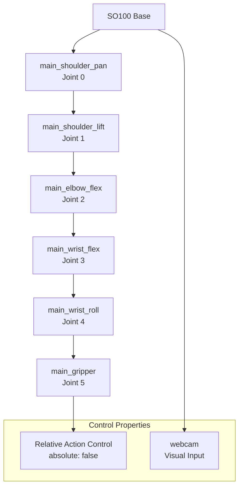
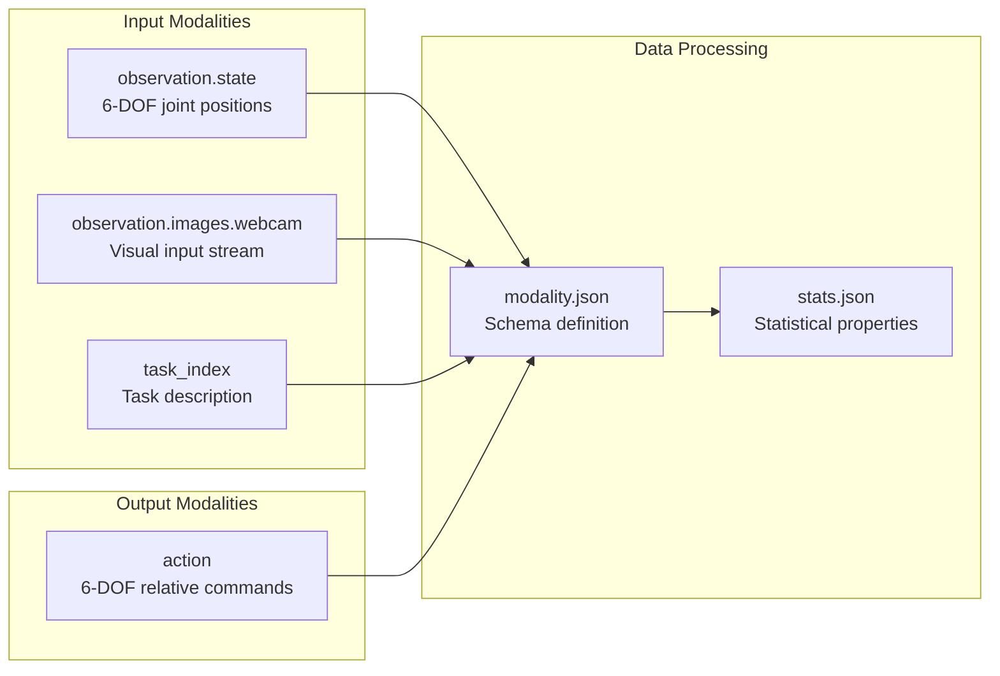
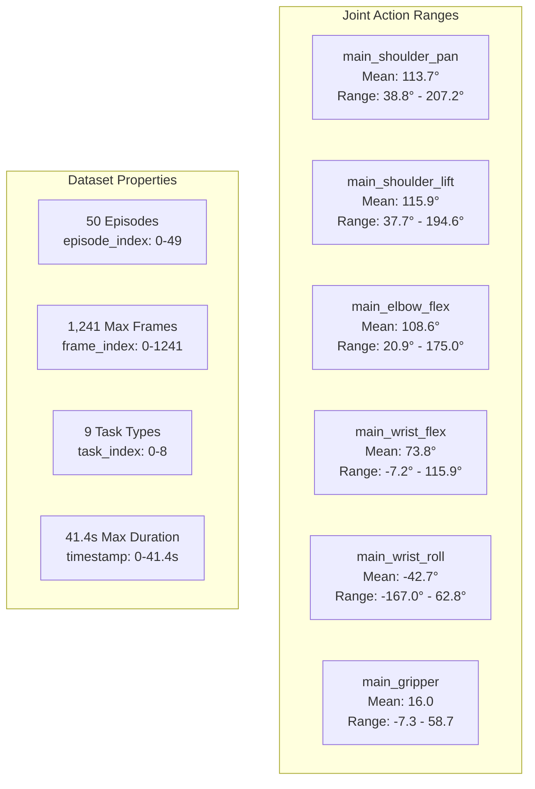
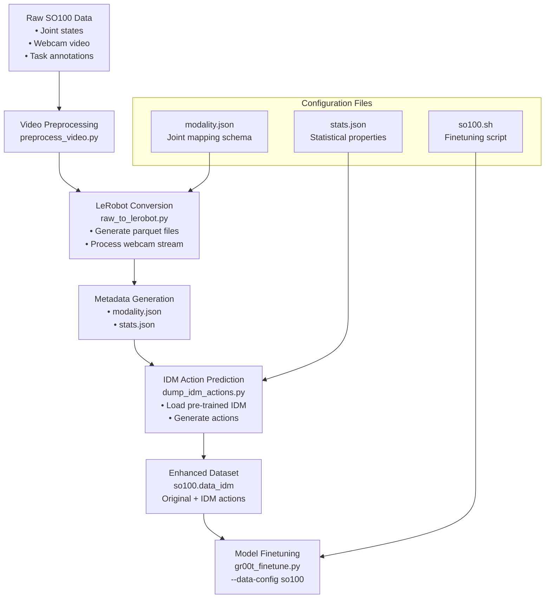
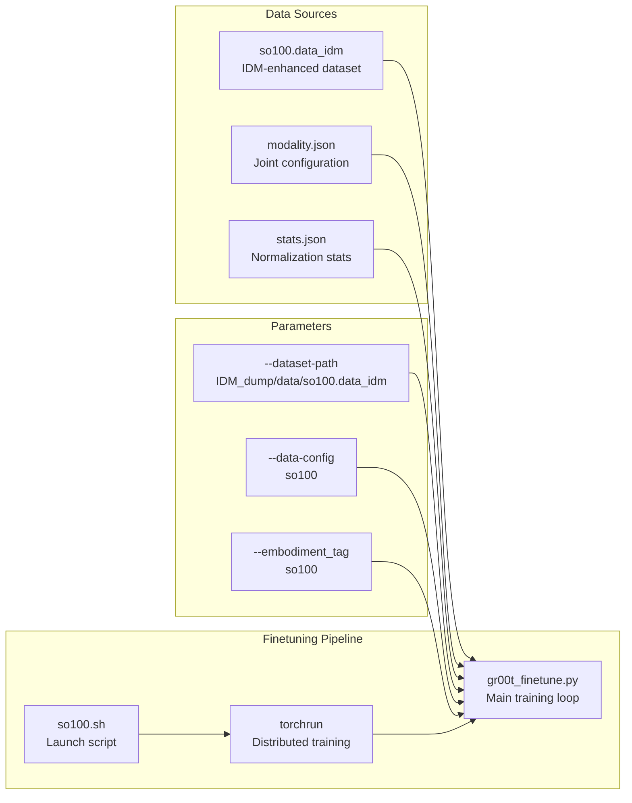

<!-- source: DeepWiki mcp.deepwiki.com · repo NVIDIA/GR00T-Dreams · page 5.5 SO100 Robot · fetched 2026-10-26 -->

# SO100 Robot

<details>
<summary>Relevant source files</summary>

The following files were used as context for generating this wiki page:

- [IDM_dump/global_metadata/so100/modality.json](IDM_dump/global_metadata/so100/modality.json)
- [IDM_dump/global_metadata/so100/stats.json](IDM_dump/global_metadata/so100/stats.json)
- [IDM_dump/scripts/finetune/so100.sh](IDM_dump/scripts/finetune/so100.sh)

</details>


This document covers the SO100 robot integration within the NVIDIA Isaac-GR00T system, including its joint configuration, data schema, statistical properties, and model finetuning procedures. The SO100 is a 6-DOF robotic arm with gripper that uses relative action control and webcam-based vision input.

For information about other supported robot embodiments, see [Supported Robots Overview](#5.1). For details about the core IDM system architecture, see [IDM Architecture](#3.1).

## Hardware Configuration

The SO100 robot is configured as a 6-degree-of-freedom robotic arm with an additional gripper joint, totaling 7 controllable joints. The system uses relative action control rather than absolute positioning, making it suitable for incremental motion commands.

### Joint Architecture



**Joint Control Mapping**

| Joint Name | State Index | Action Index | Control Type |
|------------|-------------|--------------|--------------|
| `main_shoulder_pan` | 0-1 | 0-1 | Relative |
| `main_shoulder_lift` | 1-2 | 1-2 | Relative |
| `main_elbow_flex` | 2-3 | 2-3 | Relative |
| `main_wrist_flex` | 3-4 | 3-4 | Relative |
| `main_wrist_roll` | 4-5 | 4-5 | Relative |
| `main_gripper` | 5-6 | 5-6 | Relative |

Sources: [IDM_dump/global_metadata/so100/modality.json:2-59]()

## Data Schema

The SO100 robot uses a structured data schema that defines state observations, action commands, visual input, and task annotations through the modality configuration system.

### Modality Configuration



**Video Input Configuration**
- **Source**: `observation.images.webcam`
- **Key**: `webcam`
- **Type**: Single camera feed

**Annotation Configuration**
- **Source**: `task_index`  
- **Key**: `human.task_description`
- **Purpose**: Task instruction mapping

Sources: [IDM_dump/global_metadata/so100/modality.json:60-69]()

## Statistical Properties

The SO100 dataset contains comprehensive statistical analysis of joint states, actions, and temporal properties derived from training data across multiple episodes and tasks.

### Action Statistics



**Statistical Summary**

| Joint | Mean | Std Dev | Min | Max | Q01 | Q99 |
|-------|------|---------|-----|-----|-----|-----|
| shoulder_pan | 113.7° | 36.6° | 38.8° | 207.2° | 59.7° | 195.0° |
| shoulder_lift | 115.9° | 33.7° | 37.7° | 194.6° | 51.7° | 189.3° |
| elbow_flex | 108.6° | 25.0° | 20.9° | 175.0° | 42.5° | 164.8° |
| wrist_flex | 73.8° | 22.3° | -7.2° | 115.9° | 22.2° | 112.0° |
| wrist_roll | -42.7° | 37.9° | -167.0° | 62.8° | -134.9° | 11.7° |
| gripper | 16.0 | 14.1 | -7.3 | 58.7 | -3.7 | 48.5 |

Sources: [IDM_dump/global_metadata/so100/stats.json:2-50](), [IDM_dump/global_metadata/so100/stats.json:142-201]()

### Dataset Temporal Properties

- **Total Episodes**: 50 episodes (indices 0-49)
- **Average Episode Duration**: 16.6 seconds
- **Maximum Episode Duration**: 41.4 seconds  
- **Average Frames per Episode**: 497 frames
- **Total Dataset Size**: 53,027 data points

Sources: [IDM_dump/global_metadata/so100/stats.json:102-181]()

## Integration with IDM System

The SO100 robot integrates with the core IDM (Inverse Dynamics Model) system through standardized data processing pipelines and model finetuning procedures.

### Data Processing Pipeline



**Key Integration Points**:
- **Data Configuration**: `so100` config identifier
- **Dataset Path**: `IDM_dump/data/so100.data_idm`
- **Embodiment Tag**: `so100`
- **Relative Actions**: All joints use relative control (`absolute: false`)

Sources: [IDM_dump/global_metadata/so100/modality.json:28-58]()

## Model Finetuning

The SO100 robot supports distributed model finetuning using the standardized `gr00t_finetune.py` script with SO100-specific configuration parameters.

### Finetuning Configuration



**Finetuning Command**:
```bash
PYTHONPATH=. torchrun scripts/gr00t_finetune.py \
  --dataset-path "IDM_dump/data/so100.data_idm" \
  --data-config so100 \
  --embodiment_tag "so100"
```

**Configuration Parameters**:
- **Dataset Path**: Points to IDM-enhanced SO100 dataset
- **Data Config**: Uses `so100` configuration for joint mapping
- **Embodiment Tag**: Identifies SO100-specific model parameters
- **Training Framework**: PyTorch distributed training via `torchrun`

Sources: [IDM_dump/scripts/finetune/so100.sh:1]()

---

