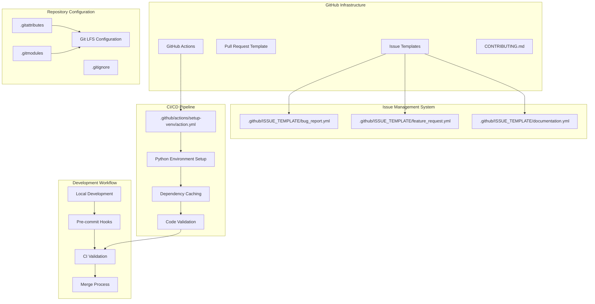
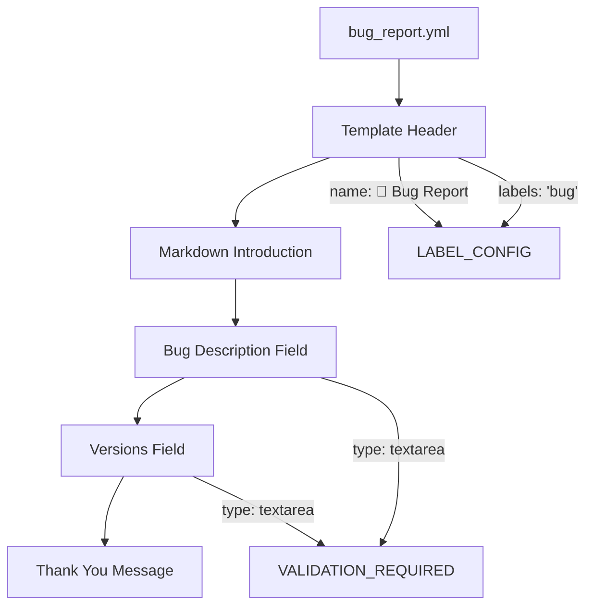
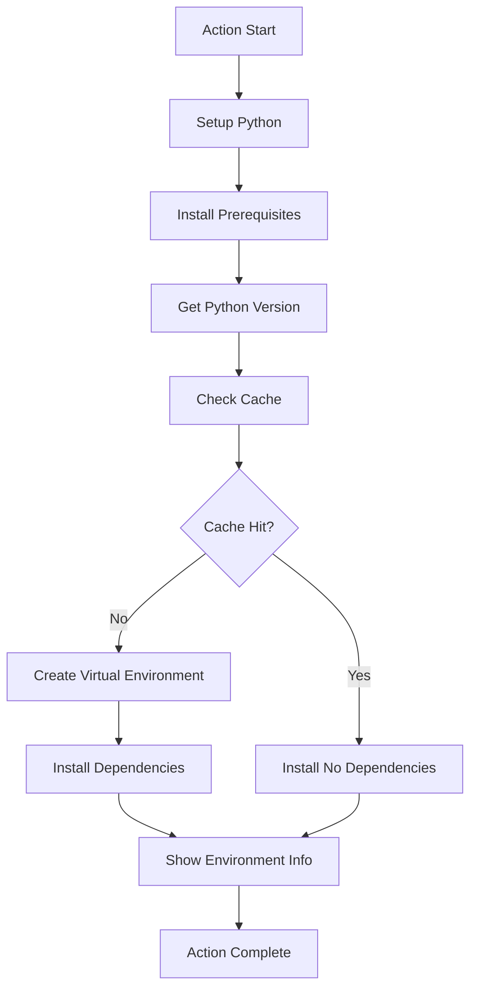
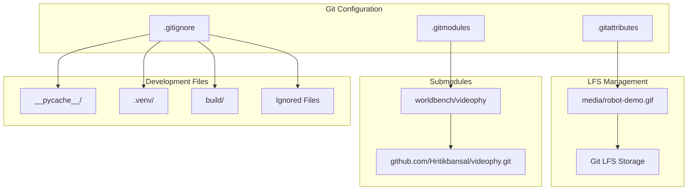

<!-- source: DeepWiki mcp.deepwiki.com · repo NVIDIA/GR00T-Dreams · page 6 Development Infrastructure · fetched 2026-10-26 -->

# Development Infrastructure

<details>
<summary>Relevant source files</summary>

The following files were used as context for generating this wiki page:

- [.gitattributes](.gitattributes)
- [.github/ISSUE_TEMPLATE/bug_report.yml](.github/ISSUE_TEMPLATE/bug_report.yml)
- [.github/actions/setup-venv/action.yml](.github/actions/setup-venv/action.yml)
- [.gitmodules](.gitmodules)

</details>


## Purpose and Scope

This document covers the development infrastructure for the NVIDIA Isaac-GR00T repository, including GitHub issue management, continuous integration pipelines, and repository configuration. The infrastructure supports collaborative development workflows, automated testing, and code quality enforcement across the multi-robot IDM system.

For information about setting up the development environment, see [Development Setup](#2.1). For contribution guidelines and code quality standards, see [Contributing Guidelines](#2.2).

## Development Infrastructure Overview

The development infrastructure provides a comprehensive framework for managing the collaborative development of the Isaac-GR00T system. It includes structured issue reporting, automated CI/CD pipelines, and repository configuration management.

### Development Infrastructure Architecture



**Sources:** [.github/ISSUE_TEMPLATE/bug_report.yml:1-47](), [.github/actions/setup-venv/action.yml:1-57](), [.gitattributes:1-2](), [.gitmodules:1-4]()

## GitHub Issue Management System

The repository uses structured YAML templates to standardize issue reporting and feature requests. This system ensures consistent information collection for effective issue resolution.

### Bug Report Template

The bug report template is implemented in `.github/ISSUE_TEMPLATE/bug_report.yml` and provides a structured format for reporting issues:

| Field | Type | Required | Purpose |
|-------|------|----------|---------|
| Bug Description | textarea | Yes | Clear description with minimal reproducible example |
| Versions | textarea | Yes | Python version and package dependencies |
| Code Example | markdown | No | Minimal code snippet demonstrating the issue |

The template includes specific formatting requirements:
- Mandatory code examples using triple backticks
- Full traceback information for errors
- Version information via `python --version && pip freeze`
- Links to existing issues to avoid duplicates

### Template Structure



**Sources:** [.github/ISSUE_TEMPLATE/bug_report.yml:1-47]()

## CI/CD Pipeline

The continuous integration pipeline is built using GitHub Actions and provides automated environment setup, dependency management, and code validation.

### Virtual Environment Setup Action

The core CI component is the `setup-venv` action located at `.github/actions/setup-venv/action.yml`. This reusable action handles Python environment configuration with intelligent caching.

#### Action Configuration

| Input | Required | Default | Purpose |
|-------|----------|---------|---------|
| `python-version` | Yes | - | Python version specification |
| `cache-prefix` | Yes | `v4` | Cache invalidation control |

#### Caching Strategy

The action implements a sophisticated caching mechanism:



The cache key combines multiple factors for precise invalidation:
- `${{ inputs.cache-prefix }}-${{ runner.os }}-${{ env.PYTHON_VERSION }}-${{ hashFiles('pyproject.toml') }}`

#### Environment Setup Process

The action follows different paths based on cache availability:

**Cache Miss Path:**
1. Creates virtual environment using `virtualenv -p $(which python) --copies --reset-app-data .venv`
2. Activates environment with `. .venv/bin/activate`
3. Installs full dependencies with `pip install -e .[dev]`

**Cache Hit Path:**
1. Activates cached environment
2. Installs only package without dependencies using `pip install --no-deps -e .[dev]`

**Sources:** [.github/actions/setup-venv/action.yml:1-57]()

## Repository Configuration

The repository uses several Git configuration files to manage large files, submodules, and development workflows.

### Git LFS Configuration

Git Large File Storage (LFS) is configured via `.gitattributes` to handle binary assets:

```
media/robot-demo.gif filter=lfs diff=lfs merge=lfs -text
```

This configuration ensures that media files are stored efficiently and don't bloat the repository history.

### Submodule Management

The repository includes external dependencies managed through Git submodules, configured in `.gitmodules`:

```
[submodule "worldbench/videophy"]
	path = worldbench/videophy
	url = https://github.com/Hritikbansal/videophy.git
```

This submodule provides video physics functionality for the broader system.

### Repository Structure



**Sources:** [.gitattributes:1-2](), [.gitmodules:1-4]()

## Development Workflow Integration

The development infrastructure components work together to provide a seamless development experience:

1. **Issue Creation**: Developers use structured templates to report bugs or request features
2. **Environment Setup**: The `setup-venv` action ensures consistent Python environments across CI runs
3. **Code Validation**: Automated checks verify code quality and functionality
4. **Asset Management**: Git LFS handles large binary files efficiently
5. **Dependency Management**: Submodules provide external functionality while maintaining version control

This infrastructure supports the collaborative development of the complex multi-robot IDM system while maintaining code quality and development efficiency.

**Sources:** [.github/ISSUE_TEMPLATE/bug_report.yml:1-47](), [.github/actions/setup-venv/action.yml:1-57](), [.gitattributes:1-2](), [.gitmodules:1-4]()

---

