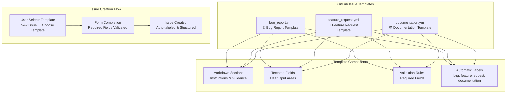
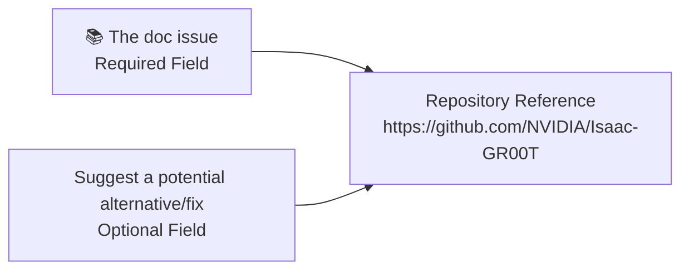
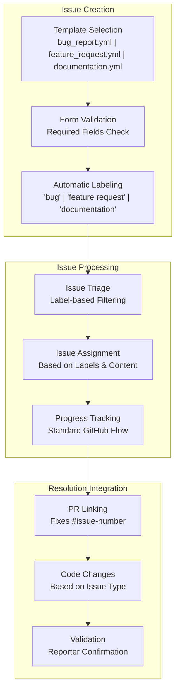

<!-- source: DeepWiki mcp.deepwiki.com · repo NVIDIA/GR00T-Dreams · page 6.1 Issue Management · fetched 2026-10-26 -->

# Issue Management

<details>
<summary>Relevant source files</summary>

The following files were used as context for generating this wiki page:

- [.github/ISSUE_TEMPLATE/bug_report.yml](.github/ISSUE_TEMPLATE/bug_report.yml)
- [.github/ISSUE_TEMPLATE/documentation.yml](.github/ISSUE_TEMPLATE/documentation.yml)
- [.github/ISSUE_TEMPLATE/feature_request.yml](.github/ISSUE_TEMPLATE/feature_request.yml)

</details>


## Purpose and Scope

This document covers the GitHub issue management system implemented in the NVIDIA Isaac-GR00T repository, including structured issue templates, validation requirements, and integration with the development workflow. The system provides standardized templates for bug reports, feature requests, and documentation improvements to ensure consistent issue reporting and efficient triage.

For information about the broader development infrastructure including CI/CD pipelines, see [CI/CD Pipeline](#6.2). For repository configuration details, see [Repository Configuration](#6.3).

## Issue Template System Overview

The repository implements a structured issue management system using GitHub's YAML-based issue templates. This system standardizes the issue reporting process and ensures contributors provide necessary information for effective triage and resolution.

**Issue Template Architecture**



Sources: [.github/ISSUE_TEMPLATE/bug_report.yml:1-47](), [.github/ISSUE_TEMPLATE/feature_request.yml:1-27](), [.github/ISSUE_TEMPLATE/documentation.yml:1-22]()

## Bug Report Template

The bug report template (`bug_report.yml`) provides a comprehensive structure for reporting software defects with automatic labeling and validation requirements.

### Template Configuration

| Field | Type | Required | Purpose |
|-------|------|----------|---------|
| `name` | String | Yes | "🐛 Bug Report" |
| `description` | String | Yes | Template description for selection |
| `labels` | Array | Yes | Automatically applies 'bug' label |

### Template Structure

The bug report template includes multiple sections designed to gather comprehensive debugging information:

**Pre-submission Guidance**
- Markdown section directing users to search existing issues [.github/ISSUE_TEMPLATE/bug_report.yml:6-9]()
- Links to repository issue search with filters

**Bug Description Section**
- Required textarea field for bug description [.github/ISSUE_TEMPLATE/bug_report.yml:10-32]()
- Detailed instructions for minimal reproducible examples
- Code snippet formatting guidelines using Python syntax highlighting
- Alternative option for GitHub Gist links for longer code samples

**Version Information**
- Required textarea for environment details [.github/ISSUE_TEMPLATE/bug_report.yml:33-42]()
- Standardized command: `python --version && pip freeze`
- Ensures consistent version reporting across issues

### Code Example Requirements

The template emphasizes minimal reproducible examples with specific formatting:

```yaml
# Example structure from bug_report.yml
placeholder: |
  # All necessary imports at the beginning
  import gr00t
  
  # A succinct reproducing example trimmed down to the essential parts:
  assert False is True, "Oh no!"
```

Sources: [.github/ISSUE_TEMPLATE/bug_report.yml:10-42]()

## Feature Request Template

The feature request template (`feature_request.yml`) structures enhancement proposals with clear motivation and alternative consideration requirements.

### Template Fields

| Field | Validation | Description |
|-------|------------|-------------|
| "🚀 The feature, motivation and pitch" | Required | Core feature description with business justification |
| "Alternatives" | Optional | Alternative solutions or approaches considered |
| "Additional context" | Optional | Supporting context, screenshots, or examples |

### Motivation Requirements

The template specifically requires motivation context [.github/ISSUE_TEMPLATE/feature_request.yml:8-11]():
- Clear feature description
- Motivation outline
- Problem statement format: *"I'm working on X and would like Y to be possible"*
- Links to related GitHub issues when applicable

Sources: [.github/ISSUE_TEMPLATE/feature_request.yml:1-27]()

## Documentation Issue Template

The documentation template (`documentation.yml`) provides a streamlined process for reporting documentation-related issues with direct repository references.

### Template Structure



### Field Configuration

The template includes two primary input areas:
- **Required field**: Clear description of documentation issues [.github/ISSUE_TEMPLATE/documentation.yml:6-12]()
- **Optional field**: Suggested improvements or fixes [.github/ISSUE_TEMPLATE/documentation.yml:13-17]()

Both fields reference the repository URL directly, ensuring context-specific feedback.

Sources: [.github/ISSUE_TEMPLATE/documentation.yml:1-22]()

## Issue Workflow Integration

The issue templates integrate with the broader development workflow through automatic labeling and structured data collection.

**Issue Processing Workflow**



### Label-Based Organization

Each template automatically applies specific labels for workflow organization:

| Template | Auto-Applied Label | Triage Category |
|----------|-------------------|-----------------|
| `bug_report.yml` | `bug` | Defect Resolution |
| `feature_request.yml` | `feature request` | Enhancement Planning |
| `documentation.yml` | `documentation` | Documentation Updates |

### Integration with Development Process

The issue system connects to the development workflow through:
- **Pre-commit validation**: Issues link to code quality requirements
- **Pull request references**: Standard `Fixes #issue-number` linking
- **Automated testing**: Bug reports inform test case development
- **Documentation updates**: Documentation issues trigger wiki updates

Sources: [.github/ISSUE_TEMPLATE/bug_report.yml:3](), [.github/ISSUE_TEMPLATE/feature_request.yml:3](), [.github/ISSUE_TEMPLATE/documentation.yml:3]()

## Template Configuration Standards

All issue templates follow consistent YAML configuration patterns and validation standards.

### Common Configuration Elements

```yaml
# Standard template structure
name: "Template Display Name"
description: "Template selection description" 
labels: 'auto-applied-label'

body:
- type: markdown
  attributes:
    value: "Instructional content"
- type: textarea
  attributes:
    label: "Field Label"
    description: "Field instructions"
  validations:
    required: true/false
```

### Validation Requirements

The templates implement consistent validation patterns:
- **Required fields**: Core information necessary for issue processing
- **Optional fields**: Additional context and supporting information
- **Format guidelines**: Specific formatting instructions for code snippets and version information
- **Reference links**: Guidance to existing documentation and search functionality

### Template Maintenance

Template updates follow standard repository practices:
- Changes tracked through version control
- Community feedback integration through meta-issues
- Consistency validation across all three templates
- Integration testing with GitHub's template rendering system

Sources: [.github/ISSUE_TEMPLATE/bug_report.yml:1-5](), [.github/ISSUE_TEMPLATE/feature_request.yml:1-5](), [.github/ISSUE_TEMPLATE/documentation.yml:1-5]()

---

