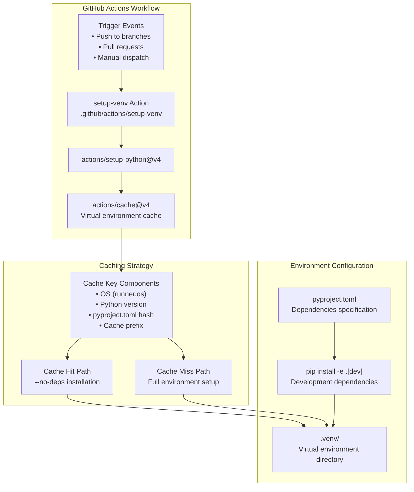
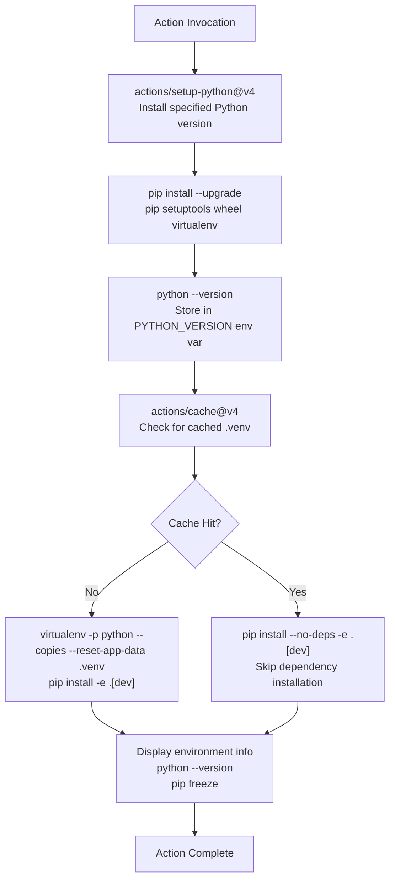
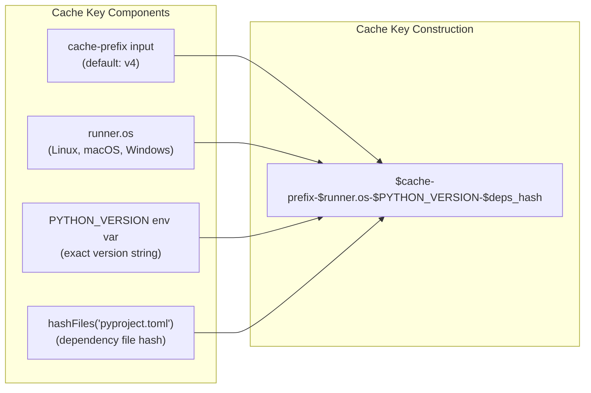

<!-- source: DeepWiki mcp.deepwiki.com · repo NVIDIA/GR00T-Dreams · page 6.2 CI/CD Pipeline · fetched 2026-10-26 -->

# CI/CD Pipeline

<details>
<summary>Relevant source files</summary>

The following files were used as context for generating this wiki page:

- [.github/actions/setup-venv/action.yml](.github/actions/setup-venv/action.yml)

</details>


This document covers the continuous integration and continuous deployment (CI/CD) infrastructure for the NVIDIA Isaac-GR00T repository. The CI/CD system provides automated environment setup, dependency management, and validation processes for development workflows.

For information about development environment setup outside of CI/CD, see [Development Setup](#2.1). For details about contributing guidelines and code quality standards, see [Contributing Guidelines](#2.2).

## Overview

The CI/CD pipeline is built around GitHub Actions and provides automated Python environment management with intelligent caching. The system ensures consistent development environments across different operating systems and Python versions while optimizing build times through dependency caching strategies.

## CI/CD Architecture

The following diagram shows the overall CI/CD architecture and how it integrates with the development workflow:



Sources: [.github/actions/setup-venv/action.yml:1-57]()

## Python Environment Setup Action

The core CI/CD component is the `setup-venv` composite action that handles Python virtual environment creation and management. This action provides a reusable workflow component for consistent environment setup across different CI jobs.

### Action Interface

The `setup-venv` action accepts the following inputs:

| Input | Description | Required | Default |
|-------|-------------|----------|---------|
| `python-version` | The Python version to use | Yes | - |
| `cache-prefix` | Cache invalidation prefix | Yes | `v4` |

### Implementation Details

The action follows a multi-step process for environment setup:



Sources: [.github/actions/setup-venv/action.yml:13-56]()

## Virtual Environment Caching Strategy

The CI/CD system implements an intelligent caching mechanism to optimize build times by reusing virtual environments when dependencies haven't changed.

### Cache Key Generation

The cache key is constructed from multiple components to ensure cache validity:



The cache key format is: `{cache-prefix}-{runner.os}-{PYTHON_VERSION}-{hashFiles('pyproject.toml')}`

Sources: [.github/actions/setup-venv/action.yml:26-33]()

### Cache Behavior Paths

The action implements two distinct installation paths based on cache availability:

**Cache Miss Path** (lines 35-41):
- Creates new virtual environment using `virtualenv -p $(which python) --copies --reset-app-data .venv`
- Installs all dependencies with `pip install -e .[dev]`
- Stores environment in cache for future use

**Cache Hit Path** (lines 43-48):
- Restores virtual environment from cache
- Performs minimal installation with `pip install --no-deps -e .[dev]`
- Skips dependency resolution for faster setup

Sources: [.github/actions/setup-venv/action.yml:35-48]()

## Environment Validation and Reporting

The CI/CD pipeline includes environment validation and reporting to ensure proper setup:

### Validation Steps

1. **Python Version Verification**: Confirms the correct Python version is active
2. **Package Inventory**: Lists all installed packages with `pip freeze`
3. **Environment Path Verification**: Shows the active Python interpreter path

### Output Format

The action provides structured output for debugging and verification:

```
✓ Installed Python X.Y.Z virtual environment to /path/to/python
Packages:
[pip freeze output with all installed packages]
```

Sources: [.github/actions/setup-venv/action.yml:50-56]()

## Integration with Development Workflow

The `setup-venv` action integrates with the broader development infrastructure by providing consistent environment setup for various CI/CD scenarios including automated testing, code quality checks, and deployment processes. The action's caching strategy significantly reduces CI build times while ensuring environment reproducibility across different runners and Python versions.

Sources: [.github/actions/setup-venv/action.yml:1-57]()

---

