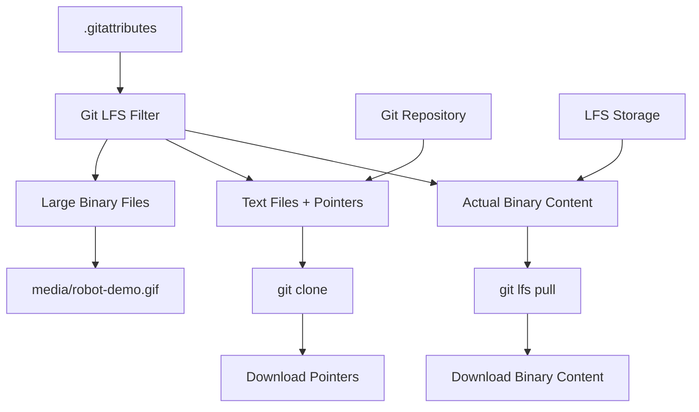
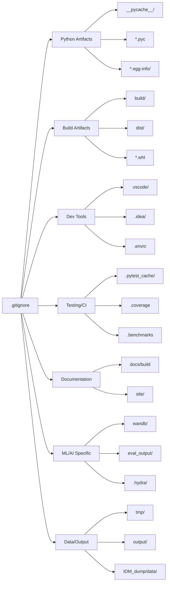
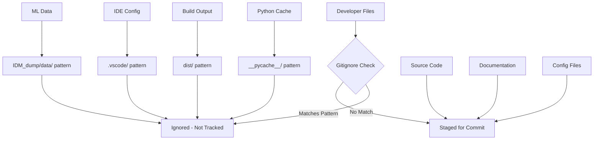
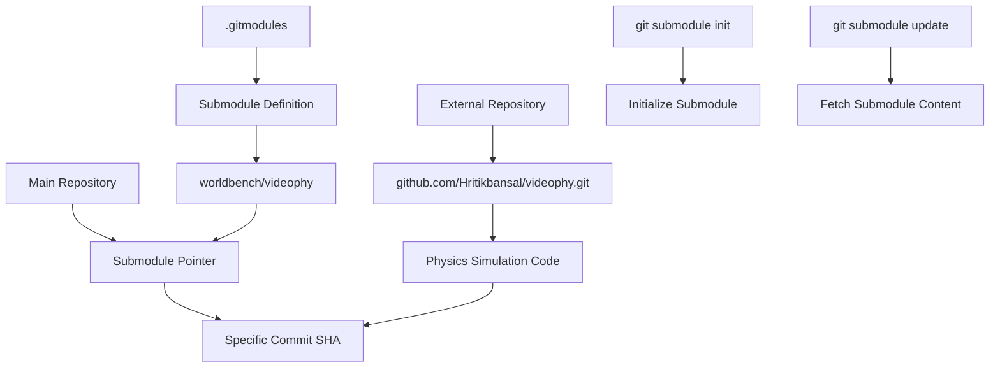
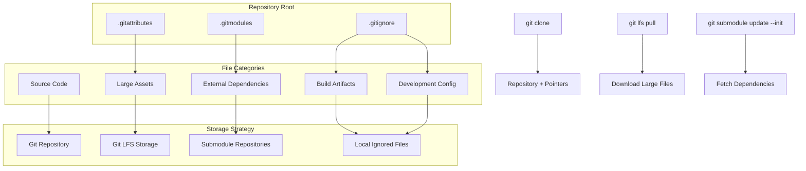

<!-- source: DeepWiki mcp.deepwiki.com · repo NVIDIA/GR00T-Dreams · page 6.3 Repository Configuration · fetched 2026-10-26 -->

# Repository Configuration

Relevant source files

The following files were used as context for generating this wiki page:

- [.gitattributes](.gitattributes)
- [.gitignore](.gitignore)
- [.gitmodules](.gitmodules)

This document covers the Git repository configuration for the NVIDIA Isaac-GR00T codebase, including file management strategies, large file handling, and external dependencies. This configuration ensures clean version control, efficient storage of large assets, and proper integration of external components.

For development environment setup, see [Development Setup](#2.1). For CI/CD pipeline configuration, see [CI/CD Pipeline](#6.2).

## Git LFS Configuration

The repository uses Git Large File Storage (Git LFS) to efficiently handle large binary assets that would otherwise bloat the repository history.

### Large File Tracking

The `.gitattributes` file defines which files are managed by Git LFS:

| File Pattern | LFS Configuration | Purpose |
|--------------|-------------------|---------|
| `media/robot-demo.gif` | `filter=lfs diff=lfs merge=lfs -text` | Demo video asset for documentation |

**Git LFS Configuration Architecture**

The LFS configuration ensures that large demonstration assets don't impact repository clone times or storage efficiency while maintaining version control over these important visual resources.

Sources: [.gitattributes:1-2]()

## Gitignore Strategy

The repository employs a comprehensive `.gitignore` strategy organized into logical categories to prevent unwanted files from being tracked.

### Ignore Categories

**Development Environment Artifacts**

### Critical Data Protection

The gitignore configuration specifically protects sensitive directories:

| Category | Examples | Purpose |
|----------|----------|---------|
| ML Training Data | `IDM_dump/data/`, `demo_data/gr00t-gr1-apple-to-shelf/` | Prevent large datasets from being committed |
| Build Outputs | `output/`, `eval_output/`, `eval-result/` | Exclude generated results and temporary files |
| Development Config | `.hydra/`, `pyrightconfig.json`, `.python-version` | Keep personal dev settings local |
| System Files | `.DS_Store`, `*.swp`, `core.*` | Exclude OS and editor artifacts |

**File Management Protection Flow**

Sources: [.gitignore:1-125]()

## Git Submodules

The repository integrates external dependencies through Git submodules for controlled versioning of third-party components.

### Submodule Configuration

| Submodule Path | Repository URL | Purpose |
|----------------|----------------|---------|
| `worldbench/videophy` | `https://github.com/Hritikbansal/videophy.git` | Physics simulation component for video understanding |

**Submodule Integration Architecture**

### Submodule Management

The `worldbench/videophy` submodule provides physics simulation capabilities that integrate with the video processing pipeline. This external component is version-locked to ensure reproducible builds while allowing controlled updates to the physics engine.

Sources: [.gitmodules:1-4]()

## Repository File Management Overview

The repository configuration creates a systematic approach to file management that balances development efficiency with storage optimization.

**Complete Repository Configuration System**

### Configuration Benefits

This repository configuration provides:

1. **Efficient Cloning**: Large binary files are downloaded on-demand via LFS
2. **Clean History**: Build artifacts and temporary files are automatically excluded
3. **Reproducible Dependencies**: External components are version-locked via submodules
4. **Development Flexibility**: Personal development configurations remain local

The configuration supports the multi-robot data processing pipeline by ensuring that large datasets, model outputs, and training artifacts don't pollute the version control system while maintaining access to essential demo assets and external physics simulation capabilities.

Sources: [.gitattributes:1-2](), [.gitignore:1-125](), [.gitmodules:1-4]()