# Page: Overview

# Overview

<details>
<summary>Relevant source files</summary>

The following files were used as context for generating this wiki page:

- [.gitignore](.gitignore)
- [CONTRIBUTING.md](CONTRIBUTING.md)
- [Dockerfile](Dockerfile)

</details>


This document provides a high-level introduction to the NVIDIA Isaac-GR00T repository, explaining its purpose as a multi-robot instruction-driven model system and outlining the key architectural components. For detailed setup instructions, see [Development Setup](#2.1). For specific robot configurations, see [Robot Embodiments](#5). For deep technical details on the core system, see [Core IDM System](#3).

## Purpose and Scope

The NVIDIA Isaac-GR00T repository is a comprehensive system for training and deploying instruction-following robots across multiple embodiments using Inverse Dynamics Models (IDM). The system processes raw robot demonstration data, converts it to standardized formats, and uses IDM-based approaches to generate robotic actions for various robot platforms including Franka arms, GR1 humanoids, RoboCasa simulations, and SO100 manipulators.

The repository provides:
- Multi-robot data processing pipelines that standardize diverse robot data formats
- IDM-based action prediction and model finetuning capabilities  
- LeRobot format conversion for interoperability with robotics frameworks
- Containerized development environment with PyTorch and CUDA support
- Professional CI/CD infrastructure for collaborative development

## System Architecture

### High-Level Architecture Overview

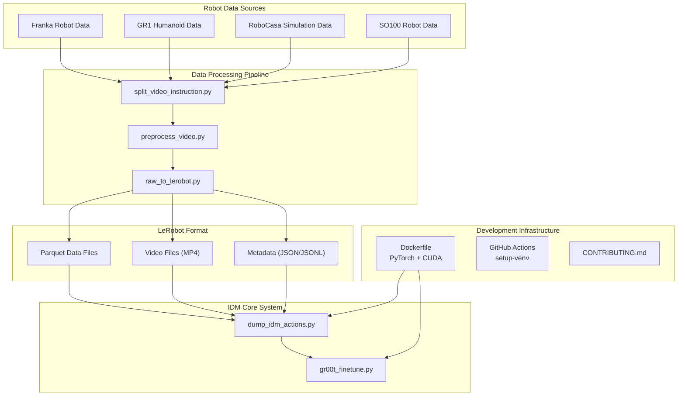

**Sources:** [Dockerfile:1-39](), [CONTRIBUTING.md:1-187](), [.gitignore:121-125]()

### Core Components and Code Mapping

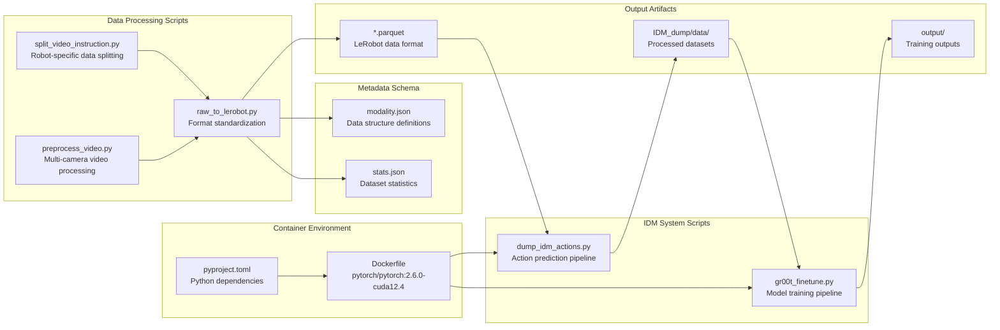

**Sources:** [Dockerfile:22-24](), [.gitignore:122-125]()

## Development Environment  

The system is designed to run in a containerized environment built on PyTorch with CUDA support. The development stack includes:

| Component | Version/Details |
|-----------|----------------|
| Base Image | `pytorch/pytorch:2.6.0-cuda12.4-cudnn9-devel` |
| Python Environment | Python 3.10 with conda/miniconda |
| Key Dependencies | PyTorch 2.5.1, OpenCV 4.8.0, flash_attn 2.7.1 |
| Development Tools | Git LFS, wandb, gpustat |

The [Dockerfile:1-39]() establishes the complete development environment with system dependencies, Python packages, and workspace configuration. The container includes video processing libraries (`ffmpeg`, `libgl1-mesa-glx`) and development utilities (`vim`, `tmux`, `htop`).

**Sources:** [Dockerfile:1-39]()

## Multi-Robot Support

The system supports four distinct robot embodiments, each with specialized data processing and metadata schemas:

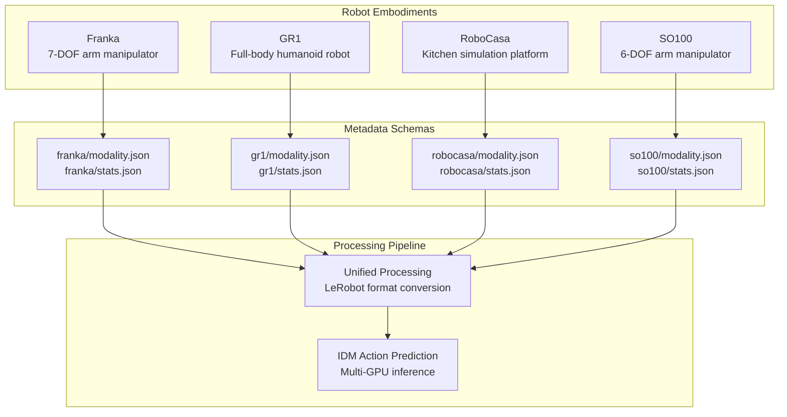

**Sources:** [.gitignore:122]()

## Data Processing Workflow

The core data processing workflow transforms raw robot demonstrations into standardized formats suitable for IDM training:

1. **Data Splitting**: `split_video_instruction.py` separates robot-specific data
2. **Video Preprocessing**: `preprocess_video.py` handles multi-camera video processing and format standardization  
3. **Format Conversion**: `raw_to_lerobot.py` converts to LeRobot parquet format with metadata generation
4. **IDM Processing**: `dump_idm_actions.py` generates action predictions using pre-trained IDM models
5. **Model Finetuning**: `gr00t_finetune.py` performs distributed training for robot-specific models

The system generates artifacts in `IDM_dump/data/` and `output/` directories, with temporary processing files managed through `.gitignore` patterns.

**Sources:** [.gitignore:122-125]()

## Development Infrastructure

The repository includes comprehensive development infrastructure:

- **Issue Management**: Structured GitHub issue templates for bug reports, feature requests, and documentation
- **CI/CD Pipeline**: GitHub Actions workflow with automated environment setup (`setup-venv`)  
- **Code Quality**: Integration with `isort`, `black`, `ruff`, `mypy`, and `pytest` for consistent code standards
- **Containerization**: Docker-based development environment ensuring reproducible builds
- **Git Configuration**: LFS support for large model files and proper artifact exclusion

The [CONTRIBUTING.md:32-147]() provides detailed workflows for fork-based development, testing procedures, and pull request guidelines.

**Sources:** [CONTRIBUTING.md:1-187](), [Dockerfile:1-39](), [.gitignore:1-125]()

## Getting Started

To begin working with the system:

1. **Environment Setup**: Follow [Development Setup](#2.1) for Docker container and virtual environment configuration
2. **Data Processing**: See [Data Processing Pipeline](#4) for converting robot demonstration data  
3. **Robot Configuration**: Consult [Robot Embodiments](#5) for robot-specific setup and processing
4. **IDM Training**: Reference [Core IDM System](#3) for model training and action prediction workflows
5. **Contributing**: Review [Contributing Guidelines](#2.2) for development workflow and code standards

The system is designed for researchers and developers working on instruction-following robotics across multiple robot platforms, with emphasis on scalable data processing and standardized model training pipelines.

**Sources:** [CONTRIBUTING.md:70-90](), [Dockerfile:19-39]()

---

# Page: Getting Started

# Getting Started

<details>
<summary>Relevant source files</summary>

The following files were used as context for generating this wiki page:

- [.github/actions/setup-venv/action.yml](.github/actions/setup-venv/action.yml)
- [CONTRIBUTING.md](CONTRIBUTING.md)
- [Dockerfile](Dockerfile)

</details>


This page provides an overview of how to set up your development environment and begin contributing to the NVIDIA Isaac-GR00T repository. It covers the initial setup process, development workflow, and contribution guidelines at a high level. For detailed setup instructions, see [Development Setup](#2.1). For comprehensive contribution guidelines, see [Contributing Guidelines](#2.2).

## Purpose and Scope

The Getting Started guide helps developers:
- Set up a working development environment for the Isaac-GR00T system
- Understand the available setup options (Docker vs local development)
- Navigate the contribution workflow
- Access the development infrastructure and tools

This page focuses on environment setup and development workflow. For information about the core IDM system architecture, see [Core IDM System](#3). For robot-specific configurations, see [Robot Embodiments](#5).

## Setup Options Overview

The Isaac-GR00T repository supports two primary development approaches:

### Docker-based Development
The repository provides a complete Docker environment with all dependencies pre-configured. This approach ensures consistency across different development machines and simplifies dependency management.

### Local Development
For developers who prefer local development, the repository supports Python virtual environments with detailed dependency specifications in `pyproject.toml`.

## Development Environment Architecture

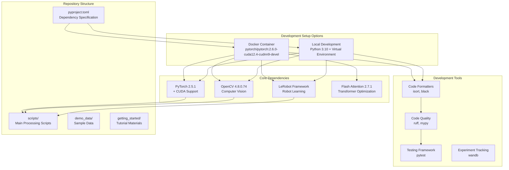

Sources: [Dockerfile:1-39](), [CONTRIBUTING.md:70-86]()

## GitHub Actions Integration

The repository includes automated CI/CD infrastructure that mirrors the local development setup:

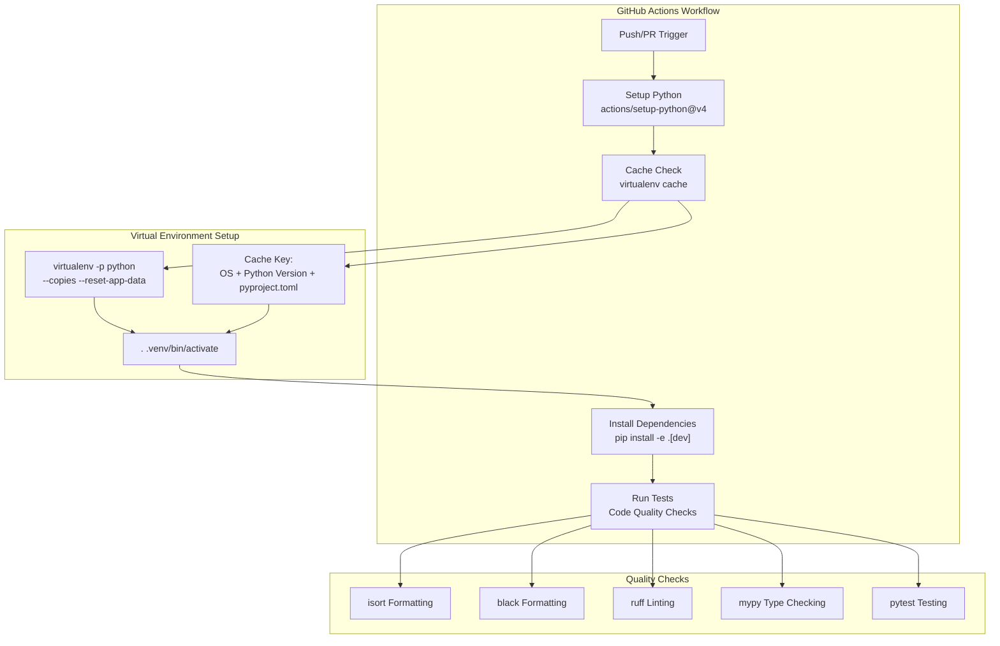

Sources: [.github/actions/setup-venv/action.yml:1-57](), [CONTRIBUTING.md:122-142]()

## Contribution Workflow

The repository follows a standard GitHub fork-and-pull-request workflow with automated quality checks:

| Stage | Action | Tools/Commands |
|-------|--------|----------------|
| **Setup** | Fork repository and clone locally | `git clone`, `git remote add upstream` |
| **Environment** | Create Python virtual environment | `conda create -n isaac-gr00t python=3.10` |
| **Dependencies** | Install project in editable mode | `pip install -e .[dev]` |
| **Development** | Create feature branch | `git checkout -b BRANCH` |
| **Quality** | Format and lint code | `isort .`, `black .`, `ruff check .` |
| **Testing** | Run test suite | `pytest -v tests/` |
| **Submission** | Create pull request | GitHub PR with clear description |

## Key Development Commands

Once your environment is set up, these are the essential commands for development:

```bash
# Code formatting
isort .
black .

# Code quality checks
ruff check .

# Type checking (if applicable)
mypy .

# Run tests
pytest -v tests/

# Install in editable mode
pip install -e .[dev]
```

## Environment Variables and Configuration

The Docker environment sets up several important environment variables:

| Variable | Value | Purpose |
|----------|-------|---------|
| `PYTHONPATH` | `/workspace:${PYTHONPATH}` | Python module resolution |
| `DEBIAN_FRONTEND` | `noninteractive` | Non-interactive package installation |
| `WORKDIR` | `/workspace` | Primary working directory |

## Next Steps

After completing the initial setup:

1. **Detailed Setup**: Follow the comprehensive setup instructions in [Development Setup](#2.1)
2. **Contributing**: Review the full contribution guidelines in [Contributing Guidelines](#2.2)
3. **Understanding the System**: Explore the [Core IDM System](#3) to understand the architecture
4. **Data Processing**: Learn about the [Data Processing Pipeline](#4) for working with robot data
5. **Robot Support**: Review [Robot Embodiments](#5) for robot-specific configurations

## Dependencies and System Requirements

The Isaac-GR00T system requires:
- **Python**: 3.10 (specified in virtual environment setup)
- **CUDA**: 12.4 (for GPU acceleration)
- **PyTorch**: 2.5.1+ with CUDA support
- **System Libraries**: OpenGL, Vulkan development libraries
- **Development Tools**: Git, Git LFS, FFmpeg

The complete dependency specification is maintained in `pyproject.toml` and the Docker environment provides all system-level dependencies pre-configured.

Sources: [CONTRIBUTING.md:1-187](), [Dockerfile:1-39](), [.github/actions/setup-venv/action.yml:1-57]()

---

# Page: Development Setup

# Development Setup

<details>
<summary>Relevant source files</summary>

The following files were used as context for generating this wiki page:

- [.github/actions/setup-venv/action.yml](.github/actions/setup-venv/action.yml)
- [.gitignore](.gitignore)
- [Dockerfile](Dockerfile)

</details>


This document provides detailed instructions for configuring the development environment for the NVIDIA Isaac-GR00T repository. It covers Docker-based development setup, local virtual environment configuration, and dependency management required for the IDM (Inverse Dynamics Model) system and multi-robot data processing pipeline.

For information about contributing code and development workflow, see [Contributing Guidelines](#2.2). For robot-specific setup procedures, see [Robot Embodiments](#5).

## Setup Options Overview

The repository supports two primary development environment configurations:

| Setup Method | Use Case | Key Benefits |
|--------------|----------|--------------|
| Docker Container | Production-like development, GPU workflows | Consistent environment, CUDA support, isolated dependencies |
| Local Virtual Environment | Rapid development, debugging | Fast iteration, native IDE integration, easier debugging |

## Docker Environment Setup

The Docker-based setup provides a complete development environment with PyTorch, CUDA support, and all required dependencies pre-configured.

### Docker Architecture

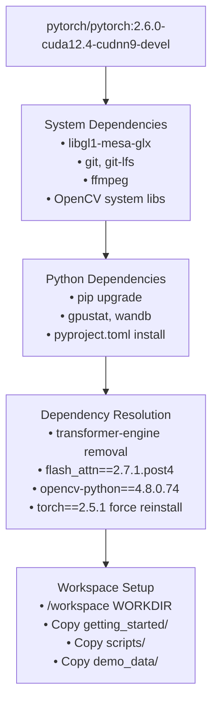

### Docker Build Process

The Docker environment is defined in [Dockerfile:1-39]() and includes:

1. **Base Image**: PyTorch 2.6.0 with CUDA 12.4 and cuDNN 9 support
2. **System Dependencies Installation**: [Dockerfile:6-15]()
   - Graphics libraries (`libgl1-mesa-glx`)
   - Development tools (`git`, `cmake`, `build-essential`)
   - Media processing (`ffmpeg`)
   - OpenCV system dependencies

3. **Python Environment Setup**: [Dockerfile:17-32]()
   - Package manager upgrades
   - Monitoring tools (`gpustat`, `wandb==0.19.0`)
   - Project dependencies from `pyproject.toml`

4. **Dependency Conflict Resolution**: [Dockerfile:25-32]()
   - Removes conflicting `transformer-engine`
   - Installs specific versions of critical packages
   - Force reinstalls PyTorch stack with compatible versions

### Docker Usage

```bash
# Build the Docker image
docker build -t gr00t-dreams .

# Run with GPU support and volume mounting
docker run --gpus all -v $(pwd):/workspace -it gr00t-dreams bash
```

Sources: [Dockerfile:1-39]()

## Local Virtual Environment Setup

The repository includes automated virtual environment setup through GitHub Actions that can be replicated locally.

### Virtual Environment Architecture

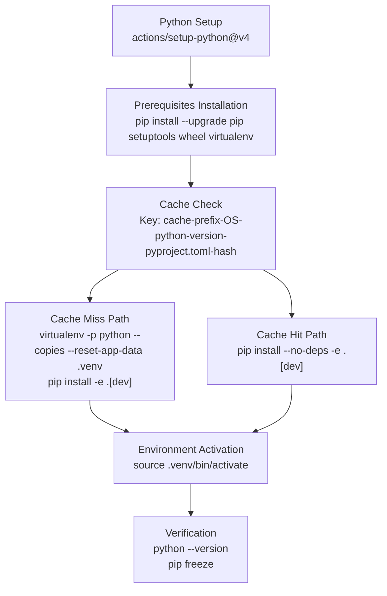

### Setup Process

The virtual environment setup follows the process defined in [.github/actions/setup-venv/action.yml:1-57]():

1. **Python Installation**: [.github/actions/setup-venv/action.yml:14-17]()
   - Uses `actions/setup-python@v4`
   - Configurable Python version via input parameter

2. **Prerequisites Installation**: [.github/actions/setup-venv/action.yml:19-23]()
   - Upgrades `pip`, `setuptools`, `wheel`, `virtualenv`

3. **Cache Management**: [.github/actions/setup-venv/action.yml:29-33]()
   - Cache key includes OS, Python version, and `pyproject.toml` hash
   - Cached path: `.venv` directory

4. **Environment Creation**: 
   - **Without cache**: [.github/actions/setup-venv/action.yml:35-41]()
     - Creates new virtual environment with `--copies --reset-app-data`
     - Installs project with development dependencies: `pip install -e .[dev]`
   
   - **With cache**: [.github/actions/setup-venv/action.yml:43-48]()
     - Installs without dependencies: `pip install --no-deps -e .[dev]`

5. **Verification**: [.github/actions/setup-venv/action.yml:50-56]()
   - Displays Python version and package list

### Local Setup Commands

```bash
# Create virtual environment
python -m virtualenv -p $(which python) --copies --reset-app-data .venv

# Activate environment
source .venv/bin/activate

# Install development dependencies
pip install -e .[dev]
```

Sources: [.github/actions/setup-venv/action.yml:1-57]()

## Development Dependencies

### Dependency Management Strategy

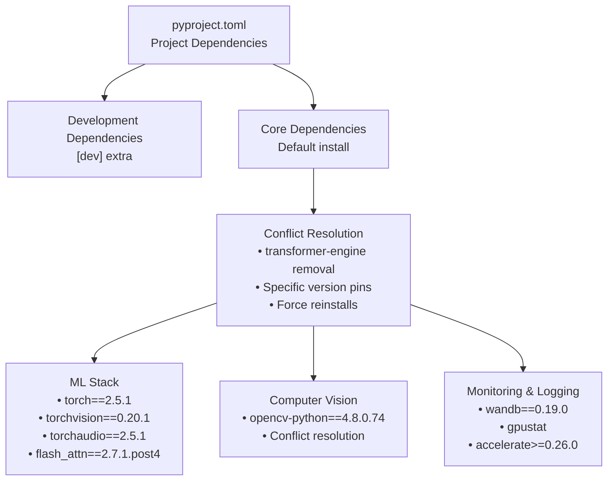

### Critical Dependency Versions

The Docker setup specifies exact versions for compatibility:

| Package | Version | Reason |
|---------|---------|---------|
| `torch` | 2.5.1 | Force reinstall for compatibility |
| `flash_attn` | 2.7.1.post4 | Replaces transformer-engine |
| `opencv-python` | 4.8.0.74 | Resolves OpenCV conflicts |
| `wandb` | 0.19.0 | Experiment tracking |
| `accelerate` | >=0.26.0 | Distributed training support |
| `numpy` | 1.26.4 | Numerical computing compatibility |

Sources: [Dockerfile:17-38]()

## Environment Verification

### Verification Checklist

After setup completion, verify the environment using these steps:

1. **Python Environment**: 
   ```bash
   python --version  # Should show configured version
   which python      # Should point to virtual environment
   ```

2. **Core Dependencies**:
   ```bash
   pip freeze | grep torch     # Verify PyTorch installation
   pip freeze | grep opencv    # Verify OpenCV installation
   pip freeze | grep wandb     # Verify monitoring tools
   ```

3. **GPU Support** (if applicable):
   ```bash
   python -c "import torch; print(torch.cuda.is_available())"
   gpustat  # Should show GPU information
   ```

### Excluded Files and Directories

The development setup excludes certain files and directories via [.gitignore:1-125]():

| Category | Patterns | Purpose |
|----------|----------|---------|
| Python artifacts | `__pycache__`, `*.pyc`, `*.egg-info` | Build artifacts |
| Development tools | `.venv/`, `.mypy_cache`, `.ruff_cache/` | Tool caches |
| IDE files | `.vscode/`, `.idea`, `pyrightconfig.json` | Editor configs |
| Data directories | `demo_data/`, `output/`, `IDM_dump/data/` | Large data files |
| ML outputs | `wandb`, `.hydra/`, `eval_output/` | Training artifacts |

Sources: [.gitignore:1-125]()

## Next Steps

After completing the development setup:

1. Review [Contributing Guidelines](#2.2) for code quality standards and workflow
2. Explore [Core IDM System](#3) for understanding the main processing pipeline  
3. Check [Robot Embodiments](#5) for robot-specific setup requirements
4. Refer to [Data Processing Pipeline](#4) for data processing workflows

Sources: [.github/actions/setup-venv/action.yml:1-57](), [Dockerfile:1-39](), [.gitignore:1-125]()

---

# Page: Contributing Guidelines

# Contributing Guidelines

<details>
<summary>Relevant source files</summary>

The following files were used as context for generating this wiki page:

- [.github/pull_request_template.md](.github/pull_request_template.md)
- [CONTRIBUTING.md](CONTRIBUTING.md)

</details>


This document provides comprehensive guidelines for contributing code to the NVIDIA Isaac-GR00T repository. It covers the complete development workflow from initial setup through pull request submission, including code quality standards, testing requirements, and development best practices.

For information about setting up the development environment and dependencies, see [Development Setup](#2.1). For details about the CI/CD pipeline and automated testing infrastructure, see [CI/CD Pipeline](#6.2).

## Contributing Workflow Overview

The contributing process follows a standard GitHub fork-and-pull-request workflow with specific quality gates and testing requirements.

### Development Process Flow

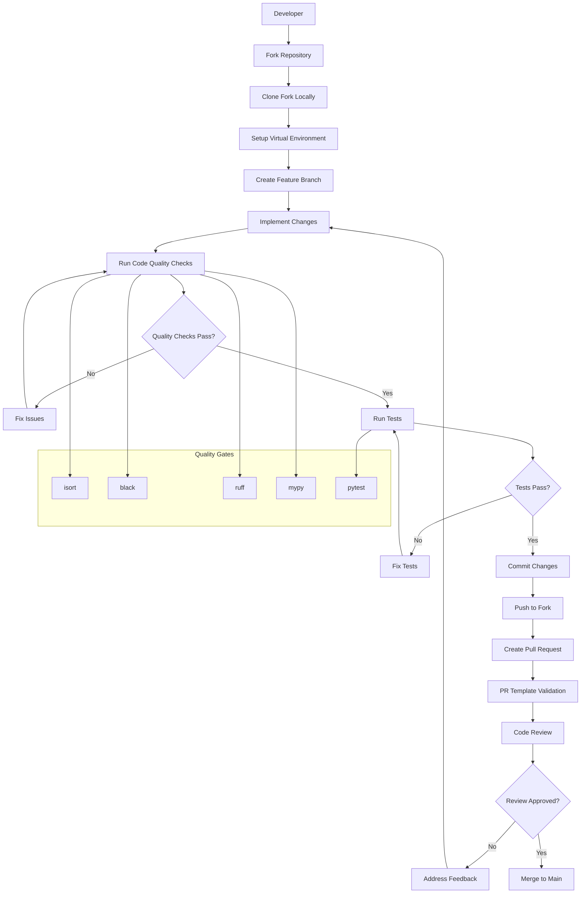

Sources: [CONTRIBUTING.md:32-147](), [.github/pull_request_template.md:1-18]()

## Initial Setup Requirements

### Repository Setup

Contributors must follow a specific fork-and-clone workflow to maintain proper upstream tracking.

| Step | Command | Purpose |
|------|---------|---------|
| Fork Repository | Web interface | Create personal copy on GitHub |
| Clone Fork | `git clone https://github.com/USERNAME/Isaac-GR00T.git` | Local development copy |
| Add Upstream | `git remote add upstream https://github.com/NVIDIA/Isaac-GR00T.git` | Track main repository |
| Verify Remotes | `git remote -v` | Confirm upstream configuration |

Sources: [CONTRIBUTING.md:40-68]()

### Python Environment Setup

The project requires Python 3.10 with a virtual environment for dependency isolation:

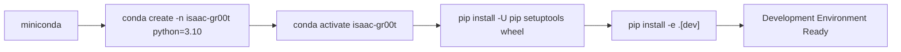

The editable installation (`-e` flag) creates symbolic links enabling immediate reflection of code changes in the virtual environment.

Sources: [CONTRIBUTING.md:70-89]()

## Code Quality Standards

### Formatting and Linting Tools

The project enforces strict code quality standards through automated tools that must pass before PR submission:

| Tool | Purpose | Command | Configuration |
|------|---------|---------|---------------|
| `isort` | Import sorting | `isort .` | Alphabetical import organization |
| `black` | Code formatting | `black .` | PEP 8 compliant formatting |
| `ruff` | Linting | `ruff check .` | Code quality analysis |
| `mypy` | Type checking | `mypy` | Static type validation |

### Pre-commit Workflow

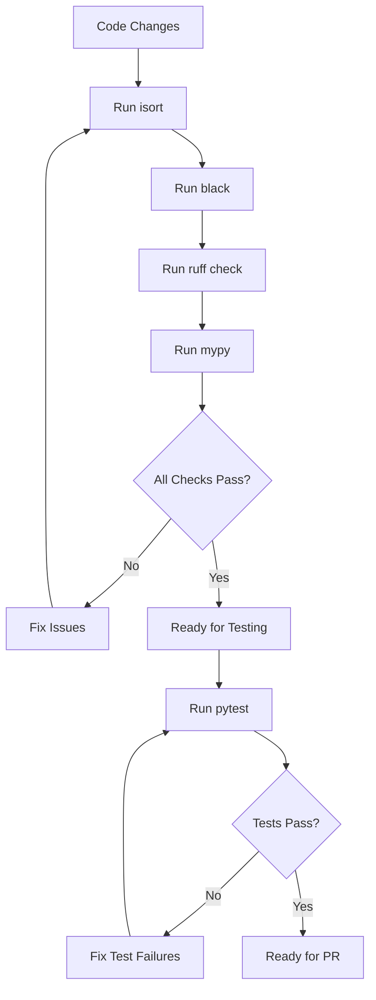

Many IDEs support these formatters as plugins for automatic execution on file save. The CI system runs identical checks to ensure consistency.

Sources: [CONTRIBUTING.md:124-137]()

## Pull Request Process

### PR Template Requirements

All pull requests must use the provided template and complete the mandatory checklist:

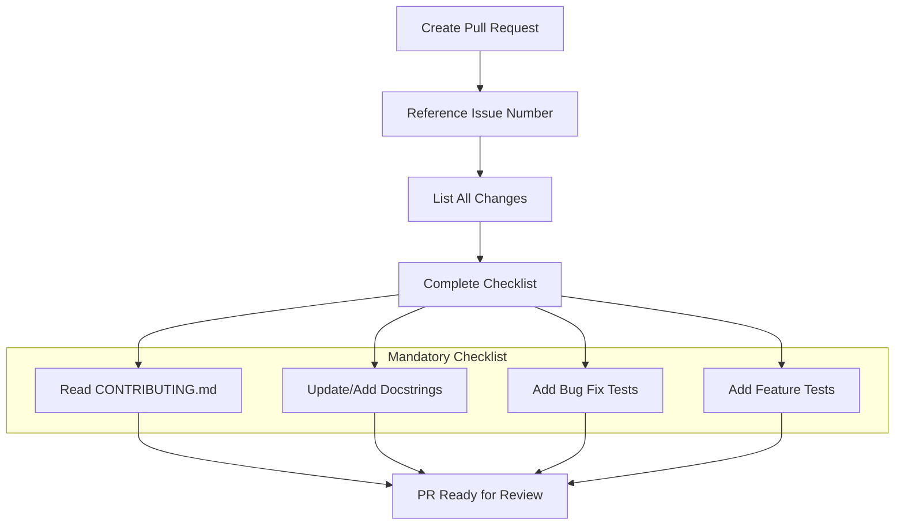

The template enforces linking to issues using "Fixes #" or "Closes #" syntax for automatic issue closure upon merge.

Sources: [.github/pull_request_template.md:1-18]()

### Branch Management Strategy

Contributors must follow specific branching practices to maintain repository cleanliness:

| Practice | Command | Rationale |
|----------|---------|-----------|
| Avoid direct main commits | `git checkout -b BRANCH` | Maintain clean main branch |
| Sync before branching | `git pull --rebase upstream main` | Prevent merge conflicts |
| Push with upstream tracking | `git push -u origin BRANCH` | Enable PR creation |

Sources: [CONTRIBUTING.md:104-116]()

## Testing Requirements

### Test Coverage Standards

The project maintains high test coverage standards requiring comprehensive test additions for all contributions:

- **Bug fixes**: Must include tests that fail without the fix
- **New features**: Must include tests covering new functionality sufficiently
- **Existing functionality changes**: Must update corresponding tests

### Test Execution

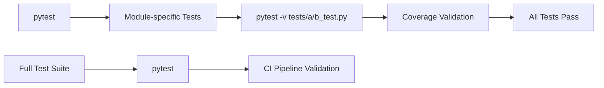

Contributors should run tests locally before PR submission to accelerate the review process.

Sources: [CONTRIBUTING.md:136-142]()

## Fork Synchronization

### Keeping Fork Updated

Regular synchronization with the upstream repository prevents merge conflicts and ensures current codebase alignment:

```bash
git checkout main
git pull --rebase upstream main
git push
```

This three-command sequence updates the local main branch, applies upstream changes, and propagates updates to the forked repository.

Sources: [CONTRIBUTING.md:92-102]()

## Developer Certificate of Origin

All contributions require adherence to the Developer Certificate of Origin (DCO) version 1.1, which certifies contributor rights to submit code under the project's open source license. The DCO covers four key areas:

1. **Original work**: Contributor created the work with submission rights
2. **Derivative work**: Based on appropriately licensed previous work
3. **Third-party contributions**: Received from certified contributors
4. **Public record understanding**: Acceptance of permanent public contribution record

The DCO ensures legal compliance for all contributions and maintains project integrity for redistribution under open source licenses.

Sources: [CONTRIBUTING.md:149-186]()

---

# Page: Core IDM System

# Core IDM System

<details>
<summary>Relevant source files</summary>

The following files were used as context for generating this wiki page:

- [IDM_dump/dump_idm_actions.py](IDM_dump/dump_idm_actions.py)
- [IDM_dump/raw_to_lerobot.py](IDM_dump/raw_to_lerobot.py)
- [IDM_dump/scripts/finetune/franka.sh](IDM_dump/scripts/finetune/franka.sh)
- [IDM_dump/scripts/finetune/gr1.sh](IDM_dump/scripts/finetune/gr1.sh)

</details>


## Purpose and Scope

The Core IDM System implements the Inverse Dynamics Model (IDM) for robotic action prediction and model finetuning across multiple robot embodiments. This system serves as the central processing engine for converting raw robot demonstrations into actionable predictions and training improved models.

This document covers the IDM architecture, action prediction pipeline, and finetuning capabilities. For data preprocessing and format conversion, see [Data Processing Pipeline](#4). For robot-specific configurations, see [Robot Embodiments](#5).

## IDM Architecture Overview

The IDM system consists of three primary components: action prediction, model finetuning, and multi-GPU processing orchestration. The system is designed to handle large-scale datasets across different robot embodiments using distributed processing.

### Core IDM Components

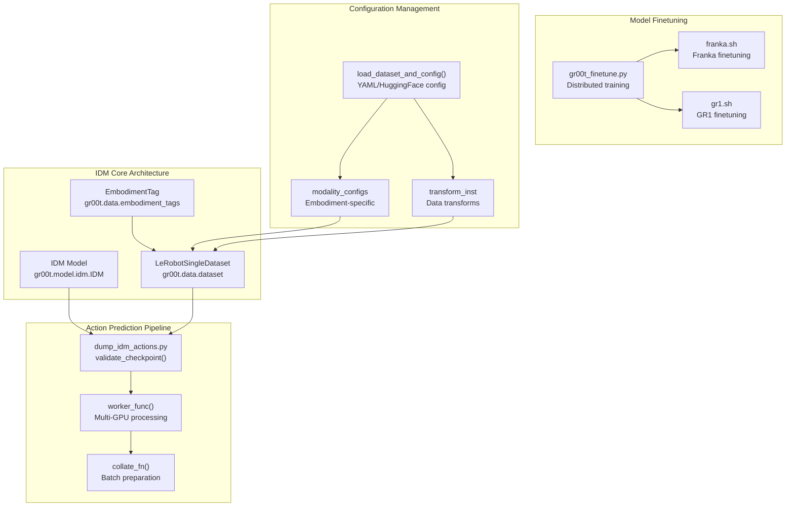

**Sources:** [IDM_dump/dump_idm_actions.py:1-476](), [IDM_dump/scripts/finetune/franka.sh:1-2](), [IDM_dump/scripts/finetune/gr1.sh:1-3]()

## Action Prediction Pipeline

The action prediction pipeline processes robot trajectories through the IDM model to generate predicted actions. The system supports both local checkpoints and HuggingFace model repositories.

### IDM Action Prediction Workflow

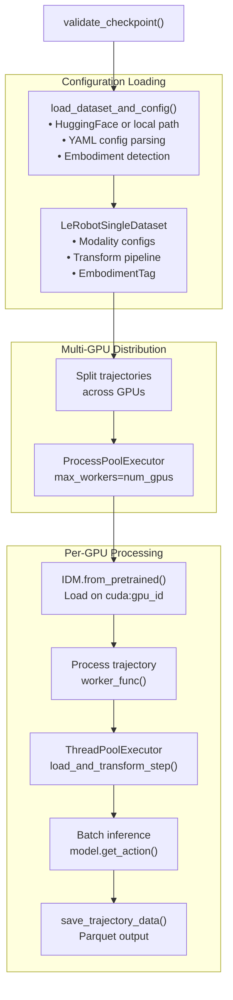

**Sources:** [IDM_dump/dump_idm_actions.py:298-382](), [IDM_dump/dump_idm_actions.py:141-297]()

### Data Processing and Batch Preparation

The system implements efficient data loading with video preprocessing and batch collation for GPU inference:

| Component | Function | Key Features |
|-----------|----------|--------------|
| `get_step_data()` | [IDM_dump/dump_idm_actions.py:113-127]() | Extracts state, action, language data |
| `load_and_transform_step()` | [IDM_dump/dump_idm_actions.py:176-191]() | Video frame extraction and transforms |
| `collate_fn()` | [IDM_dump/dump_idm_actions.py:100-111]() | Batch tensor preparation for GPU |
| `get_all_frames_and_timestamps()` | [IDM_dump/dump_idm_actions.py:199]() | Video backend processing |

**Sources:** [IDM_dump/dump_idm_actions.py:100-127](), [IDM_dump/dump_idm_actions.py:176-200]()

## Model Finetuning System

The IDM system supports distributed model finetuning across different robot embodiments using the `gr00t_finetune.py` script with embodiment-specific configurations.

### Finetuning Configuration

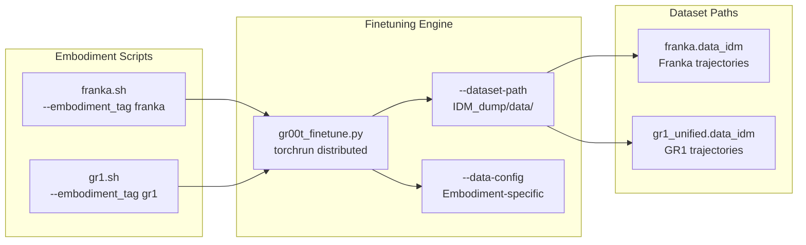

**Sources:** [IDM_dump/scripts/finetune/franka.sh:1-2](), [IDM_dump/scripts/finetune/gr1.sh:1-3]()

### Embodiment-Specific Processing

The system automatically detects and configures processing parameters based on the dataset embodiment:

| Embodiment | EmbodimentTag | Data Config | Features |
|------------|---------------|-------------|----------|
| Franka | `EmbodimentTag.FRANKA` | `franka` | 7-DOF arm control |
| GR1 | `EmbodimentTag.GR1_unified` | `gr1_arms_waist` | Humanoid body control |
| SO100 | `EmbodimentTag.SO100` | `so100` | 6-DOF arm control |
| RoboCasa | `EmbodimentTag.ROBOCASA` | `robocasa` | Kitchen simulation |

**Sources:** [IDM_dump/dump_idm_actions.py:78-87]()

## Multi-GPU Processing Architecture

The IDM system implements efficient multi-GPU processing for large-scale action prediction using process-based parallelism with CUDA device assignment.

### GPU Processing Distribution

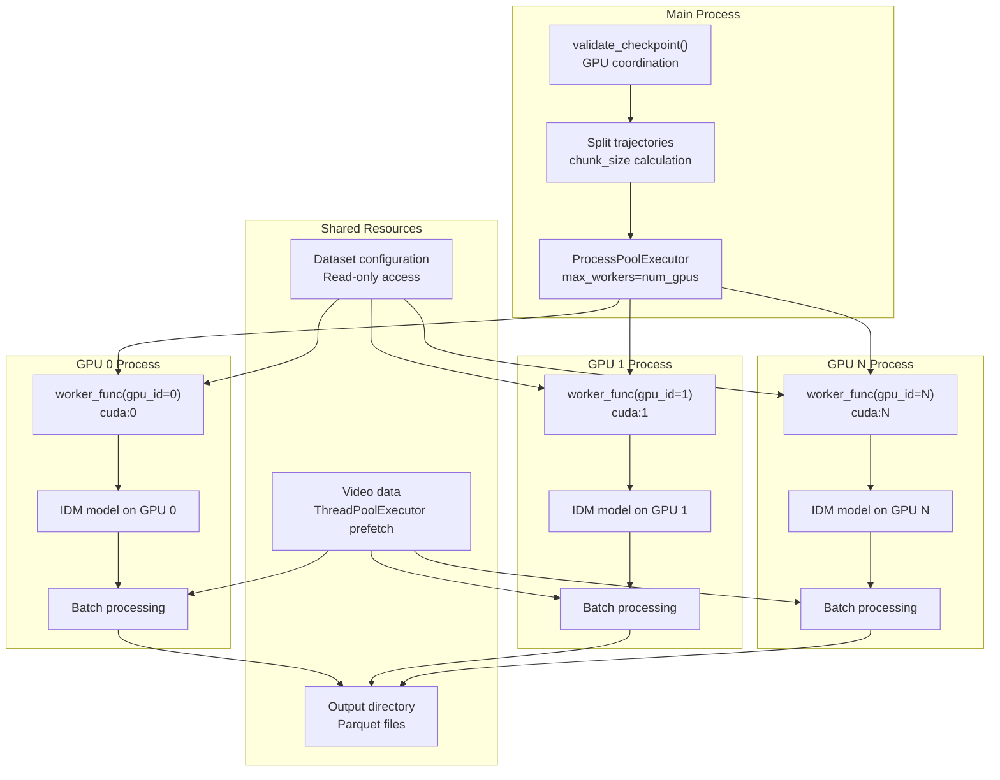

**Sources:** [IDM_dump/dump_idm_actions.py:308-382](), [IDM_dump/dump_idm_actions.py:141-297]()

### Performance Optimization Features

The system includes several optimization strategies for efficient processing:

- **Process-based Parallelism**: Uses `multiprocessing.set_start_method("spawn")` for GPU isolation
- **ThreadPoolExecutor Prefetching**: Concurrent video frame loading within each GPU process
- **Batch Processing**: Configurable batch sizes for memory optimization
- **CUDA Memory Management**: Automatic `torch.cuda.empty_cache()` after processing
- **Chunked Output**: Trajectories saved in chunks to prevent memory overflow

**Sources:** [IDM_dump/dump_idm_actions.py:436](), [IDM_dump/dump_idm_actions.py:203-212](), [IDM_dump/dump_idm_actions.py:380-381](), [IDM_dump/dump_idm_actions.py:129-137]()

## Configuration and Model Loading

The IDM system supports flexible model loading from both local checkpoints and HuggingFace repositories with automatic configuration detection.

### Model Loading Pipeline

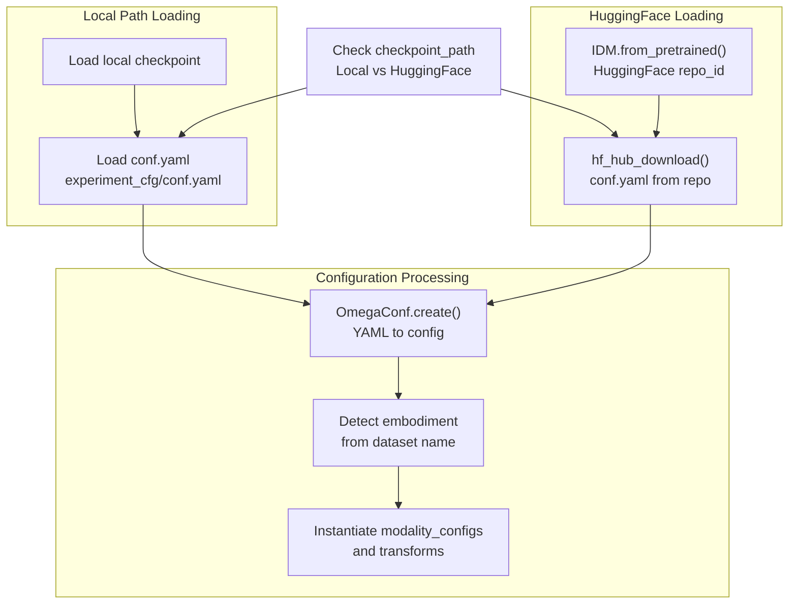

**Sources:** [IDM_dump/dump_idm_actions.py:22-97](), [IDM_dump/dump_idm_actions.py:156-162]()

---

# Page: IDM Architecture

# IDM Architecture

<details>
<summary>Relevant source files</summary>

The following files were used as context for generating this wiki page:

- [IDM_dump/dump_idm_actions.py](IDM_dump/dump_idm_actions.py)
- [IDM_dump/raw_to_lerobot.py](IDM_dump/raw_to_lerobot.py)

</details>


## Purpose and Scope

This document covers the core architecture of the Inverse Dynamics Model (IDM) system within the NVIDIA Isaac-GR00T repository. The IDM system is responsible for predicting robot actions from observation data across multiple robot embodiments, utilizing distributed GPU processing for efficient inference.

For information about specific robot embodiment configurations, see [Supported Robots Overview](#5.1). For details on data preprocessing before IDM processing, see [Data Processing Pipeline](#4). For model finetuning procedures, see [Model Finetuning](#3.3).

## Core IDM Components

The IDM architecture consists of several key components that work together to provide scalable action prediction across different robot platforms:

| Component | Primary Class/Function | Purpose |
|-----------|----------------------|---------|
| Model Loading | `IDM.from_pretrained()` | Load pre-trained IDM models from checkpoints or HuggingFace repos |
| Dataset Interface | `LeRobotSingleDataset` | Handle robot data with modality-specific processing |
| Multi-GPU Coordinator | `validate_checkpoint()` | Orchestrate distributed processing across GPUs |
| Worker Processes | `worker_func()` | Execute IDM inference on individual GPU devices |
| Data Collation | `collate_fn()` | Batch processing for efficient GPU utilization |
| Configuration Management | `load_dataset_and_config()` | Handle embodiment-specific configurations |

Sources: [IDM_dump/dump_idm_actions.py:16](), [IDM_dump/dump_idm_actions.py:89](), [IDM_dump/dump_idm_actions.py:298](), [IDM_dump/dump_idm_actions.py:141](), [IDM_dump/dump_idm_actions.py:100](), [IDM_dump/dump_idm_actions.py:22]()

## Architecture Overview

The IDM system follows a distributed processing architecture that can handle multiple robot embodiments simultaneously:

### IDM Processing Architecture

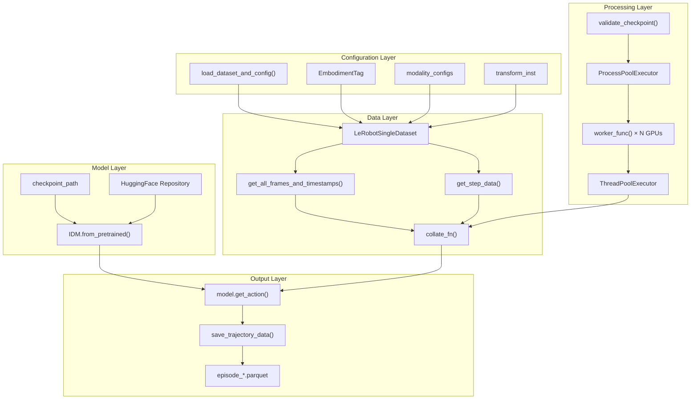

Sources: [IDM_dump/dump_idm_actions.py:22-97](), [IDM_dump/dump_idm_actions.py:141-297](), [IDM_dump/dump_idm_actions.py:298-382]()

## Model Loading and Configuration

The IDM system supports flexible model loading from both local checkpoints and HuggingFace repositories:

### Model Loading Pipeline

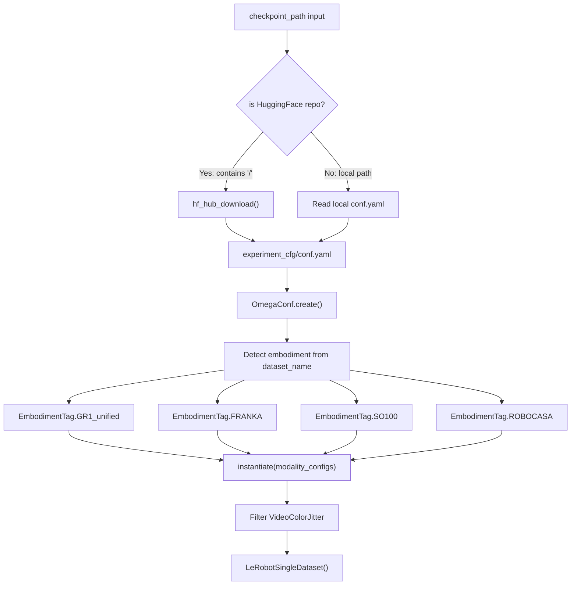

The configuration loading process handles both local and remote model sources. The system automatically detects the robot embodiment and applies appropriate modality configurations:

```python
# Embodiment detection logic
if "gr1" in embodiment:
    embodiment_tag = EmbodimentTag.GR1_unified
elif "franka" in embodiment:
    embodiment_tag = EmbodimentTag.FRANKA
elif "so100" in embodiment:
    embodiment_tag = EmbodimentTag.SO100
elif "robocasa" in embodiment:
    embodiment_tag = EmbodimentTag.ROBOCASA
```

Sources: [IDM_dump/dump_idm_actions.py:22-97](), [IDM_dump/dump_idm_actions.py:78-87]()

## Multi-GPU Processing Pipeline

The IDM system implements a sophisticated multi-GPU processing pipeline that distributes trajectory processing across available GPUs:

### Multi-GPU Coordination

```mermaid
graph TB
    subgraph "Main Process"
        VALIDATE_CHECKPOINT["validate_checkpoint()"]
        TRAJECTORY_SPLIT["Split trajectories by GPU"]
        PROCESS_POOL_EXECUTOR["ProcessPoolExecutor"]
    end
    
    subgraph "GPU 0 Process"
        WORKER_0["worker_func(gpu_id=0)"]
        MODEL_LOAD_0["IDM.from_pretrained()"]
        THREAD_POOL_0["ThreadPoolExecutor(num_workers)"]
        CUDA_0["cuda:0"]
    end
    
    subgraph "GPU N Process" 
        WORKER_N["worker_func(gpu_id=N)"]
        MODEL_LOAD_N["IDM.from_pretrained()"]
        THREAD_POOL_N["ThreadPoolExecutor(num_workers)"]
        CUDA_N["cuda:N"]
    end
    
    subgraph "Data Processing"
        LOAD_TRANSFORM["load_and_transform_step()"]
        GET_STEP_DATA["get_step_data()"]
        VIDEO_FRAMES["get_all_frames_and_timestamps()"]
        BATCH_COLLATE["collate_fn()"]
    end
    
    VALIDATE_CHECKPOINT --> TRAJECTORY_SPLIT
    TRAJECTORY_SPLIT --> PROCESS_POOL_EXECUTOR
    PROCESS_POOL_EXECUTOR --> WORKER_0
    PROCESS_POOL_EXECUTOR --> WORKER_N
    
    WORKER_0 --> MODEL_LOAD_0
    WORKER_N --> MODEL_LOAD_N
    MODEL_LOAD_0 --> CUDA_0
    MODEL_LOAD_N --> CUDA_N
    
    WORKER_0 --> THREAD_POOL_0
    WORKER_N --> THREAD_POOL_N
    
    THREAD_POOL_0 --> LOAD_TRANSFORM
    THREAD_POOL_N --> LOAD_TRANSFORM
    LOAD_TRANSFORM --> GET_STEP_DATA
    LOAD_TRANSFORM --> VIDEO_FRAMES
    
    GET_STEP_DATA --> BATCH_COLLATE
    VIDEO_FRAMES --> BATCH_COLLATE
```

The trajectory distribution logic ensures balanced workload across GPUs:

```python
# GPU workload distribution
chunk_size = (len(trajectory_ids) + num_gpus - 1) // num_gpus
tasks_by_gpu = {}
for i in range(num_gpus):
    start = i * chunk_size
    end = min(start + chunk_size, len(trajectory_ids))
    gpu_traj_list = trajectory_ids[start:end]
    tasks_by_gpu[i] = gpu_traj_list
```

Sources: [IDM_dump/dump_idm_actions.py:298-382](), [IDM_dump/dump_idm_actions.py:331-341](), [IDM_dump/dump_idm_actions.py:344-361]()

## Data Flow and Processing

The IDM system processes robot trajectory data through several stages, from raw video and state data to predicted actions:

### Data Processing Flow

```mermaid
flowchart TD
    subgraph "Input Data"
        TRAJECTORY_DATA["trajectory_data"]
        VIDEO_PATH["video_path"]
        TIMESTAMP["timestamp"]
        MODALITY_KEYS["dataset.modality_keys"]
    end
    
    subgraph "Video Processing"
        GET_ALL_FRAMES["get_all_frames_and_timestamps()"]
        VIDEO_BACKEND["video_backend"]
        WHOLE_INDICES["whole_indices"]
        DELTA_INDICES["dataset.delta_indices"]
    end
    
    subgraph "Step Processing"
        GET_STEP_DATA_FUNC["get_step_data()"]
        VIDEO_MODALITY["modality: video"]
        STATE_MODALITY["modality: state/action"]
        LANGUAGE_MODALITY["modality: language"]
    end
    
    subgraph "Batch Processing"
        LOAD_TRANSFORM_STEP["load_and_transform_step()"]
        TRANSFORMS["dataset.transforms()"]
        COLLATE_FN["collate_fn()"]
        BATCH_DICT["batch_dict"]
    end
    
    subgraph "IDM Inference"
        MODEL_GET_ACTION["model.get_action()"]
        ACTION_PRED["out['action_pred']"]
        UNAPPLY_TRANSFORMS["transforms.unapply()"]
    end
    
    TRAJECTORY_DATA --> GET_ALL_FRAMES
    VIDEO_PATH --> GET_ALL_FRAMES
    GET_ALL_FRAMES --> VIDEO_BACKEND
    VIDEO_BACKEND --> WHOLE_INDICES
    
    MODALITY_KEYS --> GET_STEP_DATA_FUNC
    GET_STEP_DATA_FUNC --> VIDEO_MODALITY
    GET_STEP_DATA_FUNC --> STATE_MODALITY  
    GET_STEP_DATA_FUNC --> LANGUAGE_MODALITY
    
    WHOLE_INDICES --> LOAD_TRANSFORM_STEP
    DELTA_INDICES --> LOAD_TRANSFORM_STEP
    TIMESTAMP --> LOAD_TRANSFORM_STEP
    VIDEO_MODALITY --> LOAD_TRANSFORM_STEP
    STATE_MODALITY --> LOAD_TRANSFORM_STEP
    LANGUAGE_MODALITY --> LOAD_TRANSFORM_STEP
    
    LOAD_TRANSFORM_STEP --> TRANSFORMS
    TRANSFORMS --> COLLATE_FN
    COLLATE_FN --> BATCH_DICT
    
    BATCH_DICT --> MODEL_GET_ACTION
    MODEL_GET_ACTION --> ACTION_PRED
    ACTION_PRED --> UNAPPLY_TRANSFORMS
```

The system handles different data modalities through specialized processing functions:

- **Video modality**: Extracts frames using `get_all_frames_and_timestamps()` with configurable video backends
- **State/Action modality**: Retrieves robot state and action data via `get_state_or_action()`
- **Language modality**: Processes natural language instructions through `get_language()`

Sources: [IDM_dump/dump_idm_actions.py:113-127](), [IDM_dump/dump_idm_actions.py:176-191](), [IDM_dump/dump_idm_actions.py:194-201]()

## Action Prediction and Output Processing

The IDM system performs action prediction with sophisticated post-processing to handle different action spaces and horizons:

### Action Processing Pipeline

```mermaid
flowchart TD
    subgraph "Batch Inference"
        BATCH_FEATURES["batch_features"]
        COLLATE_DEVICE["collate_fn(device)"]
        MODEL_INFERENCE["model.get_action()"]
        ACTION_PRED_RAW["out['action_pred'].cpu()"]
    end
    
    subgraph "Transform Unapplication"
        TIANSHOU_BATCH["Batch(action=pred_actions)"]
        UNAPPLY_TRANSFORMS["transforms.unapply()"]
        PRED_ACTIONS_DICT["pred_actions dict"]
    end
    
    subgraph "Modality Configuration"
        MODALITY_JSON["modality.json"]
        ACTION_PARTS["action_parts config"]
        TOTAL_DIM["Calculate total_dim"]
        HAS_HORIZON["Check action_horizon"]
    end
    
    subgraph "Action Assembly"
        FINAL_ACTIONS_2D["final_actions[batch, total_dim]"]
        FINAL_ACTIONS_3D["final_actions[batch, horizon, total_dim]"]
        PART_MAPPING["Map action.{part} to indices"]
    end
    
    subgraph "Output Aggregation"
        ACTION_DICT["action_dict[step_id]"]
        MEAN_ACTION["np.mean(action_dict[s])"]
        TRAJECTORY_UPDATE["traj_data.at[s, 'action']"]
    end
    
    BATCH_FEATURES --> COLLATE_DEVICE
    COLLATE_DEVICE --> MODEL_INFERENCE
    MODEL_INFERENCE --> ACTION_PRED_RAW
    
    ACTION_PRED_RAW --> TIANSHOU_BATCH
    TIANSHOU_BATCH --> UNAPPLY_TRANSFORMS
    UNAPPLY_TRANSFORMS --> PRED_ACTIONS_DICT
    
    MODALITY_JSON --> ACTION_PARTS
    ACTION_PARTS --> TOTAL_DIM
    PRED_ACTIONS_DICT --> HAS_HORIZON
    
    TOTAL_DIM --> FINAL_ACTIONS_2D
    TOTAL_DIM --> FINAL_ACTIONS_3D
    HAS_HORIZON --> FINAL_ACTIONS_2D
    HAS_HORIZON --> FINAL_ACTIONS_3D
    
    PRED_ACTIONS_DICT --> PART_MAPPING
    PART_MAPPING --> FINAL_ACTIONS_2D
    PART_MAPPING --> FINAL_ACTIONS_3D
    
    FINAL_ACTIONS_2D --> ACTION_DICT
    FINAL_ACTIONS_3D --> ACTION_DICT
    ACTION_DICT --> MEAN_ACTION
    MEAN_ACTION --> TRAJECTORY_UPDATE
```

The action assembly process handles variable action dimensions and temporal horizons based on modality configuration:

```python
# Action dimension calculation
for part, indices in action_parts.items():
    total_dim = max(total_dim, indices.get('end', 0))

# Action horizon detection  
if len(pred_actions[sample_key].shape) == 3:
    has_horizon = True
    batch_size, action_horizon, _ = pred_actions[sample_key].shape
```

Sources: [IDM_dump/dump_idm_actions.py:214-297](), [IDM_dump/dump_idm_actions.py:227-274](), [IDM_dump/dump_idm_actions.py:277-292]()

## Integration with Robot Embodiments

The IDM architecture seamlessly integrates with multiple robot embodiments through the `EmbodimentTag` system and embodiment-specific configurations:

### Embodiment Integration Architecture

```mermaid
graph TB
    subgraph "Embodiment Detection"
        DATASET_NAME["dataset_name from path"]
        EMBODIMENT_CHECK["Embodiment string matching"]
        GR1_MATCH["'gr1' in embodiment"]
        FRANKA_MATCH["'franka' in embodiment"] 
        SO100_MATCH["'so100' in embodiment"]
        ROBOCASA_MATCH["'robocasa' in embodiment"]
    end
    
    subgraph "Embodiment Tags"
        GR1_TAG["EmbodimentTag.GR1_unified"]
        FRANKA_TAG["EmbodimentTag.FRANKA"]
        SO100_TAG["EmbodimentTag.SO100"] 
        ROBOCASA_TAG["EmbodimentTag.ROBOCASA"]
    end
    
    subgraph "Configuration Resolution"
        MODALITY_CONFIGS_RESOLVE["cfg['modality_configs'][embodiment]"]
        TRANSFORM_RESOLVE["cfg['all_transforms'][embodiment]"]
        METADATA_VERSION["cfg['metadata_versions'][embodiment]"]
    end
    
    subgraph "Dataset Instantiation"
        LEROBOT_DATASET_CREATE["LeRobotSingleDataset()"]
        DATASET_PATH["dataset_path"]
        MODALITY_CONFIGS_INST["modality_configs"]
        TRANSFORMS_INST["transforms"]
        EMBODIMENT_TAG_PARAM["embodiment_tag"]
    end
    
    DATASET_NAME --> EMBODIMENT_CHECK
    EMBODIMENT_CHECK --> GR1_MATCH
    EMBODIMENT_CHECK --> FRANKA_MATCH  
    EMBODIMENT_CHECK --> SO100_MATCH
    EMBODIMENT_CHECK --> ROBOCASA_MATCH
    
    GR1_MATCH --> GR1_TAG
    FRANKA_MATCH --> FRANKA_TAG
    SO100_MATCH --> SO100_TAG
    ROBOCASA_MATCH --> ROBOCASA_TAG
    
    GR1_TAG --> MODALITY_CONFIGS_RESOLVE
    FRANKA_TAG --> MODALITY_CONFIGS_RESOLVE
    SO100_TAG --> MODALITY_CONFIGS_RESOLVE
    ROBOCASA_TAG --> MODALITY_CONFIGS_RESOLVE
    
    MODALITY_CONFIGS_RESOLVE --> LEROBOT_DATASET_CREATE
    TRANSFORM_RESOLVE --> LEROBOT_DATASET_CREATE
    METADATA_VERSION --> LEROBOT_DATASET_CREATE
    
    DATASET_PATH --> LEROBOT_DATASET_CREATE
    MODALITY_CONFIGS_INST --> LEROBOT_DATASET_CREATE
    TRANSFORMS_INST --> LEROBOT_DATASET_CREATE
    EMBODIMENT_TAG_PARAM --> LEROBOT_DATASET_CREATE
```

Each robot embodiment has specific configuration requirements that are automatically resolved:

| Embodiment | EmbodimentTag | Configuration Key | Special Processing |
|------------|---------------|------------------|-------------------|
| GR1 Humanoid | `EmbodimentTag.GR1_unified` | `"gr1"` | Full body control, body segmentation |
| Franka Robot | `EmbodimentTag.FRANKA` | `"franka"` | 7-DOF arm control, end-effector focus |
| SO100 Robot | `EmbodimentTag.SO100` | `"so100"` | 6-DOF arm control, relative actions |
| RoboCasa | `EmbodimentTag.ROBOCASA` | `"robocasa"` | Kitchen simulation, multi-view cameras |

Sources: [IDM_dump/dump_idm_actions.py:78-87](), [IDM_dump/dump_idm_actions.py:48-58](), [IDM_dump/dump_idm_actions.py:89-96]()

---

# Page: Action Prediction

# Action Prediction

<details>
<summary>Relevant source files</summary>

The following files were used as context for generating this wiki page:

- [IDM_dump/dump_idm_actions.py](IDM_dump/dump_idm_actions.py)

</details>


This document covers the IDM (Inverse Dynamics Model) action prediction pipeline, which generates predicted actions for robot trajectories using pre-trained models. The system processes existing LeRobot datasets and augments them with IDM-predicted actions, supporting multi-GPU parallel processing and multiple robot embodiments.

For information about IDM model architecture, see [IDM Architecture](#3.1). For guidance on training and finetuning IDM models, see [Model Finetuning](#3.3).

## Overview

The action prediction system takes existing robot demonstration datasets and generates predicted actions using trained IDM models. This creates "dreamed" action sequences that can be used for model training, data augmentation, or analysis purposes.

**Action Prediction Pipeline Architecture**

```mermaid
flowchart TD
    A[Input Dataset] --> B["load_dataset_and_config()"]
    B --> C["Dataset Configuration"]
    C --> D["validate_checkpoint()"]
    
    D --> E["Split Trajectories<br/>Across GPUs"]
    E --> F["GPU 0<br/>worker_func()"]
    E --> G["GPU 1<br/>worker_func()"]
    E --> H["GPU N<br/>worker_func()"]
    
    F --> I["Process Trajectories"]
    G --> I
    H --> I
    
    I --> J["Load Video Frames<br/>get_all_frames_and_timestamps()"]
    J --> K["Extract Step Data<br/>get_step_data()"]
    K --> L["Batch Processing<br/>collate_fn()"]
    L --> M["IDM Model Inference<br/>model.get_action()"]
    M --> N["Action Reconstruction"]
    N --> O["Save Trajectory Data<br/>save_trajectory_data()"]
    
    O --> P["Output Dataset<br/>with Predicted Actions"]
    P --> Q["Copy Metadata & Videos"]
    Q --> R["Final Enhanced Dataset"]
```

Sources: [IDM_dump/dump_idm_actions.py:298-382]()

## Core Components

### Model Loading and Configuration

The system supports loading IDM models from both local checkpoints and HuggingFace model repositories. Configuration is loaded from YAML files that specify modality configurations, transforms, and embodiment-specific settings.

**Model and Configuration Loading Flow**

```mermaid
flowchart TD
    A["checkpoint_path"] --> B{"is_hf_repo?"}
    B -->|Yes| C["hf_hub_download()<br/>experiment_cfg/conf.yaml"]
    B -->|No| D["Local Path<br/>experiment_cfg/conf.yaml"]
    
    C --> E["yaml.safe_load()"]
    D --> E
    E --> F["OmegaConf.create()"]
    
    F --> G["Extract Embodiment Config"]
    G --> H["modality_configs"]
    G --> I["transforms"]
    G --> J["metadata_version"]
    
    H --> K["instantiate(modality_configs)"]
    I --> L["instantiate(transforms)"]
    
    K --> M["LeRobotSingleDataset"]
    L --> M
    J --> M
    
    M --> N["IDM.from_pretrained()"]
    N --> O["Model Ready for Inference"]
```

Sources: [IDM_dump/dump_idm_actions.py:22-97]()

### Multi-GPU Parallel Processing

The system distributes trajectory processing across multiple GPUs using process-based parallelism. Each GPU process loads its own model instance and processes a subset of trajectories independently.

| Component | Function | Description |
|-----------|----------|-------------|
| `validate_checkpoint()` | Main orchestrator | Splits trajectories across GPUs and manages worker processes |
| `worker_func()` | GPU worker | Processes assigned trajectories on a specific GPU |
| `ProcessPoolExecutor` | Process manager | Manages parallel GPU processes |
| `ThreadPoolExecutor` | Data loading | Handles concurrent data loading within each GPU process |

Sources: [IDM_dump/dump_idm_actions.py:298-382](), [IDM_dump/dump_idm_actions.py:141-297]()

### Data Processing Pipeline

Each trajectory undergoes a multi-step processing pipeline that extracts multimodal data, applies transforms, and generates action predictions.

**Per-Trajectory Processing Pipeline**

```mermaid
flowchart TD
    A["trajectory_id"] --> B["get_trajectory_data()"]
    B --> C["Load All Video Frames<br/>get_all_frames_and_timestamps()"]
    
    C --> D["For Each Timestep"]
    D --> E["get_step_data()<br/>Extract multimodal data"]
    E --> F["Apply Transforms<br/>dataset.transforms()"]
    
    F --> G["Batch Processing Loop"]
    G --> H["collate_fn()<br/>Create batched tensors"]
    H --> I["model.get_action()<br/>IDM inference"]
    I --> J["transforms.unapply()<br/>Denormalize actions"]
    
    J --> K["Action Reconstruction<br/>Combine action parts"]
    K --> L["Action Averaging<br/>Handle overlapping predictions"]
    L --> M["save_trajectory_data()<br/>Write to parquet"]
```

Sources: [IDM_dump/dump_idm_actions.py:165-292]()

## Embodiment Support

The system supports multiple robot embodiments through configuration-driven processing. Each embodiment has specific modality configurations and action space definitions.

### Supported Embodiments

| Embodiment | Tag | Action Space | Key Features |
|------------|-----|--------------|--------------|
| Franka | `EmbodimentTag.FRANKA` | 7-DOF arm + gripper | End-effector control, multiple camera views |  
| GR1 | `EmbodimentTag.GR1_unified` | Full humanoid body | Body part segmentation, ego-centric view |
| RoboCasa | `EmbodimentTag.ROBOCASA` | Base + arm motion | Kitchen simulation, multi-view cameras |
| SO100 | `EmbodimentTag.SO100` | 6-DOF arm | Relative actions, webcam input |

**Embodiment Configuration Resolution**

```mermaid
flowchart TD
    A["dataset_name"] --> B{"Embodiment Detection"}
    B -->|Contains 'gr1'| C["EmbodimentTag.GR1_unified"]
    B -->|Contains 'franka'| D["EmbodimentTag.FRANKA"] 
    B -->|Contains 'so100'| E["EmbodimentTag.SO100"]
    B -->|Contains 'robocasa'| F["EmbodimentTag.ROBOCASA"]
    
    C --> G["Load GR1 Config"]
    D --> H["Load Franka Config"]  
    E --> I["Load SO100 Config"]
    F --> J["Load RoboCasa Config"]
    
    G --> K["modality_configs[embodiment]"]
    H --> K
    I --> K
    J --> K
    
    K --> L["LeRobotSingleDataset<br/>with embodiment_tag"]
```

Sources: [IDM_dump/dump_idm_actions.py:78-95]()

## Action Reconstruction

The system reconstructs complete action vectors from model predictions by combining action parts according to the modality configuration. This handles cases where models predict different action components separately.

### Action Space Assembly

```mermaid
flowchart TD
    A["Model Predictions<br/>pred_actions"] --> B["Load modality.json<br/>Action part definitions"]
    B --> C["action_parts config"]
    
    C --> D["Calculate total_dim<br/>Max end index"]
    D --> E{"Has Action Horizon?"}
    E -->|Yes| F["final_actions<br/>[batch, horizon, total_dim]"]
    E -->|No| G["final_actions<br/>[batch, total_dim]"]
    
    F --> H["Fill Action Parts Loop"]
    G --> H
    
    H --> I["For each action part"]
    I --> J["action_key = f'action.{part}'"]
    J --> K["Extract start:end indices"]
    K --> L["final_actions[:, start:end] = pred_actions[action_key]"]
    
    L --> M["Complete Action Vector"]
```

Sources: [IDM_dump/dump_idm_actions.py:227-275]()

## Video Processing Integration

The action prediction system integrates with video processing to handle multi-camera robot demonstrations. Videos are loaded once per trajectory and indexed efficiently for batch processing.

### Video Data Management

| Component | Purpose | Implementation |
|-----------|---------|----------------|
| `get_all_frames_and_timestamps()` | Load complete video | Extracts all frames and timestamps upfront |
| `video_data` dictionary | Frame caching | Stores frames for all camera views per trajectory |
| `delta_indices` | Temporal indexing | Maps model input requirements to frame indices |
| `ThreadPoolExecutor` | Concurrent loading | Parallelizes data loading within GPU processes |

Sources: [IDM_dump/dump_idm_actions.py:194-201](), [IDM_dump/dump_idm_actions.py:176-191]()

## Output Generation

The system generates enhanced datasets by augmenting original trajectory data with predicted actions. Output preserves the original LeRobot dataset structure while adding IDM predictions.

### Output Dataset Structure

```mermaid
flowchart TD
    A["Original Dataset"] --> B["Process Trajectories"]
    B --> C["Enhanced Trajectory Data<br/>Original + Predicted Actions"]
    
    C --> D["Save Data<br/>data/chunk-XXX/episode_XXXXXX.parquet"]
    
    E["Copy Metadata<br/>meta/ directory"] --> F["Update tasks.jsonl<br/>Add <DREAM> prefix"]
    G["Copy Videos<br/>videos/ directory"] --> H["Preserve Original Videos"]
    
    D --> I["Complete Enhanced Dataset"]
    F --> I
    H --> I
```

The system automatically adds a `<DREAM>` prefix to task descriptions in the output dataset to distinguish IDM-predicted trajectories from original demonstrations.

Sources: [IDM_dump/dump_idm_actions.py:384-428](), [IDM_dump/dump_idm_actions.py:129-137]()

## Usage and Configuration

### Command Line Interface

The action prediction system is invoked through the main script with configurable parameters for different processing scenarios.

| Parameter | Purpose | Default | Description |
|-----------|---------|---------|-------------|
| `--checkpoint` | Model path | Required | Local path or HuggingFace model ID |
| `--dataset` | Input dataset | Required | Path to LeRobot dataset directory |
| `--output_dir` | Output location | Optional | Directory for enhanced dataset |
| `--num_gpus` | Parallel processing | 8 | Number of GPUs for parallel processing |
| `--batch_size` | Inference batching | 32 | Batch size for model inference |
| `--max_episodes` | Processing limit | None | Limit number of episodes processed |
| `--num_workers` | Data loading | 16 | Worker threads per GPU for data loading |
| `--video_indices` | Frame selection | None | Override video frame indices |

Sources: [IDM_dump/dump_idm_actions.py:434-476]()

---

# Page: Model Finetuning

# Model Finetuning

<details>
<summary>Relevant source files</summary>

The following files were used as context for generating this wiki page:

- [IDM_dump/scripts/finetune/franka.sh](IDM_dump/scripts/finetune/franka.sh)
- [IDM_dump/scripts/finetune/gr1.sh](IDM_dump/scripts/finetune/gr1.sh)
- [IDM_dump/scripts/finetune/robocasa.sh](IDM_dump/scripts/finetune/robocasa.sh)
- [IDM_dump/scripts/finetune/so100.sh](IDM_dump/scripts/finetune/so100.sh)

</details>


## Purpose and Scope

The Model Finetuning system enables training and adaptation of Inverse Dynamics Models (IDM) for different robot embodiments using processed datasets. This system provides distributed training capabilities with robot-specific configurations to optimize models for each supported platform.

For information about the underlying IDM architecture, see [IDM Architecture](#3.1). For details on data preparation through action prediction, see [Action Prediction](#3.2). For robot-specific implementation details, see the individual robot documentation in [Robot Embodiments](#5).

## Finetuning Architecture

The finetuning system operates on IDM-processed datasets to create embodiment-specific models through distributed PyTorch training.

```mermaid
flowchart TD
    subgraph "Input Data"
        FRANKA_DATA["franka.data_idm<br/>Processed Dataset"]
        GR1_DATA["gr1_unified.data_idm<br/>Processed Dataset"]
        ROBOCASA_DATA["robocasa_panda_omron.data_idm<br/>Processed Dataset"] 
        SO100_DATA["so100.data_idm<br/>Processed Dataset"]
    end
    
    subgraph "Configuration System"
        FRANKA_CONFIG["franka<br/>Data Config"]
        GR1_CONFIG["gr1_arms_waist<br/>Data Config"]
        ROBOCASA_CONFIG["single_panda_gripper<br/>Data Config"]
        SO100_CONFIG["so100<br/>Data Config"]
    end
    
    subgraph "Training Process"
        TORCHRUN["torchrun<br/>Distributed Training"]
        FINETUNE_SCRIPT["gr00t_finetune.py<br/>Main Training Script"]
    end
    
    subgraph "Output Models"
        FRANKA_MODEL["Franka Fine-tuned Model"]
        GR1_MODEL["GR1 Fine-tuned Model"]
        ROBOCASA_MODEL["RoboCasa Fine-tuned Model"]
        SO100_MODEL["SO100 Fine-tuned Model"]
    end
    
    FRANKA_DATA --> TORCHRUN
    GR1_DATA --> TORCHRUN
    ROBOCASA_DATA --> TORCHRUN
    SO100_DATA --> TORCHRUN
    
    FRANKA_CONFIG --> FINETUNE_SCRIPT
    GR1_CONFIG --> FINETUNE_SCRIPT
    ROBOCASA_CONFIG --> FINETUNE_SCRIPT
    SO100_CONFIG --> FINETUNE_SCRIPT
    
    TORCHRUN --> FINETUNE_SCRIPT
    
    FINETUNE_SCRIPT --> FRANKA_MODEL
    FINETUNE_SCRIPT --> GR1_MODEL
    FINETUNE_SCRIPT --> ROBOCASA_MODEL
    FINETUNE_SCRIPT --> SO100_MODEL
```

**Sources:** [IDM_dump/scripts/finetune/franka.sh:1-1](), [IDM_dump/scripts/finetune/gr1.sh:2-2](), [IDM_dump/scripts/finetune/robocasa.sh:1-1](), [IDM_dump/scripts/finetune/so100.sh:1-1]()

## Robot-Specific Training Scripts

Each robot embodiment has a dedicated shell script that configures the finetuning process with appropriate parameters.

```mermaid
graph TB
    subgraph "Training Scripts"
        FRANKA_SH["franka.sh"]
        GR1_SH["gr1.sh"]
        ROBOCASA_SH["robocasa.sh"]
        SO100_SH["so100.sh"]
    end
    
    subgraph "Common Parameters"
        DATASET_PATH["--dataset-path<br/>IDM processed data location"]
        DATA_CONFIG["--data-config<br/>Robot-specific configuration"]
        EMBODIMENT_TAG["--embodiment_tag<br/>Robot identifier"]
    end
    
    subgraph "gr00t_finetune.py"
        MAIN_SCRIPT["Main Training Logic<br/>Distributed PyTorch Training"]
    end
    
    FRANKA_SH --> DATASET_PATH
    GR1_SH --> DATASET_PATH
    ROBOCASA_SH --> DATASET_PATH
    SO100_SH --> DATASET_PATH
    
    FRANKA_SH --> DATA_CONFIG
    GR1_SH --> DATA_CONFIG
    ROBOCASA_SH --> DATA_CONFIG
    SO100_SH --> DATA_CONFIG
    
    FRANKA_SH --> EMBODIMENT_TAG
    GR1_SH --> EMBODIMENT_TAG
    ROBOCASA_SH --> EMBODIMENT_TAG
    SO100_SH --> EMBODIMENT_TAG
    
    DATASET_PATH --> MAIN_SCRIPT
    DATA_CONFIG --> MAIN_SCRIPT
    EMBODIMENT_TAG --> MAIN_SCRIPT
```

**Sources:** [IDM_dump/scripts/finetune/franka.sh:1-1](), [IDM_dump/scripts/finetune/gr1.sh:2-2](), [IDM_dump/scripts/finetune/robocasa.sh:1-1](), [IDM_dump/scripts/finetune/so100.sh:1-1]()

## Configuration Parameters

Each robot embodiment uses specific configuration parameters tailored to its hardware characteristics and control requirements.

| Robot | Dataset Path | Data Config | Embodiment Tag |
|-------|-------------|-------------|----------------|
| Franka | `IDM_dump/data/franka.data_idm` | `franka` | `franka` |
| GR1 | `IDM_dump/data/gr1_unified.data_idm` | `gr1_arms_waist` | `gr1` |
| RoboCasa | `IDM_dump/data/robocasa_panda_omron.data_idm` | `single_panda_gripper` | `robocasa_panda_omron` |
| SO100 | `IDM_dump/data/so100.data_idm` | `so100` | `so100` |

### Key Configuration Elements

- **Dataset Path**: Points to the `.data_idm` format datasets generated by the IDM action prediction pipeline
- **Data Config**: Specifies the robot's kinematic and control configuration
- **Embodiment Tag**: Unique identifier used for model naming and output organization

**Sources:** [IDM_dump/scripts/finetune/franka.sh:1-1](), [IDM_dump/scripts/finetune/gr1.sh:2-2](), [IDM_dump/scripts/finetune/robocasa.sh:1-1](), [IDM_dump/scripts/finetune/so100.sh:1-1]()

## Distributed Training Process

The finetuning system leverages PyTorch's distributed training capabilities through the `torchrun` command for scalable model training across multiple GPUs.

### Training Command Structure

All finetuning scripts follow the same command pattern:

```bash
PYTHONPATH=. torchrun scripts/gr00t_finetune.py \
  --dataset-path <path_to_idm_data> \
  --data-config <robot_config> \
  --embodiment_tag <robot_tag>
```

### Environment Configuration

- **PYTHONPATH**: Set to current directory to ensure proper module resolution
- **torchrun**: PyTorch distributed training launcher for multi-GPU processing
- **scripts/gr00t_finetune.py**: Main training script handling model loading, training loops, and checkpointing

**Sources:** [IDM_dump/scripts/finetune/franka.sh:1-1](), [IDM_dump/scripts/finetune/gr1.sh:2-2](), [IDM_dump/scripts/finetune/robocasa.sh:1-1](), [IDM_dump/scripts/finetune/so100.sh:1-1]()

## Robot-Specific Configurations

### Franka Configuration
- Uses standard `franka` data configuration for 7-DOF arm control
- Single embodiment tag matching the robot type

### GR1 Humanoid Configuration  
- Employs `gr1_arms_waist` configuration for coordinated upper body control
- Processes unified dataset combining multiple body segments
- Uses simplified `gr1` embodiment tag

### RoboCasa Configuration
- Implements `single_panda_gripper` configuration for manipulation tasks
- Specific to `robocasa_panda_omron` embodiment variant
- Optimized for kitchen simulation environment

### SO100 Configuration
- Uses dedicated `so100` configuration for 6-DOF arm operation
- Direct mapping between data config and embodiment tag

**Sources:** [IDM_dump/scripts/finetune/franka.sh:1-1](), [IDM_dump/scripts/finetune/gr1.sh:2-2](), [IDM_dump/scripts/finetune/robocasa.sh:1-1](), [IDM_dump/scripts/finetune/so100.sh:1-1]()

---

# Page: Data Processing Pipeline

# Data Processing Pipeline

<details>
<summary>Relevant source files</summary>

The following files were used as context for generating this wiki page:

- [IDM_dump/preprocess_video.py](IDM_dump/preprocess_video.py)
- [IDM_dump/raw_to_lerobot.py](IDM_dump/raw_to_lerobot.py)
- [IDM_dump/scripts/preprocess/franka.sh](IDM_dump/scripts/preprocess/franka.sh)
- [IDM_dump/scripts/preprocess/gr1.sh](IDM_dump/scripts/preprocess/gr1.sh)

</details>


This document covers the comprehensive data processing pipeline that transforms raw robot demonstration data into the standardized LeRobot format. The pipeline handles video preprocessing, multi-camera extraction, parallel processing, and metadata generation across multiple robot embodiments including Franka, GR1, RoboCasa, and SO100.

For information about IDM action prediction that operates on processed datasets, see [Action Prediction](#3.2). For robot-specific configuration details, see [Robot Embodiments](#5).

## Pipeline Architecture

The data processing pipeline consists of three main stages that transform raw robot data into training-ready datasets:

### Complete Pipeline Flow

```mermaid
flowchart TD
    A["Raw Robot Data<br/>videos/ + labels/"] --> B["split_video_instruction.py<br/>Split by robot type"]
    
    B --> C["preprocess_video.py<br/>Video Processing"]
    
    C --> D["raw_to_lerobot.py<br/>LeRobot Conversion"]
    
    D --> E["LeRobot Dataset<br/>data/ + videos/ + meta/"]
    
    subgraph "Video Processing Functions"
        C1["process_video()"]
        C2["extract_subimages()"]  
        C3["custom_crop_pad_resize_gr1()"]
        C4["process_batch_frames()"]
    end
    
    subgraph "Conversion Functions"
        D1["convert_raw_to_lerobot()"]
        D2["process_video_chunk()"]
        D3["copy_videos_parallel()"]
        D4["get_video_metadata()"]
    end
    
    subgraph "Output Structure"
        E1["data/chunk-xxx/<br/>episode_xxxxxx.parquet"]
        E2["videos/chunk-xxx/<br/>view_key/<br/>episode_xxxxxx.mp4"]
        E3["meta/<br/>info.json<br/>tasks.jsonl<br/>episodes.jsonl"]
    end
    
    C --> C1
    C --> C2
    C --> C3
    C --> C4
    
    D --> D1
    D --> D2
    D --> D3
    D --> D4
    
    E --> E1
    E --> E2
    E --> E3
```

Sources: [IDM_dump/preprocess_video.py:175-245](), [IDM_dump/raw_to_lerobot.py:170-383](), [IDM_dump/scripts/preprocess/franka.sh:1-30](), [IDM_dump/scripts/preprocess/gr1.sh:1-26]()

## Video Preprocessing System

The video preprocessing system in `preprocess_video.py` handles multi-camera extraction, robot-specific transformations, and parallel processing for large datasets.

### Robot-Specific Processing

```mermaid
flowchart LR
    A["Input Video<br/>832x480"] --> B{"Dataset Type"}
    
    B -->|"robocasa"| C["extract_subimages()<br/>Split into 3 views"]
    B -->|"gr1"| D["custom_crop_pad_resize_gr1()<br/>Crop + resize"]
    B -->|"franka"| E["extract_subimages_franka()<br/>3 camera views"]
    B -->|"so100"| F["resize_with_padding()<br/>Single view"]
    
    C --> G["left_view<br/>right_view<br/>wrist_view"]
    D --> H["ego_view"]
    E --> I["exterior_image_1_left<br/>exterior_image_2_left<br/>wrist_image_left"]
    F --> J["webcam"]
    
    G --> K["256x256 Output"]
    H --> K
    I --> K
    J --> K
```

Sources: [IDM_dump/preprocess_video.py:131-173](), [IDM_dump/preprocess_video.py:15-81](), [IDM_dump/preprocess_video.py:111-129]()

### Parallel Processing Architecture

The video preprocessing system uses multi-level parallelization for efficient processing:

| Component | Function | Parallelization |
|-----------|----------|-----------------|
| Directory Processing | `process_directory()` | ThreadPoolExecutor for subdirectories |
| Video Processing | `process_video()` | Multiprocessing Pool |
| Frame Processing | `process_batch_frames()` | Batch processing (32 frames) |

The system uses `concurrent.futures.ThreadPoolExecutor` for I/O-bound subdirectory processing and `multiprocessing.Pool` for CPU-intensive video processing tasks.

Sources: [IDM_dump/preprocess_video.py:290-317](), [IDM_dump/preprocess_video.py:218-245]()

## LeRobot Data Conversion

The `raw_to_lerobot.py` module converts preprocessed video data into the standardized LeRobot format with proper metadata generation.

### Conversion Process Flow

```mermaid
flowchart TD
    A["convert_raw_to_lerobot()"] --> B["Video Discovery<br/>Scan video_subfolders"]
    
    B --> C["Parallel Processing<br/>process_video_chunk()"]
    
    C --> D["Episode Data Creation<br/>observation.state<br/>action<br/>timestamp"]
    
    D --> E["Parquet Generation<br/>DATA_PATH format"]
    
    E --> F["Video Copying<br/>copy_videos_parallel()"]
    
    F --> G["Metadata Generation<br/>tasks.jsonl<br/>episodes.jsonl<br/>info.json"]
    
    subgraph "Constants"
        H["CHUNKS_SIZE = 1000"]
        I["DATA_PATH = data/chunk-{episode_chunk:03d}/<br/>episode_{episode_index:06d}.parquet"]
        J["VIDEO_PATH = videos/chunk-{episode_chunk:03d}/<br/>{video_key}/episode_{episode_index:06d}.mp4"]
    end
```

Sources: [IDM_dump/raw_to_lerobot.py:170-383](), [IDM_dump/raw_to_lerobot.py:20-22]()

### Multi-Robot Data Schema

The conversion system handles different robot embodiments with specific annotation sources and data schemas:

| Robot | Embodiment ID | Annotation Source | Action Shape |
|-------|---------------|-------------------|--------------|
| RoboCasa | `robocasa_panda_omron` | `human.action.task_description` | (44,) |
| GR1 | `gr1_unified` | `human.coarse_action` | (44,) |
| Franka | `franka` | `language.language_instruction` | (44,) |
| SO100 | `so100` | `human.task_description` | (44,) |

Sources: [IDM_dump/raw_to_lerobot.py:458-466]()

## Metadata Management System

The pipeline generates comprehensive metadata for dataset management and model training:

### Metadata Files Structure

```mermaid
graph TD
    A["meta/ Directory"] --> B["info.json<br/>Dataset statistics<br/>Feature schemas<br/>Video metadata"]
    
    A --> C["tasks.jsonl<br/>Task annotations<br/>task_index mapping"]
    
    A --> D["episodes.jsonl<br/>Episode information<br/>Length, tasks, video_id"]
    
    A --> E["modality.json<br/>Robot-specific schema<br/>Copied from global_metadata/"]
    
    A --> F["stats.json<br/>Dataset statistics<br/>Copied from global_metadata/"]
    
    subgraph "Global Metadata Sources"
        G["IDM_dump/global_metadata/gr1/"]
        H["IDM_dump/global_metadata/robocasa/"]
        I["IDM_dump/global_metadata/franka/"]
        J["IDM_dump/global_metadata/so100/"]
    end
    
    E --> G
    E --> H  
    E --> I
    E --> J
```

Sources: [IDM_dump/raw_to_lerobot.py:327-381](), [IDM_dump/raw_to_lerobot.py:502-507]()

### Video Metadata Extraction

The `get_video_metadata()` function uses `ffprobe` to extract video properties for each camera view:

```python
# Extracted metadata structure
{
    "dtype": "video",
    "shape": [height, width, 3],
    "names": ["height", "width", "channel"],
    "video_info": {
        "video.fps": fps,
        "video.codec": codec_name,
        "video.pix_fmt": pixel_format,
        "video.is_depth_map": False
    }
}
```

Sources: [IDM_dump/raw_to_lerobot.py:25-56]()

## Performance Optimization

The pipeline implements several optimization strategies for handling large-scale datasets:

### Parallel Processing Configuration

| Process Type | Implementation | Configuration |
|--------------|----------------|---------------|
| Video Preprocessing | `multiprocessing.Pool` | `num_workers = cpu_count() // 2` |
| Data Conversion | `multiprocessing.Pool` | Chunked video processing |
| Video Copying | `ThreadPoolExecutor` | `max_workers = min(32, num_workers)` |
| Batch Processing | In-memory batching | `batch_size = 32 frames` |

### Memory Management

The system uses batch processing in `process_batch_frames()` to control memory usage during video processing, processing 32 frames at a time before writing to output videos.

Sources: [IDM_dump/preprocess_video.py:218-232](), [IDM_dump/raw_to_lerobot.py:130-143](), [IDM_dump/raw_to_lerobot.py:322-324]()

## Pipeline Execution Scripts

The complete pipeline execution is orchestrated through shell scripts for each robot embodiment:

### Franka Pipeline Example

```bash
# 1. Split video by robot type
python IDM_dump/split_video_instruction.py --source_dir "" --output_dir "IDM_dump/data/franka_data"

# 2. Preprocess videos
python IDM_dump/preprocess_video.py --src_dir "IDM_dump/data/franka_data" --dst_dir "IDM_dump/data/franka_data_split" --dataset franka --original_width 672 --original_height 376

# 3. Convert to LeRobot format
python IDM_dump/raw_to_lerobot.py --input_dir "IDM_dump/data/franka_data_split" --output_dir "IDM_dump/data/franka.data" --cosmos_predict2

# 4. Generate IDM actions
python IDM_dump/dump_idm_actions.py --checkpoint "seonghyeonye/IDM_franka" --dataset "IDM_dump/data/franka.data" --output_dir "IDM_dump/data/franka.data_idm" --num_gpus 8 --video_indices "0 8"
```

Sources: [IDM_dump/scripts/preprocess/franka.sh:1-30](), [IDM_dump/scripts/preprocess/gr1.sh:1-26]()

---

# Page: Pipeline Overview

# Pipeline Overview

<details>
<summary>Relevant source files</summary>

The following files were used as context for generating this wiki page:

- [IDM_dump/scripts/preprocess/franka.sh](IDM_dump/scripts/preprocess/franka.sh)
- [IDM_dump/scripts/preprocess/gr1.sh](IDM_dump/scripts/preprocess/gr1.sh)

</details>


This document provides a high-level overview of the complete data processing pipeline that transforms raw robot demonstration data into processed datasets suitable for IDM (Inverse Dynamics Model) training and inference. The pipeline handles multi-robot embodiments and converts proprietary data formats into the standardized LeRobot format.

For detailed information about specific pipeline stages, see [Video Preprocessing](#4.2), [LeRobot Data Conversion](#4.3), and [Metadata Management](#4.4). For robot-specific configurations, see [Robot Embodiments](#5).

## Pipeline Architecture

The data processing pipeline consists of four sequential stages that transform raw robot data into IDM-enhanced datasets:

**Four-Stage Pipeline Flow**
```mermaid
flowchart TD
    A["Raw Robot Data<br/>(Videos + Instructions)"] --> B["split_video_instruction.py<br/>Data Splitting"]
    B --> C["preprocess_video.py<br/>Video Preprocessing"]
    C --> D["raw_to_lerobot.py<br/>LeRobot Conversion"]
    D --> E["dump_idm_actions.py<br/>IDM Action Generation"]
    E --> F["IDM-Enhanced Dataset<br/>(LeRobot Format)"]
    
    subgraph "Stage 1: Data Organization"
        B
    end
    
    subgraph "Stage 2: Video Processing"
        C
    end
    
    subgraph "Stage 3: Format Standardization"
        D
    end
    
    subgraph "Stage 4: IDM Enhancement"
        E
    end
```

Sources: [IDM_dump/scripts/preprocess/franka.sh:1-30](), [IDM_dump/scripts/preprocess/gr1.sh:1-26]()

## Pipeline Stages

### Stage 1: Data Splitting
The `split_video_instruction.py` script organizes raw robot data by separating videos and instruction labels into structured directories for each robot embodiment.

| Parameter | Purpose | Example Value |
|-----------|---------|---------------|
| `--source_dir` | Raw data location | `""` |
| `--output_dir` | Organized data output | `"IDM_dump/data/franka_data"` |

### Stage 2: Video Preprocessing  
The `preprocess_video.py` script handles robot-specific video transformations including resizing, cropping, and multi-camera extraction.

| Parameter | Purpose | Franka Example | GR1 Example |
|-----------|---------|----------------|-------------|
| `--src_dir` | Input directory | `"IDM_dump/data/franka_data"` | `"IDM_dump/data/gr1_data"` |
| `--dst_dir` | Output directory | `"IDM_dump/data/franka_data_split"` | `"IDM_dump/data/gr1_data_split"` |
| `--dataset` | Robot type | `franka` | `gr1` |
| `--original_width` | Video width | `672` | Not specified |
| `--original_height` | Video height | `376` | Not specified |

### Stage 3: LeRobot Conversion
The `raw_to_lerobot.py` script converts preprocessed data into the standardized LeRobot format with parquet files and JSON metadata.

| Parameter | Purpose | Example Value |
|-----------|---------|---------------|
| `--input_dir` | Preprocessed data | `"IDM_dump/data/franka_data_split"` |
| `--output_dir` | LeRobot dataset | `"IDM_dump/data/franka.data"` |
| `--cosmos_predict2` | Prediction mode flag | Present in all examples |

### Stage 4: IDM Action Generation
The `dump_idm_actions.py` script loads pre-trained IDM models and generates action predictions for the dataset using multi-GPU processing.

| Parameter | Purpose | Franka Example | GR1 Example |
|-----------|---------|----------------|-------------|
| `--checkpoint` | Model checkpoint | `"seonghyeonye/IDM_franka"` | `"seonghyeonye/IDM_gr1"` |
| `--dataset` | Input dataset | `"IDM_dump/data/franka.data"` | `"IDM_dump/data/gr1_unified.data"` |
| `--output_dir` | IDM-enhanced output | `"IDM_dump/data/franka.data_idm"` | `"IDM_dump/data/gr1_unified.data_idm"` |
| `--num_gpus` | GPU count | `8` | `8` |
| `--video_indices` | Processing range | `"0 8"` | `"0 8"` |

Sources: [IDM_dump/scripts/preprocess/franka.sh:6-11](), [IDM_dump/scripts/preprocess/franka.sh:15-19](), [IDM_dump/scripts/preprocess/franka.sh:21-27](), [IDM_dump/scripts/preprocess/gr1.sh:5-8](), [IDM_dump/scripts/preprocess/gr1.sh:11-15](), [IDM_dump/scripts/preprocess/gr1.sh:17-22]()

## Data Flow and Directory Structure

**Pipeline Data Flow with Directory Mapping**
```mermaid
flowchart TD
    A["Raw Data Source<br/>(source_dir)"] --> B["split_video_instruction.py"]
    B --> C["IDM_dump/data/{robot}_data<br/>(Organized by robot type)"]
    C --> D["preprocess_video.py"]
    D --> E["IDM_dump/data/{robot}_data_split<br/>(Preprocessed videos)"]
    E --> F["raw_to_lerobot.py"]
    F --> G["IDM_dump/data/{robot}.data<br/>(LeRobot format)"]
    G --> H["dump_idm_actions.py"]
    H --> I["IDM_dump/data/{robot}.data_idm<br/>(IDM-enhanced dataset)"]
    
    subgraph "LeRobot Dataset Structure"
        J["data/ (parquet files)"]
        K["videos/ (mp4 files)"]
        L["meta/ (json metadata)"]
    end
    
    G --> J
    G --> K
    G --> L
    
    subgraph "IDM Model Checkpoints"
        M["seonghyeonye/IDM_franka"]
        N["seonghyeonye/IDM_gr1"]
        O["seonghyeonye/IDM_robocasa"]
        P["seonghyeonye/IDM_so100"]
    end
    
    M --> H
    N --> H
    O --> H
    P --> H
```

Sources: [IDM_dump/scripts/preprocess/franka.sh:1-30](), [IDM_dump/scripts/preprocess/gr1.sh:1-26]()

## Robot-Specific Pipeline Variations

The pipeline adapts to different robot embodiments through configuration parameters and robot-specific preprocessing:

### Franka Robot Pipeline
- Requires explicit video dimensions: `--original_width 672 --original_height 376`
- Uses `seonghyeonye/IDM_franka` checkpoint
- Outputs to `franka.data` and `franka.data_idm` directories

### GR1 Humanoid Pipeline  
- No explicit video dimensions specified (uses defaults)
- Uses `seonghyeonye/IDM_gr1` checkpoint
- Outputs to `gr1_unified.data` and `gr1_unified.data_idm` directories

### Common Pipeline Parameters
- All robots use `--cosmos_predict2` flag during LeRobot conversion
- Multi-GPU processing with `--num_gpus 8`
- Video processing range `--video_indices "0 8"`

Sources: [IDM_dump/scripts/preprocess/franka.sh:10-11](), [IDM_dump/scripts/preprocess/franka.sh:22-23](), [IDM_dump/scripts/preprocess/gr1.sh:8](), [IDM_dump/scripts/preprocess/gr1.sh:18-19]()

## Parallel Processing Architecture

The pipeline supports distributed processing across multiple stages:

**Multi-GPU IDM Processing**
```mermaid
flowchart TD
    A["dump_idm_actions.py<br/>--num_gpus 8"] --> B["GPU 0<br/>Video indices 0-1"]
    A --> C["GPU 1<br/>Video indices 1-2"]
    A --> D["GPU 2<br/>Video indices 2-3"]
    A --> E["GPU 3<br/>Video indices 3-4"]
    A --> F["GPU 4<br/>Video indices 4-5"]
    A --> G["GPU 5<br/>Video indices 5-6"]
    A --> H["GPU 6<br/>Video indices 6-7"]
    A --> I["GPU 7<br/>Video indices 7-8"]
    
    B --> J["IDM Actions<br/>Parallel Generation"]
    C --> J
    D --> J
    E --> J
    F --> J
    G --> J
    H --> J
    I --> J
    
    J --> K["Aggregated IDM Dataset<br/>(data_idm output)"]
```

Sources: [IDM_dump/scripts/preprocess/franka.sh:25-26](), [IDM_dump/scripts/preprocess/gr1.sh:21-22]()

## Pipeline Execution

The complete pipeline executes as a sequence of Python scripts with specific parameter configurations for each robot embodiment. Each stage produces intermediate datasets that serve as input to the subsequent stage, ensuring data traceability and enabling incremental processing.

The final output is an IDM-enhanced dataset in LeRobot format, ready for model training and inference across different robot embodiments.

---

# Page: Video Preprocessing

# Video Preprocessing

<details>
<summary>Relevant source files</summary>

The following files were used as context for generating this wiki page:

- [IDM_dump/preprocess_video.py](IDM_dump/preprocess_video.py)

</details>


This document covers the video preprocessing pipeline that transforms raw robot video data into standardized, multi-camera formats suitable for training and inference. The preprocessing system handles multiple robot embodiments with different camera configurations and video formats.

For information about the complete data processing pipeline, see [Pipeline Overview](#4.1). For details on converting preprocessed data to LeRobot format, see [LeRobot Data Conversion](#4.3).

## Purpose and Capabilities

The video preprocessing system performs several key operations:

- **Multi-camera extraction**: Splits composite videos into separate camera streams
- **Standardized resizing**: Converts videos to consistent 256x256 resolution
- **Aspect ratio preservation**: Uses padding to maintain original proportions
- **Robot-specific processing**: Applies custom transformations for each robot type
- **Parallel processing**: Utilizes multiprocessing for efficient batch operations
- **Directory structure maintenance**: Preserves organizational hierarchy during processing

## Supported Robot Types

The preprocessing system supports four distinct robot embodiments, each with unique video processing requirements:

| Robot Type | Camera Configuration | Output Resolution | Special Processing |
|------------|---------------------|-------------------|-------------------|
| RoboCasa   | Multi-view composite | 256x256 per view | Subimage extraction |
| GR1        | Single ego-centric  | 256x256          | Custom crop/pad/resize |
| Franka     | Multi-view composite | 256x256 per view | Subimage extraction |
| SO100      | Single webcam       | 256x256          | Standard resize with padding |

## Video Processing Pipeline

The preprocessing pipeline follows a systematic approach to transform raw videos into standardized formats:

```mermaid
flowchart TD
    A["Raw Video Input"] --> B["process_video()"]
    B --> C{"Robot Type Detection"}
    
    C -->|"robocasa"| D["extract_subimages()"]
    C -->|"gr1"| E["custom_crop_pad_resize_gr1()"]
    C -->|"franka"| F["extract_subimages_franka()"]
    C -->|"so100"| G["resize_with_padding()"]
    
    D --> H["Left View<br/>Right View<br/>Wrist View"]
    E --> I["Ego View"]
    F --> J["Exterior Image 1<br/>Exterior Image 2<br/>Wrist Image"]
    G --> K["Webcam View"]
    
    H --> L["process_batch_frames()"]
    I --> L
    J --> L
    K --> L
    
    L --> M["Output Video Writers<br/>imageio.get_writer()"]
    M --> N["Standardized MP4 Files<br/>256x256 resolution"]
    
    subgraph "Parallel Processing"
        O["Batch Processing<br/>batch_size=32"]
        P["Frame Batching<br/>frames_batch"]
        Q["Memory Management"]
    end
    
    L --> O
    O --> P
    P --> Q
    Q --> M
```

Sources: [IDM_dump/preprocess_video.py:175-245]()

## Robot-Specific Processing Details

### RoboCasa Processing

RoboCasa videos contain composite frames that need to be split into multiple camera views:

```mermaid
flowchart LR
    A["Composite Frame<br/>832x480"] --> B["extract_subimages()"]
    B --> C["Top-Left<br/>240x416"]
    B --> D["Top-Right<br/>240x416"] 
    B --> E["Bottom-Left<br/>240x416"]
    
    C --> F["resize_with_padding()"]
    D --> G["resize_with_padding()"]
    E --> H["resize_with_padding()"]
    
    F --> I["left_view<br/>256x256"]
    G --> J["right_view<br/>256x256"]
    H --> K["wrist_view<br/>256x256"]
```

Sources: [IDM_dump/preprocess_video.py:131-148](), [IDM_dump/preprocess_video.py:155-159]()

### GR1 Humanoid Processing

GR1 videos require specialized cropping to focus on the robot's perspective:

```mermaid
flowchart TD
    A["Original Frame<br/>Variable Size"] --> B["custom_crop_pad_resize_gr1()"]
    B --> C["Calculate Proportional Crop<br/>Based on 1280x800 reference"]
    C --> D["Apply Crop Ratios<br/>crop_top_ratio = 310/800<br/>crop_bottom_ratio = 770/800<br/>crop_left_ratio = 110/1280<br/>crop_right_ratio = 1130/1280"]
    D --> E["Crop Image<br/>img[crop_top:crop_bottom, crop_left:crop_right]"]
    E --> F["Resize to Intermediate<br/>720x480"]
    F --> G["Square Padding<br/>np.pad()"]
    G --> H["Final Resize<br/>256x256"]
    H --> I["ego_view<br/>256x256"]
```

Sources: [IDM_dump/preprocess_video.py:15-80](), [IDM_dump/preprocess_video.py:160-162]()

### Franka Robot Processing

Franka processing extracts multiple camera views and resizes them to original dimensions before final processing:

```mermaid
flowchart LR
    A["Composite Frame<br/>832x480"] --> B["extract_subimages_franka()"]
    B --> C["Top-Left<br/>240x416"]
    B --> D["Top-Right<br/>240x416"]
    B --> E["Bottom-Left<br/>240x416"]
    
    C --> F["Resize to Original<br/>cv2.resize()"]
    D --> G["Resize to Original<br/>cv2.resize()"]
    E --> H["Resize to Original<br/>cv2.resize()"]
    
    F --> I["exterior_image_1_left_pad_res256_freq15"]
    G --> J["exterior_image_2_left_pad_res256_freq15"]
    H --> K["wrist_image_left_pad_res256_freq15"]
```

Sources: [IDM_dump/preprocess_video.py:111-128](), [IDM_dump/preprocess_video.py:163-167]()

## Parallel Processing Architecture

The system implements a multi-level parallel processing strategy for efficient video processing:

```mermaid
flowchart TD
    A["process_directory()"] --> B["ThreadPoolExecutor<br/>num_subdirs_parallel"]
    B --> C["process_subdirectory()"]
    C --> D["Multiprocessing Pool<br/>mp.Pool(num_workers)"]
    D --> E["process_video()"]
    E --> F["Batch Processing<br/>batch_size=32"]
    
    subgraph "Resource Management"
        G["CPU Core Allocation<br/>max(1, mp.cpu_count() // 2)"]
        H["OpenCV Threading<br/>cv2.setNumThreads(1)"]
        I["Memory Batching<br/>frames_batch"]
    end
    
    D --> G
    E --> H
    F --> I
    
    subgraph "Video Processing"
        J["decord.VideoReader"]
        K["imageio.get_writer()"]
        L["Frame Processing"]
    end
    
    E --> J
    E --> K
    F --> L
```

Sources: [IDM_dump/preprocess_video.py:290-316](), [IDM_dump/preprocess_video.py:218-244](), [IDM_dump/preprocess_video.py:339-340]()

## Configuration and Command Line Interface

The preprocessing system provides extensive configuration options through command-line arguments:

### Key Parameters

| Parameter | Default | Description |
|-----------|---------|-------------|
| `--src_dir` | `/mnt/amlfs-01/home/seonghyeony/data/dreams_robocasa_70K_0228` | Source directory containing videos |
| `--dst_dir` | `/mnt/amlfs-01/home/seonghyeony/data/dreams_robocasa_70K_0228_split` | Destination directory for processed videos |
| `--workers` | 8 | Number of worker processes |
| `--parallel_subdirs` | 1 | Number of subdirectories to process in parallel |
| `--batch_size` | 32 | Number of frames to process in a batch |
| `--dataset` | `robocasa` | Dataset type (robocasa, gr1, franka, so100) |
| `--recursive` | False | Process subdirectories recursively |
| `--original_width` | 1280 | Original width of the video |
| `--original_height` | 800 | Original height of the video |

### Processing Modes

The system supports both flat and recursive directory processing:

- **Flat mode**: Processes all videos in a single directory level
- **Recursive mode**: Maintains directory structure while processing subdirectories

Sources: [IDM_dump/preprocess_video.py:318-344]()

## Output Structure

The preprocessing system generates organized output directories based on robot type and camera configuration:

### Directory Structure by Robot Type

**RoboCasa Output:**
```
dst_dir/
├── videos/
│   ├── observation.images.left_view/
│   ├── observation.images.right_view/
│   └── observation.images.wrist_view/
└── labels/
```

**GR1 Output:**
```
dst_dir/
├── videos/
│   └── observation.images.ego_view/
└── labels/
```

**Franka Output:**
```
dst_dir/
├── videos/
│   ├── observation.images.exterior_image_1_left_pad_res256_freq15/
│   ├── observation.images.exterior_image_2_left_pad_res256_freq15/
│   └── observation.images.wrist_image_left_pad_res256_freq15/
└── labels/
```

**SO100 Output:**
```
dst_dir/
├── videos/
│   └── observation.images.webcam/
└── labels/
```

Sources: [IDM_dump/preprocess_video.py:180-199](), [IDM_dump/preprocess_video.py:247-259]()

## Technical Implementation Details

### Video Reading and Writing

The system uses specialized libraries for efficient video processing:

- **Reading**: `decord.VideoReader` for fast video decoding
- **Writing**: `imageio.get_writer()` for MP4 output generation
- **Processing**: OpenCV (`cv2`) for image transformations

### Memory Management

Batch processing prevents memory overflow during large video processing:

```python
batch_size = 32  # Configurable batch size
frames_batch = []  # Frame accumulator
```

The system processes frames in batches and clears memory between batches to maintain stable resource usage.

### Aspect Ratio Preservation

The `resize_with_padding()` function ensures consistent output dimensions while preserving original aspect ratios:

1. Calculate target aspect ratio
2. Resize to fit within target dimensions
3. Add padding (black borders) to reach exact target size
4. Use `cv2.BORDER_CONSTANT` with zero padding

Sources: [IDM_dump/preprocess_video.py:82-109](), [IDM_dump/preprocess_video.py:204-244]()

---

# Page: LeRobot Data Conversion

# LeRobot Data Conversion

<details>
<summary>Relevant source files</summary>

The following files were used as context for generating this wiki page:

- [IDM_dump/raw_to_lerobot.py](IDM_dump/raw_to_lerobot.py)

</details>


This document covers the data conversion pipeline that transforms raw robot demonstration data into the standardized LeRobot format. This includes video processing, metadata generation, and multi-robot embodiment support.

For information about video preprocessing before conversion, see [Video Preprocessing](#4.2). For details about the generated metadata schemas, see [Metadata Management](#4.4).

## Overview

The LeRobot data conversion system transforms raw robot demonstration datasets into a standardized format that enables cross-platform training and evaluation. The conversion process handles multi-camera video data, action sequences, and task annotations while maintaining compatibility across different robot embodiments.

The core conversion functionality is implemented in `convert_raw_to_lerobot()` which processes raw datasets containing video files and text labels, generating structured parquet files and metadata in the LeRobot format.

Sources: [IDM_dump/raw_to_lerobot.py:170-184]()

## LeRobot Format Structure

The LeRobot format organizes data into a hierarchical structure with chunked episodes and standardized metadata:

```mermaid
graph TD
    subgraph "LeRobot Dataset Structure"
        ROOT["Dataset Root"]
        DATA_DIR["data/"]
        VIDEO_DIR["videos/"]
        META_DIR["meta/"]
        
        subgraph "Data Organization"
            CHUNK_DIR["chunk-000/"]
            EPISODE_PARQUET["episode_000001.parquet"]
            VIDEO_CHUNK["chunk-000/"]
            VIDEO_KEY["video_key/"]
            VIDEO_FILE["episode_000001.mp4"]
        end
        
        subgraph "Metadata Files"
            INFO_JSON["info.json"]
            TASKS_JSONL["tasks.jsonl"]
            EPISODES_JSONL["episodes.jsonl"]
            MODALITY_JSON["modality.json"]
            STATS_JSON["stats.json"]
        end
    end
    
    ROOT --> DATA_DIR
    ROOT --> VIDEO_DIR
    ROOT --> META_DIR
    
    DATA_DIR --> CHUNK_DIR
    CHUNK_DIR --> EPISODE_PARQUET
    
    VIDEO_DIR --> VIDEO_CHUNK
    VIDEO_CHUNK --> VIDEO_KEY
    VIDEO_KEY --> VIDEO_FILE
    
    META_DIR --> INFO_JSON
    META_DIR --> TASKS_JSONL
    META_DIR --> EPISODES_JSONL
    META_DIR --> MODALITY_JSON
    META_DIR --> STATS_JSON
```

The format uses fixed paths defined by constants:
- `DATA_PATH`: `"data/chunk-{episode_chunk:03d}/episode_{episode_index:06d}.parquet"`
- `VIDEO_PATH`: `"videos/chunk-{episode_chunk:03d}/{video_key}/episode_{episode_index:06d}.mp4"`
- `CHUNKS_SIZE`: 1000 episodes per chunk

Sources: [IDM_dump/raw_to_lerobot.py:20-22]()

## Conversion Process Flow

The conversion pipeline processes raw data through several stages with parallel processing for efficiency:

### Main Conversion Pipeline

```mermaid
flowchart TD
    RAW_INPUT["Raw Dataset Input<br/>videos/ + labels/"]
    
    subgraph "Initialization"
        SETUP_DIRS["Setup Output Directories<br/>create meta/, data/, videos/"]
        DETECT_STRUCTURE["Detect Video Structure<br/>identify video subfolders"]
        SPLIT_CHUNKS["Split Videos into Chunks<br/>prepare for parallel processing"]
    end
    
    subgraph "Parallel Processing"
        PROCESS_CHUNK_1["process_video_chunk()<br/>Chunk 1"]
        PROCESS_CHUNK_2["process_video_chunk()<br/>Chunk 2"]
        PROCESS_CHUNK_N["process_video_chunk()<br/>Chunk N"]
        
        GET_METADATA["get_video_metadata()<br/>Extract video properties"]
        READ_ANNOTATIONS["Read Label Files<br/>annotation text"]
        FRAME_COUNT["Calculate Frame Count<br/>ffprobe analysis"]
    end
    
    subgraph "Data Generation"
        CREATE_EPISODES["Create Episode Data<br/>observation.state, action, timestamps"]
        SAVE_PARQUET["Save Parquet Files<br/>chunked episode data"]
        COPY_VIDEOS["copy_videos_parallel()<br/>organize video files"]
    end
    
    subgraph "Metadata Generation"
        TASKS_JSONL["Generate tasks.jsonl<br/>task index mapping"]
        EPISODES_JSONL["Generate episodes.jsonl<br/>episode metadata"]
        INFO_JSON["Generate info.json<br/>dataset schema"]
        COPY_GLOBAL["Copy Global Metadata<br/>modality.json, stats.json"]
    end
    
    LEROBOT_OUTPUT["LeRobot Format Dataset"]
    
    RAW_INPUT --> SETUP_DIRS
    SETUP_DIRS --> DETECT_STRUCTURE
    DETECT_STRUCTURE --> SPLIT_CHUNKS
    
    SPLIT_CHUNKS --> PROCESS_CHUNK_1
    SPLIT_CHUNKS --> PROCESS_CHUNK_2
    SPLIT_CHUNKS --> PROCESS_CHUNK_N
    
    PROCESS_CHUNK_1 --> GET_METADATA
    PROCESS_CHUNK_1 --> READ_ANNOTATIONS
    PROCESS_CHUNK_1 --> FRAME_COUNT
    
    GET_METADATA --> CREATE_EPISODES
    READ_ANNOTATIONS --> CREATE_EPISODES
    FRAME_COUNT --> CREATE_EPISODES
    
    CREATE_EPISODES --> SAVE_PARQUET
    CREATE_EPISODES --> COPY_VIDEOS
    
    SAVE_PARQUET --> TASKS_JSONL
    COPY_VIDEOS --> EPISODES_JSONL
    TASKS_JSONL --> INFO_JSON
    EPISODES_JSONL --> COPY_GLOBAL
    
    COPY_GLOBAL --> LEROBOT_OUTPUT
```

Sources: [IDM_dump/raw_to_lerobot.py:170-184](), [IDM_dump/raw_to_lerobot.py:235-250]()

### Video Processing Pipeline

The video processing component handles multi-camera setups and parallel processing:

```mermaid
flowchart LR
    subgraph "Video Input Structure"
        VIDEO_DIRS["videos/<br/>camera_1/<br/>camera_2/<br/>camera_N/"]
        VIDEO_FILES["*.mp4 files<br/>per camera view"]
    end
    
    subgraph "Parallel Processing"
        CHUNK_VIDEOS["Split into Chunks<br/>math.ceil(len(videos)/workers)"]
        WORKER_1["Worker 1<br/>process_video_chunk()"]
        WORKER_2["Worker 2<br/>process_video_chunk()"]
        WORKER_N["Worker N<br/>process_video_chunk()"]
    end
    
    subgraph "Video Analysis"
        FFPROBE["ffprobe Analysis<br/>duration, fps, metadata"]
        FRAME_COUNT["Frame Count Calculation<br/>duration * fps"]
        VIDEO_METADATA["get_video_metadata()<br/>codec, dimensions"]
    end
    
    subgraph "Output Organization"
        COPY_TASKS["Video Copy Tasks<br/>source -> destination mapping"]
        PARALLEL_COPY["copy_videos_parallel()<br/>ThreadPoolExecutor"]
        LEROBOT_STRUCTURE["LeRobot Video Structure<br/>chunk-NNN/video_key/"]
    end
    
    VIDEO_DIRS --> VIDEO_FILES
    VIDEO_FILES --> CHUNK_VIDEOS
    
    CHUNK_VIDEOS --> WORKER_1
    CHUNK_VIDEOS --> WORKER_2
    CHUNK_VIDEOS --> WORKER_N
    
    WORKER_1 --> FFPROBE
    WORKER_2 --> FFPROBE
    WORKER_N --> FFPROBE
    
    FFPROBE --> FRAME_COUNT
    FFPROBE --> VIDEO_METADATA
    
    FRAME_COUNT --> COPY_TASKS
    VIDEO_METADATA --> COPY_TASKS
    
    COPY_TASKS --> PARALLEL_COPY
    PARALLEL_COPY --> LEROBOT_STRUCTURE
```

Sources: [IDM_dump/raw_to_lerobot.py:71-127](), [IDM_dump/raw_to_lerobot.py:130-142]()

## Episode Data Structure

Each episode is converted into a structured format with standardized fields:

### Episode Data Schema

| Field | Data Type | Description |
|-------|-----------|-------------|
| `observation.state` | `float32[44]` | Robot state vector (44 dimensions) |
| `action` | `float32[44]` | Action vector (44 dimensions) |
| `timestamp` | `float64` | Frame timestamps (i/fps) |
| `episode_index` | `int64` | Unique episode identifier |
| `index` | `int64` | Global frame index |
| `task_index` | `int64` | Task category index |
| `annotation.{source}` | `int64[1]` | Task annotation (embodiment-specific) |

The episode data creation process generates dummy state and action vectors filled with zeros, with timestamps calculated based on frame rate:

```python
episode_data = {
    "observation.state": [np.zeros(44, dtype=np.float32)] * frame_count,
    "action": [np.zeros(44, dtype=np.float32)] * frame_count,
    "timestamp": [i/fps for i in range(frame_count)],
    "episode_index": [episode_index] * frame_count,
    "index": np.arange(total_frames, total_frames + frame_count),
    "task_index": [annotation_to_index[annotation]] * frame_count,
    f"annotation.{annotation_source}": [[annotation_to_index[annotation]]] * frame_count
}
```

Sources: [IDM_dump/raw_to_lerobot.py:271-280]()

## Multi-Robot Embodiment Support

The conversion system supports multiple robot embodiments with specific configurations:

### Embodiment Configuration

```mermaid
graph TB
    subgraph "Embodiment Detection"
        INPUT_DIR["Input Directory Path"]
        EMBODIMENT_INFERENCE["Embodiment Inference<br/>based on path keywords"]
        
        ROBOCASA_CHECK["'robocasa' in path"]
        GR1_CHECK["'gr1' in path"] 
        FRANKA_CHECK["'franka' in path"]
        SO100_CHECK["'so100' in path"]
    end
    
    subgraph "Embodiment Configurations"
        ROBOCASA_CONFIG["robocasa_panda_omron<br/>annotation: human.action.task_description"]
        GR1_CONFIG["gr1_unified<br/>annotation: human.coarse_action"]
        FRANKA_CONFIG["franka<br/>annotation: language.language_instruction"]
        SO100_CONFIG["so100<br/>annotation: human.task_description"]
    end
    
    subgraph "Global Metadata Sources"
        ROBOCASA_META["IDM_dump/global_metadata/robocasa/"]
        GR1_META["IDM_dump/global_metadata/gr1/"]
        FRANKA_META["IDM_dump/global_metadata/franka/"]
        SO100_META["IDM_dump/global_metadata/so100/"]
    end
    
    INPUT_DIR --> EMBODIMENT_INFERENCE
    
    EMBODIMENT_INFERENCE --> ROBOCASA_CHECK
    EMBODIMENT_INFERENCE --> GR1_CHECK
    EMBODIMENT_INFERENCE --> FRANKA_CHECK
    EMBODIMENT_INFERENCE --> SO100_CHECK
    
    ROBOCASA_CHECK --> ROBOCASA_CONFIG
    GR1_CHECK --> GR1_CONFIG
    FRANKA_CHECK --> FRANKA_CONFIG
    SO100_CHECK --> SO100_CONFIG
    
    ROBOCASA_CONFIG --> ROBOCASA_META
    GR1_CONFIG --> GR1_META
    FRANKA_CONFIG --> FRANKA_META
    SO100_CONFIG --> SO100_META
```

### Embodiment-Specific Settings

| Embodiment | Annotation Source | Global Metadata Path |
|------------|-------------------|---------------------|
| `robocasa_panda_omron` | `human.action.task_description` | `IDM_dump/global_metadata/robocasa/` |
| `gr1_unified` | `human.coarse_action` | `IDM_dump/global_metadata/gr1/` |
| `franka` | `language.language_instruction` | `IDM_dump/global_metadata/franka/` |
| `so100` | `human.task_description` | `IDM_dump/global_metadata/so100/` |

Sources: [IDM_dump/raw_to_lerobot.py:446-466](), [IDM_dump/raw_to_lerobot.py:493-506]()

## Metadata Generation

The conversion process generates comprehensive metadata files for dataset introspection and compatibility:

### Metadata File Types

```mermaid
graph TD
    subgraph "Generated Metadata"
        TASKS_JSONL["tasks.jsonl<br/>Task index mapping"]
        EPISODES_JSONL["episodes.jsonl<br/>Episode metadata"]
        INFO_JSON["info.json<br/>Dataset schema"]
    end
    
    subgraph "Global Metadata"
        MODALITY_JSON["modality.json<br/>Data type definitions"]
        STATS_JSON["stats.json<br/>Dataset statistics"]
    end
    
    subgraph "Content Structure"
        TASK_CONTENT["{'task_index': idx, 'task': task}"]
        EPISODE_CONTENT["{'episode_index': idx, 'tasks': [task], 'length': frames, 'video_id': id}"]
        INFO_CONTENT["{'robot_type': type, 'total_episodes': count, 'features': {...}}"]
    end
    
    TASKS_JSONL --> TASK_CONTENT
    EPISODES_JSONL --> EPISODE_CONTENT
    INFO_JSON --> INFO_CONTENT
```

### Info.json Schema Structure

The `info.json` file contains comprehensive dataset metadata:

```json
{
    "robot_type": "dream",
    "total_episodes": 1000,
    "total_frames": 93000,
    "total_tasks": 50,
    "total_videos": 4,
    "chunks_size": 1000,
    "total_chunks": 1,
    "fps": 16,
    "data_path": "data/chunk-{episode_chunk:03d}/episode_{episode_index:06d}.parquet",
    "video_path": "videos/chunk-{episode_chunk:03d}/{video_key}/episode_{episode_index:06d}.mp4",
    "features": {
        "observation.state": {
            "dtype": "float32",
            "shape": [44],
            "names": ["motor_0", "motor_1", ..., "motor_43"]
        },
        "action": {
            "dtype": "float32", 
            "shape": [44],
            "names": ["motor_0", "motor_1", ..., "motor_43"]
        },
        "video_key": {
            "dtype": "video",
            "shape": [height, width, 3],
            "video_info": {...}
        }
    }
}
```

Sources: [IDM_dump/raw_to_lerobot.py:326-382]()

## Usage and Configuration

### Command Line Interface

The conversion script supports both single folder and multi-folder processing modes:

```bash
# Single folder conversion
python raw_to_lerobot.py \
    --input_dir /path/to/raw/data \
    --output_dir /path/to/lerobot/dataset \
    --fps 16 \
    --num_workers 16 \
    --embodiment franka

# Multi-folder processing  
python raw_to_lerobot.py \
    --input_dir /path/to/base/dir \
    --output_dir /path/to/output/base \
    --recursive \
    --cosmos_predict2 \
    --data_type dream
```

### Key Parameters

| Parameter | Description | Default |
|-----------|-------------|---------|
| `--input_dir` | Input directory with videos/ and labels/ | Required |
| `--output_dir` | Output directory for LeRobot dataset | Required |
| `--fps` | Video frame rate | 16 |
| `--num_workers` | Number of parallel workers | 16 |
| `--cosmos_predict2` | Fixed frame count mode (93 frames) | False |
| `--recursive` | Multi-folder processing mode | False |
| `--embodiment` | Robot embodiment type | Auto-detected |

### Processing Modes

The system supports two specialized processing modes:

1. **Standard Mode**: Variable frame counts based on video duration analysis
2. **Cosmos Predict2 Mode**: Fixed 93 frames per episode at 16 FPS for compatibility with specific video models

Sources: [IDM_dump/raw_to_lerobot.py:431-444](), [IDM_dump/raw_to_lerobot.py:467-491]()

---

# Page: Metadata Management

# Metadata Management

<details>
<summary>Relevant source files</summary>

The following files were used as context for generating this wiki page:

- [IDM_dump/global_metadata/franka/modality.json](IDM_dump/global_metadata/franka/modality.json)
- [IDM_dump/global_metadata/franka/stats.json](IDM_dump/global_metadata/franka/stats.json)
- [IDM_dump/global_metadata/gr1/modality.json](IDM_dump/global_metadata/gr1/modality.json)
- [IDM_dump/global_metadata/gr1/stats.json](IDM_dump/global_metadata/gr1/stats.json)

</details>


## Purpose and Scope

The metadata management system provides structured schema definitions and statistical summaries for robot datasets across different embodiments in the GR00T system. This system enables consistent data interpretation, validation, and processing by defining how raw sensor data, actions, and annotations are organized and what their statistical properties are.

For information about the broader data processing pipeline that uses this metadata, see [Pipeline Overview](#4.1). For robot-specific configurations that implement these metadata schemas, see [Robot Embodiments](#5).

## Metadata Architecture

The metadata management system consists of two primary components: modality schemas that define data structure and statistical summaries that capture dataset properties.

```mermaid
graph TB
    subgraph "Global Metadata Directory"
        GLOBAL_DIR["IDM_dump/global_metadata/"]
    end
    
    subgraph "Robot-Specific Metadata"
        FRANKA_DIR["franka/"]
        GR1_DIR["gr1/"]
        ROBOCASA_DIR["robocasa/"]
        SO100_DIR["so100/"]
    end
    
    subgraph "Schema Files"
        FRANKA_MOD["franka/modality.json"]
        FRANKA_STATS["franka/stats.json"]
        GR1_MOD["gr1/modality.json"]
        GR1_STATS["gr1/stats.json"]
    end
    
    subgraph "Data Processing Pipeline"
        RAW_CONVERT["raw_to_lerobot.py"]
        IDM_DUMP["dump_idm_actions.py"]
        PREPROCESS["preprocess_video.py"]
    end
    
    GLOBAL_DIR --> FRANKA_DIR
    GLOBAL_DIR --> GR1_DIR
    GLOBAL_DIR --> ROBOCASA_DIR
    GLOBAL_DIR --> SO100_DIR
    
    FRANKA_DIR --> FRANKA_MOD
    FRANKA_DIR --> FRANKA_STATS
    GR1_DIR --> GR1_MOD
    GR1_DIR --> GR1_STATS
    
    FRANKA_MOD --> RAW_CONVERT
    FRANKA_STATS --> IDM_DUMP
    GR1_MOD --> RAW_CONVERT
    GR1_STATS --> PREPROCESS
```

Sources: [IDM_dump/global_metadata/franka/modality.json:1-76](), [IDM_dump/global_metadata/gr1/modality.json:1-88]()

## Modality Schema System

The modality schema defines how multi-dimensional data arrays are segmented into meaningful components for each robot type. Each `modality.json` file specifies start and end indices for different data modalities.

### Schema Structure

```mermaid
graph LR
    subgraph "modality.json Structure"
        STATE["state"]
        ACTION["action"]
        VIDEO["video"]
        ANNOTATION["annotation"]
    end
    
    subgraph "Data Segmentation"
        STATE --> STATE_COMPONENTS["Array indices: start/end"]
        ACTION --> ACTION_COMPONENTS["Array indices: start/end"]
        VIDEO --> VIDEO_KEYS["Original key mappings"]
        ANNOTATION --> ANNOTATION_FIELDS["Field definitions"]
    end
    
    subgraph "Robot-Specific Examples"
        FRANKA_EEF["eef_position: 0-3<br/>eef_rotation: 3-6<br/>gripper_position: 6-7"]
        GR1_BODY["left_arm: 0-7<br/>left_hand: 7-13<br/>right_arm: 22-29"]
    end
    
    STATE_COMPONENTS --> FRANKA_EEF
    STATE_COMPONENTS --> GR1_BODY
```

Sources: [IDM_dump/global_metadata/franka/modality.json:2-20](), [IDM_dump/global_metadata/gr1/modality.json:2-35]()

### Franka Robot Schema

The Franka robot metadata defines a 7-DOF arm with end-effector control:

| Data Type | Component | Array Range | Special Properties |
|-----------|-----------|-------------|-------------------|
| state | eef_position | 0-3 | 3D position |
| state | eef_rotation | 3-6 | euler_angles_rpy |
| state | gripper_position | 6-7 | Single DOF |
| state | joint_position | 7-14 | 7 joints |
| action | eef_position_delta | 6-9 | absolute: false |
| action | gripper_velocity | 13-14 | Velocity control |

Sources: [IDM_dump/global_metadata/franka/modality.json:2-58]()

### GR1 Humanoid Schema

The GR1 humanoid uses body part segmentation for full-body control:

| Body Part | State Range | Action Range | DOF |
|-----------|-------------|--------------|-----|
| left_arm | 0-7 | 0-7 | 7 |
| left_hand | 7-13 | 7-13 | 6 |
| left_leg | 13-19 | 13-19 | 6 |
| neck | 19-22 | 19-22 | 3 |
| right_arm | 22-29 | 22-29 | 7 |
| right_hand | 29-35 | 29-35 | 6 |
| right_leg | 35-41 | 35-41 | 6 |
| waist | 41-44 | 41-44 | 3 |

Sources: [IDM_dump/global_metadata/gr1/modality.json:2-69]()

## Statistical Analysis System

The `stats.json` files contain comprehensive statistical analysis of dataset properties, including mean, standard deviation, minimum, maximum, and quantile values for all numeric fields.

### Statistical Structure

```mermaid
graph TB
    subgraph "stats.json Components"
        OBS_STATE["observation.state"]
        ACTION_DATA["action"]
        REWARD["next.reward"]
        EPISODE["episode_index"]
        TIMESTAMP["timestamp"]
    end
    
    subgraph "Statistical Measures"
        MEAN["mean"]
        STD["std"]
        MIN_MAX["min/max"]
        QUANTILES["q01/q99"]
    end
    
    subgraph "Usage"
        NORMALIZATION["Data Normalization"]
        VALIDATION["Outlier Detection"]
        ANALYSIS["Dataset Analysis"]
    end
    
    OBS_STATE --> MEAN
    ACTION_DATA --> STD
    REWARD --> MIN_MAX
    EPISODE --> QUANTILES
    
    MEAN --> NORMALIZATION
    STD --> VALIDATION
    QUANTILES --> ANALYSIS
```

Sources: [IDM_dump/global_metadata/franka/stats.json:2-541](), [IDM_dump/global_metadata/gr1/stats.json:2-698]()

### Statistical Properties

The statistical summaries capture key dataset characteristics:

**Franka Dataset Statistics:**
- Total data points: 23,129,512 samples
- Episode range: 0-76,499 episodes  
- Mean episode duration: ~17.4 seconds
- Action space statistics for precise manipulation tasks

**GR1 Dataset Statistics:**
- Total data points: 4,624,261 samples
- Episode range: 0-12,266 episodes
- Mean episode duration: ~8.4 seconds  
- Full-body humanoid motion statistics

Sources: [IDM_dump/global_metadata/franka/stats.json:522-541](), [IDM_dump/global_metadata/gr1/stats.json:678-698]()

## Data Type Integration

The metadata system integrates multiple data modalities with consistent schema definitions:

```mermaid
graph LR
    subgraph "Video Data"
        FRANKA_VID["exterior_image_1_left_pad_res256_freq15<br/>exterior_image_2_left_pad_res256_freq15<br/>wrist_image_left_pad_res256_freq15"]
        GR1_VID["ego_view"]
    end
    
    subgraph "Annotation Data"
        FRANKA_LANG["language.language_instruction<br/>language.language_instruction_2<br/>language.language_instruction_3"]
        GR1_HUMAN["human.action.verb<br/>human.action.object<br/>human.coarse_action"]
    end
    
    subgraph "Original Key Mapping"
        VID_MAPPING["original_key fields map<br/>processed names to<br/>source data keys"]
    end
    
    FRANKA_VID --> VID_MAPPING
    GR1_VID --> VID_MAPPING
    FRANKA_LANG --> VID_MAPPING
    GR1_HUMAN --> VID_MAPPING
```

Sources: [IDM_dump/global_metadata/franka/modality.json:59-75](), [IDM_dump/global_metadata/gr1/modality.json:70-87]()

## Metadata Usage Patterns

The metadata system enables consistent data processing across different robot embodiments:

### Schema Validation
The modality definitions ensure data arrays are properly segmented and interpreted according to each robot's specific capabilities and sensor configurations.

### Statistical Normalization  
The statistical summaries enable proper data normalization and outlier detection during training and inference phases.

### Cross-Robot Compatibility
The consistent metadata structure allows the same processing pipeline to handle different robot types by loading the appropriate schema files.

Sources: [IDM_dump/global_metadata/franka/modality.json:1-76](), [IDM_dump/global_metadata/franka/stats.json:1-542](), [IDM_dump/global_metadata/gr1/modality.json:1-88](), [IDM_dump/global_metadata/gr1/stats.json:1-698]()

---

# Page: Data Utilities

# Data Utilities

<details>
<summary>Relevant source files</summary>

The following files were used as context for generating this wiki page:

- [IDM_dump/convert_directory.py](IDM_dump/convert_directory.py)

</details>


This document covers additional data processing utilities that support the main data processing pipeline. These utilities handle specialized format transformations and directory structure conversions that are required at specific stages of the processing workflow.

For information about the main data processing pipeline, see [Pipeline Overview](#4.1). For video preprocessing and LeRobot data conversion, see [Video Preprocessing](#4.2) and [LeRobot Data Conversion](#4.3).

## Purpose and Scope

The data utilities provide supplementary tools for data format transformations and directory structure manipulations that are not part of the core processing pipeline but are essential for specific workflows, particularly benchmark data organization and multi-step processing scenarios.

## Directory Structure Conversion

The primary data utility is the directory structure conversion tool, which reorganizes video files between different processing steps in benchmark workflows.

### Conversion Process

The `convert_directory` function transforms flat directory structures into hierarchical task-based organizations:

**Input Structure (Step 2):**
```
results/dream_gen_benchmark/
└── cosmos_predict2_14b_gr1_object/
    ├── 0_Use_the_right_hand_to_pick_up_the_spatula_and_perform_a_serving_motion_from_the_bowl_onto_the_metal_plate.mp4
    ├── 1_Use_the_right_hand_to_close_lunch_box.mp4
    └── ...
```

**Output Structure (Step 3):**
```
results/dream_gen_benchmark/
└── cosmos_predict2_14b_gr1_object_step3/
    ├── Use_the_right_hand_to_pick_up_the_spatula_and_perform_a_serving_motion_from_the_bowl_onto_the_metal_plate/0.mp4
    ├── Use_the_right_hand_to_close_lunch_box/0.mp4
    └── ...
```

### Directory Transformation Flow

```mermaid
flowchart TD
    A["Input Directory"] --> B["glob.glob('*.mp4')"]
    B --> C["Extract MP4 Files"]
    C --> D["Process Each File"]
    
    D --> E["Parse Filename"]
    E --> F["Extract Task Name"]
    F --> G["Remove Number Prefix"]
    
    G --> H["Create Task Directory"]
    H --> I["Copy to '0.mp4'"]
    
    subgraph "File Processing"
        J["0_task_name.mp4"] --> K["task_name/0.mp4"]
        L["1_another_task.mp4"] --> M["another_task/0.mp4"]
    end
    
    I --> N["Output Directory Structure"]
```

Sources: [IDM_dump/convert_directory.py:25-33]()

### Implementation Details

The conversion utility implements the following key operations:

| Operation | Function | Description |
|-----------|----------|-------------|
| File Discovery | `glob.glob()` | Locate all MP4 files in input directory |
| Name Parsing | `split("_", 1)[1]` | Extract task name by removing numeric prefix |
| Directory Creation | `os.makedirs()` | Create hierarchical directory structure |
| File Copy | `shutil.copy()` | Copy files to new locations |

### Command Line Interface

The utility provides a command-line interface with configurable input and output directories:

```mermaid
graph LR
    A["convert_directory.py"] --> B["--input_dir"]
    A --> C["--output_dir"]
    
    B --> D["Default: results/dream_gen_benchmark/cosmos_predict2_14b_gr1_object"]
    C --> E["Default: results/dream_gen_benchmark/cosmos_predict2_14b_gr1_object_step3"]
    
    A --> F["Validation Checks"]
    F --> G["Input exists"]
    F --> H["Output does not exist"]
```

Sources: [IDM_dump/convert_directory.py:34-41]()

### Usage Context

The directory conversion utility is specifically designed for benchmark workflows involving the GR1 humanoid robot and dream generation processes. It bridges the gap between different processing steps where the directory organization requirements change.

**Typical Usage:**
- **Step 2**: Flat file structure with numbered task videos
- **Step 3**: Hierarchical structure organized by task categories
- **Use Case**: Dream generation benchmark processing for GR1 object manipulation tasks

### Safety Features

The utility includes several safety mechanisms:

| Safety Check | Implementation | Purpose |
|--------------|----------------|---------|
| Input Validation | `assert os.path.exists(args.input_dir)` | Ensure source directory exists |
| Output Protection | `assert not os.path.exists(args.output_dir)` | Prevent accidental overwrites |
| Directory Creation | `os.makedirs(exist_ok=True)` | Safe nested directory creation |

Sources: [IDM_dump/convert_directory.py:39-40]()

## Integration with Processing Pipeline

The data utilities complement the main processing pipeline by handling specialized organizational requirements:

```mermaid
graph TB
    subgraph "Main Pipeline"
        A["Video Preprocessing"]
        B["LeRobot Conversion"]
        C["IDM Processing"]
    end
    
    subgraph "Data Utilities"
        D["convert_directory"]
        E["Directory Restructuring"]
    end
    
    subgraph "Benchmark Workflows"
        F["Dream Generation"]
        G["GR1 Object Tasks"]
        H["Multi-Step Processing"]
    end
    
    A --> D
    D --> E
    E --> F
    F --> G
    G --> H
    
    B -.-> D
    C -.-> D
```

Sources: [IDM_dump/convert_directory.py:1-18]()

The data utilities serve as bridge components that enable seamless transitions between different processing stages, particularly in benchmark and evaluation workflows where specific directory organizations are required for downstream tools and analysis frameworks.

---

# Page: Robot Embodiments

# Robot Embodiments

<details>
<summary>Relevant source files</summary>

The following files were used as context for generating this wiki page:

- [IDM_dump/global_metadata/franka/modality.json](IDM_dump/global_metadata/franka/modality.json)
- [IDM_dump/global_metadata/gr1/modality.json](IDM_dump/global_metadata/gr1/modality.json)
- [IDM_dump/global_metadata/robocasa/modality.json](IDM_dump/global_metadata/robocasa/modality.json)
- [IDM_dump/global_metadata/so100/modality.json](IDM_dump/global_metadata/so100/modality.json)

</details>


This document covers the multi-robot embodiment system in the NVIDIA Isaac-GR00T repository, which provides unified data processing and model training capabilities across different robot platforms. The system supports heterogeneous robot types through a configurable schema-based architecture that standardizes data formats while preserving robot-specific characteristics.

For detailed configuration and processing information for each specific robot, see the individual robot pages: [Franka Robot](#5.2), [GR1 Humanoid](#5.3), [RoboCasa Platform](#5.4), and [SO100 Robot](#5.5). For information about the data processing pipeline that operates on these embodiments, see [Data Processing Pipeline](#4).

## Multi-Robot Architecture Overview

The robot embodiments system provides a unified framework for processing data from different robot platforms while maintaining robot-specific configurations. Each supported robot has its own modality schema that defines the structure of state observations, actions, video streams, and annotations.

### Supported Robot Embodiments

| Robot | Type | DOF | Primary Use Case | Camera Views |
|-------|------|-----|------------------|--------------|
| Franka | Manipulator Arm | 7 + Gripper | Object manipulation | Exterior (2x), Wrist |
| GR1 | Humanoid | 44 (Full body) | Whole-body tasks | Ego-centric |
| RoboCasa | Mobile Manipulator | 7 + Base | Kitchen simulation | Left, Right, Wrist |
| SO100 | Desktop Arm | 6 | Tabletop manipulation | Webcam |

```mermaid
graph TB
    subgraph "Robot Embodiments"
        FRANKA[Franka<br/>"7-DOF Arm + Gripper"]
        GR1[GR1<br/>"44-DOF Humanoid"]
        ROBOCASA[RoboCasa<br/>"Mobile Base + 7-DOF Arm"]
        SO100[SO100<br/>"6-DOF Desktop Arm"]
    end
    
    subgraph "Modality Schemas"
        FRANKA_SCHEMA["franka/modality.json<br/>eef_position, eef_rotation<br/>gripper_position, joint_position"]
        GR1_SCHEMA["gr1/modality.json<br/>left_arm, right_arm, left_hand<br/>right_hand, legs, neck, waist"]
        ROBOCASA_SCHEMA["robocasa/modality.json<br/>base_position, end_effector<br/>joint_position, gripper_qpos"]
        SO100_SCHEMA["so100/modality.json<br/>shoulder_pan, shoulder_lift<br/>elbow_flex, wrist_flex"]
    end
    
    subgraph "Unified Processing Pipeline"
        PREPROCESS["preprocess_video.py<br/>Robot-specific transforms"]
        CONVERT["raw_to_lerobot.py<br/>Schema-driven conversion"]
        IDM_DUMP["dump_idm_actions.py<br/>Multi-robot inference"]
        FINETUNE["gr00t_finetune.py<br/>Embodiment-specific training"]
    end
    
    FRANKA --> FRANKA_SCHEMA
    GR1 --> GR1_SCHEMA
    ROBOCASA --> ROBOCASA_SCHEMA
    SO100 --> SO100_SCHEMA
    
    FRANKA_SCHEMA --> PREPROCESS
    GR1_SCHEMA --> PREPROCESS
    ROBOCASA_SCHEMA --> PREPROCESS
    SO100_SCHEMA --> PREPROCESS
    
    PREPROCESS --> CONVERT
    CONVERT --> IDM_DUMP
    IDM_DUMP --> FINETUNE
```

Sources: [IDM_dump/global_metadata/franka/modality.json:1-76](), [IDM_dump/global_metadata/gr1/modality.json:1-88](), [IDM_dump/global_metadata/robocasa/modality.json:1-108](), [IDM_dump/global_metadata/so100/modality.json:1-70]()

## Modality Schema System

The modality schema system defines the data structure for each robot embodiment through JSON configuration files. Each schema specifies four key modalities: `state`, `action`, `video`, and `annotation`. This standardized approach enables unified processing while accommodating robot-specific characteristics.

### Schema Structure

Each `modality.json` file contains:

- **State**: Robot's current configuration (joint positions, end-effector poses, etc.)
- **Action**: Control commands or target configurations
- **Video**: Camera feeds and visual observations
- **Annotation**: Task descriptions, instructions, or human labels

```mermaid
graph LR
    subgraph "Modality Schema Structure"
        SCHEMA["modality.json"]
        STATE["state<br/>Current robot configuration"]
        ACTION["action<br/>Control commands"]
        VIDEO["video<br/>Visual observations"]
        ANNOTATION["annotation<br/>Task labels/instructions"]
    end
    
    SCHEMA --> STATE
    SCHEMA --> ACTION
    SCHEMA --> VIDEO
    SCHEMA --> ANNOTATION
    
    subgraph "State Examples"
        FRANKA_STATE["Franka: eef_position<br/>eef_rotation, joint_position"]
        GR1_STATE["GR1: left_arm, right_arm<br/>left_hand, right_hand"]
        ROBOCASA_STATE["RoboCasa: base_position<br/>end_effector_position"]
        SO100_STATE["SO100: shoulder_pan<br/>elbow_flex, wrist_flex"]
    end
    
    STATE --> FRANKA_STATE
    STATE --> GR1_STATE
    STATE --> ROBOCASA_STATE
    STATE --> SO100_STATE
```

Sources: [IDM_dump/global_metadata/franka/modality.json:2-20](), [IDM_dump/global_metadata/gr1/modality.json:2-35](), [IDM_dump/global_metadata/robocasa/modality.json:2-54](), [IDM_dump/global_metadata/so100/modality.json:2-27]()

### State and Action Mapping

The schema defines precise tensor indices for each robot component using `start` and `end` fields. This enables efficient data packing and unpacking during processing.

| Robot | State Dimensions | Action Dimensions | Key Components |
|-------|------------------|-------------------|----------------|
| Franka | 14 | 28 | EEF pose, gripper, 7 joints |
| GR1 | 44 | 44 | 8 body segments (arms, hands, legs, etc.) |
| RoboCasa | 53 | 12 | Base, arm, gripper with absolute/relative poses |
| SO100 | 6 | 6 | 6-DOF arm with relative actions |

Sources: [IDM_dump/global_metadata/franka/modality.json:21-58](), [IDM_dump/global_metadata/gr1/modality.json:36-69](), [IDM_dump/global_metadata/robocasa/modality.json:55-90](), [IDM_dump/global_metadata/so100/modality.json:28-59]()

## Video Processing Configuration

Each robot embodiment defines its camera configuration through the `video` modality, specifying camera names and their corresponding data keys.

### Camera Configurations by Robot

**Franka**: Multiple external and wrist-mounted cameras
- `exterior_image_1_left_pad_res256_freq15`
- `exterior_image_2_left_pad_res256_freq15`  
- `wrist_image_left_pad_res256_freq15`

**GR1**: Single ego-centric view
- `ego_view`

**RoboCasa**: Multi-view kitchen setup
- `left_view`, `right_view`, `wrist_view`

**SO100**: Single webcam feed
- `webcam`

```mermaid
graph TB
    subgraph "Video Processing Pipeline"
        RAW_VIDEO["Raw Video Data<br/>Robot-specific formats"]
        VIDEO_CONFIG["Video Configuration<br/>From modality.json"]
        PREPROCESS_VIDEO["preprocess_video.py<br/>Resize, crop, standardize"]
        LEROBOT_VIDEO["LeRobot Video Format<br/>Standardized MP4 files"]
    end
    
    subgraph "Robot-Specific Configs"
        FRANKA_VID["Franka: 3 cameras<br/>exterior_image_1/2, wrist_image"]
        GR1_VID["GR1: 1 camera<br/>ego_view"]
        ROBOCASA_VID["RoboCasa: 3 cameras<br/>left_view, right_view, wrist_view"]
        SO100_VID["SO100: 1 camera<br/>webcam"]
    end
    
    RAW_VIDEO --> VIDEO_CONFIG
    VIDEO_CONFIG --> PREPROCESS_VIDEO
    PREPROCESS_VIDEO --> LEROBOT_VIDEO
    
    FRANKA_VID --> VIDEO_CONFIG
    GR1_VID --> VIDEO_CONFIG
    ROBOCASA_VID --> VIDEO_CONFIG
    SO100_VID --> VIDEO_CONFIG
```

Sources: [IDM_dump/global_metadata/franka/modality.json:59-69](), [IDM_dump/global_metadata/gr1/modality.json:70-74](), [IDM_dump/global_metadata/robocasa/modality.json:91-101](), [IDM_dump/global_metadata/so100/modality.json:60-64]()

## Annotation Systems

Different robot embodiments use distinct annotation schemes tailored to their specific use cases and data collection methodologies.

### Annotation Types by Robot

**Franka**: Natural language instructions
- Multiple instruction variants (`language_instruction`, `language_instruction_2`, `language_instruction_3`)

**GR1**: Detailed human action annotations
- Action components: `verb`, `object`, `start_location`, `end_location`, `hand`
- Quality metrics: `rating`, `failure_code`, `validity`
- Action hierarchies: `coarse_action`, `fine_action`

**RoboCasa**: Task-oriented annotations
- `task_description`, `task_name`, `validity`

**SO100**: Simple task descriptions
- `task_description` (mapped from `task_index`)

Sources: [IDM_dump/global_metadata/franka/modality.json:70-75](), [IDM_dump/global_metadata/gr1/modality.json:75-87](), [IDM_dump/global_metadata/robocasa/modality.json:102-107](), [IDM_dump/global_metadata/so100/modality.json:65-69]()

## Integration with IDM Processing

The robot embodiment system integrates seamlessly with the IDM (Inverse Dynamics Model) processing pipeline. Each robot's modality schema enables the IDM system to understand the robot's state and action spaces for proper model training and inference.

The schema-driven approach allows the same codebase to process different robot types without hardcoded robot-specific logic, making the system extensible to new robot embodiments by simply adding new modality configuration files.

For detailed information about each specific robot embodiment, including processing pipelines, training configurations, and usage examples, refer to the individual robot documentation pages.

---

# Page: Supported Robots Overview

# Supported Robots Overview

<details>
<summary>Relevant source files</summary>

The following files were used as context for generating this wiki page:

- [IDM_dump/global_metadata/franka/modality.json](IDM_dump/global_metadata/franka/modality.json)
- [IDM_dump/global_metadata/gr1/modality.json](IDM_dump/global_metadata/gr1/modality.json)
- [IDM_dump/global_metadata/robocasa/modality.json](IDM_dump/global_metadata/robocasa/modality.json)
- [IDM_dump/global_metadata/so100/modality.json](IDM_dump/global_metadata/so100/modality.json)

</details>


This document provides a comprehensive overview of the robot embodiments supported by the NVIDIA Isaac-GR00T system. The GR00T-Dreams repository implements a unified framework for processing data from multiple robot types, each with distinct hardware configurations, control schemas, and data modalities.

For detailed documentation on individual robots, see [Franka Robot](#5.2), [GR1 Humanoid](#5.3), [RoboCasa Platform](#5.4), and [SO100 Robot](#5.5). For information about the data processing pipeline that handles these robots, see [Data Processing Pipeline](#4).

## Robot Embodiment Architecture

The system supports four primary robot embodiments, each with distinct mechanical configurations and control paradigms:

```mermaid
graph TB
    subgraph "Robot Embodiments"
        FRANKA["Franka Robot<br/>7-DOF Arm + Gripper"]
        GR1["GR1 Humanoid<br/>Full Body Control"]
        ROBOCASA["RoboCasa Platform<br/>Mobile Base + Arm"]
        SO100["SO100 Robot<br/>6-DOF Arm"]
    end
    
    subgraph "Metadata Schema Files"
        FRANKA_META["IDM_dump/global_metadata/<br/>franka/modality.json"]
        GR1_META["IDM_dump/global_metadata/<br/>gr1/modality.json"]
        ROBOCASA_META["IDM_dump/global_metadata/<br/>robocasa/modality.json"]
        SO100_META["IDM_dump/global_metadata/<br/>so100/modality.json"]
    end
    
    subgraph "Processing Pipeline"
        VIDEO_PREPROCESS["preprocess_video.py<br/>Robot-specific transforms"]
        LEROBOT_CONVERT["raw_to_lerobot.py<br/>Unified format conversion"]
        IDM_DUMP["dump_idm_actions.py<br/>Action prediction"]
    end
    
    FRANKA --> FRANKA_META
    GR1 --> GR1_META
    ROBOCASA --> ROBOCASA_META
    SO100 --> SO100_META
    
    FRANKA_META --> VIDEO_PREPROCESS
    GR1_META --> VIDEO_PREPROCESS
    ROBOCASA_META --> VIDEO_PREPROCESS
    SO100_META --> VIDEO_PREPROCESS
    
    VIDEO_PREPROCESS --> LEROBOT_CONVERT
    LEROBOT_CONVERT --> IDM_DUMP
```

**Sources:** [IDM_dump/global_metadata/franka/modality.json:1-76](), [IDM_dump/global_metadata/gr1/modality.json:1-88](), [IDM_dump/global_metadata/robocasa/modality.json:1-108](), [IDM_dump/global_metadata/so100/modality.json:1-70]()

## Robot Comparison Matrix

| Robot | DOF | Control Type | Camera Views | Primary Use Case |
|-------|-----|--------------|--------------|------------------|
| **Franka** | 7 | End-effector + Joint | 3 (exterior_1, exterior_2, wrist) | Manipulation tasks |
| **GR1** | 44 | Full body segments | 1 (ego_view) | Humanoid interaction |
| **RoboCasa** | 7 + Base | Mobile manipulation | 3 (left, right, wrist) | Kitchen simulation |
| **SO100** | 6 | Joint-level control | 1 (webcam) | Arm manipulation |

## Modality Schema Architecture

Each robot embodiment defines its data schema through `modality.json` files that specify state representation, action spaces, video configurations, and annotation formats:

```mermaid
graph TD
    subgraph "modality.json Structure"
        SCHEMA["modality.json"]
        STATE["state<br/>Robot state representation"]
        ACTION["action<br/>Control action space"]
        VIDEO["video<br/>Camera configurations"]
        ANNOTATION["annotation<br/>Task labels"]
    end
    
    subgraph "Franka Schema"
        FRANKA_STATE["eef_position: [0:3]<br/>eef_rotation: [3:6]<br/>gripper_position: [6:7]<br/>joint_position: [7:14]"]
        FRANKA_ACTION["eef_position: [0:3]<br/>eef_position_delta: [6:9]<br/>gripper_position: [12:13]<br/>joint_position: [14:21]"]
        FRANKA_VIDEO["exterior_image_1_left_pad_res256_freq15<br/>exterior_image_2_left_pad_res256_freq15<br/>wrist_image_left_pad_res256_freq15"]
    end
    
    subgraph "GR1 Schema"
        GR1_STATE["left_arm: [0:7]<br/>left_hand: [7:13]<br/>right_arm: [22:29]<br/>waist: [41:44]"]
        GR1_ACTION["left_arm: [0:7]<br/>left_hand: [7:13]<br/>right_arm: [22:29]<br/>waist: [41:44]"]
        GR1_VIDEO["ego_view"]
    end
    
    SCHEMA --> STATE
    SCHEMA --> ACTION
    SCHEMA --> VIDEO
    SCHEMA --> ANNOTATION
    
    STATE --> FRANKA_STATE
    ACTION --> FRANKA_ACTION
    VIDEO --> FRANKA_VIDEO
    
    STATE --> GR1_STATE
    ACTION --> GR1_ACTION
    VIDEO --> GR1_VIDEO
```

**Sources:** [IDM_dump/global_metadata/franka/modality.json:2-20](), [IDM_dump/global_metadata/franka/modality.json:21-58](), [IDM_dump/global_metadata/gr1/modality.json:2-35](), [IDM_dump/global_metadata/gr1/modality.json:36-69]()

## Control Schema Specifications

### State and Action Dimensions

Each robot defines its state and action spaces through indexed arrays with specific semantic meanings:

| Robot | State Dims | Action Dims | Key Features |
|-------|------------|-------------|--------------|
| **Franka** | 14 | 28 | Absolute + relative control, Euler angles |
| **GR1** | 44 | 44 | Body segment control, humanoid kinematics |
| **RoboCasa** | 53 | 12 | Mobile base, quaternion rotations |
| **SO100** | 6 | 6 | Joint-level relative control |

### Rotation Representations

The system supports multiple rotation representations across different robots:

```mermaid
graph LR
    subgraph "Rotation Types"
        EULER["euler_angles_rpy<br/>Franka robot"]
        QUAT["quaternion<br/>RoboCasa platform"]
        AXIS["axis_angle<br/>RoboCasa actions"]
    end
    
    subgraph "Implementation"
        FRANKA_ROT["eef_rotation<br/>rotation_type: euler_angles_rpy"]
        ROBOCASA_ROT["base_rotation<br/>rotation_type: quaternion"]
        ROBOCASA_ACTION["end_effector_rotation<br/>rotation_type: axis_angle"]
    end
    
    EULER --> FRANKA_ROT
    QUAT --> ROBOCASA_ROT
    AXIS --> ROBOCASA_ACTION
```

**Sources:** [IDM_dump/global_metadata/franka/modality.json:9-10](), [IDM_dump/global_metadata/robocasa/modality.json:9-10](), [IDM_dump/global_metadata/robocasa/modality.json:78-79]()

## Video Processing Configuration

Each robot embodiment specifies its camera configuration through the `video` section of `modality.json`:

### Camera View Mappings

| Robot | Camera Keys | Original Observation Keys |
|-------|-------------|---------------------------|
| **Franka** | `exterior_image_1_left_pad_res256_freq15` | `observation.images.exterior_image_1_left_pad_res256_freq15` |
| **Franka** | `wrist_image_left_pad_res256_freq15` | `observation.images.wrist_image_left_pad_res256_freq15` |
| **GR1** | `ego_view` | `observation.images.ego_view` |
| **RoboCasa** | `left_view`, `right_view`, `wrist_view` | `observation.images.{view}` |
| **SO100** | `webcam` | `observation.images.webcam` |

**Sources:** [IDM_dump/global_metadata/franka/modality.json:59-69](), [IDM_dump/global_metadata/gr1/modality.json:70-74](), [IDM_dump/global_metadata/robocasa/modality.json:91-101](), [IDM_dump/global_metadata/so100/modality.json:60-64]()

## Annotation Schema Variations

The annotation schemas vary significantly based on the robot's intended use case:

### Instruction-Following Robots (Franka)
- `language.language_instruction`: Primary task instruction
- `language.language_instruction_2`: Secondary instruction 
- `language.language_instruction_3`: Tertiary instruction

### Human Activity Recording (GR1)
- `human.action.verb`: Action verb classification
- `human.action.object`: Target object identification
- `human.action.hand`: Hand preference annotation
- `human.coarse_action`: High-level action category
- `human.validity`: Data quality validation

### Task-Oriented Simulation (RoboCasa)
- `human.action.task_description`: Natural language task description
- `human.action.task_name`: Structured task identifier
- `human.validity`: Data validation flag

### Simple Manipulation (SO100)
- `human.task_description`: Basic task description mapped from `task_index`

**Sources:** [IDM_dump/global_metadata/franka/modality.json:70-75](), [IDM_dump/global_metadata/gr1/modality.json:75-87](), [IDM_dump/global_metadata/robocasa/modality.json:102-106](), [IDM_dump/global_metadata/so100/modality.json:65-69]()

---

# Page: Franka Robot

# Franka Robot

<details>
<summary>Relevant source files</summary>

The following files were used as context for generating this wiki page:

- [IDM_dump/global_metadata/franka/modality.json](IDM_dump/global_metadata/franka/modality.json)
- [IDM_dump/global_metadata/franka/stats.json](IDM_dump/global_metadata/franka/stats.json)
- [IDM_dump/scripts/finetune/franka.sh](IDM_dump/scripts/finetune/franka.sh)
- [IDM_dump/scripts/preprocess/franka.sh](IDM_dump/scripts/preprocess/franka.sh)

</details>


This document covers the Franka robot integration within the NVIDIA Isaac-GR00T system, including its data schema definition, processing pipeline, and model training configuration. The Franka robot is a 7-DOF robotic arm with gripper support and multi-camera vision capabilities.

For information about other supported robot embodiments, see [Supported Robots Overview](#5.1). For details about the overall data processing pipeline architecture, see [Pipeline Overview](#4.1).

## Robot Configuration

The Franka robot is configured as a 7-DOF robotic arm with end-effector control and gripper manipulation capabilities. The system supports both absolute and relative (delta) control modes for position and orientation commands.

### Hardware Specifications

| Component | Specification |
|-----------|---------------|
| Degrees of Freedom | 7-DOF arm joints |
| End-Effector | Position and orientation control |
| Gripper | Single DOF gripper with position and velocity control |
| Rotation Representation | Euler angles (roll-pitch-yaw) |
| Camera Configuration | 3 cameras: 2 exterior views + 1 wrist-mounted |

### Camera System

The Franka setup includes three camera views for comprehensive visual observation:

- `exterior_image_1_left_pad_res256_freq15`: First exterior camera view
- `exterior_image_2_left_pad_res256_freq15`: Second exterior camera view  
- `wrist_image_left_pad_res256_freq15`: Wrist-mounted camera

All cameras are configured with 256x256 resolution and 15 FPS sampling frequency.

Sources: [IDM_dump/global_metadata/franka/modality.json:59-69]()

## Data Schema

The Franka robot data schema defines four main modality categories: state observations, actions, video streams, and language annotations.

```mermaid
graph TB
    subgraph "modality.json Schema"
        STATE["state modality"]
        ACTION["action modality"]
        VIDEO["video modality"]
        ANNOTATION["annotation modality"]
    end
    
    subgraph "State Components"
        EEF_POS["eef_position<br/>[0:3]"]
        EEF_ROT["eef_rotation<br/>[3:6] euler_angles_rpy"]
        GRIP_POS["gripper_position<br/>[6:7]"]
        JOINT_POS["joint_position<br/>[7:14]"]
    end
    
    subgraph "Action Components"
        A_EEF_POS["eef_position<br/>[0:3]"]
        A_EEF_ROT["eef_rotation<br/>[3:6] euler_angles_rpy"]
        A_EEF_POS_DELTA["eef_position_delta<br/>[6:9] relative"]
        A_EEF_ROT_DELTA["eef_rotation_delta<br/>[9:12] relative"]
        A_GRIP_POS["gripper_position<br/>[12:13]"]
        A_GRIP_VEL["gripper_velocity<br/>[13:14]"]
        A_JOINT_POS["joint_position<br/>[14:21]"]
        A_JOINT_VEL["joint_velocity<br/>[21:28]"]
    end
    
    subgraph "Video Streams"
        EXT1["exterior_image_1_left_pad_res256_freq15"]
        EXT2["exterior_image_2_left_pad_res256_freq15"]
        WRIST["wrist_image_left_pad_res256_freq15"]
    end
    
    subgraph "Language Instructions"
        LANG1["language.language_instruction"]
        LANG2["language.language_instruction_2"]
        LANG3["language.language_instruction_3"]
    end
    
    STATE --> EEF_POS
    STATE --> EEF_ROT
    STATE --> GRIP_POS
    STATE --> JOINT_POS
    
    ACTION --> A_EEF_POS
    ACTION --> A_EEF_ROT
    ACTION --> A_EEF_POS_DELTA
    ACTION --> A_EEF_ROT_DELTA
    ACTION --> A_GRIP_POS
    ACTION --> A_GRIP_VEL
    ACTION --> A_JOINT_POS
    ACTION --> A_JOINT_VEL
    
    VIDEO --> EXT1
    VIDEO --> EXT2
    VIDEO --> WRIST
    
    ANNOTATION --> LANG1
    ANNOTATION --> LANG2
    ANNOTATION --> LANG3
```

### State Modality

The state observation vector contains 14 dimensions representing the robot's current configuration:

| Component | Indices | Description |
|-----------|---------|-------------|
| `eef_position` | [0:3] | End-effector position (x, y, z) |
| `eef_rotation` | [3:6] | End-effector rotation (roll, pitch, yaw) |
| `gripper_position` | [6:7] | Gripper opening position |
| `joint_position` | [7:14] | 7-DOF joint angles |

### Action Modality

The action vector contains 28 dimensions supporting both absolute and relative control:

| Component | Indices | Type | Description |
|-----------|---------|------|-------------|
| `eef_position` | [0:3] | Absolute | Target end-effector position |
| `eef_rotation` | [3:6] | Absolute | Target end-effector rotation |
| `eef_position_delta` | [6:9] | Relative | Position change commands |
| `eef_rotation_delta` | [9:12] | Relative | Rotation change commands |
| `gripper_position` | [12:13] | Absolute | Target gripper position |
| `gripper_velocity` | [13:14] | Velocity | Gripper velocity command |
| `joint_position` | [14:21] | Absolute | Target joint positions |
| `joint_velocity` | [21:28] | Velocity | Joint velocity commands |

Sources: [IDM_dump/global_metadata/franka/modality.json:1-58]()

## Dataset Statistics

The Franka dataset contains comprehensive statistical information for normalization and analysis purposes. Key statistics include:

### State Distribution

- **End-effector position range**: X: [-0.22, 0.86], Y: [-0.83, 0.82], Z: [-0.24, 1.01]
- **Joint position range**: Approximately ±2.7 radians for most joints
- **Gripper position**: Binary [0, 1] representing open/closed states
- **Dataset size**: 76,500 episodes with ~23M total frames

### Episode Characteristics

- **Average episode length**: ~261 frames
- **Maximum episode length**: 4,497 frames  
- **Timestamp range**: 0 to 300 seconds
- **Reward structure**: Sparse rewards with 0.33% success rate

Sources: [IDM_dump/global_metadata/franka/stats.json:1-541]()

## Processing Pipeline

The Franka data processing pipeline consists of four main stages: data splitting, video preprocessing, LeRobot conversion, and IDM action prediction.

```mermaid
flowchart TD
    RAW["Raw Franka Data<br/>Videos + Metadata"]
    
    SPLIT["split_video_instruction.py<br/>--output_dir franka_data"]
    
    PREPROCESS["preprocess_video.py<br/>--dataset franka<br/>--original_width 672<br/>--original_height 376"]
    
    CONVERT["raw_to_lerobot.py<br/>--cosmos_predict2<br/>--output_dir franka.data"]
    
    IDM["dump_idm_actions.py<br/>--checkpoint seonghyeonye/IDM_franka<br/>--num_gpus 8<br/>--video_indices 0 8"]
    
    FINETUNE["gr00t_finetune.py<br/>--data-config franka<br/>--embodiment_tag franka"]
    
    subgraph "Output Datasets"
        FRANKA_DATA["franka.data<br/>LeRobot Format"]
        FRANKA_IDM["franka.data_idm<br/>IDM-Enhanced Dataset"]
    end
    
    subgraph "Intermediate Directories"
        SPLIT_DIR["franka_data<br/>Split by instruction"]
        PREPROCESS_DIR["franka_data_split<br/>Preprocessed videos"]
    end
    
    RAW --> SPLIT
    SPLIT --> SPLIT_DIR
    SPLIT_DIR --> PREPROCESS
    PREPROCESS --> PREPROCESS_DIR
    PREPROCESS_DIR --> CONVERT
    CONVERT --> FRANKA_DATA
    FRANKA_DATA --> IDM
    IDM --> FRANKA_IDM
    FRANKA_IDM --> FINETUNE
```

### Stage 1: Data Splitting

The `split_video_instruction.py` script separates raw data by robot type and instruction categories.

### Stage 2: Video Preprocessing

Video preprocessing handles the Franka-specific camera configuration:
- **Original resolution**: 672x376 pixels
- **Target resolution**: 256x256 pixels (with padding)
- **Frame rate**: 15 FPS
- **Multi-camera processing**: Handles 3 simultaneous video streams

### Stage 3: LeRobot Conversion

The `raw_to_lerobot.py` script converts preprocessed data to the standardized LeRobot format:
- Generates parquet files for efficient data loading
- Creates metadata files compatible with the modality schema
- Enables `cosmos_predict2` feature for enhanced data processing

### Stage 4: IDM Action Prediction

The IDM processing stage uses the pre-trained `seonghyeonye/IDM_franka` checkpoint:
- **Multi-GPU processing**: Supports up to 8 GPUs
- **Video indexing**: Processes video indices 0-8
- **Output format**: Enhanced dataset with predicted actions

Sources: [IDM_dump/scripts/preprocess/franka.sh:1-29]()

## Model Training

Franka-specific model training uses the `gr00t_finetune.py` script with robot-specific configurations.

### Training Configuration

```bash
PYTHONPATH=. torchrun scripts/gr00t_finetune.py \
    --dataset-path "IDM_dump/data/franka.data_idm" \
    --data-config franka \
    --embodiment_tag "franka"
```

### Training Parameters

| Parameter | Value | Description |
|-----------|-------|-------------|
| `dataset-path` | `IDM_dump/data/franka.data_idm` | IDM-enhanced dataset path |
| `data-config` | `franka` | Robot-specific data configuration |
| `embodiment_tag` | `franka` | Identifier for model versioning |

The training process leverages the distributed training capabilities of PyTorch's `torchrun` for efficient multi-GPU training.

Sources: [IDM_dump/scripts/finetune/franka.sh:1-2]()

## Integration Points

The Franka robot integration connects with several core system components:

- **IDM Core System**: Uses pre-trained IDM models for action prediction (see [IDM Architecture](#3.1))
- **Data Processing Pipeline**: Follows the standardized processing workflow (see [Pipeline Overview](#4.1))
- **LeRobot Format**: Outputs data in the universal LeRobot format for interoperability (see [LeRobot Data Conversion](#4.3))
- **Metadata System**: Maintains robot-specific schemas and statistics (see [Metadata Management](#4.4))

Sources: [IDM_dump/global_metadata/franka/modality.json:1-75](), [IDM_dump/global_metadata/franka/stats.json:1-541](), [IDM_dump/scripts/preprocess/franka.sh:1-29](), [IDM_dump/scripts/finetune/franka.sh:1-2]()

---

# Page: GR1 Humanoid

# GR1 Humanoid

<details>
<summary>Relevant source files</summary>

The following files were used as context for generating this wiki page:

- [IDM_dump/global_metadata/gr1/modality.json](IDM_dump/global_metadata/gr1/modality.json)
- [IDM_dump/global_metadata/gr1/stats.json](IDM_dump/global_metadata/gr1/stats.json)
- [IDM_dump/scripts/finetune/gr1.sh](IDM_dump/scripts/finetune/gr1.sh)
- [IDM_dump/scripts/preprocess/gr1.sh](IDM_dump/scripts/preprocess/gr1.sh)

</details>


This document covers the GR1 humanoid robot integration within the NVIDIA Isaac-GR00T system, including body structure configuration, data processing pipeline, and IDM model integration. For information about other supported robots, see [Supported Robots Overview](#5.1). For details on the core IDM system architecture, see [IDM Architecture](#3.1).

## Overview

The GR1 humanoid robot represents a full-body robotic embodiment supported by the IDM system. Unlike arm-only robots like Franka (see [Franka Robot](#5.2)), the GR1 provides whole-body control with 44 degrees of freedom across eight major body segments. The system processes ego-centric video observations and generates coordinated actions for complex manipulation and locomotion tasks.

## Body Structure Configuration

The GR1 humanoid is configured with a hierarchical body structure that maps physical body parts to state and action vector indices. This configuration enables the IDM system to understand and control different body segments independently.

### Body Part Mapping

The GR1 body structure consists of eight primary segments, each mapped to specific ranges in the 44-dimensional state and action vectors:

| Body Part | State Range | Action Range | DOF Count |
|-----------|-------------|--------------|-----------|
| Left Arm | 0-6 | 0-6 | 7 |
| Left Hand | 7-12 | 7-12 | 6 |
| Left Leg | 13-18 | 13-18 | 6 |
| Neck | 19-21 | 19-21 | 3 |
| Right Arm | 22-28 | 22-28 | 7 |
| Right Hand | 29-34 | 29-34 | 6 |
| Right Leg | 35-40 | 35-40 | 6 |
| Waist | 41-43 | 41-43 | 3 |

### GR1 Body Structure and Data Flow

```mermaid
graph TB
    subgraph "GR1_Body_Structure"
        LARM[left_arm<br/>"indices 0-6"]
        LHAND[left_hand<br/>"indices 7-12"]
        LLEG[left_leg<br/>"indices 13-18"]
        NECK[neck<br/>"indices 19-21"]
        RARM[right_arm<br/>"indices 22-28"]
        RHAND[right_hand<br/>"indices 29-34"]
        RLEG[right_leg<br/>"indices 35-40"]
        WAIST[waist<br/>"indices 41-43"]
    end
    
    subgraph "Data_Streams"
        STATE_VEC[observation.state<br/>"44-dim vector"]
        ACTION_VEC[action<br/>"44-dim vector"]
        EGO_VIDEO[observation.images.ego_view<br/>"ego-centric camera"]
    end
    
    subgraph "Annotation_System"
        VERB[human.action.verb]
        OBJECT[human.action.object]
        HAND[human.action.hand]
        RATING[human.action.rating]
        COARSE[human.coarse_action]
        FINE[human.fine_action]
    end
    
    STATE_VEC --> LARM
    STATE_VEC --> LHAND
    STATE_VEC --> LLEG
    STATE_VEC --> NECK
    STATE_VEC --> RARM
    STATE_VEC --> RHAND
    STATE_VEC --> RLEG
    STATE_VEC --> WAIST
    
    LARM --> ACTION_VEC
    LHAND --> ACTION_VEC
    LLEG --> ACTION_VEC
    NECK --> ACTION_VEC
    RARM --> ACTION_VEC
    RHAND --> ACTION_VEC
    RLEG --> ACTION_VEC
    WAIST --> ACTION_VEC
    
    EGO_VIDEO --> STATE_VEC
    VERB --> ANNOTATION_SYSTEM
    OBJECT --> ANNOTATION_SYSTEM
    HAND --> ANNOTATION_SYSTEM
```

Sources: [IDM_dump/global_metadata/gr1/modality.json:1-88]()

## Data Processing Pipeline

The GR1 data processing follows a multi-stage pipeline that transforms raw video and control data into the LeRobot format for IDM training and inference.

### Processing Stages

```mermaid
flowchart TD
    RAW_DATA[Raw GR1 Data<br/>"Video + Control Sequences"]
    
    SPLIT[split_video_instruction.py<br/>"--output_dir IDM_dump/data/gr1_data"]
    
    PREPROCESS[preprocess_video.py<br/>"--src_dir gr1_data<br/>--dst_dir gr1_data_split<br/>--dataset gr1"]
    
    CONVERT[raw_to_lerobot.py<br/>"--input_dir gr1_data_split<br/>--output_dir gr1_unified.data<br/>--cosmos_predict2"]
    
    IDM_DUMP[dump_idm_actions.py<br/>"--checkpoint seonghyeonye/IDM_gr1<br/>--dataset gr1_unified.data<br/>--output_dir gr1_unified.data_idm<br/>--num_gpus 8<br/>--video_indices 0 8"]
    
    FINETUNE[gr00t_finetune.py<br/>"--dataset-path gr1_unified.data_idm<br/>--data-config gr1_arms_waist<br/>--embodiment_tag gr1"]
    
    subgraph "Generated_Outputs"
        LEROBOT[LeRobot Dataset<br/>"Parquet + Video Files"]
        IDM_ACTIONS[IDM Action Predictions<br/>"Enhanced Dataset"]
        FINETUNED[Fine-tuned Model<br/>"GR1-specific IDM"]
    end
    
    RAW_DATA --> SPLIT
    SPLIT --> PREPROCESS
    PREPROCESS --> CONVERT
    CONVERT --> LEROBOT
    CONVERT --> IDM_DUMP
    IDM_DUMP --> IDM_ACTIONS
    IDM_ACTIONS --> FINETUNE
    FINETUNE --> FINETUNED
```

Sources: [IDM_dump/scripts/preprocess/gr1.sh:1-26](), [IDM_dump/scripts/finetune/gr1.sh:1-3]()

### Processing Configuration

The GR1 processing pipeline uses specific configurations for each stage:

- **Video Preprocessing**: Uses `--dataset gr1` parameter to apply GR1-specific video transformations
- **LeRobot Conversion**: Includes `--cosmos_predict2` flag for enhanced prediction capabilities
- **IDM Processing**: Uses pre-trained checkpoint `seonghyeonye/IDM_gr1` with multi-GPU processing across 8 GPUs
- **Fine-tuning**: Applies `gr1_arms_waist` data configuration focusing on upper body control

## Statistical Analysis

The GR1 dataset exhibits specific statistical characteristics that inform model training and normalization procedures.

### State Space Statistics

The observation state vector shows significant variation across body parts:

- **Arms**: High variance in joint positions (std ~0.3-0.6) indicating diverse manipulation poses
- **Hands**: Moderate variance (std ~0.2-0.4) reflecting finger articulation patterns  
- **Legs**: High variance (std ~0.4-0.7) from locomotion and balance behaviors
- **Waist**: Low variance (std ~0.03-0.12) indicating stable torso positioning

### Action Space Characteristics

The action predictions demonstrate coordinated control patterns:

- **Bilateral Coordination**: Left and right limbs show correlated statistical distributions
- **Hand Precision**: Hand actions exhibit constrained ranges (-1.5 to 1.5) for fine manipulation
- **Leg Dynamics**: Leg actions show extended ranges (-3.0 to 3.0) for locomotion control

### Dataset Composition

Key dataset statistics from the processed GR1 data:

- **Episode Count**: 12,266 episodes (max episode_index)
- **Total Samples**: 4,624,261 data points (max index)
- **Temporal Span**: Up to 115.7 seconds per episode (max timestamp)
- **Task Diversity**: 26,504 unique task indices

Sources: [IDM_dump/global_metadata/gr1/stats.json:1-698]()

## IDM Integration Architecture

The GR1 humanoid integrates with the core IDM system through specialized configurations and processing pipelines designed for full-body control.

### IDM Processing Flow

```mermaid
graph TB
    subgraph "GR1_Specific_Components"
        GR1_CHECKPOINT[seonghyeonye/IDM_gr1<br/>"Pre-trained IDM Model"]
        GR1_CONFIG[gr1_arms_waist<br/>"Data Configuration"]
        GR1_MODALITY[gr1/modality.json<br/>"Body Part Mapping"]
        GR1_STATS[gr1/stats.json<br/>"Statistical Normalization"]
    end
    
    subgraph "Core_IDM_System"
        DUMP_ACTIONS[dump_idm_actions.py<br/>"Action Prediction Engine"]
        FINETUNE_SCRIPT[gr00t_finetune.py<br/>"Distributed Training"]
        LEROBOT_DATA[LeRobot Dataset<br/>"Standardized Format"]
    end
    
    subgraph "Processing_Infrastructure"
        MULTI_GPU["Multi-GPU Processing<br/>--num_gpus 8"]
        VIDEO_INDICES["Video Indexing<br/>--video_indices 0 8"]
        TORCHRUN["Distributed Training<br/>torchrun"]
    end
    
    GR1_CHECKPOINT --> DUMP_ACTIONS
    GR1_MODALITY --> DUMP_ACTIONS
    GR1_STATS --> DUMP_ACTIONS
    LEROBOT_DATA --> DUMP_ACTIONS
    
    DUMP_ACTIONS --> MULTI_GPU
    DUMP_ACTIONS --> VIDEO_INDICES
    
    DUMP_ACTIONS --> FINETUNE_SCRIPT
    GR1_CONFIG --> FINETUNE_SCRIPT
    FINETUNE_SCRIPT --> TORCHRUN
    
    GR1_MODALITY --> GR1_CONFIG
    GR1_STATS --> GR1_CONFIG
```

Sources: [IDM_dump/scripts/preprocess/gr1.sh:17-23](), [IDM_dump/scripts/finetune/gr1.sh:2]()

## Usage and Configuration

### Running GR1 Processing Pipeline

Execute the complete GR1 processing pipeline using the provided shell scripts:

```bash
# Data preprocessing
bash IDM_dump/scripts/preprocess/gr1.sh

# Model fine-tuning  
bash IDM_dump/scripts/finetune/gr1.sh
```

### Configuration Parameters

Key configuration parameters for GR1 processing:

- **Embodiment Tag**: `gr1` - Identifies the robot type throughout the pipeline
- **Data Config**: `gr1_arms_waist` - Focuses training on upper body control
- **Checkpoint**: `seonghyeonye/IDM_gr1` - Pre-trained model for GR1 humanoid
- **GPU Configuration**: 8 GPUs for parallel IDM action prediction
- **Video Processing**: Indices 0-8 for multi-camera ego-centric views

### Integration Points

The GR1 system integrates with the broader IDM infrastructure through:

- **Metadata Schema**: Standardized body part definitions in `modality.json`
- **Statistical Normalization**: Pre-computed statistics in `stats.json`  
- **LeRobot Format**: Unified dataset format for cross-robot compatibility
- **Distributed Training**: Multi-GPU training infrastructure via `torchrun`

Sources: [IDM_dump/global_metadata/gr1/modality.json:1-88](), [IDM_dump/global_metadata/gr1/stats.json:1-698](), [IDM_dump/scripts/preprocess/gr1.sh:1-26](), [IDM_dump/scripts/finetune/gr1.sh:1-3]()

---

# Page: RoboCasa Platform

# RoboCasa Platform

<details>
<summary>Relevant source files</summary>

The following files were used as context for generating this wiki page:

- [IDM_dump/global_metadata/robocasa/modality.json](IDM_dump/global_metadata/robocasa/modality.json)
- [IDM_dump/global_metadata/robocasa/stats.json](IDM_dump/global_metadata/robocasa/stats.json)
- [IDM_dump/scripts/finetune/robocasa.sh](IDM_dump/scripts/finetune/robocasa.sh)

</details>


This document covers the RoboCasa platform integration within the NVIDIA Isaac-GR00T system. RoboCasa is a simulation environment designed for kitchen manipulation tasks, featuring a mobile manipulator with multi-camera vision capabilities. This page details the data schema, action space configuration, video processing pipeline, and model training procedures specific to RoboCasa.

For information about other supported robot embodiments, see [Supported Robots Overview](#5.1). For general data processing pipeline details, see [Data Processing Pipeline](#4).

## Platform Overview

RoboCasa integrates as one of the supported robot embodiments in the IDM system, providing a simulated kitchen environment for manipulation tasks. The platform features a mobile base combined with a 7-DOF robotic arm and parallel gripper, equipped with multiple camera viewpoints for comprehensive scene observation.

```mermaid
graph TB
    subgraph "RoboCasa Environment"
        KITCHEN["Kitchen Simulation Environment"]
        ROBOT["Mobile Manipulator Robot"]
        TASKS["Kitchen Manipulation Tasks"]
    end
    
    subgraph "Hardware Configuration"
        BASE["Mobile Base<br/>4-DOF motion"]
        ARM["7-DOF Robotic Arm<br/>Joint control"]
        GRIPPER["Parallel Gripper<br/>Binary open/close"]
    end
    
    subgraph "Vision System"
        LEFT_CAM["left_view camera"]
        RIGHT_CAM["right_view camera"] 
        WRIST_CAM["wrist_view camera"]
    end
    
    subgraph "IDM Processing Pipeline"
        SCHEMA["modality.json<br/>Data schema definition"]
        STATS["stats.json<br/>Statistical normalization"]
        FINETUNE["robocasa.sh<br/>Model finetuning script"]
    end
    
    KITCHEN --> ROBOT
    ROBOT --> BASE
    ROBOT --> ARM
    ROBOT --> GRIPPER
    
    ROBOT --> LEFT_CAM
    ROBOT --> RIGHT_CAM
    ROBOT --> WRIST_CAM
    
    BASE --> SCHEMA
    ARM --> SCHEMA
    GRIPPER --> SCHEMA
    LEFT_CAM --> SCHEMA
    RIGHT_CAM --> SCHEMA
    WRIST_CAM --> SCHEMA
    
    SCHEMA --> STATS
    STATS --> FINETUNE
```

**Sources:** [IDM_dump/global_metadata/robocasa/modality.json](), [IDM_dump/scripts/finetune/robocasa.sh]()

## Data Schema Configuration

The RoboCasa data schema is defined through a comprehensive modality configuration that specifies state representations, action spaces, video modalities, and annotation formats.

### State Representation

The robot state encompasses multiple coordinate frames and kinematic representations:

| Component | Dimensions | Index Range | Description |
|-----------|------------|-------------|-------------|
| `base_position` | 3 | 0-3 | Mobile base position in world coordinates |
| `base_rotation` | 4 | 3-7 | Base orientation as quaternion |
| `end_effector_position_absolute` | 3 | 7-10 | EE position in world frame |
| `end_effector_position_relative` | 3 | 10-13 | EE position relative to base |
| `end_effector_rotation_absolute` | 4 | 13-17 | EE orientation in world frame (quaternion) |
| `end_effector_rotation_relative` | 4 | 17-21 | EE orientation relative to base (quaternion) |
| `gripper_qpos` | 2 | 21-23 | Gripper joint positions |
| `gripper_qvel` | 2 | 23-25 | Gripper joint velocities |
| `joint_position` | 7 | 25-32 | Arm joint angles |
| `joint_position_cos` | 7 | 32-39 | Cosine of joint angles |
| `joint_position_sin` | 7 | 39-46 | Sine of joint angles |
| `joint_velocity` | 7 | 46-53 | Arm joint velocities |

**Sources:** [IDM_dump/global_metadata/robocasa/modality.json:2-54]()

### Action Space Configuration

The action space provides hierarchical control capabilities with multiple motion modes:

```mermaid
graph LR
    subgraph "Action Components"
        BASE_MOTION["base_motion<br/>indices 0-4<br/>relative coordinates"]
        CONTROL_MODE["control_mode<br/>index 4-5<br/>binary selection"]
        EE_POS["end_effector_position<br/>indices 5-8<br/>relative motion"]
        EE_ROT["end_effector_rotation<br/>indices 8-11<br/>axis-angle relative"]
        GRIPPER["gripper_close<br/>index 11-12<br/>binary control"]
    end
    
    subgraph "Control Modes"
        MODE_0["Mode 0: Joint Control"]
        MODE_1["Mode 1: Cartesian Control"]
    end
    
    CONTROL_MODE --> MODE_0
    CONTROL_MODE --> MODE_1
    
    BASE_MOTION --> MODE_0
    BASE_MOTION --> MODE_1
    
    EE_POS --> MODE_1
    EE_ROT --> MODE_1
    
    GRIPPER --> MODE_0
    GRIPPER --> MODE_1
```

**Sources:** [IDM_dump/global_metadata/robocasa/modality.json:55-90]()

## Multi-Camera Vision System

RoboCasa employs a three-camera configuration providing comprehensive environmental awareness:

| Camera | Original Key | Purpose |
|--------|--------------|---------|
| `left_view` | `observation.images.left_view` | External left perspective |
| `right_view` | `observation.images.right_view` | External right perspective |
| `wrist_view` | `observation.images.wrist_view` | End-effector mounted camera |

The vision system integrates with the video preprocessing pipeline to generate multi-modal observations for the IDM training process.

**Sources:** [IDM_dump/global_metadata/robocasa/modality.json:91-101]()

## Statistical Data Profile

The dataset statistics reveal the operational characteristics and data distribution patterns:

### State Space Statistics

Key statistical insights from the RoboCasa dataset:

- **Base Position Range:** X: [0.31, 5.60] meters, Y: [-5.11, -0.49] meters, Z: [0.69, 0.83] meters
- **Joint Position Range:** 7-DOF arm with joint limits approximately [-3.10, 3.79] radians
- **End Effector Workspace:** Position range of approximately 6 meters in X, 5 meters in Y, 1.2 meters in Z
- **Gripper States:** Binary positions with continuous velocity feedback

### Action Space Statistics

The action statistics demonstrate the relative motion characteristics:

- **Base Motion:** Stationary (mean = 0.0, std = 0.0) indicating primarily manipulation-focused tasks
- **End Effector Motion:** Relative movements with standard deviations around 0.4 units
- **Gripper Control:** Binary actions with 35.6% average activation rate

**Sources:** [IDM_dump/global_metadata/robocasa/stats.json:2-599]()

## Model Training Configuration

The RoboCasa model training utilizes the distributed finetuning system with platform-specific configurations:

```mermaid
graph TB
    subgraph "Training Pipeline"
        DATASET["robocasa_panda_omron.data_idm<br/>IDM-enhanced dataset"]
        CONFIG["single_panda_gripper<br/>Data configuration"]
        EMBODIMENT["robocasa_panda_omron<br/>Embodiment tag"]
    end
    
    subgraph "Training Script"
        TORCHRUN["torchrun<br/>Distributed training launcher"]
        FINETUNE_SCRIPT["gr00t_finetune.py<br/>Main training script"]
    end
    
    subgraph "Training Parameters"
        DATASET_PATH["--dataset-path<br/>Input data location"]
        DATA_CONFIG["--data-config<br/>Configuration selection"]
        EMBODIMENT_TAG["--embodiment_tag<br/>Robot identification"]
    end
    
    DATASET --> DATASET_PATH
    CONFIG --> DATA_CONFIG
    EMBODIMENT --> EMBODIMENT_TAG
    
    DATASET_PATH --> FINETUNE_SCRIPT
    DATA_CONFIG --> FINETUNE_SCRIPT
    EMBODIMENT_TAG --> FINETUNE_SCRIPT
    
    TORCHRUN --> FINETUNE_SCRIPT
```

The training configuration specifies:
- **Dataset Path:** `IDM_dump/data/robocasa_panda_omron.data_idm`
- **Data Configuration:** `single_panda_gripper` 
- **Embodiment Tag:** `robocasa_panda_omron`

**Sources:** [IDM_dump/scripts/finetune/robocasa.sh:1]()

## Annotation System

RoboCasa includes human annotation capabilities for task specification and validation:

| Annotation Type | Description | Statistics |
|-----------------|-------------|------------|
| `human.action.task_description` | Natural language task descriptions | Mean length: 8.25 tokens |
| `human.action.task_name` | Categorical task identifiers | Single category per episode |
| `human.validity` | Human validation flags | Consistent validation score: 2.0 |

The annotation system supports both natural language instruction following and categorical task classification, enabling flexible training paradigms for instruction-conditioned manipulation policies.

**Sources:** [IDM_dump/global_metadata/robocasa/modality.json:102-107](), [IDM_dump/global_metadata/robocasa/stats.json:440-519]()

---

# Page: SO100 Robot

# SO100 Robot

<details>
<summary>Relevant source files</summary>

The following files were used as context for generating this wiki page:

- [IDM_dump/global_metadata/so100/modality.json](IDM_dump/global_metadata/so100/modality.json)
- [IDM_dump/global_metadata/so100/stats.json](IDM_dump/global_metadata/so100/stats.json)
- [IDM_dump/scripts/finetune/so100.sh](IDM_dump/scripts/finetune/so100.sh)

</details>


This document covers the SO100 robot integration within the NVIDIA Isaac-GR00T system, including its joint configuration, data schema, statistical properties, and model finetuning procedures. The SO100 is a 6-DOF robotic arm with gripper that uses relative action control and webcam-based vision input.

For information about other supported robot embodiments, see [Supported Robots Overview](#5.1). For details about the core IDM system architecture, see [IDM Architecture](#3.1).

## Hardware Configuration

The SO100 robot is configured as a 6-degree-of-freedom robotic arm with an additional gripper joint, totaling 7 controllable joints. The system uses relative action control rather than absolute positioning, making it suitable for incremental motion commands.

### Joint Architecture

```mermaid
graph TD
    BASE["SO100 Base"] --> SHOULDER_PAN["main_shoulder_pan<br/>Joint 0"]
    SHOULDER_PAN --> SHOULDER_LIFT["main_shoulder_lift<br/>Joint 1"]
    SHOULDER_LIFT --> ELBOW["main_elbow_flex<br/>Joint 2"]
    ELBOW --> WRIST_FLEX["main_wrist_flex<br/>Joint 3"]
    WRIST_FLEX --> WRIST_ROLL["main_wrist_roll<br/>Joint 4"]
    WRIST_ROLL --> GRIPPER["main_gripper<br/>Joint 5"]
    
    subgraph "Control Properties"
        RELATIVE["Relative Action Control<br/>absolute: false"]
        WEBCAM["webcam<br/>Visual Input"]
    end
    
    GRIPPER --> RELATIVE
    BASE --> WEBCAM
```

**Joint Control Mapping**

| Joint Name | State Index | Action Index | Control Type |
|------------|-------------|--------------|--------------|
| `main_shoulder_pan` | 0-1 | 0-1 | Relative |
| `main_shoulder_lift` | 1-2 | 1-2 | Relative |
| `main_elbow_flex` | 2-3 | 2-3 | Relative |
| `main_wrist_flex` | 3-4 | 3-4 | Relative |
| `main_wrist_roll` | 4-5 | 4-5 | Relative |
| `main_gripper` | 5-6 | 5-6 | Relative |

Sources: [IDM_dump/global_metadata/so100/modality.json:2-59]()

## Data Schema

The SO100 robot uses a structured data schema that defines state observations, action commands, visual input, and task annotations through the modality configuration system.

### Modality Configuration

```mermaid
graph LR
    subgraph "Input Modalities"
        STATE["observation.state<br/>6-DOF joint positions"]
        VIDEO["observation.images.webcam<br/>Visual input stream"]
        TASK["task_index<br/>Task description"]
    end
    
    subgraph "Output Modalities"
        ACTIONS["action<br/>6-DOF relative commands"]
    end
    
    subgraph "Data Processing"
        MODALITY_JSON["modality.json<br/>Schema definition"]
        STATS_JSON["stats.json<br/>Statistical properties"]
    end
    
    STATE --> MODALITY_JSON
    VIDEO --> MODALITY_JSON
    TASK --> MODALITY_JSON
    ACTIONS --> MODALITY_JSON
    
    MODALITY_JSON --> STATS_JSON
```

**Video Input Configuration**
- **Source**: `observation.images.webcam`
- **Key**: `webcam`
- **Type**: Single camera feed

**Annotation Configuration**
- **Source**: `task_index`  
- **Key**: `human.task_description`
- **Purpose**: Task instruction mapping

Sources: [IDM_dump/global_metadata/so100/modality.json:60-69]()

## Statistical Properties

The SO100 dataset contains comprehensive statistical analysis of joint states, actions, and temporal properties derived from training data across multiple episodes and tasks.

### Action Statistics

```mermaid
graph TB
    subgraph "Joint Action Ranges"
        SP["main_shoulder_pan<br/>Mean: 113.7°<br/>Range: 38.8° - 207.2°"]
        SL["main_shoulder_lift<br/>Mean: 115.9°<br/>Range: 37.7° - 194.6°"]
        EF["main_elbow_flex<br/>Mean: 108.6°<br/>Range: 20.9° - 175.0°"]
        WF["main_wrist_flex<br/>Mean: 73.8°<br/>Range: -7.2° - 115.9°"]
        WR["main_wrist_roll<br/>Mean: -42.7°<br/>Range: -167.0° - 62.8°"]
        GR["main_gripper<br/>Mean: 16.0<br/>Range: -7.3 - 58.7"]
    end
    
    subgraph "Dataset Properties"
        EPISODES["50 Episodes<br/>episode_index: 0-49"]
        FRAMES["1,241 Max Frames<br/>frame_index: 0-1241"]
        TASKS["9 Task Types<br/>task_index: 0-8"]
        DURATION["41.4s Max Duration<br/>timestamp: 0-41.4s"]
    end
```

**Statistical Summary**

| Joint | Mean | Std Dev | Min | Max | Q01 | Q99 |
|-------|------|---------|-----|-----|-----|-----|
| shoulder_pan | 113.7° | 36.6° | 38.8° | 207.2° | 59.7° | 195.0° |
| shoulder_lift | 115.9° | 33.7° | 37.7° | 194.6° | 51.7° | 189.3° |
| elbow_flex | 108.6° | 25.0° | 20.9° | 175.0° | 42.5° | 164.8° |
| wrist_flex | 73.8° | 22.3° | -7.2° | 115.9° | 22.2° | 112.0° |
| wrist_roll | -42.7° | 37.9° | -167.0° | 62.8° | -134.9° | 11.7° |
| gripper | 16.0 | 14.1 | -7.3 | 58.7 | -3.7 | 48.5 |

Sources: [IDM_dump/global_metadata/so100/stats.json:2-50](), [IDM_dump/global_metadata/so100/stats.json:142-201]()

### Dataset Temporal Properties

- **Total Episodes**: 50 episodes (indices 0-49)
- **Average Episode Duration**: 16.6 seconds
- **Maximum Episode Duration**: 41.4 seconds  
- **Average Frames per Episode**: 497 frames
- **Total Dataset Size**: 53,027 data points

Sources: [IDM_dump/global_metadata/so100/stats.json:102-181]()

## Integration with IDM System

The SO100 robot integrates with the core IDM (Inverse Dynamics Model) system through standardized data processing pipelines and model finetuning procedures.

### Data Processing Pipeline

```mermaid
flowchart TD
    RAW["Raw SO100 Data<br/>• Joint states<br/>• Webcam video<br/>• Task annotations"] --> VIDEO_PROC["Video Preprocessing<br/>preprocess_video.py"]
    
    VIDEO_PROC --> LEROBOT["LeRobot Conversion<br/>raw_to_lerobot.py<br/>• Generate parquet files<br/>• Process webcam stream"]
    
    LEROBOT --> METADATA["Metadata Generation<br/>• modality.json<br/>• stats.json"]
    
    METADATA --> IDM_DUMP["IDM Action Prediction<br/>dump_idm_actions.py<br/>• Load pre-trained IDM<br/>• Generate actions"]
    
    IDM_DUMP --> ENHANCED["Enhanced Dataset<br/>so100.data_idm<br/>Original + IDM actions"]
    
    ENHANCED --> FINETUNE["Model Finetuning<br/>gr00t_finetune.py<br/>--data-config so100"]
    
    subgraph "Configuration Files"
        MODALITY["modality.json<br/>Joint mapping schema"]
        STATS["stats.json<br/>Statistical properties"]
        SCRIPT["so100.sh<br/>Finetuning script"]
    end
    
    MODALITY --> LEROBOT
    STATS --> IDM_DUMP
    SCRIPT --> FINETUNE
```

**Key Integration Points**:
- **Data Configuration**: `so100` config identifier
- **Dataset Path**: `IDM_dump/data/so100.data_idm`
- **Embodiment Tag**: `so100`
- **Relative Actions**: All joints use relative control (`absolute: false`)

Sources: [IDM_dump/global_metadata/so100/modality.json:28-58]()

## Model Finetuning

The SO100 robot supports distributed model finetuning using the standardized `gr00t_finetune.py` script with SO100-specific configuration parameters.

### Finetuning Configuration

```mermaid
graph LR
    subgraph "Finetuning Pipeline"
        SCRIPT["so100.sh<br/>Launch script"]
        TORCHRUN["torchrun<br/>Distributed training"]
        FINETUNE_PY["gr00t_finetune.py<br/>Main training loop"]
    end
    
    subgraph "Parameters"
        DATASET["--dataset-path<br/>IDM_dump/data/so100.data_idm"]
        CONFIG["--data-config<br/>so100"]
        EMBODIMENT["--embodiment_tag<br/>so100"]
    end
    
    subgraph "Data Sources"
        IDM_DATA["so100.data_idm<br/>IDM-enhanced dataset"]
        MODALITY_CFG["modality.json<br/>Joint configuration"]
        STATS_CFG["stats.json<br/>Normalization stats"]
    end
    
    SCRIPT --> TORCHRUN
    TORCHRUN --> FINETUNE_PY
    
    DATASET --> FINETUNE_PY
    CONFIG --> FINETUNE_PY
    EMBODIMENT --> FINETUNE_PY
    
    IDM_DATA --> FINETUNE_PY
    MODALITY_CFG --> FINETUNE_PY
    STATS_CFG --> FINETUNE_PY
```

**Finetuning Command**:
```bash
PYTHONPATH=. torchrun scripts/gr00t_finetune.py \
  --dataset-path "IDM_dump/data/so100.data_idm" \
  --data-config so100 \
  --embodiment_tag "so100"
```

**Configuration Parameters**:
- **Dataset Path**: Points to IDM-enhanced SO100 dataset
- **Data Config**: Uses `so100` configuration for joint mapping
- **Embodiment Tag**: Identifies SO100-specific model parameters
- **Training Framework**: PyTorch distributed training via `torchrun`

Sources: [IDM_dump/scripts/finetune/so100.sh:1]()

---

# Page: Development Infrastructure

# Development Infrastructure

<details>
<summary>Relevant source files</summary>

The following files were used as context for generating this wiki page:

- [.gitattributes](.gitattributes)
- [.github/ISSUE_TEMPLATE/bug_report.yml](.github/ISSUE_TEMPLATE/bug_report.yml)
- [.github/actions/setup-venv/action.yml](.github/actions/setup-venv/action.yml)
- [.gitmodules](.gitmodules)

</details>


## Purpose and Scope

This document covers the development infrastructure for the NVIDIA Isaac-GR00T repository, including GitHub issue management, continuous integration pipelines, and repository configuration. The infrastructure supports collaborative development workflows, automated testing, and code quality enforcement across the multi-robot IDM system.

For information about setting up the development environment, see [Development Setup](#2.1). For contribution guidelines and code quality standards, see [Contributing Guidelines](#2.2).

## Development Infrastructure Overview

The development infrastructure provides a comprehensive framework for managing the collaborative development of the Isaac-GR00T system. It includes structured issue reporting, automated CI/CD pipelines, and repository configuration management.

### Development Infrastructure Architecture

```mermaid
graph TB
    subgraph "GitHub Infrastructure"
        ISSUES["Issue Templates"]
        PR_TEMPLATE["Pull Request Template"]
        ACTIONS["GitHub Actions"]
        CONTRIB["CONTRIBUTING.md"]
    end
    
    subgraph "Issue Management System"
        BUG_TEMPLATE[".github/ISSUE_TEMPLATE/bug_report.yml"]
        FEATURE_TEMPLATE[".github/ISSUE_TEMPLATE/feature_request.yml"]
        DOC_TEMPLATE[".github/ISSUE_TEMPLATE/documentation.yml"]
    end
    
    subgraph "CI/CD Pipeline"
        SETUP_VENV[".github/actions/setup-venv/action.yml"]
        PYTHON_SETUP["Python Environment Setup"]
        CACHE_SYSTEM["Dependency Caching"]
        VALIDATION["Code Validation"]
    end
    
    subgraph "Repository Configuration"
        GITATTRIBUTES[".gitattributes"]
        GITMODULES[".gitmodules"]
        GITIGNORE[".gitignore"]
        LFS_CONFIG["Git LFS Configuration"]
    end
    
    subgraph "Development Workflow"
        LOCAL_DEV["Local Development"]
        PRECOMMIT["Pre-commit Hooks"]
        CI_CHECKS["CI Validation"]
        MERGE["Merge Process"]
    end
    
    ISSUES --> BUG_TEMPLATE
    ISSUES --> FEATURE_TEMPLATE
    ISSUES --> DOC_TEMPLATE
    
    ACTIONS --> SETUP_VENV
    SETUP_VENV --> PYTHON_SETUP
    PYTHON_SETUP --> CACHE_SYSTEM
    CACHE_SYSTEM --> VALIDATION
    
    GITATTRIBUTES --> LFS_CONFIG
    GITMODULES --> LFS_CONFIG
    
    LOCAL_DEV --> PRECOMMIT
    PRECOMMIT --> CI_CHECKS
    CI_CHECKS --> MERGE
    
    VALIDATION --> CI_CHECKS
```

**Sources:** [.github/ISSUE_TEMPLATE/bug_report.yml:1-47](), [.github/actions/setup-venv/action.yml:1-57](), [.gitattributes:1-2](), [.gitmodules:1-4]()

## GitHub Issue Management System

The repository uses structured YAML templates to standardize issue reporting and feature requests. This system ensures consistent information collection for effective issue resolution.

### Bug Report Template

The bug report template is implemented in `.github/ISSUE_TEMPLATE/bug_report.yml` and provides a structured format for reporting issues:

| Field | Type | Required | Purpose |
|-------|------|----------|---------|
| Bug Description | textarea | Yes | Clear description with minimal reproducible example |
| Versions | textarea | Yes | Python version and package dependencies |
| Code Example | markdown | No | Minimal code snippet demonstrating the issue |

The template includes specific formatting requirements:
- Mandatory code examples using triple backticks
- Full traceback information for errors
- Version information via `python --version && pip freeze`
- Links to existing issues to avoid duplicates

### Template Structure

```mermaid
flowchart TD
    BUG_REPORT["bug_report.yml"]
    HEADER["Template Header"]
    MARKDOWN_INTRO["Markdown Introduction"]
    BUG_DESC["Bug Description Field"]
    VERSIONS["Versions Field"]
    MARKDOWN_THANKS["Thank You Message"]
    
    BUG_REPORT --> HEADER
    HEADER --> MARKDOWN_INTRO
    MARKDOWN_INTRO --> BUG_DESC
    BUG_DESC --> VERSIONS
    VERSIONS --> MARKDOWN_THANKS
    
    HEADER --> |"name: 🐛 Bug Report"| LABEL_CONFIG
    HEADER --> |"labels: 'bug'"| LABEL_CONFIG
    
    BUG_DESC --> |"type: textarea"| VALIDATION_REQUIRED
    VERSIONS --> |"type: textarea"| VALIDATION_REQUIRED
```

**Sources:** [.github/ISSUE_TEMPLATE/bug_report.yml:1-47]()

## CI/CD Pipeline

The continuous integration pipeline is built using GitHub Actions and provides automated environment setup, dependency management, and code validation.

### Virtual Environment Setup Action

The core CI component is the `setup-venv` action located at `.github/actions/setup-venv/action.yml`. This reusable action handles Python environment configuration with intelligent caching.

#### Action Configuration

| Input | Required | Default | Purpose |
|-------|----------|---------|---------|
| `python-version` | Yes | - | Python version specification |
| `cache-prefix` | Yes | `v4` | Cache invalidation control |

#### Caching Strategy

The action implements a sophisticated caching mechanism:

```mermaid
flowchart TD
    START["Action Start"]
    SETUP_PYTHON["Setup Python"]
    INSTALL_PREREQS["Install Prerequisites"]
    GET_VERSION["Get Python Version"]
    CACHE_CHECK["Check Cache"]
    CACHE_HIT{"Cache Hit?"}
    CREATE_VENV["Create Virtual Environment"]
    INSTALL_DEPS["Install Dependencies"]
    INSTALL_NO_DEPS["Install No Dependencies"]
    SHOW_INFO["Show Environment Info"]
    END["Action Complete"]
    
    START --> SETUP_PYTHON
    SETUP_PYTHON --> INSTALL_PREREQS
    INSTALL_PREREQS --> GET_VERSION
    GET_VERSION --> CACHE_CHECK
    CACHE_CHECK --> CACHE_HIT
    
    CACHE_HIT --> |"No"| CREATE_VENV
    CREATE_VENV --> INSTALL_DEPS
    INSTALL_DEPS --> SHOW_INFO
    
    CACHE_HIT --> |"Yes"| INSTALL_NO_DEPS
    INSTALL_NO_DEPS --> SHOW_INFO
    
    SHOW_INFO --> END
```

The cache key combines multiple factors for precise invalidation:
- `${{ inputs.cache-prefix }}-${{ runner.os }}-${{ env.PYTHON_VERSION }}-${{ hashFiles('pyproject.toml') }}`

#### Environment Setup Process

The action follows different paths based on cache availability:

**Cache Miss Path:**
1. Creates virtual environment using `virtualenv -p $(which python) --copies --reset-app-data .venv`
2. Activates environment with `. .venv/bin/activate`
3. Installs full dependencies with `pip install -e .[dev]`

**Cache Hit Path:**
1. Activates cached environment
2. Installs only package without dependencies using `pip install --no-deps -e .[dev]`

**Sources:** [.github/actions/setup-venv/action.yml:1-57]()

## Repository Configuration

The repository uses several Git configuration files to manage large files, submodules, and development workflows.

### Git LFS Configuration

Git Large File Storage (LFS) is configured via `.gitattributes` to handle binary assets:

```
media/robot-demo.gif filter=lfs diff=lfs merge=lfs -text
```

This configuration ensures that media files are stored efficiently and don't bloat the repository history.

### Submodule Management

The repository includes external dependencies managed through Git submodules, configured in `.gitmodules`:

```
[submodule "worldbench/videophy"]
	path = worldbench/videophy
	url = https://github.com/Hritikbansal/videophy.git
```

This submodule provides video physics functionality for the broader system.

### Repository Structure

```mermaid
graph TB
    subgraph "Git Configuration"
        GITATTRIBUTES[".gitattributes"]
        GITMODULES[".gitmodules"]
        GITIGNORE[".gitignore"]
    end
    
    subgraph "LFS Management"
        MEDIA_FILES["media/robot-demo.gif"]
        LFS_STORAGE["Git LFS Storage"]
    end
    
    subgraph "Submodules"
        VIDEOPHY["worldbench/videophy"]
        EXTERNAL_REPO["github.com/Hritikbansal/videophy.git"]
    end
    
    subgraph "Development Files"
        PYTHON_CACHE["__pycache__/"]
        VENV[".venv/"]
        BUILD_ARTIFACTS["build/"]
        IGNORED_FILES["Ignored Files"]
    end
    
    GITATTRIBUTES --> MEDIA_FILES
    MEDIA_FILES --> LFS_STORAGE
    
    GITMODULES --> VIDEOPHY
    VIDEOPHY --> EXTERNAL_REPO
    
    GITIGNORE --> PYTHON_CACHE
    GITIGNORE --> VENV
    GITIGNORE --> BUILD_ARTIFACTS
    GITIGNORE --> IGNORED_FILES
```

**Sources:** [.gitattributes:1-2](), [.gitmodules:1-4]()

## Development Workflow Integration

The development infrastructure components work together to provide a seamless development experience:

1. **Issue Creation**: Developers use structured templates to report bugs or request features
2. **Environment Setup**: The `setup-venv` action ensures consistent Python environments across CI runs
3. **Code Validation**: Automated checks verify code quality and functionality
4. **Asset Management**: Git LFS handles large binary files efficiently
5. **Dependency Management**: Submodules provide external functionality while maintaining version control

This infrastructure supports the collaborative development of the complex multi-robot IDM system while maintaining code quality and development efficiency.

**Sources:** [.github/ISSUE_TEMPLATE/bug_report.yml:1-47](), [.github/actions/setup-venv/action.yml:1-57](), [.gitattributes:1-2](), [.gitmodules:1-4]()

---

# Page: Issue Management

# Issue Management

<details>
<summary>Relevant source files</summary>

The following files were used as context for generating this wiki page:

- [.github/ISSUE_TEMPLATE/bug_report.yml](.github/ISSUE_TEMPLATE/bug_report.yml)
- [.github/ISSUE_TEMPLATE/documentation.yml](.github/ISSUE_TEMPLATE/documentation.yml)
- [.github/ISSUE_TEMPLATE/feature_request.yml](.github/ISSUE_TEMPLATE/feature_request.yml)

</details>


## Purpose and Scope

This document covers the GitHub issue management system implemented in the NVIDIA Isaac-GR00T repository, including structured issue templates, validation requirements, and integration with the development workflow. The system provides standardized templates for bug reports, feature requests, and documentation improvements to ensure consistent issue reporting and efficient triage.

For information about the broader development infrastructure including CI/CD pipelines, see [CI/CD Pipeline](#6.2). For repository configuration details, see [Repository Configuration](#6.3).

## Issue Template System Overview

The repository implements a structured issue management system using GitHub's YAML-based issue templates. This system standardizes the issue reporting process and ensures contributors provide necessary information for effective triage and resolution.

**Issue Template Architecture**

```mermaid
graph TB
    subgraph "GitHub Issue Templates"
        bug_report_yml["bug_report.yml<br/>🐛 Bug Report Template"]
        feature_request_yml["feature_request.yml<br/>🚀 Feature Request Template"]
        documentation_yml["documentation.yml<br/>📚 Documentation Template"]
    end
    
    subgraph "Template Components"
        markdown_sections["Markdown Sections<br/>Instructions & Guidance"]
        textarea_fields["Textarea Fields<br/>User Input Areas"]
        validation_rules["Validation Rules<br/>Required Fields"]
        labels_auto["Automatic Labels<br/>bug, feature request, documentation"]
    end
    
    subgraph "Issue Creation Flow"
        user_selects["User Selects Template<br/>New Issue → Choose Template"]
        form_filled["Form Completion<br/>Required Fields Validated"]
        issue_created["Issue Created<br/>Auto-labeled & Structured"]
    end
    
    bug_report_yml --> markdown_sections
    feature_request_yml --> markdown_sections
    documentation_yml --> markdown_sections
    
    bug_report_yml --> textarea_fields
    feature_request_yml --> textarea_fields
    documentation_yml --> textarea_fields
    
    bug_report_yml --> validation_rules
    feature_request_yml --> validation_rules
    documentation_yml --> validation_rules
    
    bug_report_yml --> labels_auto
    feature_request_yml --> labels_auto
    documentation_yml --> labels_auto
    
    user_selects --> form_filled
    form_filled --> issue_created
```

Sources: [.github/ISSUE_TEMPLATE/bug_report.yml:1-47](), [.github/ISSUE_TEMPLATE/feature_request.yml:1-27](), [.github/ISSUE_TEMPLATE/documentation.yml:1-22]()

## Bug Report Template

The bug report template (`bug_report.yml`) provides a comprehensive structure for reporting software defects with automatic labeling and validation requirements.

### Template Configuration

| Field | Type | Required | Purpose |
|-------|------|----------|---------|
| `name` | String | Yes | "🐛 Bug Report" |
| `description` | String | Yes | Template description for selection |
| `labels` | Array | Yes | Automatically applies 'bug' label |

### Template Structure

The bug report template includes multiple sections designed to gather comprehensive debugging information:

**Pre-submission Guidance**
- Markdown section directing users to search existing issues [.github/ISSUE_TEMPLATE/bug_report.yml:6-9]()
- Links to repository issue search with filters

**Bug Description Section**
- Required textarea field for bug description [.github/ISSUE_TEMPLATE/bug_report.yml:10-32]()
- Detailed instructions for minimal reproducible examples
- Code snippet formatting guidelines using Python syntax highlighting
- Alternative option for GitHub Gist links for longer code samples

**Version Information**
- Required textarea for environment details [.github/ISSUE_TEMPLATE/bug_report.yml:33-42]()
- Standardized command: `python --version && pip freeze`
- Ensures consistent version reporting across issues

### Code Example Requirements

The template emphasizes minimal reproducible examples with specific formatting:

```yaml
# Example structure from bug_report.yml
placeholder: |
  # All necessary imports at the beginning
  import gr00t
  
  # A succinct reproducing example trimmed down to the essential parts:
  assert False is True, "Oh no!"
```

Sources: [.github/ISSUE_TEMPLATE/bug_report.yml:10-42]()

## Feature Request Template

The feature request template (`feature_request.yml`) structures enhancement proposals with clear motivation and alternative consideration requirements.

### Template Fields

| Field | Validation | Description |
|-------|------------|-------------|
| "🚀 The feature, motivation and pitch" | Required | Core feature description with business justification |
| "Alternatives" | Optional | Alternative solutions or approaches considered |
| "Additional context" | Optional | Supporting context, screenshots, or examples |

### Motivation Requirements

The template specifically requires motivation context [.github/ISSUE_TEMPLATE/feature_request.yml:8-11]():
- Clear feature description
- Motivation outline
- Problem statement format: *"I'm working on X and would like Y to be possible"*
- Links to related GitHub issues when applicable

Sources: [.github/ISSUE_TEMPLATE/feature_request.yml:1-27]()

## Documentation Issue Template

The documentation template (`documentation.yml`) provides a streamlined process for reporting documentation-related issues with direct repository references.

### Template Structure

```mermaid
graph LR
    doc_issue["📚 The doc issue<br/>Required Field"]
    potential_fix["Suggest a potential alternative/fix<br/>Optional Field"]
    repo_reference["Repository Reference<br/>https://github.com/NVIDIA/Isaac-GR00T"]
    
    doc_issue --> repo_reference
    potential_fix --> repo_reference
```

### Field Configuration

The template includes two primary input areas:
- **Required field**: Clear description of documentation issues [.github/ISSUE_TEMPLATE/documentation.yml:6-12]()
- **Optional field**: Suggested improvements or fixes [.github/ISSUE_TEMPLATE/documentation.yml:13-17]()

Both fields reference the repository URL directly, ensuring context-specific feedback.

Sources: [.github/ISSUE_TEMPLATE/documentation.yml:1-22]()

## Issue Workflow Integration

The issue templates integrate with the broader development workflow through automatic labeling and structured data collection.

**Issue Processing Workflow**

```mermaid
flowchart TD
    subgraph "Issue Creation"
        template_selection["Template Selection<br/>bug_report.yml | feature_request.yml | documentation.yml"]
        form_validation["Form Validation<br/>Required Fields Check"]
        auto_labeling["Automatic Labeling<br/>'bug' | 'feature request' | 'documentation'"]
    end
    
    subgraph "Issue Processing"
        triage["Issue Triage<br/>Label-based Filtering"]
        assignment["Issue Assignment<br/>Based on Labels & Content"]
        tracking["Progress Tracking<br/>Standard GitHub Flow"]
    end
    
    subgraph "Resolution Integration"
        pr_linking["PR Linking<br/>Fixes #issue-number"]
        code_changes["Code Changes<br/>Based on Issue Type"]
        validation["Validation<br/>Reporter Confirmation"]
    end
    
    template_selection --> form_validation
    form_validation --> auto_labeling
    auto_labeling --> triage
    triage --> assignment
    assignment --> tracking
    tracking --> pr_linking
    pr_linking --> code_changes
    code_changes --> validation
```

### Label-Based Organization

Each template automatically applies specific labels for workflow organization:

| Template | Auto-Applied Label | Triage Category |
|----------|-------------------|-----------------|
| `bug_report.yml` | `bug` | Defect Resolution |
| `feature_request.yml` | `feature request` | Enhancement Planning |
| `documentation.yml` | `documentation` | Documentation Updates |

### Integration with Development Process

The issue system connects to the development workflow through:
- **Pre-commit validation**: Issues link to code quality requirements
- **Pull request references**: Standard `Fixes #issue-number` linking
- **Automated testing**: Bug reports inform test case development
- **Documentation updates**: Documentation issues trigger wiki updates

Sources: [.github/ISSUE_TEMPLATE/bug_report.yml:3](), [.github/ISSUE_TEMPLATE/feature_request.yml:3](), [.github/ISSUE_TEMPLATE/documentation.yml:3]()

## Template Configuration Standards

All issue templates follow consistent YAML configuration patterns and validation standards.

### Common Configuration Elements

```yaml
# Standard template structure
name: "Template Display Name"
description: "Template selection description" 
labels: 'auto-applied-label'

body:
- type: markdown
  attributes:
    value: "Instructional content"
- type: textarea
  attributes:
    label: "Field Label"
    description: "Field instructions"
  validations:
    required: true/false
```

### Validation Requirements

The templates implement consistent validation patterns:
- **Required fields**: Core information necessary for issue processing
- **Optional fields**: Additional context and supporting information
- **Format guidelines**: Specific formatting instructions for code snippets and version information
- **Reference links**: Guidance to existing documentation and search functionality

### Template Maintenance

Template updates follow standard repository practices:
- Changes tracked through version control
- Community feedback integration through meta-issues
- Consistency validation across all three templates
- Integration testing with GitHub's template rendering system

Sources: [.github/ISSUE_TEMPLATE/bug_report.yml:1-5](), [.github/ISSUE_TEMPLATE/feature_request.yml:1-5](), [.github/ISSUE_TEMPLATE/documentation.yml:1-5]()

---

# Page: CI/CD Pipeline

# CI/CD Pipeline

<details>
<summary>Relevant source files</summary>

The following files were used as context for generating this wiki page:

- [.github/actions/setup-venv/action.yml](.github/actions/setup-venv/action.yml)

</details>


This document covers the continuous integration and continuous deployment (CI/CD) infrastructure for the NVIDIA Isaac-GR00T repository. The CI/CD system provides automated environment setup, dependency management, and validation processes for development workflows.

For information about development environment setup outside of CI/CD, see [Development Setup](#2.1). For details about contributing guidelines and code quality standards, see [Contributing Guidelines](#2.2).

## Overview

The CI/CD pipeline is built around GitHub Actions and provides automated Python environment management with intelligent caching. The system ensures consistent development environments across different operating systems and Python versions while optimizing build times through dependency caching strategies.

## CI/CD Architecture

The following diagram shows the overall CI/CD architecture and how it integrates with the development workflow:

```mermaid
graph TB
    subgraph "GitHub Actions Workflow"
        TRIGGER["Trigger Events<br/>• Push to branches<br/>• Pull requests<br/>• Manual dispatch"]
        SETUP_VENV["setup-venv Action<br/>.github/actions/setup-venv"]
        PYTHON_SETUP["actions/setup-python@v4"]
        CACHE_CHECK["actions/cache@v4<br/>Virtual environment cache"]
    end
    
    subgraph "Environment Configuration"
        PYPROJECT["pyproject.toml<br/>Dependencies specification"]
        VENV_DIR[".venv/<br/>Virtual environment directory"]
        PIP_INSTALL["pip install -e .[dev]<br/>Development dependencies"]
    end
    
    subgraph "Caching Strategy"
        CACHE_KEY["Cache Key Components<br/>• OS (runner.os)<br/>• Python version<br/>• pyproject.toml hash<br/>• Cache prefix"]
        CACHE_HIT["Cache Hit Path<br/>--no-deps installation"]
        CACHE_MISS["Cache Miss Path<br/>Full environment setup"]
    end
    
    TRIGGER --> SETUP_VENV
    SETUP_VENV --> PYTHON_SETUP
    PYTHON_SETUP --> CACHE_CHECK
    CACHE_CHECK --> CACHE_KEY
    
    CACHE_KEY --> CACHE_HIT
    CACHE_KEY --> CACHE_MISS
    
    CACHE_HIT --> VENV_DIR
    CACHE_MISS --> VENV_DIR
    
    PYPROJECT --> PIP_INSTALL
    PIP_INSTALL --> VENV_DIR
```

Sources: [.github/actions/setup-venv/action.yml:1-57]()

## Python Environment Setup Action

The core CI/CD component is the `setup-venv` composite action that handles Python virtual environment creation and management. This action provides a reusable workflow component for consistent environment setup across different CI jobs.

### Action Interface

The `setup-venv` action accepts the following inputs:

| Input | Description | Required | Default |
|-------|-------------|----------|---------|
| `python-version` | The Python version to use | Yes | - |
| `cache-prefix` | Cache invalidation prefix | Yes | `v4` |

### Implementation Details

The action follows a multi-step process for environment setup:

```mermaid
flowchart TD
    START["Action Invocation"] --> PYTHON_SETUP["actions/setup-python@v4<br/>Install specified Python version"]
    
    PYTHON_SETUP --> PIP_UPGRADE["pip install --upgrade<br/>pip setuptools wheel virtualenv"]
    
    PIP_UPGRADE --> VERSION_DETECT["python --version<br/>Store in PYTHON_VERSION env var"]
    
    VERSION_DETECT --> CACHE_LOOKUP["actions/cache@v4<br/>Check for cached .venv"]
    
    CACHE_LOOKUP --> CACHE_DECISION{"Cache Hit?"}
    
    CACHE_DECISION -->|No| FULL_SETUP["virtualenv -p python --copies --reset-app-data .venv<br/>pip install -e .[dev]"]
    
    CACHE_DECISION -->|Yes| CACHED_SETUP["pip install --no-deps -e .[dev]<br/>Skip dependency installation"]
    
    FULL_SETUP --> SHOW_INFO["Display environment info<br/>python --version<br/>pip freeze"]
    CACHED_SETUP --> SHOW_INFO
    
    SHOW_INFO --> END["Action Complete"]
```

Sources: [.github/actions/setup-venv/action.yml:13-56]()

## Virtual Environment Caching Strategy

The CI/CD system implements an intelligent caching mechanism to optimize build times by reusing virtual environments when dependencies haven't changed.

### Cache Key Generation

The cache key is constructed from multiple components to ensure cache validity:

```mermaid
graph LR
    subgraph "Cache Key Components"
        PREFIX["cache-prefix input<br/>(default: v4)"]
        OS["runner.os<br/>(Linux, macOS, Windows)"]
        PYTHON_VER["PYTHON_VERSION env var<br/>(exact version string)"]
        DEPS_HASH["hashFiles('pyproject.toml')<br/>(dependency file hash)"]
    end
    
    subgraph "Cache Key Construction"
        CACHE_KEY["$cache-prefix-$runner.os-$PYTHON_VERSION-$deps_hash"]
    end
    
    PREFIX --> CACHE_KEY
    OS --> CACHE_KEY
    PYTHON_VER --> CACHE_KEY
    DEPS_HASH --> CACHE_KEY
```

The cache key format is: `{cache-prefix}-{runner.os}-{PYTHON_VERSION}-{hashFiles('pyproject.toml')}`

Sources: [.github/actions/setup-venv/action.yml:26-33]()

### Cache Behavior Paths

The action implements two distinct installation paths based on cache availability:

**Cache Miss Path** (lines 35-41):
- Creates new virtual environment using `virtualenv -p $(which python) --copies --reset-app-data .venv`
- Installs all dependencies with `pip install -e .[dev]`
- Stores environment in cache for future use

**Cache Hit Path** (lines 43-48):
- Restores virtual environment from cache
- Performs minimal installation with `pip install --no-deps -e .[dev]`
- Skips dependency resolution for faster setup

Sources: [.github/actions/setup-venv/action.yml:35-48]()

## Environment Validation and Reporting

The CI/CD pipeline includes environment validation and reporting to ensure proper setup:

### Validation Steps

1. **Python Version Verification**: Confirms the correct Python version is active
2. **Package Inventory**: Lists all installed packages with `pip freeze`
3. **Environment Path Verification**: Shows the active Python interpreter path

### Output Format

The action provides structured output for debugging and verification:

```
✓ Installed Python X.Y.Z virtual environment to /path/to/python
Packages:
[pip freeze output with all installed packages]
```

Sources: [.github/actions/setup-venv/action.yml:50-56]()

## Integration with Development Workflow

The `setup-venv` action integrates with the broader development infrastructure by providing consistent environment setup for various CI/CD scenarios including automated testing, code quality checks, and deployment processes. The action's caching strategy significantly reduces CI build times while ensuring environment reproducibility across different runners and Python versions.

Sources: [.github/actions/setup-venv/action.yml:1-57]()

---

# Page: Repository Configuration

# Repository Configuration

<details>
<summary>Relevant source files</summary>

The following files were used as context for generating this wiki page:

- [.gitattributes](.gitattributes)
- [.gitignore](.gitignore)
- [.gitmodules](.gitmodules)

</details>


This document covers the Git repository configuration for the NVIDIA Isaac-GR00T codebase, including file management strategies, large file handling, and external dependencies. This configuration ensures clean version control, efficient storage of large assets, and proper integration of external components.

For development environment setup, see [Development Setup](#2.1). For CI/CD pipeline configuration, see [CI/CD Pipeline](#6.2).

## Git LFS Configuration

The repository uses Git Large File Storage (Git LFS) to efficiently handle large binary assets that would otherwise bloat the repository history.

### Large File Tracking

The `.gitattributes` file defines which files are managed by Git LFS:

| File Pattern | LFS Configuration | Purpose |
|--------------|-------------------|---------|
| `media/robot-demo.gif` | `filter=lfs diff=lfs merge=lfs -text` | Demo video asset for documentation |

**Git LFS Configuration Architecture**

```mermaid
flowchart TD
    A[".gitattributes"] --> B["Git LFS Filter"]
    B --> C["Large Binary Files"]
    C --> D["media/robot-demo.gif"]
    
    E["Git Repository"] --> F["Text Files + Pointers"]
    G["LFS Storage"] --> H["Actual Binary Content"]
    
    B --> F
    B --> H
    
    I["git clone"] --> J["Download Pointers"]
    K["git lfs pull"] --> L["Download Binary Content"]
    
    F --> I
    H --> K
```

The LFS configuration ensures that large demonstration assets don't impact repository clone times or storage efficiency while maintaining version control over these important visual resources.

Sources: [.gitattributes:1-2]()

## Gitignore Strategy

The repository employs a comprehensive `.gitignore` strategy organized into logical categories to prevent unwanted files from being tracked.

### Ignore Categories

**Development Environment Artifacts**

```mermaid
flowchart LR
    A[".gitignore"] --> B["Python Artifacts"]
    A --> C["Build Artifacts"] 
    A --> D["Dev Tools"]
    A --> E["Testing/CI"]
    A --> F["Documentation"]
    A --> G["ML/AI Specific"]
    A --> H["Data/Output"]
    
    B --> B1["__pycache__/"]
    B --> B2["*.pyc"]
    B --> B3["*.egg-info/"]
    
    C --> C1["build/"]
    C --> C2["dist/"]
    C --> C3["*.whl"]
    
    D --> D1[".vscode/"]
    D --> D2[".idea/"]
    D --> D3[".envrc"]
    
    E --> E1[".pytest_cache/"]
    E --> E2[".coverage"]
    E --> E3[".benchmarks"]
    
    F --> F1["docs/build"]
    F --> F2["site/"]
    
    G --> G1["wandb/"]
    G --> G2["eval_output/"]
    G --> G3[".hydra/"]
    
    H --> H1["tmp/"]
    H --> H2["output/"]
    H --> H3["IDM_dump/data/"]
```

### Critical Data Protection

The gitignore configuration specifically protects sensitive directories:

| Category | Examples | Purpose |
|----------|----------|---------|
| ML Training Data | `IDM_dump/data/`, `demo_data/gr00t-gr1-apple-to-shelf/` | Prevent large datasets from being committed |
| Build Outputs | `output/`, `eval_output/`, `eval-result/` | Exclude generated results and temporary files |
| Development Config | `.hydra/`, `pyrightconfig.json`, `.python-version` | Keep personal dev settings local |
| System Files | `.DS_Store`, `*.swp`, `core.*` | Exclude OS and editor artifacts |

**File Management Protection Flow**

```mermaid
flowchart TD
    A["Developer Files"] --> B{"Gitignore Check"}
    B -->|"Matches Pattern"| C["Ignored - Not Tracked"]
    B -->|"No Match"| D["Staged for Commit"]
    
    E["Python Cache"] --> F["__pycache__/ pattern"]
    G["Build Output"] --> H["dist/ pattern"] 
    I["IDE Config"] --> J[".vscode/ pattern"]
    K["ML Data"] --> L["IDM_dump/data/ pattern"]
    
    F --> C
    H --> C
    J --> C
    L --> C
    
    M["Source Code"] --> D
    N["Documentation"] --> D
    O["Config Files"] --> D
```

Sources: [.gitignore:1-125]()

## Git Submodules

The repository integrates external dependencies through Git submodules for controlled versioning of third-party components.

### Submodule Configuration

| Submodule Path | Repository URL | Purpose |
|----------------|----------------|---------|
| `worldbench/videophy` | `https://github.com/Hritikbansal/videophy.git` | Physics simulation component for video understanding |

**Submodule Integration Architecture**

```mermaid
flowchart TB
    A[".gitmodules"] --> B["Submodule Definition"]
    B --> C["worldbench/videophy"]
    
    D["External Repository"] --> E["github.com/Hritikbansal/videophy.git"]
    E --> F["Physics Simulation Code"]
    
    G["Main Repository"] --> H["Submodule Pointer"]
    H --> I["Specific Commit SHA"]
    
    J["git submodule init"] --> K["Initialize Submodule"]
    L["git submodule update"] --> M["Fetch Submodule Content"]
    
    C --> H
    F --> I
```

### Submodule Management

The `worldbench/videophy` submodule provides physics simulation capabilities that integrate with the video processing pipeline. This external component is version-locked to ensure reproducible builds while allowing controlled updates to the physics engine.

Sources: [.gitmodules:1-4]()

## Repository File Management Overview

The repository configuration creates a systematic approach to file management that balances development efficiency with storage optimization.

**Complete Repository Configuration System**

```mermaid
flowchart TD
    subgraph "Repository Root"
        A[".gitattributes"]
        B[".gitignore"] 
        C[".gitmodules"]
    end
    
    subgraph "File Categories"
        D["Source Code"]
        E["Large Assets"]
        F["Build Artifacts"]
        G["External Dependencies"]
        H["Development Config"]
    end
    
    subgraph "Storage Strategy"
        I["Git Repository"]
        J["Git LFS Storage"]
        K["Submodule Repositories"]
        L["Local Ignored Files"]
    end
    
    A --> E
    E --> J
    
    B --> F
    B --> H
    F --> L
    H --> L
    
    C --> G
    G --> K
    
    D --> I
    
    M["git clone"] --> N["Repository + Pointers"]
    O["git lfs pull"] --> P["Download Large Files"]
    Q["git submodule update --init"] --> R["Fetch Dependencies"]
```

### Configuration Benefits

This repository configuration provides:

1. **Efficient Cloning**: Large binary files are downloaded on-demand via LFS
2. **Clean History**: Build artifacts and temporary files are automatically excluded
3. **Reproducible Dependencies**: External components are version-locked via submodules
4. **Development Flexibility**: Personal development configurations remain local

The configuration supports the multi-robot data processing pipeline by ensuring that large datasets, model outputs, and training artifacts don't pollute the version control system while maintaining access to essential demo assets and external physics simulation capabilities.

Sources: [.gitattributes:1-2](), [.gitignore:1-125](), [.gitmodules:1-4]()